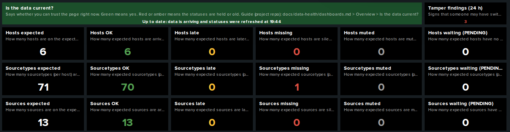
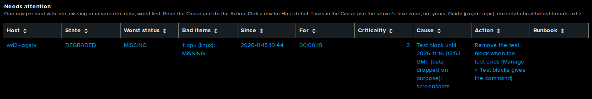
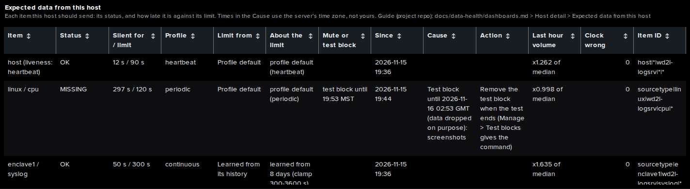
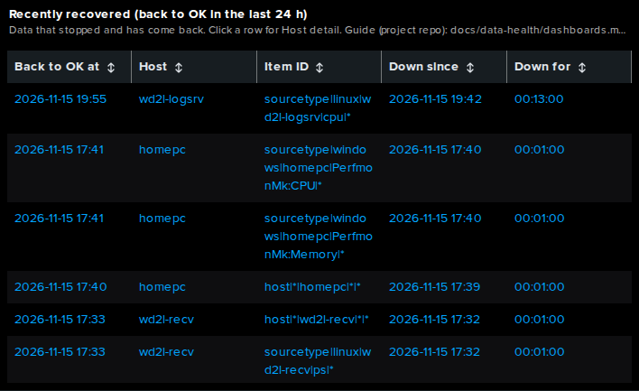
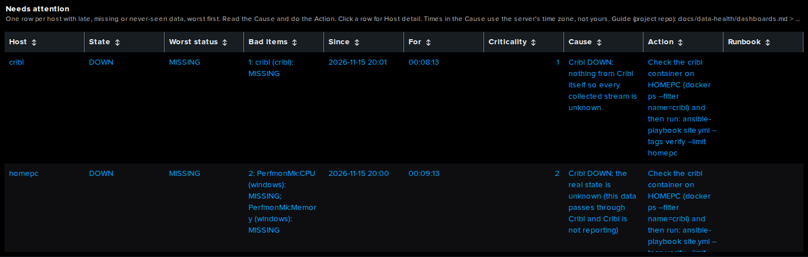

# Your first five minutes with a finding

This is a section of the analyst guide. It shows what to do when the **HL Data Health** app tells you
something is wrong. You will follow one real finding from the first look to the all-clear. Then you
will see a second case, where one cause hits many rows.

The panels are described in [the dashboard guide](../../data-health/dashboards.md). This page does not
repeat that. It shows the order of your steps.

Names such as `wd2l-logsrv` are the lab's hosts. In your copy they will be your own.

## Walkthrough 1: one item is missing

### Step 1: check the banner

Open the **Overview**. Look at the banner first. It says whether you can trust the page.

- The banner is green. It reads "Up to date: data is arriving and statuses were refreshed at 19:44".
  So the page is fresh. You can trust it.
- If the banner were red or amber, stop. The statuses would be held or old. Fix the banner first.
  See [the banner](../../data-health/dashboards.md#the-banner-is-the-data-current).
- Now look at the tiles. **Hosts OK** is 6 of 6. But **Sourcetypes missing** shows 1. So every host
  is arriving, and one kind of data on one host is not.
- The **Tamper findings (24 h)** tile shows 3. Those are a separate matter. Look at them later.

### Step 2: read the Needs attention row

Scroll to **Needs attention**. It has one row per host with a problem, worst first.

Read the row from left to right:

| Column | In this row | What you learn |
|---|---|---|
| Host | `wd2l-logsrv` | Which host. |
| State | DEGRADED | The host works, but one item is bad. DOWN means the host is silent. |
| Bad items | `cpu (linux)`: MISSING | One kind of data has stopped. |
| Criticality | 3 | How much this host matters. |
| Cause | Test block until ... (data dropped on purpose): screenshots | The app knows why. |
| Action | Remove the test block when the test ends | What to do. |

The **Cause** is the most useful column. The app picks the first cause that fits. Here, someone put
a test block on this data on purpose. You do not have to hunt for a fault.

### Step 3: open Host detail

Click the row. **Host detail** opens for that host. Find **Expected data from this host**.

Look at three things:
- The **host** line is OK. Its heartbeat is 12 s old against a limit of 90 s. The Splunk agent is
  alive.
- The **linux / cpu** line is MISSING. It has been silent for 297 s against a limit of 120 s.
- The **Mute or test block** column says "test block until 19:53 MST". This confirms the cause.

Another item, `enclave1 / syslog`, is OK. So this is one stream, not the whole host.

### Step 4: decide and act

Ask three questions:

1. Is the cause planned? A test block is. Someone asked for it.
2. Does it end by itself? Yes. The block ends at the time shown.
3. Is anyone waiting on this data? Check the criticality, and ask the on-call analyst.

If the test is over, ask the Splunk admin to clear the block. If the test is still going, do
nothing. Write a note so the next shift knows. The steps are in
[Clear a test block](../../runbook-missing-data.md#clear-a-test-block).

If the cause had said "Possible deliberate blinding", you would escalate at once. For a case like
that, see the [agent stopped runbook](example-runbook-agent-stopped-not-explained.md).

### Step 5: confirm recovery

When the data returns, the row leaves Needs attention. Check that it really recovered. Open **Recently
recovered**.

The first row is your item. `cpu` on `wd2l-logsrv` came back to OK at 19:55. It was down since 19:42,
for 13 minutes. That matches the test block.

Do not close your note until you see the item here. A row can also leave Needs attention because
someone muted it. A muted row is not a recovered one.

## Walkthrough 2: one cause, many rows

Now a bigger case. Several hosts show problems at once.

Read the **Cause** column.

- The `cribl` row says "Cribl DOWN: nothing from Cribl itself so every collected stream is unknown".
- The `homepc` row says "Cribl DOWN: the real state is unknown (this data passes through Cribl and
  Cribl is not reporting)".

The word "unknown" matters. Cribl carries the data of every host. When Cribl stops, every host looks
silent. But the hosts may be fine. The app does not blame them. It points at Cribl.

What to do:
1. Do not work each host row. They share one cause.
2. Fix the one root cause. The `cribl` row's Action says what to check.
3. Wait. The other rows clear after Cribl is back and data flows again.
4. Confirm in **Recently recovered**.

Rule of thumb: when many rows share one Cause, find the shared cause first.

## Check yourself

1. The banner is amber. What do you do first?
2. One row says DEGRADED and another says DOWN. What is the difference?
3. Which column tells you why the app thinks an item is missing?
4. Ten hosts show "Cribl DOWN". How many things do you fix?
5. How do you confirm an item has really recovered?

Answers

1. Stop and fix the banner's problem. The statuses are held or old, so you cannot trust the page.
2. DEGRADED means the host works but one or more items are bad. DOWN means the host itself is silent.
3. The **Cause** column. The **Action** column says what to do about it.
4. One: Cribl. The other rows share its cause and clear when it is back.
5. Look for it in **Recently recovered**. It shows when the item came back to OK and how long it was down.

