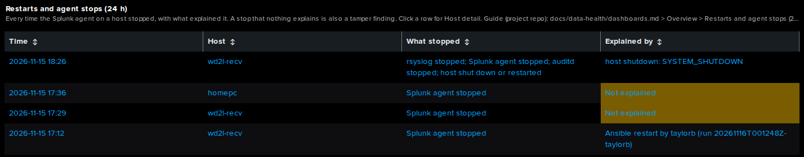
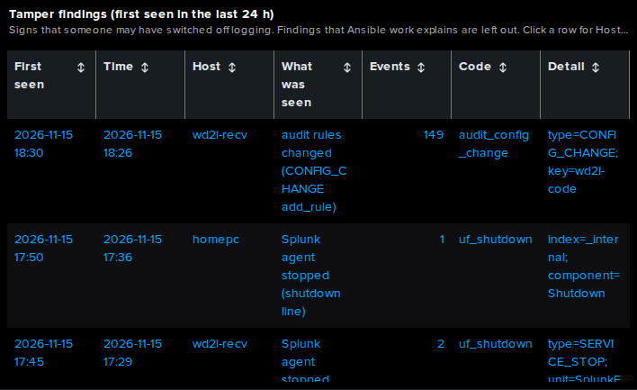

# Runbook: Splunk agent stopped (not explained)

The Splunk agent on a host stopped, and nothing planned explains it. This is also a tamper finding.
The on-call analyst reads this page when that finding shows.

## What you see

On the **Restarts and agent stops** panel, the row's **Explained by** column says **Not explained**,
in amber. The panel is on the Overview (last 24 hours) and on Host detail (last 7 days).



Look at the rows:
- The top row is explained: "host shutdown: SYSTEM_SHUTDOWN". The whole host went down. No action.
- Two rows say **Not explained** in amber. These are the ones to work.
- The last row is explained by an automation restart. It is planned work. No action.

The same stop is a tamper finding. It appears in **Tamper findings** on the Overview. Its detail names
the source that saw it.



In the picture, the `uf_shutdown` rows read "Splunk agent stopped (shutdown line)". The agent logged
that it was shutting down. Other rows may name a service stop. A row can combine sources, for example
"Splunk agent stopped (SERVICE_STOP + shutdown line)".

The **Explained by** column has three kinds of value:

| Value | Meaning |
|---|---|
| A sentence, such as "host shutdown: ..." | Something planned or known explains it. No action. |
| Waiting for the host to report back | The app has not judged it yet. Wait. |
| **Not explained** (amber) | Nothing explains it. Follow this page. |

## What it means

The agent stopped. The app found no planned work that covers the stop. It found no host shutdown
close to it either. Someone may have stopped the agent to hide activity. A stop of a few minutes
can hide a lot, and the host never reaches DOWN.

A reboot only explains a stop when it comes within 2 minutes of the stop. A reboot much later does not.

## How urgent

- **Timing.** The alert is late on purpose. The app waits until the agent is back. It needs a
  heartbeat from the host more than 2 minutes after the stop. Then it waits 10 more minutes for late
  records. The search runs every 5 minutes. So the alert comes about 10 to 17 minutes after the
  agent returns. A stop is "Waiting for the host to report back" until then.
- **Alert.** The alert *DH Alert tamper* fires once for the finding. It is held for 1 hour for the
  same host and indicator, so a repeat does not spam you.
- **If the agent never comes back.** The finding stays pending and never alerts. The host goes DOWN
  instead, and DOWN alerts on its own.
- **Criticality.** The host's criticality, shown in Needs attention, sets how fast you act. Treat a
  high-criticality host as urgent.
- Act the same day. Start within the first five minutes below.

## First five minutes

1. **Escalate.** Tell the security lead. Do this first. Save the evidence before you fix anything.
   See [Evidence to save](#evidence-to-save).
2. **Read the finding.** In Splunk Web, in the HL Data Health app, run:

   ```
   | inputlookup dh_tamper | search host=<host> | table time code indicator detail state explained_by explanation
   ```

   `<host>` is the host's short name in lowercase, as the Overview shows it. `state` is `judged` for
   an alert. `indicator` names every source that saw the stop.
3. **Find who and why.** Look at the host's own logs near the stop time:
   - **Linux:** the audit log names the user. Look for a `USER_CMD` near the stop.
   - **Windows Server:** the System log records event 7036 when a service stops. Look for the
     Splunk service. Also look for event 1074, which names the user and the reason for a shutdown.
   - **Desktop Windows (8 and later):** the system does not log event 7036. Use the agent's own
     shutdown line instead. In Splunk, search `index=_internal sourcetype=splunkd component=Shutdown
     "Shutting down splunkd"` for the host. Event 1074 is still logged for a shutdown.
4. **Check that the agent is running.** If it is not, start it. See [Fix](#fix).
5. **Decide.** If a change ticket or a person explains the stop, note it and close. If not, keep
   the escalation open and go to [Escalate when](#escalate-when).

## Fix

The finding itself does not change. The app judges a stop once. A later planned run will not hide
it. So "fix" means to put the host right and keep the record.

1. **Start the agent.** The step must start the Splunk agent service on the host and check that it
   connects. It must not run as the root user.
   - In the lab: on the automation host, run `ansible-playbook site.yml --tags status --limit <host>`
     to read the agent's state. Then start the agent with `ansible-playbook site.yml --tags start --limit <host>`. The lab runbook has the
     steps in [The Splunk agent is late or stopped](../../runbook-missing-data.md#the-splunk-agent-is-late-or-stopped).
2. **Check the data is back.** On Host detail, the host line should be OK, and its heartbeat should
   be under its limit. Check **Recently recovered** for the host's items.
3. **Keep the finding.** Leave it on the panel. It is a record. It does not clear.

## Escalate when

- The stop is **Not explained**. Escalate at once, as step 1 says.
- Nobody can say who stopped the agent, or the user in the log is not expected.
- The stop came together with other tamper findings on the host, such as a log cleared or audit
  rules changed.
- The same host shows stops again.
- The host is high criticality.

Escalate to the security lead. The customer fills in the name and the contact.

## Evidence to save

Save these before you change anything:
- The result of the `dh_tamper` search from step 2.
- The marker search for the same host. It shows whether planned work was recorded:

  ```
  index=data_health source=dh:marker target_host=<host> | table _time action by run_id
  ```

- A screenshot of the **Restarts and agent stops** panel and the **Tamper findings** panel.
- The host's audit or System log lines near the stop time.
- The time you started the agent again.

## Related

- [Restarts and agent stops](../../data-health/dashboards.md#restarts-and-agent-stops-24-h): the
  panel in full.
- [The Splunk agent stop](../../data-health-design.md#the-splunk-agent-stop): how the app judges a stop.
- [Possible deliberate blinding](../../runbook-missing-data.md#possible-deliberate-blinding): the
  nearby case for other tamper signs.
- [The Splunk agent is late or stopped](../../runbook-missing-data.md#the-splunk-agent-is-late-or-stopped).
- [Tamper indicator](../../glossary.md#tamper-indicator-tamper-finding) in the glossary.
- [The runbook template](README.md#the-runbook-template).
