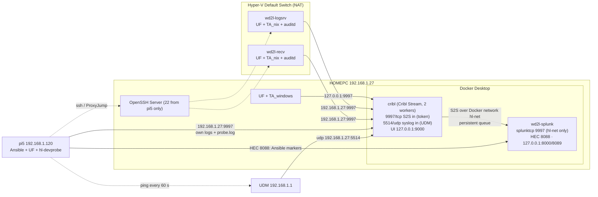

# Architecture

The design and the reasons behind it are in [the spec](specs/2026-10-30-design.md) (§4) and
[the Cribl addendum](specs/2026-10-31-cribl-stream.md). This page shows how things are. Terms such
as UF, TA, S2S, HEC and Cribl are in the [glossary](glossary.md).

## Hosts and data paths

In this lab, [HOMEPC](glossary.md#homepc) is `192.168.1.27`, [pi5](glossary.md#pi5) is
`192.168.1.120` and the [UDM](glossary.md#udm) is `192.168.1.1`.



- **Everything collected goes through Cribl.** The four UFs send S2S with a token and `useACK`. The
  UDM sends syslog straight to Cribl on `192.168.1.27:5514/udp`. There is no syslog relay host.
- **The device probe runs on pi5** as a systemd timer (`hl-devprobe`, every 60 s). It pings each
  syslog device. It writes one line per ping to `/var/log/hl-devprobe/probe.log`. pi5's UF forwards
  that file like any other. The probe doesn't use rsyslog or the journal.
- **wd2l and the Ansible markers stay on HEC 8088,** straight to Splunk. So "Cribl is down" and
  "Splunk isn't receiving" look different on the dashboards.
- **Cribl and `wd2l-splunk` share the Docker network `hl-net`.** Cribl reaches Splunk's `splunktcp`
  9997 there, by container name. Container addresses on `hl-net` change with start order, so
  nothing uses them. Splunk publishes no new port.
- **Docker Desktop's NAT hides every sender's address.** Cribl sees all senders as the Docker
  gateway. So the UDM gets its own port, and Cribl names the host from the port. Forwarders are
  identified by hostname, never by IP. Anything sent to 5514/udp is named `udm`.
- **Reaching the hosts:**
  - pi5 is reached only through Windows OpenSSH on HOMEPC (`ssh pi5`). From HOMEPC, use
    `C:\Windows\System32\OpenSSH\ssh.exe pi5`. Git Bash's `ssh` is refused.
  - HOMEPC can't SSH to the VMs directly. Ansible on pi5 reaches them by ProxyJump through HOMEPC's
    sshd. ProxyJump makes SSH hop through one host to reach another. The settings are in
    `inventory/group_vars/uf_linux.yml`. To run one command on a VM, use
    [Ansible from pi5](runbook-missing-data.md#how-to-reach-a-host).
  - Why: the VMs sit behind Hyper-V's Default Switch NAT. Their `<vm>.mshome.net` names resolve only
    on HOMEPC.
  - More: [SSH and ProxyJump](glossary.md#ssh-proxyjump).

## Hosts in this lab

The role names each host by its inventory name. In this lab they are:

| Inventory name | What it is | Groups |
|---|---|---|
| `wd2l-logsrv` | An AlmaLinux 10 VM on HOMEPC. It runs wd2l's sender. | `uf_linux` |
| `wd2l-recv` | An AlmaLinux 10 VM on HOMEPC. It runs wd2l's receiver. | `uf_linux` |
| `pi5` | The Raspberry Pi 5 and the Ansible controller. | `uf_linux` |
| `homepc` | The Windows 11 PC. It runs Docker Desktop (Splunk and Cribl). | `uf_windows`, `splunk_server` |

The groups are in `ansible/inventory/hosts.yml`:

- `uf_linux` holds the hosts that run a Linux UF.
- `uf_windows` holds the hosts that run a Windows UF.
- `splunk_server` holds the host that runs `wd2l-splunk`.

The UDM isn't an inventory host, because the role never logs in to it. It is a row of
`syslog_devices` in `ansible/inventory/group_vars/splunk_server.yml`.

To see the groups, run this on pi5, in `~/homelab-splunk-missing-source/ansible`
([venv on](running-the-role.md#how-to-run-a-command)):

```bash
ansible-inventory --graph
```

## Inside Cribl

The config is code: the repo's `cribl/` tree. The role's `cribl` tag deploys it as files.

| Piece | What it does |
|---|---|
| `in_splunk_tcp` (9997) | Takes the UFs' data. It needs a token. Its event breaker is `hl_uf_breakers`. |
| `in_udm_syslog` (5514/udp) | One source for each syslog device. The host, index, sourcetype and source all come from the port. |
| `CriblLogs`, `CriblMetrics`, `in_cribl_audit` | Cribl's own logs go to `cribl`, its metrics to `cribl_metrics`, its audit log to `cribl` / `cribl:audit`. |
| routes (first match wins) | `r_cribl_self`, `r_syslog_devices`, `r_uf` and `r_default`. |
| `pl_test_block` | Drops events that match an unexpired row of `hl_ingest_block.csv`. |
| `out_splunk` | Sends to `wd2l-splunk:9997` over `hl-net`, with the token and a persistent queue. `systemFields: []` adds nothing. |

Details the table can't hold:
- **`hl_uf_breakers`** keeps TA_nix tables whole and breaks auditd per record.
- **`pl_syslog_pre`** sets `_time` to the receive time, because the UDM's header has no time zone.
- **Routes:** `r_cribl_self` sends Cribl's own data as it is. `r_syslog_devices` and `r_uf` send data
  through `pl_test_block`. `r_default` sends anything else as it is.
- **`pl_test_block` keys** are `host|*|*`, `host|sourcetype|*` and `host|sourcetype|<raw source>`. It
  applies only to the `linux`, `windows` and `network` indexes.

Splunk applies **no** index-time rule to what Cribl delivers. That's why the test block and event
breaking live in Cribl.

## Ports

S2S ([glossary](glossary.md#s2s-splunktcp)) is the UFs' protocol, on 9997. HEC
([glossary](glossary.md#hec-http-event-collector)) is Splunk's HTTPS event input, on 8088.

| Port | Listener | Who sends | Published on the PC |
|---|---|---|---|
| 9997/tcp | Cribl, Splunk TCP source (token) | 4 UFs | yes, all interfaces |
| 5514/udp | Cribl, syslog source | UDM only | yes |
| 9000/tcp | Cribl UI/API | admin on HOMEPC, Ansible over SSH | 127.0.0.1 only |
| 9997/tcp | Splunk `splunktcp` (token) | Cribl only | **no**; reached on `hl-net` |
| 8088/tcp | Splunk HEC | wd2l, Ansible markers | yes |
| 8000, 8089/tcp | Splunk Web, REST | admin and tests on HOMEPC | 127.0.0.1 only |
| 22/tcp | OpenSSH Server on HOMEPC | pi5 only (firewall rule) | yes |

## Indexes and retention

| Index | Holds |
|---|---|
| `linux` | The Linux UFs' files (`/var/log/messages`, `cron`, `secure`, `audit/audit.log`) and TA_nix scripts. |
| `windows` | The Windows event logs (`XmlWinEventLog`) and perfmon CPU and Memory. |
| `network` | The UDM's syslog (`unifi:syslog`, host `udm`) and pi5's probe (`hl:devprobe`). |
| `wd2l_uf_audit` | wd2l's audit trail as the UFs read it. Only `wd2l_auditor` and admin can read it. |
| `cribl` / `cribl_metrics` | Cribl's logs and audit log / Cribl's metrics (a metrics index). |
| `data_health` | The app's records and the Ansible markers (`dh:marker`). The records are `dh:transition`, `dh:daily`, `dh:volume`, `dh:tamper`, `dh:admin`, `dh:discover` and `dh:soh`. |
| `enclave1`, `wd2l` | wd2l's own indexes. This repo only reads them. |

`wd2l_audit` (wd2l's own audit index) is not tracked.

**Retention** is 14 days (`frozenTimePeriodInSecs = 1209600`) on every index above except wd2l's own.
The role leaves wd2l's settings alone. `_internal` and `_audit` keep at most 30 days. The app looks
back 14 days at most. Older history exists only in its KV collections:
- Mutes: up to 30 days.
- Tamper findings: 30 days.
- The admin log: 90 days.

**Licence.** In this lab it is Splunk Developer Personal, 10 GB/day, valid to
2027-04-29 00:59:59 MDT. Renew it before then. After that date the instance falls back to the Free
group, and alerts and roles stop. The licence file lives outside the repo, in
`~/wd2l-splunk/secrets/` on HOMEPC. Never commit it. Steady volume is about 529 MB/day. With the
hardened audit rules loaded it is about 600 MB/day, or about 6 % of the licence. Cribl's own data is
about 18 MB/day of that.

## What is collected

The inputs are rows of one schema: `hl_linux_inputs` and `hl_windows_inputs` in the role's defaults.
The same rows render the UFs' `inputs.conf` **and** the expected list.

| Host | Input | Index / sourcetype (source) |
|---|---|---|
| wd2l-logsrv, wd2l-recv, pi5 | `/var/log/messages`, `/var/log/cron` | `linux` / `syslog` |
| same | `/var/log/secure` | `linux` / `linux_secure` |
| same | `/var/log/audit/audit.log` | `linux` / `linux_audit` |
| same | 16 TA_nix scripts (listed below the table) | `linux` / as the TA sets them |
| same | `/var/log/wd2l/audit-*.jsonl` | `wd2l_uf_audit` / `wd2l:audit` (`wd2l:sender:audit` on wd2l-logsrv) |
| pi5 | `/var/log/hl-devprobe/probe.log` | `network` / `hl:devprobe` |
| HOMEPC | The Windows event logs (listed below the table) | `windows` / `XmlWinEventLog` (`XmlWinEventLog:<channel>`) |
| HOMEPC | perfmon CPU and Memory every 60 s | `windows` / `PerfmonMk:CPU`, `PerfmonMk:Memory` |
| UDM | Its syslog, through Cribl | `network` / `unifi:syslog` (`syslog:udm`, host `udm`) |
| cribl | Its own logs, audit log and metrics | `cribl` / `cribl`, `cribl:audit`; `cribl_metrics` |
| every UF | `_internal`: the heartbeat, plus the UF's version, OS and last connect | `_internal` |
| wd2l | What wd2l delivers over HEC, not through Cribl (`dh_extra_expected`) | `enclave1` / `syslog` |

The 16 TA_nix scripts, by how often they run:
- Every 30 s: `cpu`, `ps`.
- Every 60 s: `vmstat`, `top`, `interfaces`, `netstat`.
- Every 300 s: `df`, `openPorts`, `lastlog`.
- Every 3600 s: `package`, `Unix:Service`, `Linux:SELinuxConfig`, `Unix:SSHDConfig`,
  `Unix:UserAccounts`.
- Every 86400 s: `Unix:Uptime`, `Unix:Version`.

The Windows event logs on HOMEPC are Security, System, Application,
`Microsoft-Windows-PowerShell/Operational`, `Microsoft-Windows-Windows Defender/Operational`,
`Microsoft-Windows-Hyper-V-VMMS-Admin` and `Microsoft-Windows-Hyper-V-Worker-Admin`.

`cribl:audit` has no expected row. It logs only when Cribl's config changes, so silence is normal.
The DH Tamper search reads it. Cribl-delivered events have no `punct` field (see
[Searching](running-the-role.md#searching)).
