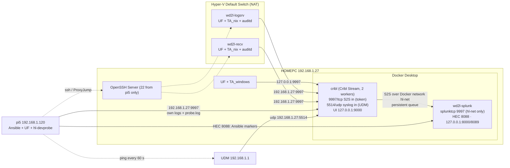

# Architecture

The design and the reasons behind it are in [the spec](specs/2026-10-30-design.md) (§4) and
[the Cribl addendum](specs/2026-10-31-cribl-stream.md). This page shows how things are.

## Hosts and data paths

- **Everything collected goes through Cribl.** The four UFs send S2S with a token and `useACK`.
  The UDM sends syslog straight to Cribl on `192.168.1.27:5514/udp`; there is no syslog relay host.
- **The device probe runs on pi5** as a systemd timer (`hl-devprobe`, every 60 s). It pings each
  syslog device and writes one line per ping to `/var/log/hl-devprobe/probe.log`, which pi5's UF
  forwards like any other file. It doesn't use rsyslog or the journal.
- **wd2l and the Ansible markers stay on HEC 8088**, straight to Splunk. So "Cribl is down" and
  "Splunk isn't receiving" look different on the dashboards.
- **Cribl and `wd2l-splunk` share the Docker network `hl-net`**, and Cribl reaches Splunk's
  `splunktcp` 9997 there, by container name. Container addresses on `hl-net` change with start order,
  so nothing uses them. Splunk publishes no new port.
- **Docker Desktop's NAT hides every sender's address.** Cribl sees all of them as the Docker
  gateway. So the UDM gets its own port and Cribl names the host from the port, and forwarders are
  identified by hostname, never by IP. Anything sent to 5514/udp is named `udm`.
- **Reaching the hosts:** pi5 is reached only through Windows OpenSSH on HOMEPC (`ssh pi5`), and the
  VMs only by ProxyJump through HOMEPC's sshd (see `inventory/group_vars/uf_linux.yml`).

## Inside Cribl

The config is code: the repo's `cribl/` tree, deployed as files by the role's `cribl` tag.

| Piece | What it does |
|---|---|
| `in_splunk_tcp` (9997) | the UFs; a token is required; event breaker `hl_uf_breakers` (TA_nix tables whole, auditd per record) |
| `in_udm_syslog` (5514/udp) | one source per syslog device; **the host comes from the port**, and so do index, sourcetype and source; `pl_syslog_pre` sets `_time` to the receive time, because the UDM's header has no time zone |
| `CriblLogs`, `CriblMetrics`, `in_cribl_audit` | Cribl's own logs → `cribl`, metrics → `cribl_metrics`, audit log → `cribl` / `cribl:audit` |
| routes (first match wins) | `r_cribl_self` (Cribl's own data, as is); `r_syslog_devices` and `r_uf` (through `pl_test_block`); `r_default` (anything else, as is) |
| `pl_test_block` | drops events matching an unexpired row of `hl_ingest_block.csv` (`host\|*\|*`, `host\|sourcetype\|*`, `host\|sourcetype\|<raw source>`); only `linux`, `windows`, `network` |
| `out_splunk` | `wd2l-splunk:9997` over `hl-net`, token, persistent queue, `systemFields: []` (nothing added) |

Splunk applies **no** index-time rule to what Cribl delivers. That's why the test block and event
breaking live in Cribl.

## Ports

| Port | Listener | Who sends | Published on the PC |
|---|---|---|---|
| 9997/tcp | Cribl, Splunk TCP source (token) | 4 UFs | yes, all interfaces |
| 5514/udp | Cribl, syslog source | UDM only | yes |
| 9000/tcp | Cribl UI/API | admin on HOMEPC, Ansible over SSH | 127.0.0.1 only |
| 9997/tcp | Splunk `splunktcp` (token) | Cribl only | **no**; reached on `hl-net` |
| 8088/tcp | Splunk HEC | wd2l, Ansible markers | yes |
| 8000, 8089/tcp | Splunk Web, REST | admin and tests on HOMEPC | 127.0.0.1 only |
| 22/tcp | OpenSSH Server on HOMEPC | pi5 only (firewall rule) | yes |

## Indexes and retention

| Index | Holds |
|---|---|
| `linux` | the Linux UFs' files (`/var/log/messages`, `cron`, `secure`, `audit/audit.log`) and TA_nix scripts |
| `windows` | the Windows event logs (`XmlWinEventLog`) and perfmon CPU/Memory |
| `network` | the UDM's syslog (`unifi:syslog`, host `udm`) and pi5's probe (`hl:devprobe`) |
| `wd2l_uf_audit` | wd2l's audit trail as the UFs read it (readable by `wd2l_auditor` and admin only) |
| `cribl` / `cribl_metrics` | Cribl's logs and audit log / Cribl's metrics (a metrics index) |
| `data_health` | the data-health app's records (`dh:transition`, `dh:daily`, `dh:volume`, `dh:tamper`, `dh:admin`, `dh:discover`, `dh:soh`) and the Ansible markers (`dh:marker`) |
| `enclave1`, `wd2l` | wd2l's, read-only here |

`wd2l_audit` (wd2l's own audit index) is not tracked. **Retention** is 14 days
(`frozenTimePeriodInSecs = 1209600`) on every index above except wd2l's own, whose settings the role
leaves alone. `_internal` and `_audit` keep at most 30 days. `hl_data_health` looks back 14 days at
most; older history exists only in its KV collections (mutes up to 30 days, tamper findings 30 days,
the admin log 90 days).

**Licence:** Splunk Developer Personal, 10 GB/day, valid to 2027-04-29 00:59:59 MDT; renew it before
then. After that date the instance falls back to the Free group, and alerts and roles stop. The
licence file lives outside the repo, in `~/wd2l-splunk/secrets/` on HOMEPC; never commit it. Steady
volume is about 529 MB/day (about 600 MB/day once the STIG audit rules are loaded), or about 6 % of
the licence. Cribl's own data is about 18 MB/day of that.

## What is collected

The inputs are rows of one schema (`hl_linux_inputs` / `hl_windows_inputs` in the role's defaults).
The same rows render the forwarders' `inputs.conf` **and** the expected list.

| Host | Input | Index / sourcetype (source) |
|---|---|---|
| wd2l-logsrv, wd2l-recv, pi5 | `/var/log/messages`, `/var/log/cron` | `linux` / `syslog` |
| same | `/var/log/secure` | `linux` / `linux_secure` |
| same | `/var/log/audit/audit.log` | `linux` / `linux_audit` |
| same | 16 TA_nix scripts: `cpu`, `ps` every 30 s; `vmstat`, `top`, `interfaces`, `netstat` 60 s; `df`, `openPorts`, `lastlog` 300 s; `package`, `Unix:Service`, `Linux:SELinuxConfig`, `Unix:SSHDConfig`, `Unix:UserAccounts` 3600 s; `Unix:Uptime`, `Unix:Version` 86400 s | `linux` / as the TA sets them |
| same | `/var/log/wd2l/audit-*.jsonl` | `wd2l_uf_audit` / `wd2l:audit` (`wd2l:sender:audit` on wd2l-logsrv) |
| pi5 | `/var/log/hl-devprobe/probe.log` | `network` / `hl:devprobe` |
| HOMEPC | Security, System, Application, `Microsoft-Windows-PowerShell/Operational`, `Microsoft-Windows-Windows Defender/Operational`, `Microsoft-Windows-Hyper-V-VMMS-Admin`, `Microsoft-Windows-Hyper-V-Worker-Admin` | `windows` / `XmlWinEventLog` (`XmlWinEventLog:<channel>`) |
| HOMEPC | perfmon CPU and Memory every 60 s | `windows` / `PerfmonMk:CPU`, `PerfmonMk:Memory` |
| UDM | its syslog, through Cribl | `network` / `unifi:syslog` (`syslog:udm`, host `udm`) |
| cribl | its own logs, audit log and metrics | `cribl` / `cribl`, `cribl:audit`; `cribl_metrics` |
| every UF | `_internal` (the heartbeat; also the forwarder's version, OS and last connect) | `_internal` |
| wd2l | what wd2l delivers over HEC, not through Cribl (`dh_extra_expected`) | `enclave1` / `syslog` |

`cribl:audit` has no expected row, because it logs only when Cribl's config changes and silence is
normal; the DH Tamper search consumes it. Cribl-delivered events have no `punct` field (see
[Searching](running-the-role.md#searching)).
