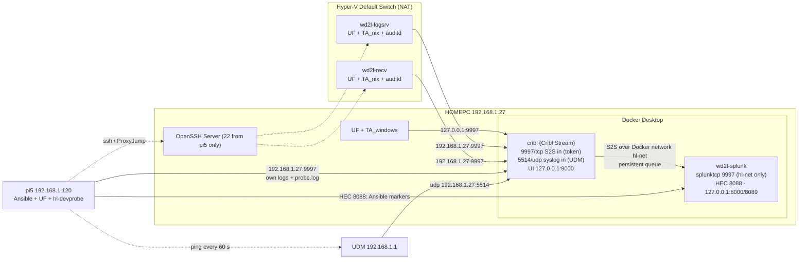

# Architecture

The design and the reasons behind it are in [the spec](specs/2026-10-30-design.md) (§4) and
[the Cribl addendum](specs/2026-10-31-cribl-stream.md). This page shows how things are now.

## Hosts and data paths

- **Everything collected goes through Cribl.** The four UFs send S2S with a token and `useACK`.
  The UDM sends syslog to its own UDP port.
- **wd2l and the Ansible markers stay on HEC 8088**, straight to Splunk. So "Cribl is down" and
  "Splunk isn't receiving" look different on the dashboards.
- **No container was recreated:** `wd2l-splunk` joined the Docker network `hl-net` live, and Cribl
  reaches its `splunktcp` 9997 there. Splunk publishes no new port.

## Inside Cribl

| Piece | What it does |
|---|---|
| `in_splunk_tcp` (9997) | the UFs; a token is required; event breaker `hl_uf_breakers` (TA_nix tables whole, auditd per record) |
| `in_udm_syslog` (5514/udp) | one source per syslog device; **the host comes from the port** (Docker's NAT hides the sender), and so do index, sourcetype and source; `pl_syslog_pre` sets `_time` to the receive time |
| `CriblLogs`, `CriblMetrics`, `in_cribl_audit` | Cribl's own logs → `cribl`, metrics → `cribl_metrics`, audit log → `cribl` / `cribl:audit` |
| routes | Cribl's own data → as is; devices and UFs → `pl_test_block`; anything else → as is |
| `pl_test_block` | drops events matching an unexpired row of `hl_ingest_block.csv` (`host\|*\|*`, `host\|sourcetype\|*`, `host\|sourcetype\|source`); only `linux`, `windows`, `network` |
| `out_splunk` | `wd2l-splunk:9997` over `hl-net`, token, persistent queue, `systemFields: []` (nothing added) |

Splunk applies **no** index-time rule to what Cribl delivers. That's why the test block and event
breaking live in Cribl.

## Ports

| Port | Listener | Who sends | Published on the PC |
|---|---|---|---|
| 9997/tcp | Cribl, Splunk TCP source (token) | 4 UFs | yes, all interfaces |
| 5514/udp | Cribl, syslog source | UDM only | yes |
| 9000/tcp | Cribl UI/API | Taylor, Ansible over SSH | 127.0.0.1 only |
| 9997/tcp | Splunk `splunktcp` (token) | Cribl only | **no**; reached on `hl-net` |
| 8088/tcp | Splunk HEC | wd2l, Ansible markers | yes |
| 8000, 8089/tcp | Splunk Web, REST | Taylor, tests | 127.0.0.1 only |

## Indexes

| Index | Holds |
|---|---|
| `linux` | the Linux UFs' files (`/var/log/messages`, `cron`, `secure`, `audit/audit.log`) and TA_nix scripts |
| `windows` | the Windows event logs (`XmlWinEventLog`) and perfmon CPU/Memory |
| `network` | the UDM's syslog (`unifi:syslog`, host `udm`) and pi5's probe (`hl:devprobe`) |
| `wd2l_uf_audit` | wd2l's audit trail as the UFs read it (readable by `wd2l_auditor` and admin only) |
| `cribl` / `cribl_metrics` | Cribl's logs and audit log / Cribl's metrics (a metrics index) |
| `data_health` | the data-health app's records (`dh:transition`, `dh:daily`, `dh:tamper`, `dh:admin`, `dh:discover`) and the Ansible markers (`dh:marker`) |
| `enclave1`, `wd2l` | wd2l's, read-only here |

## What is collected

The inputs are rows of one schema (`hl_linux_inputs` / `hl_windows_inputs` in the role's defaults).
The same rows render the forwarders' `inputs.conf` **and** the expected list. Per host they are:

| Host | Inputs |
|---|---|
| wd2l-logsrv, wd2l-recv, pi5 | the four files above; 16 TA_nix scripts (`cpu`, `ps` every 30 s … `Unix:Version` daily); `wd2l_uf_audit`; pi5 also `probe.log` |
| HOMEPC | Security, System, Application, PowerShell/Operational, Windows Defender/Operational, Hyper-V VMMS-Admin and Worker-Admin; perfmon CPU and Memory every 60 s |
| UDM | its syslog, through Cribl |
| every UF | `_internal` (the heartbeat; also the forwarder's version, OS and last connect) |
