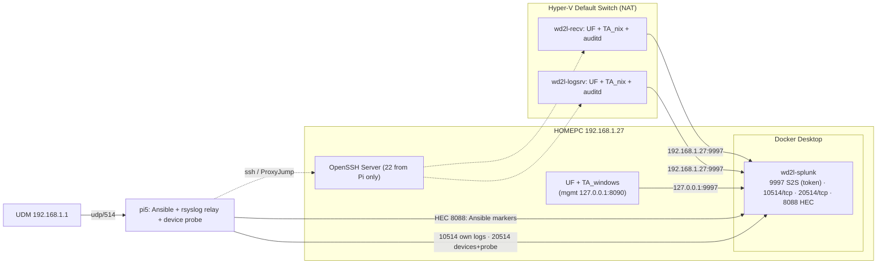

# Homelab Splunk collection + "missing data" health monitoring: spec and plan

Status: **approved** by Taylor 2026-10-30. Repo: `C:\Users\taylo\Documents\claude-code\homelab-splunk-missing-source` (empty today; it becomes a git repo). A reviewer read the draft as the builder would, and its fixes are folded in.

## 1. Context

Taylor wants a realistic, production-shaped lab that answers one SOC question fast: **"Am I blind somewhere?"** That covers a host that stopped sending, a sourcetype or source that went quiet, or a forwarder someone stopped and never restarted. The answer has to be authoritative (compared against a declared list), quick (minutes), aware of normal cadence (a quiet network device isn't an outage), and usable at a few hundred hosts. Production struggles with this today, so the monitoring design matters most.

The collection side gets built as well: Universal Forwarders (UFs) + TAs on the two AlmaLinux 10 VMs and the Windows PC, STIG-style auditing, and syslog from the Pi and the UniFi Dream Machine (UDM). It's all deployed by **one Ansible role run from the Pi**, with clean install and uninstall and service control by tags, and no deployment server.

## 2. The recommendation (the "better way")

Typical failures: a hand-kept list that drifts; one global "no data for N hours" threshold; no way to tell "forwarder down" from "one input broken"; mutes that never expire; dashboards that scan raw data. The fixes:

1. **Expectations come from the deployment code.** The role knows every input it enabled (index, sourcetype, source, interval). It renders the expected list from the same inventory and pushes it to Splunk, so deploying an input creates its expectation and removing it retires it. Agentless devices are declared in the inventory too. UI-added rows are kept separate, so a redeploy never clobbers them. *(Production equivalent: generate the list from the deployment pipeline/CMDB, not memory.)*
2. **Cadence profiles, not one threshold**: `heartbeat`, `periodic`, `continuous`, `sporadic`, `info`. Periodic thresholds come from the input's own interval. Continuous and sporadic thresholds are **learned** nightly from 14 days of history, excluding the times the host or Splunk was down, then clamped per profile, explained in the UI, and overridable per entity.
3. **Liveness separate from data.** Each UF's self-telemetry (`_internal`, every 30 s) is a fast, cadence-independent heartbeat (~2 min detection). A **probe on the Pi** pings each syslog device every 60 s and logs the result, which gives agentless devices a heartbeat. "Device up but not logging" and "device down" become different findings.
4. **State, not scans.** Trackers (`tstats`, every minute) record last-seen times in the KV store. An evaluator turns them into statuses and writes **state transitions** to a summary index (history, MTTR, daily report). Dashboards read the KV store, so they stay fast at hundreds of hosts.
5. **Every finding gets a likely cause and the next step.** The cause combines the heartbeat, Ansible's own maintenance markers, Hyper-V VM events, relay status and tamper indicators. For example: "Stopped by Ansible `--tags stop` 14:03 by taylorb, not restarted → `--tags start --limit wd2l-recv`", or "Security log cleared 2 min before silence → escalate". Volume drops catch partial blinding, such as auditd still sending at 10% of normal.

**Off-the-shelf:** TrackMe covers much of this, but its free Community Edition ended Aug 2026 (it goes read-only after a 90-day trial). Hurricane Labs' Broken Hosts (free) uses the same lookup + `lateSecs` + suppressions model, without learning, heartbeats or causes. Ours is plain SPL + KV store: it ports to production, or serves as the yardstick for evaluating TrackMe. See §10 for porting notes.

## 3. Environment as found (read-only recon)

| Thing | Fact | Consequence |
|---|---|---|
| VMs `wd2l-logsrv`, `wd2l-recv` | AlmaLinux 10, **FIPS**, SELinux enforcing, Hyper-V **Default Switch NAT**, `<vm>.mshome.net`, user `taylorb`, ECDSA keys only; **Off**, started manually (Taylor's choice) | Ansible reaches them via a ProxyJump through the PC; the UF runs in FIPS mode; an off VM shows DOWN (mute long gaps) |
| wd2l on all 3 Linux hosts | rsyslog → wd2l → Splunk HEC (`enclave1`, `wd2l`, `wd2l_audit`); `/etc/audit/rules.d/wd2l.rules`; `/var/log/wd2l/audit-*.jsonl`; `authorize.conf` limits `user`/`power` to `enclave1;wd2l` | Never edit wd2l's files or the `[syslog]` props; `wd2l_audit` is out of scope; the new roles need explicit `srchIndexesAllowed` |
| Pi `pi5` | 192.168.1.120, AlmaLinux 10.2 **aarch64**, Python 3.12, no Ansible; `/etc/rsyslog.d/90-wd2l.conf` sends `*.*` to wd2l | Every new syslog input (UDM, probe) must be **bound to its own ruleset**, or it leaks into wd2l |
| PC `HOMEPC` | 192.168.1.27, Win 11 Pro (likely a Microsoft account), no sshd, WinRM off, Docker Desktop only after sign-in | Taylor runs a one-time elevated SSH bootstrap; no `docker pull` over SSH (no credential store); the image is already local |
| Splunk | `wd2l-splunk`, `splunk/splunk` 10.6.0.5 (pinned digest), volumes `wd2l-splunk-etc/var`, ports `127.0.0.1:8000/8089`, `8088`; **download-trial licence, 500 MB/day, expires 2026-12-10 00:43 UTC (12-09 17:43 local)** (spike §14 h) | Recreate it with more ports (Taylor approved; confirm just before). Get a licence before 12-09 |
| Docker Desktop | NAT hides the client's source IP | Syslog is relayed by the Pi, which writes the real hostname into each message header; forwarders are identified by hostname/guid, never by IP |
| UDM | 192.168.1.1; UniFi CEF timestamps have no time zone | The relay stamps its own receive time in the header |
| TAs | `splunk-ta-local`: Splunk_TA_nix 10.3.4, Splunk_TA_windows 11.0.3 | Pinned |

## 4. Architecture



**Indexes** (app `hl_server_base`): `linux`, `windows`, `network`, `data_health` (written with `collect` only as sourcetype `stash`, so it isn't licence-metered; the record type goes in `source=dh:transition|dh:daily|dh:tamper|dh:admin|dh:marker`), and `wd2l_uf_audit` (readable by `wd2l_auditor` + admin only, mirroring `wd2l_audit`). `enclave1` and `wd2l` are monitored read-only; `wd2l_audit` isn't tracked.

**Data collected**

| Host | Input | index / sourcetype (source) | Profile → threshold |
|---|---|---|---|
| VMs | `/var/log/messages`, `/var/log/cron` | linux / syslog | continuous (learned) |
| VMs | `/var/log/secure` | linux / linux_secure | sporadic (learned) |
| VMs | `/var/log/audit/audit.log` | linux / linux_audit | continuous (learned) |
| VMs | TA_nix (event versions, not `*_metric`): `cpu`,`ps` 30 s; `vmstat`,`top`,`interfaces`,`netstat` 60 s; `df`,`openPorts`,`lastlog` 300 s; `package`,`Unix:Service`,`Linux:SELinuxConfig`,`Unix:SSHDConfig`,`Unix:UserAccounts` 3600 s; `Unix:Uptime`,`Unix:Version` 86400 s | linux / as the TA sets them | periodic: 2×interval+60 s |
| VMs | `/var/log/wd2l/audit-*.jsonl` | wd2l_uf_audit / `wd2l:sender:audit` (logsrv), `wd2l:audit` (recv) | sporadic |
| PC | WinEventLog Security, System, Application, `Microsoft-Windows-PowerShell/Operational`, `Microsoft-Windows-Windows Defender/Operational`, `Microsoft-Windows-Hyper-V-VMMS-Admin`, `Microsoft-Windows-Hyper-V-Worker-Admin` (exact names from `wevtutil el`, spike §14 g: the Hyper-V ones use a hyphen, not `/`), `renderXml=true` | windows / XmlWinEventLog (`XmlWinEventLog:<channel>`) | Security continuous; the rest sporadic |
| PC | `perfmon://CPU`, `perfmon://Memory` at 60 s | windows / Perfmon:* | periodic |
| UFs | `_internal` metrics, every 30 s | (read only) | heartbeat 90 s |
| pi5 | its own logs | linux / syslog (`tcp:10514`) | continuous |
| UDM | syslog/CEF via the relay | network / `unifi:syslog` (`tcp:20514`) | sporadic → learned |
| pi5 | `hl-devprobe` (ping per device, 60 s) | network / `hl:devprobe` | periodic 180 s |
| existing | wd2l-delivered syslog | enclave1 / syslog | continuous, `via=wd2l-recv` |

No `ignoreOlderThan`: on a single quiet file it can cause false MISSING. Windows logs start from the oldest event (logs are size-capped, so the backfill is small). `sysstat` is installed on the VMs, because TA_nix `cpu`/`vmstat` need `sar`/`mpstat`. If a host has no rsyslog files, it falls back to a `journald://` input.

## 5. Part A: Ansible role `homelab_splunk`

### 5.1 Transport and bootstrap
- **Windows:** OpenSSH Server, default shell PowerShell, key in `administrators_authorized_keys` (the SSH session is elevated), firewall rule 22/tcp from 192.168.1.120 only. Ansible uses `ansible_connection: ssh`, `ansible_shell_type: powershell`.
- **VMs:** `ansible_host: <vm>.mshome.net` with `-o ProxyJump=<winuser>@192.168.1.27` (the jump host resolves the name). The Pi gets a new **ECDSA P-256** key, `~/.ssh/id_ecdsa_homelab_ansible`.
- **Pi:** `ansible_connection: local`. Install `ansible-core` ≥ 2.18 (from dnf if the version is new enough, otherwise a venv in `~/.venvs/ansible`) and the collections from `requirements.yml`.
- **Scripts (Taylor runs them):** `scripts/bootstrap-windows-sshd.ps1` (elevated, idempotent, `-Remove`), `scripts/bootstrap-pi.sh`, `scripts/add-ansible-key.ps1` (copies the Pi's public key to the VMs and Windows). `scripts/sync-to-pi.ps1` copies the repo to the Pi with `tar | ssh pi5 tar x`.

### 5.2 Layout
```
ansible/ansible.cfg  requirements.yml  site.yml
ansible/inventory/hosts.yml                    # YAML; groups uf_linux, uf_windows, splunk_server, syslog_relay
ansible/inventory/group_vars/<group>.yml  host_vars/<host>.yml   # input toggles, criticality, owner, profile overrides
ansible/inventory/group_vars/all/vault.yml     # ansible-vault: UF admin pw, S2S token, HEC marker token (vault pass file on the Pi only)
ansible/roles/homelab_splunk/{defaults,meta/argument_specs.yml,tasks,handlers,templates,files,vars}
ansible/files/packages/   (gitignored)         # UF rpm x86_64, UF msi x64, TA .spl; sha256 pinned in defaults
splunk/apps/{hl_server_base,hl_data_health}/   # server apps (the role packages them)
tests/spl/                                     # fixture lookups + expected statuses for the evaluator
scripts/  docs/
```
Syslog devices are **vars on the relay** (`syslog_devices: [{name: udm, ip: 192.168.1.1, index: network, sourcetype: unifi:syslog, profile: sporadic, criticality: 2}]`), so Ansible never logs in to them. The Splunk admin password is read on HOMEPC from `~/wd2l-splunk/secrets/splunk-admin-password` and not copied anywhere. The role keeps a **state file** on each host (`/var/lib/hl_splunk/state.json`, or `C:\ProgramData\hl_splunk\state.json`) recording everything it added: packages (such as sysstat), SELinux port labels, firewalld rules, the audit-policy backup. Removal undoes exactly that list.

### 5.3 Tags. Destructive tags carry `never`, so a bare run never removes, stops or restarts anything.

| Tag | Hosts | Does |
|---|---|---|
| *(none)* / `deploy` | all | server → install → apps → audit_rules → audit_policy → syslog_relay → expected |
| `install` | UF hosts | check sha256 (§14 package table) → install the UF (rpm; msi with `LAUNCHSPLUNK=0`) → **before first start**: FIPS (`SPLUNK_FIPS=1` + `SPLUNK_FIPS_VERSION=140-3` appended to `etc/splunk-launch.conf` when `/proc/sys/crypto/fips_enabled=1`; verified on UF 10.6.1.1, §14 d), `user-seed.conf` (`PASSWORD` from the vault; consumed on first start only if `etc/passwd` is absent), mgmt `127.0.0.1:8090` (`web.conf [settings] mgmtHostPort`; the Linux UF 10.6 listens on a Unix socket only, so this is a guard against the container's 8089 on HOMEPC, and `status`/`verify` use the CLI, not REST), `limits.conf [thruput] maxKBps=0` → boot-start (Linux: `splunk enable boot-start -systemd-managed 1 -user splunkfwd -group splunkfwd`; the RPM creates `splunkfwd`, and boot-start writes `/etc/systemd/system/SplunkForwarder.service` with `AmbientCapabilities=CAP_DAC_READ_SEARCH` and no polkit rule; run later CLI calls as `splunkfwd`; Windows: the virtual account added to Event Log Readers) → the UF-path tamper audit rules (Linux, §5.4) → start → marker |
| `apps` | UF hosts | sync the role-owned apps (§5.5); restart only on change; marker |
| `apps_remove` | UF hosts | remove the role-owned apps (or `-e hl_apps_only=[…]`) |
| `uninstall` | UF hosts | marker → stop → **remove the UF-path tamper rules first and reload auditd** (otherwise augenrules stops at the failing file and drops `wd2l.rules`) → remove apps → disable boot-start → remove the package → delete leftovers (§5.6) → **verify the contract; fail if anything is left** → the next `expected` run retires the host's rows |
| `start` / `stop` / `restart` / `status` | UF hosts | service control + marker; `status` = state, version, apps, outputs connection |
| `audit_rules` / `audit_rules_remove` | uf_linux | STIG sample rules `/usr/share/audit-rules/30-stig.rules` (package `audit-rules` 4.0.3, 33 b32 + 33 b64 rules, no `-e`/`-b`/`-f`) + `31-privileged` generated with the `find … -perm -04000` / `filecap` commands that `/usr/share/audit-rules/31-privileged.rules` ships as comments, into `/etc/audit/rules.d/50-hl-stig.rules`; `augenrules --load` (it sorts with `ls -1v` and always moves `-D` first and `-e` last, so sorting before the stock `audit.rules` is safe); `audit_immutable: false` (no `-e` is set anywhere today and `auditctl -s` shows `enabled 1`; STIG's `-e 2` would make every change need a reboot, documented). Never touches `wd2l.rules` or `wd2l-quadlet.rules` |
| `audit_policy` / `audit_policy_remove` | uf_windows | `auditpol /backup` first, then the focused subset: Logon/Logoff, Account Mgmt, Security Group Mgmt, Audit Policy Change, Authentication Policy Change, Security System Extension (4697), System Integrity, Process Creation (no command line). Remove = `auditpol /restore` from the backup |
| `syslog_relay` / `syslog_relay_remove` | pi5 | `/etc/rsyslog.d/60-hl-splunk.conf`: own logs → 10514 (traditional RFC3164 format, so Splunk's `syslog-host` finds the host, confirmed in §14 c; disk-assisted queue); `imudp` 514 bound to ruleset `hl_remote` (`fromhost-ip` → device name, relay receive time in the header) → 20514; probe → a local `imudp` on 127.0.0.1:5141 bound to `hl_remote` (never through the journal, which feeds wd2l); firewalld rich rule udp/514 per device IP; SELinux port label only if `semanage port -l` lacks it (spike §14 f: tcp/10514 is `syslog_tls_port_t` and tcp/20514 `syslogd_port_t`, both `name_connect`-able by `syslogd_t`; udp/514 is `syslogd_port_t`; **udp/5141 is unlabelled, so the role adds `semanage port -a -t syslogd_port_t -p udp 5141` and records it in the state file**); `hl-devprobe.service/.timer`; `rsyslogd -N1` before restart. Remove undoes every item |
| `server` / `server_remove` | splunk_server | build each app as a tar → `win_copy` → `docker cp` into a temp folder → swap **only `default/`, `metadata/default.meta` and shipped lookups**, keeping `local/` and UI-written lookups → chown → restart splunkd only when indexes/inputs/props changed. Remove deletes the apps **and their KV collections (REST)**; index data stays unless `-e hl_purge_index_data=true` |
| `server_ports` | splunk_server | one-time, after Taylor confirms: tar backup of both volumes → recreate from `compose.yml.j2` (same name, hostname, **digest**, env, volumes `external: true` with their exact names, plus 9997, 10514/tcp, 20514/tcp) → wait healthy → check wd2l HEC `/services/collector/health` |
| `expected` | splunk_server, once | render `dh_expected_ansible.csv` from all hostvars + `syslog_devices` + `dh_extra_expected` → push → run the sync search |
| `verify` | all | UF running; connected (tcpin by hostname/guid); every expected sourcetype seen in the last N min (REST search through the container) |
| `download` | localhost | fetch UF packages from download.splunk.com; check sha256 |

**Markers:** every `install/apps/stop/start/restart/uninstall/apps_remove` run posts an event to HEC (`index=data_health source=dh:marker`, token `hl_markers`) with host, action, the Ansible user and the time. The causes use them ("stopped by Ansible"), and the tamper search suppresses findings inside a marker window, so the role's own deploys don't look like an attack.
**"Turn off receipt" at the source:** `--tags stop --limit <host>`; or `-e '{"hl_disabled_inputs":["monitor:///var/log/secure"]}' --tags apps` to turn off one input, then re-run without it.

### 5.4 Tamper audit rules (Linux; installed and removed with the UF)
`/etc/audit/rules.d/zz-hl-uf-tamper.rules`, which sorts after `wd2l.rules`: `-a always,exit -F dir=/opt/splunkforwarder/etc -F perm=wa -F auid!=unset -k hl-uf-config`, the same for `bin`, and for `/etc/rsyslog.conf`, `/etc/rsyslog.d`, `/etc/audit` (keys `hl-syslog-config`, `hl-audit-config`). The b32 and b64 forms, like wd2l's.

### 5.5 Apps (TAs deployed **unmodified in `default/`**; our settings live in `local/`, which beats any app's `default/`; checked with `btool --debug`)
- **Linux UF:** `Splunk_TA_nix` + a role-templated `Splunk_TA_nix/local/inputs.conf` (enables the TA scripted stanzas, `index=linux`) · `hl_uf_outputs` (tcpout → `{{ splunk_indexer }}:9997`, `useACK=true`, S2S `token`, `limits.conf` thruput) · `hl_uf_linux_inputs` (the file monitors) · `hl_uf_wd2l_inputs` (wd2l hosts).
- **Windows UF:** `Splunk_TA_windows` + `local/inputs.conf` (perfmon interval 60, WinHostMon off) · `hl_uf_outputs` (→ 127.0.0.1:9997) · `hl_uf_windows_inputs` (event log channels).
- **Server:** `hl_server_base` (indexes; `splunktcp:9997` + `splunktcptoken`; `tcp:10514` and `tcp:20514` with `connection_host=none`; props scoped to `[source::tcp:10514]`, `[unifi:syslog]` with its own host transform, and `[hl:devprobe]`, **never `[syslog]`**; the test-block transform §7.7; roles `dh_analyst`/`dh_admin` with explicit `srchIndexesAllowed`) · `Splunk_TA_nix` + `Splunk_TA_windows` (search time) · `hl_data_health`.
- Every role-owned app's `app.conf` has `[hl] managed = true`; `apps_remove` deletes only those apps, plus the role-owned `local/inputs.conf` inside the TAs.

### 5.6 The clean-uninstall contract (checked by the role; it fails the play if anything is left)
**Linux** (the removal order was proven on wd2l-recv in the spike, §14 d):
- `rpm -q splunkforwarder` is absent.
- `/opt/splunkforwarder` is gone (`rpm -e` leaves `etc/` and `splunkfwd`'s `~/.splunk` there, about 9 MB, so the role must `rm -rf` it).
- No `SplunkForwarder*.service` exists in any systemd path (`splunk disable boot-start` removes the unit and its `multi-user.target.wants` link; it also tries the absent `/sbin/chkconfig`, which is harmless), then `systemctl daemon-reload`.
- No `/etc/polkit-1/rules.d/*plunk*` file exists (10.6 creates none; the check stays as a guard).
- `getent passwd/group splunkfwd` is empty (`userdel splunkfwd` also removes the group), and `/var/spool/mail/splunkfwd` is gone (none is created today).
- No `~/.splunk` in `/root` or the Ansible user's home.
- `find / -xdev \( -nouser -o -nogroup \)` finds nothing new **compared with a list saved before install** (wd2l-recv already has 1,435 such paths in rootless podman storage).
- The tamper rules are gone, and `auditctl -l` matches the set from before the install.
- Packages the role added (sysstat) are removed, as the state file recorded them.

**Windows:**
- The MSI product code and its uninstall key are absent.
- `C:\Program Files\SplunkUniversalForwarder` is gone.
- `HKLM:\SYSTEM\CurrentControlSet\Services\SplunkForwarder` is absent.
- The virtual account is out of Event Log Readers and Performance Monitor Users.
- No user right references the service SID: `secedit /export` is checked, and `win_user_right` removes any orphan.
- The staging folder and the state file are gone.

## 6. Part B: Splunk server
1. **Recreate the container** (Q2, approved; Claude confirms right before): back up both volumes, recreate from compose, check wd2l HEC and wd2l's dashboard. wd2l's receiver spools to disk during the few minutes of downtime.
2. **Licence:** the download-trial (500 MB/day) ends 2026-12-10 00:43 UTC; after that the instance falls back to the Free group, whose features lack `Alerting`, `ScheduledAlerts` and `Auth` (REST `licenser/licenses`, §14 h), so alerts and roles stop. Get a Splunk Developer licence (free; check the current programme) before then. The daily report shows usage against the daily cap, and the evaluator raises a banner if its own tracker stops running.
3. Roles: `dh_analyst` (read, mute) and `dh_admin` (expectations, test blocks). Analysts get no `run_collect` (§7.3).

## 7. Part C: the data-health model (`hl_data_health`: SPL + KV store only)

### 7.1 Entities
Levels: **host**, **sourcetype** (index+host+sourcetype) and **source** (index+host+sourcetype+source_norm). `entity_id = level|index|host|sourcetype|source_norm`. Macros normalize the values:
- `dh_host_norm` lowercases the host and strips its domain.
- `dh_source_norm` replaces the timestamp or rotation part of a source name with `*`.

### 7.2 Storage
| Name | Kind | Writer | Holds |
|---|---|---|---|
| `dh_expected_ansible.csv` | CSV | Ansible | generated rows |
| `dh_expected` | KV | sync (*/5) + UI | **the authoritative list**: entity_id, level, index, host, sourcetype, source, collection (uf/syslog/hec), via, hypervisor, profile, interval_secs, max_gap_secs, criticality 1–4, owner, site, runbook, description, managed_by (ansible/ui), enabled |
| `dh_overrides` | KV | UI | mute_until (required, ≤30 d), reason, ticket, threshold_override_secs, by, at |
| `dh_state_fast` / `dh_state_slow` | KV | one tracker each (**one writer per collection**; KV `key_field` upserts replace whole records) | first_seen, last_indextime, last_eventtime, last_count, lag |
| `dh_fwd` | KV | fast tracker | per forwarder (hostname/guid): last heartbeat, last tcpin, version, OS |
| `dh_baseline` | KV | nightly | learned gap, days of history, suggested profile, hourly volume median |
| `dh_status` | KV | evaluator | status, since, cause, action, threshold and its origin |
| `dh_meta` | KV | trackers | last run times (staleness and resume detection) |
| `dh_admin_log` | KV | UI (append) | every mute/override/block/edit; a scheduled search copies it to `data_health` |
| `hl_ingest_block.csv` | CSV (app lookup definition `hl_ingest_block` in `hl_server_base`) | UI (dh_admin) | test blocks; **the key column `k` must be the first column** (§7.7, §14 b) |

### 7.3 Scheduled searches (1-minute ones: `max_concurrent=1`, `schedule_priority=highest`; monitor the skipped-search count)
- **DH Tracker fast** (1 min): `| tstats max(_indextime) max(_time) count where index IN (<dh_indexes>) _index_earliest=-5m earliest=-7d latest=+1d by index host sourcetype source` (spike §14 a: `tstats` honours `_index_earliest`/`_index_latest` exactly like a raw search, at about 0.03 s here. After wd2l's spool flushed events with `_time` up to 13 h old, this variant saw 99 index/host/sourcetype/source rows arrive in 5 min, while a `_time` window of -15m saw only 52, so a `_time` window hides backfilled arrivals) → merge with the current rows (`inputlookup … | stats max()`) → `dh_state_fast`. Also: the UF heartbeat (`tstats` on `_internal` metrics by host) and indexer `tcpin_connections` (by hostname/guid; the IPs are all NAT'd) → `dh_fwd`.
- **DH Tracker slow** (hourly, -7d..+1d) → `dh_state_slow`, catching skewed or backfilled time; it flags `clock_skew` when `_indextime − _time` is large.
- **DH Evaluate** (1 min): `dh_expected` ⨝ max(fast, slow) ⨝ baseline/overrides/fwd/markers → status/cause → `dh_status`, and changed rows → `collect index=data_health source=dh:transition`. It's **gated**: if the fast tracker didn't run in the last 2 min, or Splunk has received nothing in 2 min, or it's within 5 min of a resume (a gap in `dh_meta` run times, which covers PC sleep, where the container doesn't restart), everything is PENDING and no alerts fire. The logic is a macro over lookup names, so it can be tested on fixtures.
- **DH Sync expected** (*/5), **DH Discover unregistered** (*/15), **DH Baseline daily** (02:05: per-entity active minutes, max gap, p95 gap, count, counting only minutes when the host heartbeat and Splunk were up → `dh:daily`), **DH Baseline compute** (02:30, 14 d → `dh_baseline`; it skips days < 50% covered; if the PC was off at 02:05 it catches up on the next run), **DH Volume hourly**, **DH Tamper** (*/5), **DH Admin log copy** (*/5), **DH Prune** (*/1 for expired blocks and mutes; daily for stale state), **DH Daily SoH report** (07:00).
- Alerts (throttled per entity, 1 h): **DH Alert missing** (to MISSING, criticality ≤ 2) and **DH Alert tamper**. Action: Triggered Alerts + log event; email optional if SMTP is set up.

### 7.4 Profiles and thresholds (the answer to "what's normal?")
| Profile | For | Threshold (max silence) |
|---|---|---|
| heartbeat | UF self-telemetry (30 s) | 90 s → detection ≈ 1.5–3 min |
| periodic | scripted inputs, the device probe | 2 × interval + 60 s (rendered by Ansible) |
| continuous | busy 24×7 logs | learned; floor 5 min, cap 60 min; **15 min while learning** |
| sporadic | event-driven | learned; floor 2 h, cap 7 d; **24 h while learning**. Host liveness comes from the heartbeat or probe |
| info | tracked, never alerts | — |

Learned = `clamp(1.5 × p90(daily max gap, 14 d) + 120 s, floor, cap)`, once there are ≥ 3 covered days. **While learning, an entity alerts normally** on the profile default and is labeled "learning". Precedence: override > `max_gap_secs` > learned > default. The UI always shows which one applied and why.

### 7.5 Statuses
`OK` · `LATE` (> threshold) · `MISSING` (> 2× threshold) · `NEVER_SEEN` (expected > 1 h, never arrived) · `MUTED` · `PENDING` (gated, see §7.3) · `INFO`.
Hosts roll up to:
- **DOWN:** heartbeat missing, or every agentless stream missing.
- **DEGRADED:** some children are LATE or MISSING.
- **OK.**

Mutes cascade down from a host to its children. A global banner shows when Splunk isn't receiving or the trackers are stale.

### 7.6 Likely cause → action
| Evidence | Cause | Action |
|---|---|---|
| Ansible `stop` marker, no `start` since | stopped via Ansible, not restarted | `--tags start --limit <host>` |
| Hyper-V event: the VM stopped (`Microsoft-Windows-Hyper-V-Worker-Admin`, matched on `UserData/VmlEventLog/VmName` in the inventory; Docker/WSL utility VMs log under GUID names): **18502** turned off, **18504** shut down by the host through the Shutdown IC (preceded by 18506 "initiated"), **18508** shut down by the guest OS, **18510** saved; **18500** started clears it; 18514 = reset by the guest (§14 g) | VM off | start the VM, or mute |
| heartbeat missing, nothing else | host down, 9997 path broken, UF crash, or an admin stop outside Ansible | ping/ssh, `--tags status`. **Annotated after recovery** from the shutdown lines, auditd `SERVICE_STOP` (auid) or Windows 7036 that arrive once the UF is back |
| heartbeat OK, all data missing | apps/inputs removed, output problem, or a test block | `--tags apps`; check the blocks |
| heartbeat OK, one sourcetype/source missing | input broken (file/permissions/rotation), auditd/rsyslog stopped, rules removed | the latest splunkd errors for that path, shown inline |
| relay pi5 DOWN | relay outage; dependants unknown | fix the relay first |
| probe: reachable, no logs | device logging config changed | check the device |
| probe: unreachable | device or network down | — |
| tamper finding within ±15 min (outside a marker window) | **possible deliberate blinding** | escalate |
| everything at once | Splunk not receiving | container/ports |

**Tamper indicators:**
- **Windows:** 1102, 104, 4719, 1100, 4697, 7045, 7036/7040 (SplunkForwarder, EventLog).
- **Linux:** auditd DAEMON_END/ABORT, CONFIG_CHANGE, SERVICE_STOP (SplunkForwarder/auditd/rsyslog), keys `hl-*` and `wd2l-*`.
- **Anywhere:** big clock steps.

**Volume flag:** last hour < 20% of the 14-day same-hour median (where the median is ≥ 100 events).

### 7.7 Mute, maintenance and the test block
- **Mute:** a `dh_overrides` row with a **required reason and expiry (≤ 30 d)**, from the Manage dashboard; host mutes cascade. The daily report lists active and expiring mutes.
- **Test block:**
  - **Rule:** `props.conf [default] TRANSFORMS-zzz_hl_testblock` (it sorts after `syslog-host`, so it sees the final host; verified with an INGEST_EVAL under `[default]`, §14 b). It applies only when `index IN (linux, windows, network)`: never `_internal`, wd2l's indexes or `wd2l_uf_audit`.
  - **Matching** (all verified on 10.6.0.5, §14 b):
    - One `INGEST_EVAL`: `queue=if(in(index, "linux", "windows", "network") AND (<level1> OR <level2> OR <level3>), "nullQueue", queue)`.
    - Each level is `isnotnull(json_extract(lookup("hl_ingest_block", json_object("k", <key>), json_array("reason")), "reason"))`, where the key is `h."|*|*"`, `h."|".sourcetype."|*"` or `h."|".sourcetype."|".source`, and `h = lower(replace(host, "[.].*$", ""))`. Use `[.]`, not a backslash.
    - `lookup()` accepts the app-scoped definition name (no `etc/system/lookups`, no `export = system` needed) or the bare CSV file name.
    - It returns NULL on no match. In INGEST_EVAL, `index`, `host`, `sourcetype` and `source` read as plain values, and `queue` reads as NULL. Assigning that NULL back in the else branch leaves the event alone.
  - **Rows:** `hl_ingest_block.csv` has the columns `k,until,reason,set_by` (`set_by` rather than `by`, which is an SPL keyword), **with `k` first**. With any other first column (a leading `_time` included), every ingest-time lookup on the table returns NULL. The Manage dashboard's writer must therefore end with `| table k until reason set_by | outputlookup hl_ingest_block`, because `makeresults` adds `_time` and `outputlookup` writes it as the first column.
  - **Refresh:** Splunk reloads the table lazily, `ingest_lookup_refresh_period_secs = 60` (limits.conf default). Edits by `outputlookup` and by direct file writes took effect without a restart within 1–58 s (six measured edits). Expired rows are pruned every minute, so a block can outlive `until` by up to about 2 min; the label shows that.
  - **On the dashboard:** the status stays real, so the test is real, and the row is labeled "test block until hh:mm".
  - **Safeguards:** admin only; every change is logged. The docs warn that in production a block control is itself a blinding vector.

### 7.8 Dashboard writes (Manage)
No auto-refresh. A write runs only on submit, with every token set. Writes are upserts keyed on `_key` (so a repeat is harmless) to KV through `outputlookup append=true key_field=_key`, plus an append to `dh_admin_log`. There's no `collect` from the UI, and a confirmation step shows the change before it's applied.

## 8. Part D: dashboards (Dashboard Studio, dark, filters: site · owner · index · criticality · status · text)
1. **Overview (SOC, refresh 60 s).**
   - **KPI tiles:** hosts/sourcetypes/sources expected · OK · late · missing · muted, plus tamper findings in 24 h; the banner.
   - **Needs attention:** one row per host, sorted by severity × criticality × duration: worst status, missing children, since, cause, action, runbook link. It says "All expected data is arriving" when empty.
   - Recently recovered (24 h) and tamper findings.
   - Clicking a row opens Host detail.
2. **Host detail.**
   - Children: status, age vs threshold, profile and threshold origin.
   - A 24 h `tstats` chart by sourcetype.
   - The forwarder: version, OS, last connect, last marker.
   - The latest splunkd errors, tamper events, transitions and Hyper-V events.
3. **Manage (no refresh).** Mute/unmute, threshold override, add a row, adopt an unregistered entity, learned vs configured thresholds, test blocks (admin), and the admin log.
4. **Daily state of health (engineering).** Outages in 24 h with durations and MTTR; flapping (≥ 3 transitions); never-seen; unregistered; forwarders off the expected version or disconnected; lag p95; volume flags; licence usage; skipped searches; expiring mutes.

**Scale:** tables paginate at 25, there are no per-host tiles, and every panel reads KV or summary data, except the host-detail chart. A **synthetic 300-host fixture** (generated KV rows) is part of the tests.

## 9. Part E: documentation (in the repo)
- `README.md`: what and why, and a quick start.
- `docs/architecture.md`: flows, indexes, sourcetypes, ports.
- `docs/running-the-role.md`: prerequisites, bootstraps, every tag with examples, `--limit`, `-e` toggles, vault, troubleshooting.
- `docs/data-health-design.md`: §2 and §7, plus porting (§10).
- `docs/dashboards.md`: the analyst guide.
- `docs/runbook-missing-data.md`: §7.6 expanded.
- `docs/testing.md`: the §12 results with measured times.
- The Obsidian handoff and log, updated at each phase end.

## 10. Decisions and porting
**Taylor decided:**
- The PC's OpenSSH Server is the jump host and the Windows transport.
- `wd2l-splunk` is recreated with the same volumes.
- "Turn off receipt" means both mute and the ingest test block.
- Collect auditd **and** the wd2l files (index `wd2l_uf_audit`).
- Windows audit policy: the focused subset.
- The VMs stay manually started.

**My calls (say if wrong):**
- The Pi is a relay + probe, with no UF.
- S2S is plaintext but token-authenticated (TLS-ready variables).
- auditd goes in `linux`.
- `useACK=true`.
- The UF is the latest 10.6.x.
- The TAs are pinned to 10.3.4 / 11.0.3.
- Dashboard Studio.
- Ansible markers go over HEC.
**GitHub (Taylor, 2026-10-30):**
- Create the **private** repo `JoeHazurmoney/homelab-splunk-missing-source` with `gh`.
- **Protect `main`:** PR required, no direct pushes, no force-push, no deletion, and the required checks `lint` + `pr-issue-link`.
- **Claude may merge PRs to main** in this repo once the checks are green (squash merge, conventional PR titles).
- **Every PR closes an issue** (`Closes #N` in the body); `.github/workflows/pr-issue-link.yml` fails a PR that doesn't link an open issue.
- **Result (2026-10-30):** GitHub refused both branch protection and rulesets (private repo, no Pro). So the rules are kept by convention: `.githooks/pre-push` blocks direct pushes to `main` (`git config core.hooksPath .githooks` per clone), and Claude merges only with `gh pr merge --squash` after `gh pr checks` is green.
- These rules go into the Obsidian handoff's "Rules for Claude" and into Claude's memory for this project.

**Porting to production (in the docs):**
- **Distributed Splunk:** the test-block CSV and transform must be pushed to the indexers or heavy forwarders by the cluster manager, not written from the search head.
- **Search-head cluster:** the KV writes replicate; keep one writer per collection.
- **Splunk Cloud:** no `INGEST_EVAL lookup()`, so drop the test block (or use Ingest Actions); everything else works.
- **The expected list:** generate it from the deployment server serverclasses or the CMDB, the same way this role does.

## 11. Implementation tasks (subagents: `model: opus`, `effort: high`, per Taylor; superpowers:subagent-driven-development; TDD for SPL logic and role checks; a review after each task)
| # | Task | Needs | Done when |
|---|---|---|---|
| 0 | `git init`, an initial commit on `main` (README stub, `.gitignore`, the CI workflows `lint` + `pr-issue-link`), `gh repo create --private`, push `main`, set branch protection (§10), then open one **issue per task 1–14** (the task table becomes their checklist). Work on a branch per task (`feat/<n>-<slug>`), with one PR per task that closes its issue; Claude merges when green. Commit this spec as `docs/specs/2026-10-30-design.md` (PR closes the task-0 issue). Write the handoff rules and the memory | — | repo private, `main` protected (or the fallback reported), issues open |
| 1 | Bootstrap scripts + inventory + `ansible.cfg` + argument specs; lint clean | 0 | **Taylor runs the two bootstraps**; `ping`/`win_ping` all from the Pi |
| 2 | **Spike** (throwaway; findings go into the spec): `tstats` `_index_earliest`/`max(_indextime)`; `INGEST_EVAL lookup()` + nullQueue + refresh; docker CLI over SSH (`whoami /groups`, `docker version`); UF FIPS on a VM; when the UF shutdown lines arrive; the STIG rules path; the syslog SELinux ports; the Hyper-V channel names; a UDM CEF sample | 1 | written up |
| 3 | `server_ports` (after Taylor's go) + `hl_server_base` + `server`/`server_remove`; **first, the spike check deferred here (§14): Docker CLI over SSH** (`whoami /groups`, `docker version` from the Pi) | 2 | ports listen; `btool check` clean; wd2l HEC + dashboard OK |
| 4 | UF Linux: install/uninstall/service/status/markers/tamper rules + the contract; **plus the spike check deferred here (§14): when the UF shutdown lines and auditd `SERVICE_STOP` arrive after a stop/start**, and UF 10.6.1.1 → indexer 10.6.0.5 compatibility | 3 | install → connected; uninstall → contract passes; reinstall works |
| 5 | UF Windows: the same + `audit_policy`/`_remove` | 3 | the same; auditpol restored exactly |
| 6 | Forwarder apps + toggles | 4, 5 | every §4 row arrives with the right index/host/source/sourcetype |
| 7 | `audit_rules`/`_remove` (STIG) | 4 | rules loaded; `auditctl -l` restored on remove; `wd2l.rules` still loaded |
| 8 | `syslog_relay`/`_remove` + probe; **plus the spike check deferred here (§14): a UDM CEF sample** (after Taylor sets UniFi remote syslog) | 3 | pi5, UDM and probe arrive with the correct host; **wd2l `soak-check.sh` still green** |
| 9 | `hl_data_health`: collections, macros, trackers, evaluator; **fixture tests in `tests/spl/`** | 3 | every fixture case gives the expected status and cause |
| 10 | `expected` tag + sync + discovery | 6, 8, 9 | each enabled input has a row; removing one retires it |
| 11 | Baselines, volume, tamper, markers, prune, alerts, daily report | 9 | runs clean; learned values visible |
| 12 | Dashboards 1–4 + the 300-host fixture | 9–11 | load < 3 s at 300 hosts; drilldowns work |
| 13 | Docs | all | someone can run the role from the docs alone |
| 14 | E2E matrix (§12), handoff/log, PR | all | the matrix passes; the PR is open |

After task 3, run 4/5, 7/8 and 9 in parallel. **Stop and ask Taylor before:** the container recreate (task 3), anything needing elevation on the PC, configuring the UDM (Taylor does it in the UniFi UI), any force push, tags or releases. Repo creation, the first push of `main`, PRs and merges to `main` are approved (§10).

## 12. Verification (E2E; measured times go into `docs/testing.md`)
| Inject | Expected on the Overview | Within |
|---|---|---|
| `--tags stop --limit wd2l-recv` | DOWN, "stopped via Ansible, not restarted" | ≤ 3 min |
| `systemctl stop SplunkForwarder` over ssh (no marker) | DOWN, "heartbeat missing"; after `start`, annotated "stopped by auid=taylorb" | ≤ 3 min |
| `Stop-VM wd2l-logsrv -TurnOff` | DOWN, "VM off (Hyper-V)" | ≤ 3 min |
| disable the `/var/log/secure` input | DEGRADED, linux_secure LATE→MISSING, cause "heartbeat OK, input" | threshold |
| disable TA_nix `cpu` | `cpu` MISSING | ≤ 3 min |
| `sudo service auditd stop` (`systemctl stop auditd` is refused: the EL10 unit has `RefuseManualStop=yes`, §14 e) | linux_audit MISSING + tamper "auditd stopped" | threshold / ≤ 5 min |
| stop rsyslog on pi5 | pi5 DOWN; UDM "relay down" | threshold |
| UDM remote syslog off | UDM MISSING, "reachable, not logging" | threshold |
| clear a **test** event log (`New-EventLog HLTest` → `wevtutil cl HLTest`) | tamper 104 on HOMEPC | ≤ 5 min |
| test block host / sourcetype / source | that level missing, labeled test block | threshold + ≤ 1 min |
| mute a host | MUTED with its children, expiry shown | ≤ 1 min |
| restart splunkd; sleep and wake the PC | PENDING, **no** false alerts | — |
| deploy twice | the second run reports 0 changes | — |
| `uninstall` then `install` | contract passes; rows retire and return | — |
| wd2l | `soak-check.sh` + its dashboard unchanged | — |
Plus: ansible-lint, yamllint, `--syntax-check`, `splunk btool check`, AppInspect on `hl_data_health`, and the `tests/spl` fixtures.

## 13. Risks
- Docker CLI over SSH needs Docker Desktop running in Taylor's session. Task 3 checks it first (deferred from the spike, §14); the fallback is a local PowerShell runner for the `server` tasks.
- The licence runs out 2026-12-10 00:43 UTC (12-09 local).
- STIG rules and the Windows audit policy add volume (watch the daily report).
- FIPS quirks with the UF: the spike found none on Linux (UF 10.6.1.1 starts with the OpenSSL FIPS 140-3 provider 3.1.2). Windows FIPS is still unchecked (task 5).
- The pinned UF (10.6.1.1) is newer than the indexer (10.6.0.5); check the forwarder compatibility matrix in task 4.
- Hyper-V Admin logs are only 1 MB (about 3 weeks of Worker-Admin history), so old VM events roll off; the UF reads them as they arrive.
- UniFi time zones (the relay stamps its receive time).
- The Default Switch subnet changes on each boot (everything uses names).
- Port 9997 is open on the LAN (token required).
- 1-minute searches may be skipped if WSL2 is short of CPU (the daily report shows the skipped count).

## 14. Spike findings (2026-10-30)
Task 2 (issue #3). Everything was tested on the real hosts. The throwaway app/index `hl_spike` and the UF on wd2l-recv were removed afterwards (§14.4). 3 splunkd restarts were used (`splunk restart` inside the container; wd2l HEC was healthy after each). The full evidence log is in the task-2 report.

### 14.1 Answers
| # | Question | Verified answer | Evidence (command → key output) | Design consequence |
|---|---|---|---|---|
| a | Does `tstats max(_indextime)` work? Is `_index_earliest`/`_index_latest` honoured in `where`? | **Yes, both.** The index-time filter gives exactly the same result as a raw search and scans only the matching events. The `tstats` variants ran in 0.03–0.07 s (the raw `where _indextime` equivalent took 0.39 s). | Fixed bounds T1/T2, 5 min apart, over `-24h..+15m` on `_internal, enclave1, wd2l`: `tstats … where … _index_earliest=T1 _index_latest=T2` → 9975 / 10793 / 1795 events (scanCount 22563); raw `search … _index_earliest=T1 _index_latest=T2` → identical; raw `\| where _indextime>=T1 AND _indextime<T2` → identical (scanCount 865284). Real backfill: wd2l's spool flushed at the container start (14:47Z), and `_index_earliest=-5m` saw enclave1 events with `_time` 46,803 s old. `tstats … by index host sourcetype source` gave 99 rows with `_index_earliest=-5m earliest=-7d latest=+1d` and 52 rows with `earliest=-15m latest=+15m`. | §7.3 fast tracker uses `_index_earliest=-5m earliest=-7d latest=+1d` (edited). |
| b | `INGEST_EVAL lookup()`: app-level definition? `nullQueue`? `[default]` `TRANSFORMS-zzz_*` after `syslog-host`? Refresh time? | **App-level definition works**: an app-scoped definition (`export = none`), a definition exported to system, and the bare file name in the app's `lookups/` all matched; `etc/system/lookups` is not needed. **`queue="nullQueue"` drops** the event. **The `[default]` zzz class runs after `syslog-host`.** **Refresh takes ≤ 60 s with no restart** (`ingest_lookup_refresh_period_secs = 60`). Two traps: **the key must be the CSV's first column**, and `outputlookup` after `makeresults` writes `_time` first. | One oneshot per case into `hl_spike`: hosts `tb-a`, `TB-A.mshome.net` (normalized), `tb-host`/`tb-st`/`tb-src`+src1 (three levels, composite key `k`), `tb-c` and syslog header `hlspike-ord-drop` → **dropped**; `tb-none`, `tb-src`+src2 → kept. Under `[default]`, the design-shape INGEST_EVAL with `index=="hl_spike" AND lookup(…host…)` dropped header hosts `hlspike-ie-drop` and `HLSPIKE-IE-DROP.mshome.net`, and kept `ie_keep2`, whose oneshot input host was blocked but whose header host wasn't, so the rule saw the final host. A debug transform showed `meta=tb-none\|hl_spike\|/tmp/…\|hl_spike\|NULL` (`queue` reads NULL) and `nomatch=NULL`. Refresh: six measured CSV edits took effect after 53–58, 11–16, 32–37, ≤1, 37–42 and 11–16 s. A file whose first column was `_time` or `reason` made every key return NULL (lookups by the constant `tb-host` and `tb-c` keys failed too), and key-first again restored it. wd2l's rates were unchanged (enclave1 ≈ 10/min, wd2l ≈ 4/min). | §7.7 rewritten: the exact expression, the `k`-first CSV, the writer's `| table k until reason set_by`\| table k until reason by`, ≤ 60 s refresh, up to about 2 min past `until`. §7.2 row edited. |
| c | Does the built-in `syslog-host` set `host` from `<PRI>Mmm dd hh:mm:ss pi5 tag: msg`? | **Yes**, with the PRI prefix and without touching `[syslog]` props. | oneshot `-host hlspike-oneshot -sourcetype syslog` of `<13>Oct 30 14:56:37 pi5 spiketag: …` → indexed with `host=pi5`; `hlspike-ord-keep` likewise. | §5.3 relay plan confirmed (noted inline). |
| d | UF FIPS on a FIPS VM; what does boot-start create? | **Works.** UF **10.6.1.1** (build b2ae2962645c) with `SPLUNK_FIPS=1` + `SPLUNK_FIPS_VERSION=140-3` in `splunk-launch.conf` before first start → FIPS 140-3 provider active. The RPM (not boot-start) creates `splunkfwd` (uid/gid 1001, home `/opt/splunkforwarder`, shell bash). `enable boot-start -systemd-managed 1 -user splunkfwd -group splunkfwd` creates **only** `/etc/systemd/system/SplunkForwarder.service` + its `multi-user.target.wants` link (`User/Group=splunkfwd`, `AmbientCapabilities=CAP_DAC_READ_SEARCH`, `NoNewPrivileges=yes`, `ExecStartPre` chown); **no polkit rule**. splunkd runs as `unconfined_service_t`, with no AVC from splunkd (one benign `useradd_t` denial creating the home dir). **No TCP management listener**: mgmt is UDS-only (`var/run/splunk/cli.socket`), and the CLI works through it. | Host: `fips_enabled=1`, crypto policy `FIPS`, SELinux Enforcing. `splunk show fips-mode` → `FIPS mode enabled.`; `server/info` → `fips_mode=1`; splunkd.log: `FIPS provider enabled. provider: 140-3, name: OpenSSL FIPS Provider, version: 3.1.2 … status: Success`, `Server supporting only TLS (FIPS enabled)`; `splunk cmd openssl list -providers` → base + fips 3.1.2 active; `CapEff 0x4`; `loader - Management port is available for UDS connections`; `ss -ltnp` shows only sshd. Gotchas: the VM has no `openssl` CLI, and an empty `user-seed.conf` PASSWORD → `Seed user file is missing password` and no admin. Running the CLI as root prints "revert the SPLUNK_HOME ownership". | §5.3 `install` row edited (exact FIPS lines, seed, UDS mgmt, boot-start facts). §5.6 edited (removal facts). Also verify Windows FIPS in task 5. |
| e | EL10 STIG sample rules path; `rules.d`; `-e 2`; `auditctl -s` | `/usr/share/audit-rules/30-stig.rules` and `31-privileged.rules` (package `audit-rules-4.0.3-5.el10`; the latter is comments holding the generator commands). `rules.d`: `audit.rules` (stock, `-D -b 8192 --backlog_wait_time 60000 -f 1`), `wd2l.rules`, `wd2l-quadlet.rules`. **No `-e` anywhere** (`99-finalize.rules` has `#-e 2` commented). `auditctl -s`: `enabled 1`, `failure 1`, `backlog_limit 8192`, `lost 0`. `augenrules` (`ls -1v` order) hoists `-D/-b/-f` to the top and `-e` to the end. `auditd.service` has `RefuseManualStop=yes`; rules load through `audit-rules.service` (`augenrules --load`). | `rpm -ql audit audit-rules \| grep -i -E 'stig\|sample\|privileged'` → the two paths; `grep -E '^\s*-e'` over `rules.d` and `audit.rules` → none, on both VMs; `auditctl -l` = 42 rules (logsrv) / 54 (recv); `augenrules --check` → `No change`. | §5.3 `audit_rules` row edited (exact path, safe ordering, wd2l-quadlet). §12 uses `service auditd stop` (edited). |
| f | pi5 SELinux syslog ports; can `syslogd_t` `name_connect` to tcp/10514 and tcp/20514? | **Yes, both, without any change.** tcp/10514 = `syslog_tls_port_t`, tcp/20514 = `syslogd_port_t`, udp/514 = `syslogd_port_t`. **udp/5141 is unlabelled** (`unreserved_port_t`; `nis_enabled` off), so rsyslog can't bind it until a label is added. | `semanage port -l \| grep -i syslog` → `syslog_tls_port_t tcp 6514, 10514`, `syslogd_port_t tcp 10070, 601, 20514`, `syslogd_port_t udp 514, 601, 20514` (10070/tcp is a local customization, not ours); `sesearch -A -s syslogd_t -c tcp_socket -p name_connect` (setools-console already installed) → `allow syslogd_t syslog_tls_port_t:tcp_socket { name_bind name_connect }`, `allow syslogd_t syslogd_port_t:tcp_socket { name_bind name_connect }`; `-c udp_socket -p name_bind` → only `syslog_tls_port_t`/`syslogd_port_t` (others need `nis_enabled`). rsyslogd runs as `syslogd_t`; there are no UDP listeners or firewalld 514 rules today. | §5.3 `syslog_relay` row edited: the role labels udp/5141 `syslogd_port_t` (state file). |
| g | Exact channel names, Event Log Readers access, Hyper-V lifecycle IDs | Names: `Microsoft-Windows-Hyper-V-VMMS-Admin`, `Microsoft-Windows-Hyper-V-Worker-Admin`, `Microsoft-Windows-PowerShell/Operational`, `Microsoft-Windows-Windows Defender/Operational`. **Event Log Readers (S-1-5-32-573) has read (`0x1`) on all of them** and on Security/System/Application. Worker-Admin IDs for `wd2l-*`: **18500** started, **18502** turned off, **18504** shut down (Shutdown IC, host-initiated; **18506** = initiated), **18510** saved, **18514** reset by guest, **12050** failed to restore; **18508** = shut down by the guest OS (seen for utility VMs). The VM name is in `UserData/VmlEventLog/VmName`. | `wevtutil el`; `wevtutil gl <ch>` → `channelAccess: …(A;;0x1;;;S-1-5-32-573)…`; the Hyper-V Admin logs are 1 MB (Worker-Admin holds events since 10-09). Counts by `Get-WinEvent`: 18500 ×17, 18502 ×1, 18504 ×8, 18506 ×8, 18510 ×2, 18514 ×4 for wd2l VMs. | §4 PC row and §7.6 Hyper-V row edited; §13 risk added (small logs). |
| h | Licence type, quota, expiry | `download-trial` ("Splunk Enterprise … Download Trial"), group `Trial` active, **quota 524288000 B (500 MB/day)**, **expires 2026-12-10T00:43:09Z**, 10 MB used today. The fallback Free licence lacks `Alerting`/`ScheduledAlerts`/`Auth`. | REST `GET /services/licenser/licenses` and `/licenser/groups` | §3 and §6.2 edited with the exact date. |

### 14.2 Deferred (controller ruling)
- **Docker CLI over SSH** (`whoami /groups`, `docker version`) → **task 3**, the first task that needs it. The Windows OpenSSH Server isn't installed yet (Taylor's elevated bootstrap).
- **When the UF shutdown lines (and auditd `SERVICE_STOP`) arrive after a stop/start** → **task 4**, which needs 9997, which task 3 opens.
- **A UDM CEF sample** → **task 8**; it needs Taylor's UniFi remote-syslog setting.
- Not in scope and still open: UF FIPS on Windows (task 5), and UF 10.6.1.1 → indexer 10.6.0.5 compatibility (task 4).

The task rows in §11 (3, 4, 8) now name these checks.

### 14.3 UF packages (tasks 4 and 5 pin these)
Downloaded from download.splunk.com into `ansible/files/packages/` (gitignored). Splunk's published `.sha256`, `.sha512` and `.md5` files all match the downloads.

| Package | URL | Size (bytes) | sha256 |
|---|---|---|---|
| Linux x86_64 RPM, UF 10.6.1.1 | `https://download.splunk.com/products/universalforwarder/releases/10.6.1.1/linux/splunkforwarder-10.6.1.1-b2ae2962645c.x86_64.rpm` | 164887040 | `3ffe3856b1bcaa856c28124f49bd9c47cb81b228506119aa14ced8ec1c52550d` |
| Windows x64 MSI, UF 10.6.1.1 | `https://download.splunk.com/products/universalforwarder/releases/10.6.1.1/windows/splunkforwarder-10.6.1.1-b2ae2962645c-windows-x64.msi` | 386322432 | `3a42233e387dc28d9e9ecc4c9dc41f184a006862762aa9213f7cd3cc97145a03` |

Checksum URLs: append `.sha256` (not linked from the download page, but present), `.sha512` or `.md5` to the package URL.

### 14.4 Cleanup proof
- **Splunk:**
  - App `hl_spike`, `etc/users/admin/hl_spike`, `var/lib/splunk/hl_spike{,.dat}`, the two empty `confsnapshot/*/apps/hl_spike` dirs and `/tmp/hl_spike` were removed, then the final restart.
  - `GET /services/data/indexes/hl_spike` and `/services/apps/local/hl_spike` → `Could not find object`. No lookup definitions match.
  - `find /opt/splunk /tmp -iname '*hl_spike*'` → nothing.
  - btool `[default] TRANSFORMS =` and `[syslog] TRANSFORMS = syslog-host`, as before.
  - wd2l HEC `{"text":"HEC is healthy","code":17}`, and wd2l is still ingesting.
- **wd2l-recv:**
  - Stopped, `disable boot-start`, `rpm -e`, `rm -rf /opt/splunkforwarder`, `userdel splunkfwd`, `daemon-reload`.
  - `rpm -q` → not installed; `getent` → empty; `/etc/passwd`, `/etc/group` and `/etc/systemd/system` match the pre-install snapshot.
  - `systemctl list-unit-files | grep -i splunk` → none; polkit dir unchanged; nouser/nogroup list identical to the baseline (1,435).
  - `auditctl -l` still 54 rules; no `~/.splunk`; staging dir deleted.
- **wd2l-logsrv, pi5, HOMEPC:** read-only; the temporary check scripts in `/tmp` were deleted.

### 14.5 Spec edits made from these findings
- §3 Splunk row: exact licence and expiry.
- §4 PC row: exact channel names.
- §5.3 `install`: FIPS lines, seed, UDS mgmt, boot-start facts.
- §5.3 `audit_rules`: STIG path, ordering, `wd2l-quadlet.rules`.
- §5.3 `syslog_relay`: SELinux ports; udp/5141 needs a label.
- §5.3 `syslog_relay`: `syslog-host` confirmed.
- §5.6: Linux removal facts and the nouser baseline.
- §6.2: licence date and Free-group features.
- §7.2: `hl_ingest_block.csv` key first.
- §7.3: fast-tracker variant.
- §7.6: Hyper-V IDs.
- §7.7: test-block expression, CSV layout, writer, refresh.
- §11 rows 3/4/8: deferred checks.
- §12: `service auditd stop`.
- §13: Docker check moved to task 3; licence date; FIPS/compatibility/Hyper-V log-size risks.
