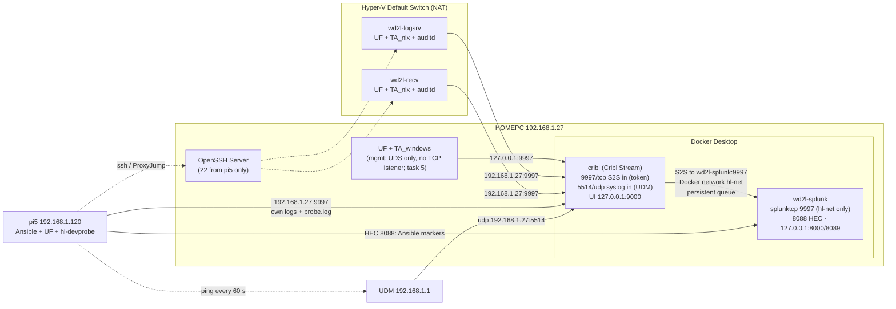
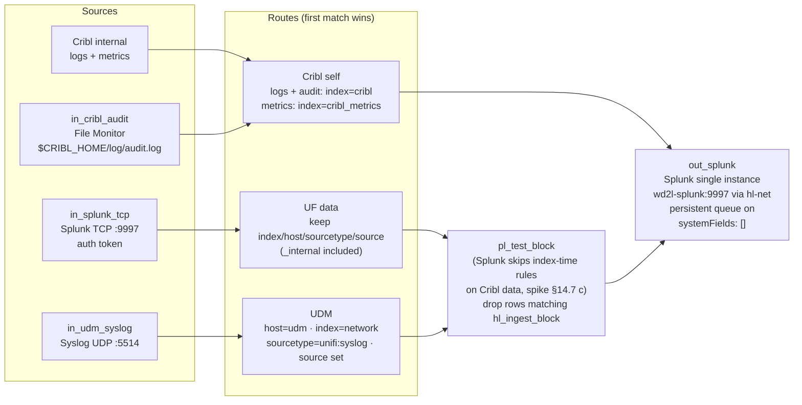

# Homelab Splunk collection + "missing data" health monitoring: spec and plan

Status: **approved** by Taylor 2026-10-30. Repo: `C:\Users\taylo\Documents\claude-code\homelab-splunk-missing-source` (empty today; it becomes a git repo). A reviewer read the draft as the builder would, and its fixes are folded in.

Amended 2026-10-31 for Cribl Stream; see [2026-10-31-cribl-stream.md](2026-10-31-cribl-stream.md) for the decisions and why.

## 1. Context

Taylor wants a realistic, production-shaped lab that answers one SOC question fast: **"Am I blind somewhere?"** That covers a host that stopped sending, a sourcetype or source that went quiet, or a forwarder someone stopped and never restarted. The answer has to be authoritative (compared against a declared list), quick (minutes), aware of normal cadence (a quiet network device isn't an outage), and usable at a few hundred hosts. Production struggles with this today, so the monitoring design matters most.

The collection side gets built as well: Universal Forwarders (UFs) + TAs on the two AlmaLinux 10 VMs and the Windows PC, a UF on the Pi, STIG-style auditing, and syslog from the UniFi Dream Machine (UDM). Everything collected goes through **Cribl Stream**, which forwards it to Splunk. It's all deployed by **one Ansible role run from the Pi**, with clean install and uninstall and service control by tags, and no deployment server.

## 2. The recommendation (the "better way")

Typical failures: a hand-kept list that drifts; one global "no data for N hours" threshold; no way to tell "forwarder down" from "one input broken"; mutes that never expire; dashboards that scan raw data. The fixes:

1. **Expectations come from the deployment code.** The role knows every input it enabled (index, sourcetype, source, interval). It renders the expected list from the same inventory and pushes it to Splunk, so deploying an input creates its expectation and removing it retires it. Agentless devices are declared in the inventory too. UI-added rows are kept separate, so a redeploy never clobbers them. *(Production equivalent: generate the list from the deployment pipeline/CMDB, not memory.)*
2. **Cadence profiles, not one threshold**: `heartbeat`, `periodic`, `continuous`, `sporadic`, `info`. Periodic thresholds come from the input's own interval. Continuous and sporadic thresholds are **learned** nightly from 14 days of history, excluding the times the host or Splunk was down, then clamped per profile, explained in the UI, and overridable per entity.
3. **Liveness separate from data.** Each UF's self-telemetry (`_internal`, every 30 s) is a fast, cadence-independent heartbeat (~2 min detection). A **probe on the Pi** pings each syslog device every 60 s and writes the result to a file the Pi's UF forwards, which gives agentless devices a heartbeat. "Device up but not logging" and "device down" become different findings.
4. **State, not scans.** Trackers (`tstats`, every minute) record last-seen times in the KV store. An evaluator turns them into statuses and writes **state transitions** to a summary index (history, MTTR, daily report). Dashboards read the KV store, so they stay fast at hundreds of hosts.
5. **Every finding gets a likely cause and the next step.** The cause combines the heartbeat, Ansible's own maintenance markers, Hyper-V VM events, relay (Cribl) status and tamper indicators. For example: "Stopped by Ansible `--tags stop` 14:03 by taylorb, not restarted → `--tags start --limit wd2l-recv`", or "Security log cleared 2 min before silence → escalate". Volume drops catch partial blinding, such as auditd still sending at 10% of normal.

**Off-the-shelf:** TrackMe covers much of this, but its free Community Edition ended Aug 2026 (it goes read-only after a 90-day trial). Hurricane Labs' Broken Hosts (free) uses the same lookup + `lateSecs` + suppressions model, without learning, heartbeats or causes. Ours is plain SPL + KV store: it ports to production, or serves as the yardstick for evaluating TrackMe. See §10 for porting notes.

## 3. Environment as found (read-only recon)

| Thing | Fact | Consequence |
|---|---|---|
| VMs `wd2l-logsrv`, `wd2l-recv` | AlmaLinux 10, **FIPS**, SELinux enforcing, Hyper-V **Default Switch NAT**, `<vm>.mshome.net`, user `taylorb`, ECDSA keys only; **Off**, started manually (Taylor's choice) | Ansible reaches them via a ProxyJump through the PC; the UF runs in FIPS mode; an off VM shows DOWN (mute long gaps) |
| wd2l on all 3 Linux hosts | rsyslog → wd2l → Splunk HEC (`enclave1`, `wd2l`, `wd2l_audit`); `/etc/audit/rules.d/wd2l.rules`; `/var/log/wd2l/audit-*.jsonl`; `authorize.conf` limits `user`/`power` to `enclave1;wd2l` | Never edit wd2l's files or the `[syslog]` props; `wd2l_audit` is out of scope; the new roles need explicit `srchIndexesAllowed` |
| Pi `pi5` | 192.168.1.120, AlmaLinux 10.2 **aarch64**, Python 3.12, no Ansible; `/etc/rsyslog.d/90-wd2l.conf` sends `*.*` to wd2l; Raspberry Pi kernel (`raspberrypi2-kernel4`) with **no `/proc/sys/crypto`, so no FIPS** (spike §14.7 i) | pi5 is a **UF host** (task 4), not a syslog relay. The probe writes to a file that the UF reads, never through rsyslog or the journal, so nothing new leaks into wd2l; `90-wd2l.conf` is never touched |
| PC `HOMEPC` | 192.168.1.27, Win 11 Pro (likely a Microsoft account), no sshd, WinRM off, Docker Desktop only after sign-in | Taylor runs a one-time elevated SSH bootstrap; no `docker pull` over SSH (no credential store); the image is already local |
| Splunk | `wd2l-splunk`, `splunk/splunk` 10.6.0.5 (pinned digest), volumes `wd2l-splunk-etc/var`, ports `127.0.0.1:8000/8089`, `8088`; **Splunk Developer Personal licence** (group `Enterprise` active), **10,240 MB/day, expires 2027-04-29 00:59:59 MDT (06:59:59 UTC)** (REST `licenser/licenses`, 2026-11-07; it replaced the spike's download-trial, §14 h) | No recreate: Cribl reaches its `splunktcp` 9997 over the Docker network `hl-net`, attached live (§6). Renew the Developer licence before 2027-04-29 |
| Docker Desktop | NAT hides the client's source IP | The UDM gets its **own Cribl port (5514/udp)**, and Cribl names the host from the port, never from the source address; forwarders are identified by hostname/guid, never by IP |
| UDM | 192.168.1.1; UniFi CEF timestamps have no time zone | It sends straight to Cribl. `_time` is **Cribl's receive time** by default, just as a relay would stamp its own. Cribl's syslog source would otherwise take the header time (spike §14.7 d), so the UDM route sets `_time` to the receive time. Task 8's CEF sample may switch it to the device timestamp, if that timestamp proves reliable and carries a time zone |
| TAs | `splunk-ta-local`: Splunk_TA_nix 10.3.4, Splunk_TA_windows 11.0.3 | Pinned |

## 4. Architecture

**Cribl Stream sits between every collected source and `wd2l-splunk`.** Every UF sends to Cribl, the UDM sends its syslog straight to Cribl, and Cribl forwards to Splunk. That makes Cribl a single point everything collected depends on, and a place where data can be dropped on purpose; the data-health app watches for both (§7.6). The decisions and why are in [the Cribl addendum](2026-10-31-cribl-stream.md).

wd2l's HEC traffic and the Ansible markers stay **direct to Splunk HEC 8088**. Neither is forwarder or syslog data, and keeping them off Cribl means "Cribl down" and "Splunk not receiving" can be told apart.

### 4.1 Hosts and paths



### 4.2 Inside Cribl



- **The UDM gets its own port (5514/udp)** because Docker Desktop's NAT hides the sender's IP: Cribl sees every sender, UDP and TCP alike, as the Docker network gateway (spike §14.7 d). Cribl names the host from the port, never from the source address. The source sets `host`, `index`, `sourcetype` **and `source`** (otherwise Splunk fills in `tcp:9997`). Each device source's pre-processing pipeline `pl_syslog_pre` sets `_time` to the receive time, because the syslog source takes the header time by default (§3; verified in task 3b with a line stamped 1 January: skew 0 s, §14.9). The route `r_syslog_devices` matches every device source with `__inputId.startsWith('syslog:in_')`, because the UDP id carries a `:udp` suffix. Each source is `in_<name>_syslog`, built by the role from `syslog_devices`.
- **Cribl changes nothing in UF data:** the index, host, sourcetype and source pass through unchanged (verified for `_internal`, spike §14.7 b), so every rule in the data-health app keeps working. By default Cribl's Splunk destination adds an indexed field `cribl_pipe`, so `out_splunk` sets `systemFields: []`. Task 3b verified that this removes it (§14.9).
- **Cribl's internal metrics source has the type `criblmetrics`** (no underscore), and its input id starts `criblmetrics:`. A source with an unknown type is ignored without an error, and Cribl keeps its disabled default (task 3b, §14.9).
- **Splunk applies no index-time rule to what Cribl delivers** (spike §14.7 c): no `TRANSFORMS`, no `INGEST_EVAL`, and so no line breaking or timestamping on the indexer either. That is why the test block runs in Cribl (`pl_test_block`). Cribl's event breaker now splits and timestamps UF data, and task 6 checks it (§13).
- **Cribl's own data:** logs and the audit log go to the index `cribl`, metrics to the metrics index `cribl_metrics`. Metrics sent to an event index arrive without their values (spike §14.7 f). That gives Cribl a heartbeat, and its audit log of config changes. The audit log isn't among Cribl's internal sources, so a File Monitor source reads it.
- **Cribl's config is code:** its YAML lives in the repo under `cribl/`, and the role deploys it as files (§5.3 `cribl`).
- **The routes, first match wins:** `r_cribl_self` (Cribl's logs, metrics and audit log, `passthru`), `r_syslog_devices` and `r_uf` (both through `pl_test_block`), then **`r_default`**, a catch-all that sends anything unmatched to Splunk unchanged, so a new source is never dropped silently (task 3b; in its checks every Cribl event matched one of the first three).

### 4.3 Ports

| Port | Listener | Who sends | Published on the PC |
|---|---|---|---|
| 9997/tcp | Cribl, Splunk TCP source (token) | 4 UFs | yes, all interfaces |
| 5514/udp | Cribl, syslog source | UDM only | yes |
| 9000/tcp | Cribl UI/API | Taylor, Ansible over SSH | 127.0.0.1 only |
| 9997/tcp | Splunk `splunktcp` (token) | Cribl only | **no**; reached on `hl-net` |
| 8088/tcp | Splunk HEC | wd2l, Ansible markers | yes |
| 8000, 8089/tcp | Splunk Web, REST | Taylor, tests | 127.0.0.1 only |

### 4.4 Indexes and data collected

**Indexes** (app `hl_server_base`): `linux`, `windows`, `network`, `cribl` (Cribl's internal logs and audit log), `cribl_metrics` (`datatype = metric`: Cribl's internal metrics, spike §14.7 f), `data_health` (written with `collect` only as sourcetype `stash`, so it isn't licence-metered; the record type goes in `source=dh:transition|dh:daily|dh:tamper|dh:admin|dh:marker`), and `wd2l_uf_audit` (readable by `wd2l_auditor` + admin only, like `wd2l_audit`). `enclave1` and `wd2l` are monitored read-only; `wd2l_audit` isn't tracked.

**Retention** (Taylor, 2026-11-07; evidence in §14.11):
- **14 days** (`frozenTimePeriodInSecs = 1209600`) on every index above, `wd2l_uf_audit` included (it was 366 days, copying `wd2l_audit`'s retention; `wd2l_audit` itself keeps its own).
- **`_internal` and `_audit`: 30 days** (`2592000`), set on `[_internal]` and `[_audit]` in `hl_server_base/default/indexes.conf`. That beats `etc/system/default` (`_audit` was 6 years there), but `system/local`, any app's `local/`, or the `default/` of an app that sorts before `hl_server_base` would beat it, so `btool indexes list _audit --debug` is the check. `_introspection`, `_metrics`, `_telemetry` and wd2l's indexes keep their own settings.
- Splunk freezes (deletes) a bucket once its newest event is older than the limit: everything younger than 14 days is kept (unless an index reaches its size cap, `maxTotalDataSizeMB`, 500 GB by default), and anything older may be gone. **hl_data_health looks back 14 days at most**, and the SPL test `retention-windows` checks every saved search, macro and view against the shortest retention in `hl_server_base`. Two windows changed behaviour: DH Baseline daily catches up the last 13 days, not 14 (§7.3), and DH Tamper writes only findings of the last 7 days to the index (§7.6). Longer history is only in the KV collections: mutes (≤ 30 days), tamper findings (30 days), the admin log (90 days).

**Data collected.** Every UF row goes UF → Cribl → Splunk; the UDM goes straight to Cribl on 5514/udp. pi5 is a full Linux UF host: the "VMs" rows are the standard Linux UF rows and apply to pi5 too (each switchable per host in `host_vars`, §5.2). The pi5 rows below are not its full list: one gives its wd2l sourcetype, and the other is its one addition, `probe.log`.

| Host | Input | index / sourcetype (source) | Profile → threshold |
|---|---|---|---|
| VMs | `/var/log/messages`, `/var/log/cron` | linux / syslog | continuous (learned) |
| VMs | `/var/log/secure` | linux / linux_secure | sporadic (learned) |
| VMs | `/var/log/audit/audit.log` | linux / linux_audit | continuous (learned) |
| VMs | TA_nix (event versions, not `*_metric`): `cpu`,`ps` 30 s; `vmstat`,`top`,`interfaces`,`netstat` 60 s; `df`,`openPorts`,`lastlog` 300 s; `package`,`Unix:Service`,`Linux:SELinuxConfig`,`Unix:SSHDConfig`,`Unix:UserAccounts` 3600 s; `Unix:Uptime`,`Unix:Version` 86400 s | linux / as the TA sets them | periodic: 2×interval+60 s |
| VMs | `/var/log/wd2l/audit-*.jsonl` | wd2l_uf_audit / `wd2l:sender:audit` (logsrv), `wd2l:audit` (recv) | sporadic |
| pi5 | `/var/log/wd2l/audit-*.jsonl` | wd2l_uf_audit / `wd2l:audit` (the receiver's trail, settled in task 6, §14.14; pi5's sender trail is in `/var/log/wd2l/sender/`, which this glob doesn't match, so it isn't collected) | sporadic |
| PC | WinEventLog Security, System, Application, `Microsoft-Windows-PowerShell/Operational`, `Microsoft-Windows-Windows Defender/Operational`, `Microsoft-Windows-Hyper-V-VMMS-Admin`, `Microsoft-Windows-Hyper-V-Worker-Admin` (exact names from `wevtutil el`, spike §14 g: the Hyper-V ones use a hyphen, not `/`), `renderXml=true` | windows / XmlWinEventLog (`XmlWinEventLog:<channel>`), both set on the UF stanza (§5.5) | Security continuous; the rest sporadic |
| PC | `perfmon://CPU`, `perfmon://Memory` at 60 s (the TA's `mode = multikv`) | windows / `PerfmonMk:CPU`, `PerfmonMk:Memory` (source the same; one indexed event per collection, one result per instance at search time) | periodic |
| UFs (all 4, pi5 included) | `_internal` metrics, every 30 s, through Cribl with the host intact (verified, spike §14.7 b) | (read only) | heartbeat 90 s |
| pi5 | `monitor:///var/log/hl-devprobe/probe.log` (`hl-devprobe`, one ping per device every 60 s) | network / `hl:devprobe` | periodic 180 s |
| UDM | syslog/CEF, straight to Cribl :5514 | network / `unifi:syslog` (host `udm` and the source, set by Cribl from the port; `_time` = Cribl's receive time unless task 8 switches it, §3) | sporadic → learned |
| cribl | internal logs (worker processes; each logs `stats` every 60 s, max gap seen 37 s), audit log (File Monitor), metrics (every 30 s) | cribl / `cribl`, `cribl:audit`; cribl_metrics / `cribl.logstream.*` | heartbeat 120 s on `index=cribl sourcetype=cribl` (spike §14.7 f) |
| existing | wd2l-delivered syslog (HEC, not through Cribl) | enclave1 / syslog | continuous, `via=wd2l-recv` |

**The probe line format** is `time=<iso8601> device=udm ip=192.168.1.1 reachable=1 rtt_ms=0.8`, which the `dh_fwd_from_probe` macro reads (`device`, `reachable`). The probe doesn't go through rsyslog, so nothing can leak into wd2l through the journal.

No `ignoreOlderThan`: on a single quiet file it can cause false MISSING. Windows logs start from the oldest event (logs are size-capped, so the backfill is small and happens once: measured at 103,511 events and ≈ 111 MB across HOMEPC's channels, §14.14 row 10; the older events age out under the 14-day retention). `sysstat` is installed on every `uf_linux` host, pi5 included, because TA_nix `cpu`/`vmstat` need `sar`/`mpstat`. If a host has no rsyslog files, it falls back to a `journald://` input.

## 5. Part A: Ansible role `homelab_splunk`

### 5.1 Transport and bootstrap
- **Windows:** OpenSSH Server, default shell PowerShell, key in `administrators_authorized_keys` (the SSH session is elevated), firewall rule 22/tcp from 192.168.1.120 only. Ansible uses `ansible_connection: ssh`, `ansible_shell_type: powershell`.
- **VMs:** `ansible_host: <vm>.mshome.net` with `-o ProxyJump=<winuser>@192.168.1.27` (the jump host resolves the name). The Pi gets a new **ECDSA P-256** key, `~/.ssh/id_ecdsa_homelab_ansible`.
- **Pi:** `ansible_connection: local`. Install `ansible-core` ≥ 2.18 (from dnf if the version is new enough, otherwise a venv in `~/.venvs/ansible`) and the collections from `requirements.yml`.
- **Scripts (Taylor runs them):** `scripts/bootstrap-windows-sshd.ps1` (elevated, idempotent, `-Remove`), `scripts/bootstrap-pi.sh`, `scripts/add-ansible-key.ps1` (copies the Pi's public key to the VMs and Windows). `scripts/sync-to-pi.ps1` copies the repo to the Pi with `tar | ssh pi5 tar x`.

### 5.2 Layout
```
ansible/ansible.cfg  requirements.yml  site.yml
ansible/inventory/hosts.yml                    # YAML; groups uf_linux (wd2l-logsrv, wd2l-recv, pi5), uf_windows, splunk_server
ansible/inventory/group_vars/<group>.yml  host_vars/<host>.yml   # input toggles, criticality, owner, profile overrides
ansible/inventory/group_vars/all/vault.yml     # ansible-vault: UF admin pw, S2S token, HEC marker token, Cribl admin pw (vault pass file on the Pi only)
ansible/roles/homelab_splunk/{defaults,meta/argument_specs.yml,tasks,handlers,templates,files,vars}
ansible/files/packages/   (gitignored)         # UF rpm x86_64 + aarch64 (pi5, §14.3), UF msi x64, TA .spl; sha256 pinned in defaults
splunk/apps/{hl_server_base,hl_data_health}/   # server apps (the role packages them)
cribl/local/cribl/{inputs,outputs,cribl,breakers}.yml   # Cribl config as code, laid out as Cribl 4.20 stores it (spike §14.7); cribl.yml: workers only; breakers.yml: the UF event breakers (§13, §14.14)
cribl/local/cribl/pipelines/route.yml          #   the routes (there is no routes.yml)
cribl/local/cribl/pipelines/{pl_test_block,pl_syslog_pre}/conf.yml
cribl/data/lookups/hl_ingest_block.csv         #   lookups live under $CRIBL_HOME/data/lookups (+ a .yml); pushed through the API
tests/spl/                                     # fixture lookups + expected statuses for the evaluator
scripts/  docs/
```
- **pi5 is a full `uf_linux` member.** It gets everything the VMs get: the UF, the tamper rules (§5.4), the STIG `audit_rules`, TA_nix, the file monitors and the wd2l inputs (wd2l runs on pi5 too). Each is switchable per host in `host_vars`. There is no relay group.
- **Syslog devices are vars on `splunk_server`**, each with its own Cribl port (`syslog_devices: [{name: udm, ip: 192.168.1.1, port: 5514, index: network, sourcetype: unifi:syslog, source: "syslog:udm", profile: sporadic, criticality: 2}]` in `group_vars/splunk_server.yml`), so Ansible never logs in to them.
- **Cribl vars are flat `hl_cribl_*`** in the role's `defaults/main.yml` (image digest, container, volume, compose folder, the ports of §4.3, the self-test switch), like the rest of the role and its argument specs, not a `cribl:` dict (task 3b). The admin password is `vault_hl_cribl_admin_password`. Cribl's own tunables (`maxS2Sversion`, `pqMaxSize`, `workers.count`) are literals in the `cribl/` files: change Cribl by editing `cribl/`.
- **`hl_collector`** is where the UFs send: `192.168.1.27`, or `127.0.0.1` on HOMEPC. It is Cribl's address.
- **Secrets** come from the vault and are never committed. The S2S token is templated into the Cribl YAML the role pushes (Cribl 4.20.4 keeps it there in plain text, readable by root in the container only, mode 600); the Cribl admin password is set through Cribl's API, not written into any file (§5.3 `cribl`).
- The Splunk admin password is read on HOMEPC from `~/wd2l-splunk/secrets/splunk-admin-password` and not copied anywhere.
- The role keeps a **state file** on each host (`/var/lib/hl_splunk/state.json`, or `C:\ProgramData\hl_splunk\state.json`) recording everything it added: packages (such as sysstat), the audit-policy backup, the `hl-net` attachment, the Cribl container and volume. Removal undoes exactly that list. On Windows the folder `C:\ProgramData\hl_splunk` gets a protected ACL (SYSTEM and Administrators full control, owner Administrators, nothing inherited), set when the role creates it and corrected when it differs, because `C:\ProgramData` lets `BUILTIN\Users` create and write there (task 5 fix round 1).

### 5.3 Tags. Destructive tags carry `never`, so a bare run never removes, stops or restarts anything.

| Tag | Hosts | Does |
|---|---|---|
| *(none)* / `deploy` | all | server → server_network → cribl → install → apps → audit_rules → audit_policy → probe → expected |
| `install` | UF hosts | check sha256 (§14 package table) → install the UF (rpm; msi with `LAUNCHSPLUNK=0`) → **before first start**: FIPS (`SPLUNK_FIPS=1` + `SPLUNK_FIPS_VERSION=140-3` appended to `etc/splunk-launch.conf` when `/proc/sys/crypto/fips_enabled=1`; verified on UF 10.6.1.1, §14 d; a missing file means "not FIPS", never an error: pi5's kernel has no `/proc/sys/crypto`, §14.7 i), `user-seed.conf` (`PASSWORD` from the vault; consumed on first start only if `etc/passwd` is absent), mgmt `127.0.0.1:8090` (`web.conf [settings] mgmtHostPort`, meant to avoid the container's 8089 on HOMEPC). On the Linux UF 10.6.1.1 nothing listens on TCP: only the Unix socket `var/run/splunk/cli.socket` ("Management port is available for UDS connections"), although `btool web list settings` shows `mgmtHostPort = 127.0.0.1:8090` read from `hl_uf_outputs` (task 4, §14.10 row 4). `splunk status` works over the socket with outputs configured, but commands that need a login (`show fips-mode`) don't, so `install`, `status` and `verify` read systemd, rpm and splunkd.log, never the CLI; task 5 checks the Windows UF's mgmt listener; `limits.conf [thruput] maxKBps=0` → boot-start (Linux: `splunk enable boot-start -systemd-managed 1 -user splunkfwd -group splunkfwd`; the RPM creates `splunkfwd`, and boot-start writes `/etc/systemd/system/SplunkForwarder.service` with `AmbientCapabilities=CAP_DAC_READ_SEARCH` and no polkit rule; the role runs the CLI only as root and only for boot-start (enable/disable): status, FIPS and the connection come from systemd, `/proc`, the rpm and splunkd.log; Windows: the virtual account added to Event Log Readers) → the UF-path tamper audit rules (Linux, §5.4; counted as `-F key=…`, the form `auditctl -l` prints; reloaded when the loaded set differs from the file; wd2l's loaded count must be unchanged) → start; **a bare `install` (or `deploy`) restarts the UF when `hl_uf_outputs` changed**, e.g. a rotated token or collector, as `server` restarts splunkd → **connected**, checked on every run: the UF's splunkd.log shows the latest `Connected to idx=<collector>:9997` newer than the latest close, and Splunk has this host's `_internal` stamped after the running splunkd started (the unit's `ActiveEnterTimestamp`, not the moment the restart was asked for: the old splunkd sends its own shutdown lines with the old token while it stops, and those let a wrong token pass, task 4 fix round 1). A close doesn't end the wait early: the UF logs a wrong token as a plain `Connection closed by server`, the same line as a benign close (a Cribl reload, the hold), so the play waits `hl_uf_connect_timeout` and then fails, quoting the last close; and a refused attempt also logs `Connected to idx=…` 1 ms before the close, so the log alone can race → FIPS hosts: the running splunkd (the unit's MainPID) has `SPLUNK_FIPS=1` and `SPLUNK_FIPS_VERSION=140-3` in its environment and OpenSSL's `ossl-modules/fips140-3/fips.so` mapped (not splunkd.log, whose start lines are gone after a rotation) → marker. The packages it adds (sysstat) are recorded in the state file before dnf runs, so a failed run can't lose them. Verified on wd2l-recv, wd2l-logsrv and pi5 (task 4, §14.10). **Windows** (HOMEPC, task 5, §14.12): the same order and rules, in PowerShell. The MSI's arguments are one string (`AGREETOLICENSE=Yes LAUNCHSPLUNK=0 SERVICESTARTTYPE=auto INSTALLDIR="…"`), because a list item with a space is quoted whole and msiexec then waits on its hidden usage dialog. The UF runs as the virtual account `NT SERVICE\SplunkForwarder` (the play asserts it), which joins Event Log Readers (S-1-5-32-573) and Performance Monitor Users (S-1-5-32-558) by SID. The `uf` state record is written before the MSI runs, and its product code, service SID and groups before the groups are joined, so a failed run can still be rerun or uninstalled. The running splunkd's start is the service process's start time. Like Linux, the UF listens on no TCP port (`Management port is available for UDS connections`), so it never touches the container's `127.0.0.1:8089`; the play fails if the UF's process listens on 8089 or on a non-loopback address. FIPS (only when `HKLM:\…\Lsa\FipsAlgorithmPolicy\Enabled=1`; HOMEPC has 0): the two `splunk-launch.conf` lines and `lib\ossl-modules\fips140-3\fips.dll` loaded in the service process. Markers on Windows are best effort |
| `apps` | UF hosts | sync the role-owned apps (§5.5): the TA when its version differs (the `.spl` pinned in `hl_tas`; its shipped files swapped in, `local/` kept), each app's `app.conf` and `local/inputs.conf`, and `hl_uf_outputs`. **Restart only on a real change**, or when a role-owned file is newer than the running splunkd (a run that died before its restart); when restarting, the marker (best effort) is posted first → the connection proof of `install` on every run, restart or not. A rerun is `changed=0`. Verified on all four UFs (task 6, §14.14) |
| `apps_remove` | UF hosts | remove the role-owned input apps (only those whose `default/app.conf` has `[hl] managed = true`) and the role's `local/inputs.conf` inside the TA, or just `-e hl_apps_only=[…]`. `hl_uf_outputs` stays unless it's named (without it the UF sends nothing, heartbeat included); the TA itself goes with `uninstall`. Only on a change: marker (best effort) → restart → connection check. Verified on wd2l-recv, then restored (§14.14 row 9) |
| `uninstall` | UF hosts | marker → stop → **remove the UF-path tamper rules first and reload auditd** (otherwise augenrules stops at the failing file and drops `wd2l.rules`) → remove apps → disable boot-start → remove the package → delete leftovers (§5.6) → **verify the contract; fail if anything is left** → the next `expected` run retires the host's rows. auditd is also reloaded when the file is already gone but `hl-*` rules are still loaded, and a unit left without its CLI is removed directly (reruns after a partial uninstall). When the state file records an install but its baselines are missing, the play fails rather than skip those comparisons (`-e hl_uninstall_without_baseline=true` accepts it), and new unit files are listed and fail it unless `-e hl_uninstall_accept_new_units=true`; a rerun after a finished uninstall has no record and passes, saying it compared nothing. `auditctl -l` is compared with the pre-install baseline ignoring the STIG rules (`hl_stig_key_re`), which belong to the separate `audit_rules` tag. Verified on wd2l-recv, then reinstalled (task 4, §14.10 rows 12–13 and fix round 1) |
| `start` / `stop` / `restart` / `status` | UF hosts | service control + marker (a stop posts it first; start/restart post theirs after the `install` connection check; a start of a running UF checks the whole log); `status` = service state, rpm version, build (`etc/splunk.version`), last connect, `last_close`, apps, FIPS (the running splunkd) (from systemd, rpm and splunkd.log, not the CLI) |
| `audit_rules` / `audit_rules_remove` | uf_linux | STIG sample rules `/usr/share/audit-rules/30-stig.rules` (package `audit-rules` 4.0.3, 26 b32 + 26 b64 rules, no `-e`/`-b`/`-f`) + `31-privileged` rules generated with the `#find … -perm -04000` / `#filecap` commands that `/usr/share/audit-rules/31-privileged.rules` ships as comments (they write b64 only, so the build adds the b32 forms; a build with no privileged rules on a host that has setuid binaries fails the play), into `/etc/audit/rules.d/zz-hl-zz-stig.rules`; `augenrules --load` (it sorts with `ls -1v` and always moves `-D` first and `-e` last); `audit_immutable: false` (no `-e` is set anywhere today and `auditctl -s` shows `enabled 1`; STIG's `-e 2` would make every change need a reboot, documented). **That file loads last, on purpose:** the exit filter is first-match by load order and a matching rule's key sticks, so STIG's path-less rules (`delete`, `perm_mod`, `access`), loaded earlier, would take events on wd2l's and the UF's paths and tag them with STIG's keys, and `key=wd2l-*`/`key=hl-*` (§7.6) would stop matching. Loaded last, those events stay under their own keys, and a rejected STIG line can't cost wd2l its rules. **The name is deliberate:** `ls -1v` puts punctuation after letters, so `zzz-…` sorts *before* `zz-hl-uf-tamper.rules` (measured on all three hosts); don't "simplify" it. Each `-S` list is filtered per ABI with `ausyscall` (b64: `uname -m`; b32: `arm` on aarch64, `i386` on x86_64): auditctl aborts the load on a name the ABI lacks (pi5's aarch64 has no `chmod`, `chown`, `lchown`, `open`, `creat`, `rename`, `unlink`); dropped names are printed (`HL_DROPPED`), and a rule goes only if no name survives. `filecap` needs `libcap-ng-utils`, which the role doesn't add (it keeps the host footprint): its generators produce nothing, leaving out 4 file-capability binaries per host (§14.15). After the load the block checks the STIG rules are loaded with the expected count and last (`auditctl -l`), and that wd2l's and the tamper rules' counts are unchanged; otherwise it removes the file, reloads and fails. A rerun reloads when the loaded set differs from what the file should give, not only after a write, and otherwise is `changed=0` with no marker. `audit_rules_remove` deletes the file, reloads (also when the file is already gone but its rules are loaded) and compares `auditctl -l` with the baseline from before the first run, the UF's tamper rules left out. Never touches `wd2l.rules` or `wd2l-quadlet.rules` |
| `audit_policy` / `audit_policy_remove` | uf_windows | `auditpol /backup` first, then the focused subset: Logon/Logoff, Account Mgmt, Security Group Mgmt, Audit Policy Change, Authentication Policy Change, Security System Extension (4697), System Integrity, Process Creation (no command line). By GUID, **add-only**: a wanted Success/Failure is turned on, a setting the PC already had is never turned off (HOMEPC audits Account Lockout success by default), read back after. Remove = `auditpol /restore` from the backup, then a fresh `/backup` compared row by row (GUID, subcategory, setting value); an empty `FileGlobalSacl`/`RegistryGlobalSacl` row, which `/backup` writes after any `/restore`, counts as no global SACL. Verified on HOMEPC (task 5, §14.12 rows 9–10) |
| `probe` / `probe_remove` | pi5 | `hl-devprobe.service` + `.timer` (one ping per `syslog_devices` entry every 60 s, one line per ping appended to `/var/log/hl-devprobe/probe.log`, format in §4.4), the `/var/log/hl-devprobe/` directory, logrotate. Remove undoes each |
| `server` / `server_remove` | splunk_server | build each app as a tar → `win_copy` → `docker cp` into a temp folder → swap **only `default/`, `metadata/default.meta` and shipped lookups**, keeping `local/` and UI-written lookups → chown → restart splunkd only when indexes/inputs/props/web changed. When `default/inputs.conf` changes, the helper drops the stale encrypted `token` copies from `local/inputs.conf` for stanzas `default/` still sets, and removes whole any `splunktcptoken` stanza `default/` named before this run and no longer does (otherwise the old token stays accepted after a contract, §13); stanzas the role never shipped are left alone. **A splunkd restart loses what Cribl sends during Splunk's shutdown** (≈ 30 s in the spike, despite the persistent queue, §14.7 g). `maxS2Sversion: v4` (the spike ran v3) cut it to ≈ 3 s; **`hl_cribl_hold_on_splunk_restart` (on by default since task 4) prevents it**: `docker pause cribl` before `splunk restart`, unpause once splunktcp 9997 accepts a TCP connect inside the Splunk container (HEC answering isn't enough), also on failure. With it, a restart takes ≈ 2 min (Splunk waits up to its 90 s input quiesce timeout for the paused Cribl's connections), and UDP syslog sent meanwhile is lost (§13, §14.10 row 15). `-e hl_server_force_restart=true` restarts splunkd even with nothing changed (the test). Remove deletes the apps **and their KV collections (REST)**; index data stays unless `-e hl_purge_index_data=true`. `server_remove` also undoes `server_network`: it disconnects `wd2l-splunk` from `hl-net`, then deletes `hl-net` if no container is still attached, as the state file recorded them. In a full removal, `cribl_remove` runs first. `hl_server_base` includes the indexes `cribl` and `cribl_metrics` and the Cribl search-time props (§5.5) |
| `server_network` | splunk_server | create the Docker network `hl-net` → `docker network connect hl-net wd2l-splunk` (live; no recreate, no new published port) → check wd2l HEC `/services/collector/health` → record the attachment and the network in the state file. Idempotent: each run checks the attachment and re-attaches if it's missing. It survived `docker restart wd2l-splunk` and an in-container splunkd restart (same IP, §14.7 h); a Docker Desktop restart also left it attached with the same IP (task 3, §14.8). `server_remove` undoes it |
| `cribl` | splunk_server | preconditions (the image is on HOMEPC: the role never pulls, because Docker Desktop has no credential store over SSH; `hl-net` exists; the vault password; `syslog_devices`: names and indexes match `^[a-z0-9][a-z0-9_-]*$`, names and ports unique, ports not 9997/9000, no quotes in sourcetype or source) → marker → render `compose.yml` into `C:\ProgramData\hl_splunk\cribl` (image pinned by digest `cribl/cribl@sha256:cb2b2e32…` (§6.2), `hostname: cribl` so Cribl's own events carry `host=cribl`, volume `hl-cribl-data` on `CRIBL_VOLUME_DIR=/opt/cribl/config-volume`, `hl-net` external, 9997/tcp, one UDP port per `syslog_devices` entry, `127.0.0.1:9000`) → `docker compose up -d` over SSH → `/health` → **set the admin password first** (a fresh image has `admin`/`admin` with `forcePasswordChange`; `PATCH /system/users/admin` with the user object plus `password` clears it, and the new password logs in after about a second) → **the config goes in as files, not through the API**: render the repo's `cribl/local/cribl/*` on the controller (only the token is templated; one syslog source per device merged into `inputs.yml`), `docker cp` them in, and swap the changed ones into `$CRIBL_VOLUME_DIR/local/cribl/` with an in-container helper that also deletes files the role pushed before but no longer ships, and records what it pushed in `local/.hl_pushed.manifest.pending`. The record is committed (`.hl_pushed.manifest`) only after Cribl restarted and the load check passed, so a failed restart or check is retried by the next run (a pending record counts as a change). Idempotence compares against the committed record, not the live file, so a UI edit isn't reverted by the next run: the Cribl tamper indicator catches it (§7.6) → `docker restart cribl` only when a file changed (lost nothing in the spike, §14.7 a, nor in three measured restarts during a token change, §14.13 row 6; `cribl reload` doesn't load pushed files, row 5) → check that every input (type and enabled), the output, the pipelines, the four routes and the UF breakers (`hl_uf_breakers` with the repo's rules, attached to `in_splunk_tcp`) are loaded → **seed** `hl_ingest_block.csv` through the lookups API when Cribl has none (and then reset Splunk's mirror to the seed), and check its header → wait for Cribl's logs and metrics in Splunk, and that no event carries `cribl_pipe` → **self-test** after a change: one `HL_CRIBL_SELFTEST run=<id>` line stamped `Jan  1 00:00:00` to each device port, found in Splunk with the device's host/index/sourcetype/source and `_time` within 60 s of `_indextime` (it makes the device look alive for one threshold; `-e hl_cribl_selftest=false` turns it off) → state file → marker. Verified live in task 3b (§14.9) |
| `cribl_remove` (never) | splunk_server | marker → `docker compose down --volumes --remove-orphans` → by name, a leftover container or volume the state file recorded → the compose folder → the state record → Splunk's mirror of the test-block table back to the header (skipped when the Splunk container is absent or not running, or has no `hl_server_base`, e.g. a second run after a full `server_remove`: there is no mirror then) → **the contract** (§5.6): no `cribl` container, no `hl-cribl-data` volume, no compose folder, or the play fails → wd2l health. The image stays (Taylor pulled it), and so does `hl-net` (`server_remove` owns it; in a full removal `cribl_remove` runs first). Verified in task 3b, followed by a reinstall (§14.9) |
| `cribl_block` (never) | splunk_server | set (`-e hl_block_key='host\|st\|src' -e hl_block_minutes=N -e hl_block_reason=…`, 1 ≤ N ≤ 1440) or clear (`-e hl_block_clear=true`) one test block; with no key it only prunes. It reads Cribl's `hl_ingest_block.csv`, drops expired rows, adds or removes the one row, pushes the whole table through the lookups API (`PUT` then `PATCH`, or `POST` for a new lookup) only when it changed, reads it back and checks it, and **mirrors the same table into Splunk's `hl_server_base/lookups/hl_ingest_block.csv`** for the dashboard label, writing it only when Splunk's copy differs (this answers the §7.2 open item; task 11b reads it); markers before and after. A prune-only run with nothing expired reports no change. This is the only thing that removes expired rows from Cribl's table; expiry itself is checked per event. Verified in task 3b with `udm\|*\|*` and a synthetic line (§14.9) |
| `expected` | splunk_server, once | render `dh_expected_ansible.csv` from all hostvars + `syslog_devices` + `dh_extra_expected`, with `via=cribl` on every UF and syslog row, plus the `cribl` host row → push → run the sync search |
| `verify` | all | UF running; on the vault's current S2S token (`default/outputs.conf` hashed and compared on the host, never printed, and the running splunkd newer than that file with no older local token: the straggler check before a rotation's contract, §13); connected to Cribl (the UF's own status: Splunk sees only Cribl's connection) and this host's `_internal` in Splunk from the running splunkd and the last 120 s; Cribl healthy; every expected sourcetype seen in the last N min (REST search through the container) |
| `download` | localhost | fetch UF packages from download.splunk.com; check sha256 |

**Markers:** every `install/apps/stop/start/restart/uninstall/apps_remove/cribl/cribl_remove/cribl_block` run, a real change by `audit_rules` or `audit_rules_remove` (best effort; a rerun with nothing to do posts none), and the `server` tag's Cribl hold (`cribl_hold` before the pause, `cribl_release` after the unpause once HEC answers, also after a failed restart, `target_host=cribl`; both best effort: a failed marker warns and never blocks the restart or the unpause), posts an event to HEC (`index=data_health source=dh:marker`, token `hl_markers`) with host, action, the Ansible user and the time. The causes use them ("stopped by Ansible"), and the tamper search suppresses findings inside a marker window, so the role's own deploys don't look like an attack.
**"Turn off receipt" at the source:** `--tags stop --limit <host>`; or `-e '{"hl_disabled_inputs":["monitor:///var/log/secure"]}' --tags apps` to turn off one input, then re-run without it.

### 5.4 Tamper audit rules (Linux; installed and removed with the UF)
`/etc/audit/rules.d/zz-hl-uf-tamper.rules`, which sorts after `wd2l.rules`: `-a always,exit -F dir=/opt/splunkforwarder/etc -F perm=wa -F auid!=unset -k hl-uf-config`, the same for `bin`, and for `/etc/rsyslog.conf`, `/etc/rsyslog.d`, `/etc/audit` (keys `hl-syslog-config`, `hl-audit-config`). The b32 and b64 forms, like wd2l's.

### 5.5 Apps (TAs deployed **unmodified in `default/`**; our settings live in `local/`, which beats any app's `default/`; checked with `btool --debug`)
- **Linux UF:** `Splunk_TA_nix` + a role-templated `Splunk_TA_nix/local/inputs.conf` (enables the TA scripted stanzas, `index=linux`) · `hl_uf_outputs` (tcpout → Cribl at `{{ hl_collector }}:9997`, S2S `token`, `useACK = true`. Cribl honours it but ACKs on receipt, so it covers the UF→Cribl hop only; what protects a Cribl restart is Cribl's own shutdown persisting what it holds to the queue, and only while Splunk accepts its token (§14.13 row 6; §14.11 row 10 is the case where it didn't), with the persistent queue as the buffer towards Splunk (§14.7 a). No `enableOldS2SProtocol` (S2S v4 works). The UF rewrites `token` encrypted on start, so the template mustn't report a change every run. `limits.conf` thruput) · `hl_uf_linux_inputs` (the file monitors; on pi5 also `probe.log`) · `hl_uf_wd2l_inputs` (wd2l hosts).
- **Windows UF:** `Splunk_TA_windows` + `local/inputs.conf` (perfmon interval 60, WinHostMon off; the TA's `mode = multikv` stays, so Perfmon arrives as `PerfmonMk:CPU` and `PerfmonMk:Memory`, §14.14 row 6) · `hl_uf_outputs` (→ Cribl at 127.0.0.1:9997) · `hl_uf_windows_inputs` (event log channels, `renderXml = true`, `start_from = oldest`). **Each channel stanza also sets `sourcetype = XmlWinEventLog` and `source = XmlWinEventLog:<channel>` on the UF**, because `Splunk_TA_windows` sets both at index time and Cribl-delivered data skips the TA's index-time rules (§14.7 c, §14.14).
- **Server:** `hl_server_base` (indexes, `cribl` and the metrics index `cribl_metrics` included; `splunktcptoken` `hl_cribl`, with Cribl the only sender, over `hl-net`, and `hl_cribl_previous` only while `vault_hl_s2s_token_previous` is set (a rotation, §13). The listener `[splunktcp://9997]` already exists in `etc/system/local` from the image's provisioning (§14.7 h), so `hl_server_base` adds only the token. If task 3 finds the stanza missing, `hl_server_base` adds `[splunktcp://9997]` itself (task 3 found it present, §14.8); the HEC token `hl_markers` for the Ansible markers (index `data_health`, sourcetype `hl:marker`); the Splunk-side `hl_ingest_block` lookup, shipped empty once; props for `[hl:devprobe]` and Cribl's search-time props, **never `[syslog]`**; **no test-block transform**: Splunk applies no index-time rule to Cribl-delivered data, §14.7 c; roles `dh_analyst`/`dh_admin` with explicit `srchIndexesAllowed`; `web.conf [settings] enable_risky_command_check_dashboard = false`, so Manage's Apply runs without Studio's risk prompt, §7.8, §13) · `Splunk_TA_nix` + `Splunk_TA_windows` (search time) · `hl_data_health`. Splunk has no syslog inputs: Cribl receives the UDM and sets its host, index and sourcetype.
- **Cribl:** the `cribl/` tree (§5.2), as tested in §14.7:
  - the Splunk TCP source (token; both tokens while `vault_hl_s2s_token_previous` is set, §13; `breakerRulesets: [hl_uf_breakers]`, Cribl's event breakers for UF data, §13, `cribl/local/cribl/breakers.yml`);
  - the UDM syslog source (metadata `host`, `index`, `sourcetype`, `source`; the UDM route sets `_time` to the receive time, §3);
  - the internal sources (`CriblLogs` → `cribl`, `CriblMetrics` → `cribl_metrics`);
  - `in_cribl_audit` (File Monitor on `$CRIBL_HOME/log`, `filenames: ["*/audit.log"]`, sourcetype `cribl:audit`);
  - the routes (§4.2);
  - `out_splunk` (persistent queue on, `systemFields: []`);
  - `pl_test_block` and its lookup (§7.7).
  
  Eval and filter expressions can't hold arrow functions; the block's key logic lives in a Code function.
- Every role-owned app's `app.conf` has `[hl] managed = true`; `apps_remove` deletes only those apps, plus the role-owned `local/inputs.conf` inside the TAs.

### 5.6 The clean-uninstall contract (checked by the role; it fails the play if anything is left)
**Linux** (the removal order was proven on wd2l-recv in the spike, §14 d):
- `rpm -q splunkforwarder` is absent.
- `/opt/splunkforwarder` is gone (`rpm -e` leaves `etc/` and `splunkfwd`'s `~/.splunk` there, about 9 MB, so the role must `rm -rf` it).
- No `SplunkForwarder*.service` exists in any systemd path (`splunk disable boot-start` removes the unit and its `multi-user.target.wants` link; it also tries the absent `/sbin/chkconfig`, which is harmless), then `systemctl daemon-reload`. No unit file is new compared with a list saved before install (sysstat's units go with it; transient units such as an SSH login's `session-N.scope` are left out of both lists). A unit that something unrelated added meanwhile is listed and fails the contract unless `-e hl_uninstall_accept_new_units=true`.
- No `/etc/polkit-1/rules.d/*plunk*` file exists (10.6 creates none; the check stays as a guard).
- `getent passwd/group splunkfwd` is empty (`userdel splunkfwd` also removes the group), and `/var/spool/mail/splunkfwd` is gone (none is created today).
- No `~/.splunk` in `/root` or the Ansible user's home.
- `find / -xdev \( -nouser -o -nogroup \)` finds nothing new **compared with a list saved before install** (wd2l-recv already has 1,435 such paths in rootless podman storage).
- The tamper rules are gone, and `auditctl -l` matches the set from before the install.
- Packages the role added (sysstat) are removed, as the state file recorded them.

**Windows:**
- The MSI product code and its uninstall key are absent.
- `C:\Program Files\SplunkUniversalForwarder` is gone.
- `HKLM:\SYSTEM\CurrentControlSet\Services\SplunkForwarder` is absent.
- The virtual account is out of Event Log Readers and Performance Monitor Users. The members are read through ADSI (`WinNT://`) and compared by SID, so an orphaned SID can't hide; each removal is read back. The contract **fails closed**: a group it can't read, or a failed `secedit /export`, fails it rather than reading as empty (task 5 fix round 1). The MSI's uninstall takes the account out of Performance Monitor Users itself, but not out of Event Log Readers.
- No user right references the service SID: `secedit /export` is checked, and `win_user_right` removes any orphan. The MSI grants the virtual account `SeServiceLogonRight`, `SeBackupPrivilege` and `SeSecurityPrivilege`, and its uninstall removes all three itself (task 5, §14.12 row 12).
- The staging folder is gone, and the state file no longer has a `uf` record. The file itself stays while it holds other records (on HOMEPC: `cribl`, `server_network`, `audit_policy`).

**Cribl (HOMEPC, `cribl_remove`):**
- No `cribl` container, from `docker ps -a`.
- No `hl-cribl-data` volume, from `docker volume ls`.
- The rendered `compose.yml`, the pushed config and anything else the role added for Cribl are gone, as the state file recorded them.

**Splunk server (HOMEPC, `server_remove`):**
- `hl-net` (in a full removal, `cribl_remove` runs first): `wd2l-splunk` is no longer attached to `hl-net`, and `hl-net` is gone unless another container is still attached. The state file recorded both the attachment and the network.
- `wd2l-splunk` keeps its volumes, ports and HEC health, and wd2l keeps ingesting.

## 6. Part B: Splunk server and Cribl
1. **No recreate.** `server_network` creates `hl-net` and attaches `wd2l-splunk` to it live (`docker network connect`), which is reversible and recorded in the state file. Cribl reaches Splunk's `splunktcp` 9997 there, so `wd2l-splunk` publishes no new port. wd2l HEC and wd2l's dashboard are checked after.
2. **Cribl** runs as the `cribl` container in Docker Desktop, from a compose file the role renders (volume `hl-cribl-data`). The image is pinned by digest: `cribl/cribl:4.20.4` = `sha256:cb2b2e32933e492f439b5825b0c36f420df2fa986fe36d5f31fce6755190eb71`. That is the multi-arch **index** digest; the amd64 manifest is `sha256:f175d143…`, arm64 `sha256:8cd919e1…`; Cribl `4.20.4-9651be2b`; spike §14.7 g. Its **Free licence** (unregistered, from REST `/system/licenses`):
   - 1,024 GB/day;
   - 1 worker group, at most 10 worker processes (the role runs 2: `cribl/local/cribl/cribl.yml`, merged over Cribl's defaults, task 3b);
   - no RBAC, remote auth, notifications, remote git, KMS or external secret stores;
   - expires 2040-07-04.

   With no RBAC, Ansible and people share the `admin` account, so Cribl's audit log can't tell them apart; the marker windows do that (§7.6). A fresh container starts as `admin`/`admin` with a forced password change, so the `cribl` tag sets the vault password first. Config, lookups and the persistent queue live on the volume and survive a container restart.
3. **Licence:** a Splunk Developer Personal licence ("Splunk Developer Personal License", group `Enterprise` active, VALID), 10,240 MB/day, expires 2027-04-29 00:59:59 MDT (06:59:59 UTC) (REST `licenser/licenses` and `licenser/groups`, 2026-11-07; it replaced the download-trial of §14 h). Renew it before 2027-04-29: after that the instance falls back to the Free group (500 MB/day), whose features lack `Alerting`, `ScheduledAlerts` and `Auth` (§14 h), so alerts and roles stop. Cribl's own data is ≈ 18 MB/day of it, ≈ 0.2 % (§14.9). The daily report shows usage against the daily cap, and the evaluator raises a banner if its own tracker stops running.
4. Roles: `dh_analyst` (read, mute) and `dh_admin` (expectations, test blocks). Analysts get no `run_collect` (§7.3).

## 7. Part C: the data-health model (`hl_data_health`: SPL + KV store only)

### 7.1 Entities
Levels: **host**, **sourcetype** (index+host+sourcetype) and **source** (index+host+sourcetype+source_norm). `entity_id = level|index|host|sourcetype|source_norm`. Macros normalize the values:
- `dh_host_norm` lowercases the host and strips its domain.
- `dh_source_norm` replaces the timestamp or rotation part of a source name with `*`.

### 7.2 Storage
| Name | Kind | Writer | Holds |
|---|---|---|---|
| `dh_expected_ansible.csv` | CSV | Ansible | generated rows |
| `dh_expected` | KV | sync (*/5) + UI | **the authoritative list**: entity_id, level, index, host, sourcetype, source, collection (uf/syslog/hec), via, hypervisor, profile, interval_secs, max_gap_secs, criticality 1–4, owner, site, runbook, description, managed_by (ansible/ui), enabled |
| `dh_overrides` | KV | UI | mute_until (required, ≤30 d), reason, ticket, threshold_override_secs, by, at |
| `dh_state_fast` / `dh_state_slow` | KV | one tracker each (**one writer per collection**; KV `key_field` upserts replace whole records) | first_seen, last_indextime, last_eventtime, last_count, lag |
| `dh_fwd` | KV | fast tracker | per forwarder (hostname/guid): last heartbeat, last connect, version, OS, all from the UF's own `_internal` (§7.3) |
| `dh_baseline` | KV | nightly | learned gap, days of history, suggested profile, hourly volume median |
| `dh_status` | KV | evaluator | status, since, cause, action, threshold and its origin |
| `dh_meta` | KV | trackers | last run times (staleness and resume detection) |
| `dh_admin_log` | KV | UI (append) | every mute/override/block/edit; a scheduled search copies it to `data_health` |
| `hl_ingest_block.csv` | Cribl lookup (`$CRIBL_HOME/data/lookups/hl_ingest_block.csv`, from the repo's `cribl/data/lookups/`) | the `cribl` tag seeds it (header only); the Ansible `cribl_block` tag writes it, through Cribl's lookups API (the Manage form shows the command) | test blocks: `k,until,reason,set_by`, with `until` in epoch seconds (§7.7, §14.7 c). Splunk applies no index-time rule to Cribl-delivered data, so the block is enforced only in Cribl. **How Splunk learns the active blocks (answered in task 3b):** `cribl_block` writes the same table to Splunk's `hl_server_base/lookups/hl_ingest_block.csv` (the `hl_ingest_block` definition) after every change, so `\| inputlookup hl_ingest_block` mirrors Cribl's table (verified, §14.9). The merged app still uses that Splunk-side table its own way: the Manage form writes it (`dh_ui_block_write`), DH Prune rewrites it and the evaluator reads it. A row written there by the dashboard blocks nothing. **Task 11b wires the mirror in:** the Manage form shows the `cribl_block` command instead of writing, DH Prune stops rewriting the mirror (it currently leaves a 0-byte file), and the evaluator reads the mirror for the label and the cause "a test block" (§11) |

### 7.3 Scheduled searches (1-minute ones: `max_concurrent=1`, `schedule_priority=highest`; monitor the skipped-search count)
- **DH Tracker fast** (1 min): `| tstats max(_indextime) max(_time) count where index IN (<dh_indexes>) _index_earliest=-5m earliest=-7d latest=+1d by index host sourcetype source` (spike §14 a: `tstats` honours `_index_earliest`/`_index_latest` exactly like a raw search, at about 0.03 s here. After wd2l's spool flushed events with `_time` up to 13 h old, this variant saw 99 index/host/sourcetype/source rows arrive in 5 min, while a `_time` window of -15m saw only 52, so a `_time` window hides backfilled arrivals) → merge with the current rows (`inputlookup … | stats max()`) → `dh_state_fast`. Also → `dh_fwd`:
  - The UF heartbeat (`tstats` on `_internal` metrics by host). `_internal` passes through Cribl with the UF's host intact (verified, spike §14.7 b).
  - The forwarder identity, from the UF's own `_internal` (spike §14.7 e). Splunk's `tcpin_connections` now shows only Cribl's connection, so `dh_fwd_from_tcpin` is replaced (task 11b). Forwarders are keyed by hostname/guid; the IPs are all NAT'd.
    - **Last connect:** splunkd.log `AutoLoadBalancedConnectionStrategy - Connected to idx=…`, every 30 s, or metrics `group=tcpout_connections`.
    - **OS and arch:** `loader - System info: <OS>, <host>, <kernel>, …, <arch>.`
    - **Build:** `loader - Splunkd starting (build <build>).`
    - These two lines appear only at splunkd start, so `dh_fwd` keeps the last seen value. The UF never logs its version string, so a small build→version lookup maps the build (`b2ae2962645c` = 10.6.1.1).
    - Only Linux was checked; task 11b confirms the Windows wording.
- **DH Tracker slow** (hourly, -7d..+1d) → `dh_state_slow`, catching skewed or backfilled time; it flags `clock_skew` when `_indextime − _time` is large.
- **DH Evaluate** (1 min): `dh_expected` ⨝ max(fast, slow) ⨝ baseline/overrides/fwd/markers → status/cause → `dh_status`, and changed rows → `collect index=data_health source=dh:transition`. It's **gated**: if the fast tracker didn't run in the last 2 min, or Splunk has received nothing in 2 min, or it's within 5 min of a resume (a gap in `dh_meta` run times, which covers PC sleep, where the container doesn't restart), everything is PENDING and no alerts fire. The logic is a macro over lookup names, so it can be tested on fixtures.
- **DH Sync expected** (*/5), **DH Discover unregistered** (*/15), **DH Baseline daily** (02:05: per-entity active minutes, max gap, p95 gap, count, counting only minutes when the host heartbeat and Splunk were up → `dh:daily`), **DH Baseline compute** (02:30, 14 d → `dh_baseline`; it skips days < 50% covered; if the PC was off at 02:05, DH Baseline daily catches up on the next run, for any of the last 13 completed days: day −14 began more than 14 days ago, so its raw data may be partly frozen (§4.4) and a refill would record a silence that never happened), **DH Volume hourly**, **DH Tamper** (*/5), **DH Admin log copy** (*/5), **DH Prune** (*/1 for expired mutes and, until task 11b reworks it, expired rows in the Splunk-side `hl_ingest_block` table. The real block lives in Cribl and expires per event, so this branch only tidies the labels (§7.2, §7.7). Daily for stale state), **DH Daily SoH report** (07:00).
- Alerts (throttled per entity, 1 h): **DH Alert missing** (to MISSING, criticality ≤ 2) and **DH Alert tamper**. Action: Triggered Alerts + log event; email optional if SMTP is set up.

### 7.4 Profiles and thresholds (the answer to "what's normal?")
| Profile | For | Threshold (max silence) |
|---|---|---|
| heartbeat | UF self-telemetry (30 s); Cribl's internal logs | UF: 90 s → detection ≈ 1.5–3 min. Cribl: 120 s on `index=cribl sourcetype=cribl` (each worker logs `stats` every 60 s; the largest gap seen was 37 s, spike §14.7 f) |
| periodic | scripted inputs, the device probe | 2 × interval + 60 s (rendered by Ansible) |
| continuous | busy 24×7 logs | learned; floor 5 min, cap 60 min; **15 min while learning** |
| sporadic | event-driven | learned; floor 2 h, cap 7 d; **24 h while learning**. Host liveness comes from the heartbeat or probe |
| info | tracked, never alerts | — |

Learned = `clamp(1.5 × p90(daily max gap, 14 d) + 120 s, floor, cap)`, once there are ≥ 3 covered days. 14 days is also the indexes' retention (§4.4): when compute runs, day −14's `dh:daily` record may already be frozen, so it may learn from 13; `days` in `dh_baseline` counts what it found. **While learning, an entity alerts normally** on the profile default and is labeled "learning". Precedence: override > `max_gap_secs` > learned > default. The UI always shows which one applied and why.

### 7.5 Statuses
`OK` · `LATE` (> threshold) · `MISSING` (> 2× threshold) · `NEVER_SEEN` (expected > 1 h, never arrived) · `MUTED` · `PENDING` (gated, see §7.3) · `INFO`.
Hosts roll up to:
- **DOWN:** heartbeat missing, or every agentless stream missing.
- **DEGRADED:** some children are LATE or MISSING.
- **OK.**

Mutes cascade down from a host to its children. A global banner shows when Splunk isn't receiving or the trackers are stale.

**Relay.** Cribl is the relay for everything collected: there is a host row `cribl`, and every UF and syslog row carries `via=cribl`. When `cribl` is DOWN, every row with `via=cribl` gets the cause "Cribl DOWN" (§7.6), through the existing `relay_down` logic in `dh_eval_rollup` and `dh_eval_cause`, unchanged.

### 7.6 Likely cause → action
| Evidence | Cause | Action |
|---|---|---|
| Ansible `stop` marker, no `start` since | stopped via Ansible, not restarted | `--tags start --limit <host>` |
| Hyper-V event: the VM stopped (`Microsoft-Windows-Hyper-V-Worker-Admin`, matched on `UserData/VmlEventLog/VmName` in the inventory; Docker/WSL utility VMs log under GUID names): **18502** turned off, **18504** shut down by the host through the Shutdown IC (preceded by 18506 "initiated"), **18508** shut down by the guest OS, **18510** saved; **18500** started clears it; 18514 = reset by the guest (§14 g). Caveats: 18508 was seen only for GUID-named utility VMs, never a wd2l VM, and 18502 only once (wd2l-recv). Whether `VmName` can be extracted from `XmlWinEventLog` in Splunk is untested. Task 11 verifies all three | VM off | start the VM, or mute |
| heartbeat missing, nothing else | host down, 9997 path to Cribl broken, UF crash, or an admin stop outside Ansible | ping/ssh, `--tags status`. **Annotated after recovery** from the shutdown lines, auditd `SERVICE_STOP` (auid) or Windows 7036 that arrive once the UF is back |
| heartbeat OK, all data missing | apps/inputs removed, output problem, or a test block | `--tags apps`; check the blocks |
| heartbeat OK, one sourcetype/source missing | input broken (file/permissions/rotation), auditd/rsyslog stopped, rules removed | the latest splunkd errors for that path, shown inline |
| **Cribl DOWN** (the `cribl` row) | every collected stream is unknown: "Cribl DOWN: the real state is unknown" | check the `cribl` container |
| probe: reachable, no logs | device logging config changed | check the device |
| probe: unreachable | device or network down | — |
| probe stale | the probe stopped | check `hl-devprobe` on pi5 |
| tamper finding within ±15 min (outside a marker window) | **possible deliberate blinding** | escalate |
| everything at once, HEC included | Splunk not receiving | container/ports |

"Cribl DOWN" and "Splunk not receiving" stay distinct: HEC (wd2l, the markers) goes direct to Splunk, so it still arrives when only Cribl is down.

**Tamper indicators:**
- **Windows:** 1102, 104, 4719, 1100, 4697, 7045, 7036/7040 (SplunkForwarder, EventLog).
- **Linux:** auditd DAEMON_END/ABORT, CONFIG_CHANGE, SERVICE_STOP (SplunkForwarder/auditd/rsyslog), keys `hl-*` and `wd2l-*`.
- **Cribl:** any `create`/`update`/`delete`/`reorder`/`upload` of `routes`, `pipelines`, `outputs`, `inputs` or `lookups` in Cribl's audit log (`index=cribl sourcetype=cribl:audit`), outside an Ansible `cribl` marker window → "possible deliberate blinding".
  - The audit log reaches Splunk through the `in_cribl_audit` File Monitor in 0–2 s (spike §14.7 f).
  - Its entries hold only time, action, type, id and user, so a new Drop function or a route to devnull can't be told from any other pipeline or route edit: every such change outside a marker window counts.
  - The free licence has no RBAC, so the user is always `admin`.
- **Anywhere:** big clock steps.

**Findings in the index:** DH Tamper writes a finding to `dh:tamper` (and so DH Alert tamper sees it) only while it is within its 7-day re-check window. `dh_tamper` keeps findings 30 days but the index only 14 (§4.4), so an older finding whose `dh:tamper` event aged out is never written, or alerted, again.

**Volume flag:** last hour < 20% of the 14-day same-hour median (where the median is ≥ 100 events).

### 7.7 Mute, maintenance and the test block
- **Mute:** a `dh_overrides` row with a **required reason and expiry (≤ 30 d)**, from the Manage dashboard; host mutes cascade. The daily report lists active and expiring mutes.
- **Test block:**
  - **It runs in Cribl** (Taylor's decision 4, settled by spike §14.7 c). Splunk applies no `[default]` index-time rule to Cribl-delivered events: neither `INGEST_EVAL` nor a regex `TRANSFORMS`, while the same rules did act on events fed straight into Splunk.
    - **Pipeline `pl_test_block`** (§4.2), on the UF and UDM routes. A Code function, filtered to `index=="linux" || index=="windows" || index=="network"`, builds the three keys and checks `until`; a Drop function then drops what matched (§14.7, "the Cribl test block as tested").
      - The keys: `h|*|*` (L1), `h|<sourcetype>|*` (L2), `h|<sourcetype>|<source>` (L3), with `h` = the host lowercased, with its domain stripped.
      - L3 takes the **raw, exact `source`**, as before; a rotated file name won't match, so block that file's sourcetype (L2) instead.
    - **It applies only to `linux`, `windows` and `network`:** never `_internal`, `cribl`, `cribl_metrics`, wd2l's indexes or `wd2l_uf_audit`.
    - **Lookup** `hl_ingest_block.csv` (`k,until,reason,set_by`, `until` in epoch seconds):
      - The Ansible `cribl_block` tag writes it through Cribl's lookups API (§5.3), and mirrors it into Splunk for the label (§7.2). The Manage form shows the command to run instead of writing it (task 11b).
      - An API update took effect in 15–17 s; a direct file write in 51–53 s. In task 3b a block set 28 s before the test line dropped it, and a clear 27 s before the next line let it through (§14.9).
      - Expiry is checked per event, so a block stops exactly at `until`; each `cribl_block` run prunes expired rows, which only tidies the file.
    - **Verified in the spike:** L2, L3 (and a different file kept), an FQDN host (`HLSPIKE-UF.mshome.net`), an expired row kept and an unblocked sourcetype kept. L1 was verified through the refresh test.
    - **Task 3b** built it and checked `udm|*|*` with a synthetic line on 5514 (§14.9); **task 8** checks that the block drops real UDM events.
  - **On the dashboard:** the status stays real, so the test is real, and the row is labeled "test block until hh:mm". Splunk gets the active blocks from the mirror that `cribl_block` writes (§7.2); task 11b wires it into the label.
  - **Safeguards:** admin only; every change is logged. The docs warn that in production a block control is itself a blinding vector. In Cribl, every block change is an audit-log `lookups` entry, and the tamper rule counts it outside a `cribl` marker window (§7.6).
  - **Superseded, not built: the Splunk-side rule.** Everything from here to the end of §7.7 (Rule, Expression of record, What actually ran, Pre-check, Rows, Writer, Refresh) is kept as the record of §14 b, not as a design. It never sees Cribl-delivered data, so task 3 builds neither the rule nor its pre-check. The merged app's Splunk-side table and its writer and prune are reworked by task 11b (§7.2).
  - **Rule (Splunk-side):** `props.conf [default] TRANSFORMS-zzz_hl_testblock`. It applies only to `linux`, `windows` and `network`: never `_internal`, wd2l's indexes or `wd2l_uf_audit`.
    - **Final host:** the class sorts after `syslog-host`, so it sees the host from the syslog header.
    - **Where that was proven:** only for `[syslog]`'s `TRANSFORMS = syslog-host`, through `[default]` with a regex probe and a host-level INGEST_EVAL, on events fed straight into Splunk (§14 b). On Cribl-delivered events these rules don't run at all (spike §14.7 c).
  - **Expression of record** (one `INGEST_EVAL`; not yet run as a whole, see below):
    - `queue=if((index=="linux" OR index=="windows" OR index=="network") AND (<L1> OR <L2> OR <L3>), "nullQueue", queue)`
    - Each `<Ln>` is `isnotnull(json_extract(lookup("hl_ingest_block", json_object("k", <key>), json_array("reason")), "reason"))`.
    - The keys are `h."|*|*"` (L1), `h."|".sourcetype."|*"` (L2) and `h."|".sourcetype."|".source` (L3), with `h = lower(replace(host, "[.].*$", ""))`. Use `[.]`, not a backslash.
    - L3 compares the **raw `source`**, not `dh_source_norm` (§7.1). A level-3 block therefore takes an **exact source**, and a rotated or timestamped file name won't match. Normalized patterns aren't supported at ingest time; block that file's sourcetype (L2) instead.
  - **What actually ran** (10.6.0.5, §14 b):
    - **Under `[default]`:** `queue=if(index=="hl_spike" AND <L1 for host>, "nullQueue", queue)`, on syslog events. It dropped blocked header hosts, normalized FQDNs included, and kept the rest.
    - **In a `[hl_spike]` sourcetype stanza only:** the three-level `L1 OR L2 OR L3` behind `index=="hl_spike"`, plus host-level variants.
    - **Never run:** the multi-index OR, the combined three-level expression under `[default]`, and level 2/3 on syslog events.
    - **Observed facts:** `lookup()` accepts the app-scoped definition name (no `etc/system/lookups`, no `export = system`) or the bare CSV file name, and returns NULL on no match. In INGEST_EVAL, `index`, `host`, `sourcetype` and `source` read as plain values, and `queue` reads as NULL. Assigning that NULL back in the else branch left the event alone.
  - **Pre-check (not needed: spike 2b-c moved the block into Cribl; kept as the record):**
    - Put the expression of record under `[default]` in a throwaway app, with the index condition temporarily set to a throwaway index only, and otherwise character-for-character identical.
    - Feed it with the §14 b method: one oneshot per case, covering all three levels, a syslog and a non-syslog sourcetype, and FQDN hosts.
    - Confirm that the blocked cases drop and the rest index, and that wd2l's indexes (`enclave1`, `wd2l`, `wd2l_audit`) keep their rates and HEC stays healthy.
    - Then remove the throwaway app and index.
  - **Rows (superseded, Splunk-side table):** `hl_ingest_block.csv` has the columns `k,until,reason,set_by` (`set_by` rather than `by`, which is an SPL keyword), **with `k` first**. With any other first column (a leading `_time` included), every ingest-time lookup on the table returns NULL.
  - **Writer (superseded; the merged app still does this until task 11b, but it blocks nothing):** the Manage dashboard rewrites the whole file: `| inputlookup hl_ingest_block | <add, remove or expire rows> | table k until reason set_by | outputlookup hl_ingest_block`. Prune does the same. `makeresults` adds `_time`, which `outputlookup` writes first, so the final `table` is required. In the spike, full rewrites that ended with `table k reason` (or kept `_time` last) worked. The one rewrite without a `table` (`inputlookup | append [makeresults …] | outputlookup`) wrote `_time` first and broke the table. `outputlookup append=true` was never run, so it's **untested**; don't use it.
  - **Refresh (superseded; Splunk's ingest-time lookup only; the Cribl block's refresh and per-event expiry are above):** Splunk reloads the table lazily, every `ingest_lookup_refresh_period_secs = 60` (limits.conf default), with no restart. The four edits that produced a valid key-first file (two rewrites, two direct writes) took effect after 11–16, 32–37, 37–42 and 11–16 s. Three edits that wrote a broken file (`_time` first, at 53–58 s and ≤ 1 s; key second, NULL throughout 80 s) were also picked up but matched nothing. The design assumes ≤ 60 s. Expired rows are pruned every minute, so a block can outlive `until` by up to about 2 min; the label shows that.

### 7.8 Dashboard writes (Manage)
No auto-refresh. A write runs only on that form's explicit Apply confirmation (its Confirm choice, offered only for the previewed change), with every token set (task 12e).
- **Apply relies on the dashboard risky-command check being off** (`hl_server_base/default/web.conf`: `enable_risky_command_check_dashboard = false`, §13, §14.8). Without it, Studio holds every Apply search, because it ends in `outputlookup`, until the viewer clicks "Run Query".
- **KV collections** (`dh_expected`, `dh_overrides`, …): upserts keyed on `_key` (so a repeat is harmless) through `outputlookup append=true key_field=_key`.
- **The test block:** it lives in Cribl (§7.7, spike §14.7 c), so (from task 11b) the form writes nothing: it shows the Ansible `cribl_block` command to run (`--tags cribl_block -e hl_block_key=… -e hl_block_minutes=… -e hl_block_reason=…`, or `-e hl_block_clear=true`), and reads the active blocks from the Splunk-side mirror that command writes (§7.2, task 11b). Until task 11b, the merged form still writes the Splunk-side table with the full-file rewrite `| table k until reason set_by | outputlookup hl_ingest_block`, which blocks nothing; task 11b retires it.
- Every write also appends to `dh_admin_log`.

There's no `collect` from the UI, and a confirmation step shows the change before it's applied.

## 8. Part D: dashboards (Dashboard Studio, dark, filters: site · owner · index · criticality · status · text)
**Reference docs** (task 12d; details in [the Cribl addendum §11](2026-10-31-cribl-stream.md#11-documentation-for-the-data-health-app-taylor-2026-10-31)):
- `docs/data-health/dashboards.md` says how to read each dashboard, panel by panel: what it shows, where the number comes from (no SPL), and what to do next. It also covers the statuses, the host roll-up, every cause and every banner state.
- `docs/data-health/macros.md` says what each macro in `macros.conf` is for, its arguments and what uses it.
- Labels that only make sense after reading the guide are rewritten in plain language, and each panel's description points to its section of `dashboards.md`.
- They're **living documents**: every later task that adds or changes a macro or a panel updates them in the same PR. A coverage check in `tests/spl/` fails when a macro or panel has no entry, or an entry names one that no longer exists.

1. **Overview (SOC, refresh 60 s).**
   - **KPI tiles:** hosts/sourcetypes/sources expected · OK · late · missing · muted, plus tamper findings in 24 h; the banner.
   - **Needs attention:** one row per host, sorted by severity × criticality × duration: worst status, missing children, since, cause, action, runbook link. It says "All expected data is arriving" when empty.
   - Recently recovered (24 h) and tamper findings.
   - Clicking a row opens Host detail.
2. **Host detail.**
   - Children: status, age vs threshold, profile and threshold origin.
   - A 24 h `tstats` chart by sourcetype.
   - The forwarder: version, OS, last connect, last marker. Splunk sees only Cribl's connection, so these come from the UF's own `_internal`, not from `tcpin_connections` (task 11b). The last connect comes from `Connected to idx` / `tcpout_connections`; the OS, arch and build from splunkd's startup lines; the version from the build→version lookup (§7.3, spike §14.7 e).
   - The latest splunkd errors, tamper events, transitions and Hyper-V events.
3. **Manage (no refresh).** Mute/unmute, threshold override, add a row, adopt an unregistered entity, learned vs configured thresholds, test blocks (admin), and the admin log.
4. **Daily state of health (engineering).** Outages in 24 h with durations and MTTR; flapping (≥ 3 transitions); never-seen; unregistered; forwarders off the expected version or disconnected; lag p95; volume flags; licence usage; skipped searches; expiring mutes.

**Scale:** tables paginate at 25, there are no per-host tiles, and every panel reads KV or summary data, except the host-detail chart and three further single-entity, on-demand panels (task 12 ruling): Host detail's latest splunkd errors and Hyper-V events, and Manage's raw-source picker for a test block. Each constrains its base search to the one host (a quoted host term, or for Hyper-V the Worker-Admin source plus the host as a quoted term) over the shortest useful window (24 h; 7 d for Hyper-V, like the fast tracker). A **synthetic 300-host fixture** (generated KV rows) is part of the tests.

## 9. Part E: documentation (in the repo)
- `README.md`: what and why, and a quick start.
- `docs/architecture.md`: flows (Cribl included), indexes, sourcetypes, ports.
- `docs/running-the-role.md`: prerequisites, bootstraps, every tag with examples, `--limit`, `-e` toggles, vault, troubleshooting.
- `docs/data-health-design.md`: §2 and §7, plus porting (§10).
- `docs/data-health/dashboards.md`: the analyst guide, and `docs/data-health/macros.md`: the macro reference (both task 12d, §8).
- `docs/runbook-missing-data.md`: §7.6 expanded.
- `docs/testing.md`: the §12 results with measured times.
- The Obsidian handoff and log, updated at each phase end.

## 10. Decisions and porting
**Taylor decided:**
- The PC's OpenSSH Server is the jump host and the Windows transport.
- **Cribl Stream** sits between every collected source and Splunk (2026-10-31; [addendum](2026-10-31-cribl-stream.md)):
  - Cribl's config is code, under `cribl/`, deployed by the `cribl` / `cribl_remove` tags.
  - Cribl reaches `wd2l-splunk` over the Docker network `hl-net`, attached live; `wd2l-splunk` isn't recreated.
  - The device probe runs on pi5 into a file that pi5's UF forwards.
  - If Splunk skips ingest-time rules on Cribl data (spike 2b-c), the test block moves into Cribl. It does skip them (§14.7 c), so the block is in Cribl.
- "Turn off receipt" means both mute and the ingest test block.
- Collect auditd **and** the wd2l files (index `wd2l_uf_audit`).
- Windows audit policy: the focused subset.
- The VMs stay manually started.

**My calls (say if wrong):**
- The Pi runs a UF and the device probe.
- wd2l's HEC traffic and the Ansible markers stay direct to Splunk HEC, off Cribl.
- S2S is plaintext but token-authenticated (TLS-ready variables), on both hops (UF → Cribl, Cribl → Splunk).
- auditd goes in `linux`.
- `useACK` on the UFs: Cribl honours it (§14.7 a). Cribl ACKs on receipt, so Cribl's persistent queue is the buffer towards Splunk.
- The UF is the latest 10.6.x.
- The TAs are pinned to 10.3.4 / 11.0.3.
- Dashboard Studio.
- Ansible markers go over HEC.
**GitHub (Taylor, 2026-10-30):**
- Create the **private** repo `JoeHazurmoney/homelab-splunk-missing-source` with `gh`.
- **Protect `main`:** PR required, no direct pushes, no force-push, no deletion, and the required checks `lint` + `pr-issue-link`.
- **Claude may merge PRs to main** in this repo once the checks are green (squash merge, conventional PR titles).
- **Every PR closes an issue** (`Closes #N` in the body); `.github/workflows/pr-issue-link.yml` fails a PR that doesn't link an open issue.
- **Result (2026-10-30):** GitHub refused both branch protection and rulesets (private repo, no Pro). So the rules are kept by convention: `.githooks/pre-push` blocks direct pushes to `main` (`git config core.hooksPath .githooks` per clone), and Claude merges only with `gh pr merge --squash` after `gh pr checks` is green.
- These rules go into the Obsidian handoff's "Rules for Claude" and into Claude's memory for this project.

**Porting to production (in the docs):**
- **Distributed Splunk:** the test-block CSV and transform must be pushed to the indexers or heavy forwarders by the cluster manager, not written from the search head. *(Superseded by §14.7 c: the block runs in Cribl.)*
- **Search-head cluster:** the KV writes replicate; keep one writer per collection.
- **Splunk Cloud:** no `INGEST_EVAL lookup()`, so drop the test block (or use Ingest Actions); everything else works. *(Superseded by §14.7 c: the block now runs in Cribl, so it ports with Cribl, not with Splunk.)*
- **The expected list:** generate it from the deployment server serverclasses or the CMDB, the same way this role does.

## 11. Implementation tasks (subagents: `model: opus`, `effort: high`, per Taylor; superpowers:subagent-driven-development; TDD for SPL logic and role checks; a review after each task)
| # | Task | Needs | Done when |
|---|---|---|---|
| 0 | `git init`, an initial commit on `main` (README stub, `.gitignore`, the CI workflows `lint` + `pr-issue-link`), `gh repo create --private`, push `main`, set branch protection (§10), then open one **issue per task 1–14** (the task table becomes their checklist). Work on a branch per task (`feat/<n>-<slug>`), with one PR per task that closes its issue; Claude merges when green. Commit this spec as `docs/specs/2026-10-30-design.md` (PR closes the task-0 issue). Write the handoff rules and the memory | — | repo private, `main` protected (or the fallback reported), issues open |
| 1 | Bootstrap scripts + inventory + `ansible.cfg` + argument specs; lint clean | 0 | **Taylor runs the two bootstraps**; `ping`/`win_ping` all from the Pi |
| 2 | **Spike** (throwaway; findings go into the spec): `tstats` `_index_earliest`/`max(_indextime)`; `INGEST_EVAL lookup()` + nullQueue + refresh; docker CLI over SSH (`whoami /groups`, `docker version`); UF FIPS on a VM; when the UF shutdown lines arrive; the STIG rules path; the syslog SELinux ports; the Hyper-V channel names; a UDM CEF sample | 1 | written up |
| 2b (#23) | **Cribl spike** (throwaway; findings go into §14): the questions a–i in [the addendum §7](2026-10-31-cribl-stream.md#7-spike-2b-throwaway-findings-go-into-spec-14): UF S2S with a token into Cribl and `useACK`; `_internal` host intact; `[default]` ingest-time rules on Cribl-delivered events; the source IP and host-by-port for UDP; forwarder identity without `tcpin_connections`; Cribl's own data and its cadence; image digest, licence limits, persistent queue, restart; `hl-net` across restarts; the UF aarch64 rpm and FIPS on pi5 | 2 | written up in §14 |
| 3 | `hl_server_base` (+ indexes `cribl` and `cribl_metrics`) + `server`/`server_remove` + `server_network`; **first, the spike check deferred here (§14): Docker CLI over SSH** (`whoami /groups`, `docker version` from the Pi); **plus from spike 2b (§14.7 h): whether `hl-net` survives a Docker Desktop restart** (`server_network` re-attaches either way). No §7.7 pre-check: the test block moved into Cribl (§14.7 c) | 2b | `btool check` clean; wd2l HEC + dashboard OK; `hl-net` attached |
| 3b (#24) | `cribl`/`cribl_remove` + the `cribl/` config tree, including `pl_test_block` and its lookup (§7.7). **Plus, from spike 2b (§14.7):**<br>• fix or document the data lost on a splunkd restart (g);<br>• `systemFields: []` removes `cribl_pipe` (b);<br>• a plaintext token in pushed YAML is accepted;<br>• a low worker-process count (f);<br>• the admin password is set first;<br>• audit File Monitor and `cribl_metrics` delivery;<br>• the UDM route sets `_time` to the receive time (§3, §14.7 d).<br>Done 2026-11-07 (§14.9), except the restart-loss check, which needs a real UF and moved to task 4 | 3 | Cribl healthy; a test event reaches Splunk with the right index/host/sourcetype; remove leaves nothing |
| 4 | UF Linux on wd2l-logsrv, wd2l-recv **and pi5** → Cribl: install/uninstall/service/status/markers/tamper rules + the contract; **plus the spike check deferred here (§14): when the UF shutdown lines and auditd `SERVICE_STOP` arrive after a stop/start**; pi5's package pin (§14.3 aarch64 row) and FIPS handling (pi5 has no `fips_enabled`: treat as not FIPS, §14.7 i); `useACK = true` with the token (§14.7 a); the `outputs.conf` template mustn't flap on the token the UF encrypts; `verify` catches a token mismatch; **plus from task 3b: the splunkd-restart loss test** (`docs/handoff/task-3b-cribl.md` check 6: a 1/s sequence file on wd2l-recv, `--tags server -e hl_server_force_restart=true`, then no gap in the sequence; try `maxS2Sversion: v4` alone, then `hl_cribl_hold_on_splunk_restart: true`, then `enableACK: false`, keep the first with no gap, or document the gap in §13 and the E2E row). The hold option (`server_restart.yml`) unpauses Cribl once HEC 8088 answers, but Cribl sends to splunktcp 9997, which may open later: gate the unpause on 9997 before testing it (task 3b review).<br>Done 2026-11-07 (§14.10): checks 1–15 pass after seven live fixes; the restart-loss winner is the hold, gated on 9997 and now on by default (`maxS2Sversion: v4` alone still lost 3 s) | 3b | install → connected through Cribl; uninstall → contract passes; reinstall works |
| 5 | UF Windows → 127.0.0.1:9997 (Cribl): the same + `audit_policy`/`_remove`.<br>Done 2026-11-08 (§14.12): checks 1–14 pass after three live fixes (the MSI arguments, the audit-restore compare, the PowerShell quoting) | 3b | the same; auditpol restored exactly |
| 6 | Forwarder apps + toggles; **plus from spike 2b (§14.7 c): Cribl, not Splunk, now breaks and timestamps UF data**, so check that multi-line TA_nix events (`ps`, `top`, `df`, …) arrive whole and every row has the right `_time`.<br>Done 2026-11-08 (§14.14): checks 1–10 ran on all four UFs; the fixes are Cribl's breakers, built from the TAs' `props.conf`, and the event log stanzas' `source` and `sourcetype` | 4, 5 | every §4 row arrives with the right index/host/source/sourcetype |
| 7 | `audit_rules`/`_remove` (STIG) | 4 | rules loaded; `auditctl -l` restored on remove; `wd2l.rules` still loaded |
| 8 | UDM via Cribl + `probe`/`probe_remove` on pi5; **`syslog_devices` now lives in `group_vars/splunk_server.yml`** (task 3b), and pi5 is only in `syslog_relay` (`hosts.yml`), so the probe must read the list from the splunk_server host's vars (`hostvars[groups.splunk_server[0]].syslog_devices`), not its own; **plus the spike check deferred here (§14): a UDM CEF sample** (after Taylor repoints UniFi remote syslog). `_time` stays Cribl's receive time (the UDM route overwrites the header time that Cribl's syslog source takes by default, §14.7 d) unless the sample shows the device timestamp is reliable and carries a time zone; then switch to it (§3); confirm that Docker's firewall rule lets the UDM's packets in without a new rule (pi5's did); **a UDM host block (`udm\|*\|*`) in `pl_test_block` drops UDM events** (§7.7) | 3b, 4 | UDM events arrive as `host=udm`; probe lines arrive; **wd2l `soak-check.sh` still green** |
| 9 | `hl_data_health`: collections, macros, trackers, evaluator; **fixture tests in `tests/spl/`** | 3 | every fixture case gives the expected status and cause |
| 10 | `expected` tag + sync + discovery (rows carry `via=cribl`; the `cribl` host row). **Discovery ignores `cribl_metrics`:** Cribl's per-host and per-sourcetype metrics carry the data's host and sourcetype as dimensions (live `mcatalog`: hosts `cribl`, `udm`; sourcetypes `cribl`, `cribl:audit`, `unifi:syslog`, §14.9 row 8), so they must not count as hosts or sources | 6, 8, 9 | each enabled input has a row; removing one retires it |
| 11 | Baselines, volume, tamper, markers, prune, alerts, daily report; **plus the Hyper-V cause checks (§7.6): `VmName` extracts from `XmlWinEventLog` in Splunk, and 18508/18502 fire for a wd2l VM** (guest `shutdown` and `Stop-VM -TurnOff`) | 9 | runs clean; learned values visible |
| 11b (#25) | Data-health Cribl adaptation: the `cribl` relay row and `via=cribl`, the "Cribl DOWN" cause, forwarder identity from the UF's own `_internal` (replacing `dh_fwd_from_tcpin`; the sources and the build→version lookup are in §7.3 and §14.7 e), the Cribl tamper indicator (on `cribl:audit` entries, §7.6), **the test-block rework now that the block is enforced in Cribl** (§7.2 open item, §7.7): Splunk learns the active blocks from the mirror that the `cribl_block` tag writes into `hl_server_base/lookups/hl_ingest_block.csv` (built and verified in task 3b, §7.2, §14.9), so rework the Manage writer `dh_ui_block_write`, the DH Prune block branch and the evaluator's `hl_ingest_block` input to match, and the `probe_stale` action naming pi5, not the relay ("check hl-devprobe on pi5") (§7.3–§7.6, §8) + fixture cases. **Ignore `cribl_metrics` dimensions** when finding hosts or sources: its points carry `host=udm` and `sourcetype=unifi:syslog`/`cribl:audit` from Cribl's per-host and per-sourcetype metrics (§14.9 row 8) | 2b, 10 | fixtures pass; Host detail shows UF version/last connect again; the Cribl tamper finding fires |
| 12 | Dashboards 1–4 + the 300-host fixture | 9–11 | load < 3 s at 300 hosts; drilldowns work |
| 12d (#26) | The data-health reference docs (§8): `docs/data-health/macros.md`, `docs/data-health/dashboards.md`, plain-language on-screen wording, and the coverage check | 12 | every macro and every panel is documented; the coverage check runs in `tests/spl/run.sh`; Taylor can read the Overview with the guide alone |
| 13 | Docs | all | someone can run the role from the docs alone |
| 14 | E2E matrix (§12, the Cribl rows included), handoff/log, PR | all | the matrix passes |

This spec's Cribl amendment is issue #22. After task 3b, run 4 and 5 in parallel; 11b follows 2b and 10, and 12d follows 12. **Stop and ask Taylor before:** anything needing elevation on the PC (including a Windows Firewall inbound rule for 5514/udp from 192.168.1.1, only if Docker Desktop's existing rule doesn't cover it), configuring the UDM (Taylor repoints UniFi remote syslog to `192.168.1.27:5514/udp` in the UniFi UI, during task 8), putting the Cribl admin password into the vault on pi5, any force push, tags or releases. Repo creation, the first push of `main`, PRs and merges to `main` are approved (§10).

## 12. Verification (E2E; measured times go into `docs/testing.md`)
| Inject | Expected on the Overview | Within |
|---|---|---|
| `--tags stop --limit wd2l-recv` | DOWN, "stopped via Ansible, not restarted" | ≤ 3 min |
| `systemctl stop SplunkForwarder` over ssh (no marker) | DOWN, "heartbeat missing"; after `start`, annotated "stopped by auid=taylorb" | ≤ 3 min |
| `Stop-VM wd2l-logsrv -TurnOff` | DOWN, "VM off (Hyper-V)" | ≤ 3 min |
| disable the `/var/log/secure` input | DEGRADED, linux_secure LATE→MISSING, cause "heartbeat OK, input" | threshold |
| disable TA_nix `cpu` | `cpu` MISSING | ≤ 3 min |
| `sudo service auditd stop` (`systemctl stop auditd` would be refused: the EL10 unit has `RefuseManualStop=yes`, §14 e). **Measured on wd2l-recv (task 7, §14.15):** it works (rc 0, the daemon exits, the unit goes inactive, the rules stay loaded), and writes `DAEMON_END` with the auid of who ran it (in `audit.log` and in Splunk). **No `SERVICE_STOP` for `unit=auditd` is recorded**, in the file or in Splunk. So the tamper search must key on `DAEMON_END` for this one; `SERVICE_STOP` does appear for other units (`audit-rules`, in the same restart) | linux_audit MISSING + tamper "auditd stopped" | threshold / ≤ 5 min |
| `--tags stop --limit pi5` | pi5 DOWN, "stopped via Ansible"; the UDM's syslog stream stays OK (it goes straight to Cribl), while the UDM's probe goes stale within its threshold, because `probe.log` rides on pi5's UF | ≤ 3 min; probe: threshold |
| `systemctl stop hl-devprobe.timer` on pi5 | UDM's probe stale ("check hl-devprobe on pi5") | threshold |
| UDM remote syslog off | UDM MISSING, "reachable, not logging" | threshold |
| `docker stop cribl` | `cribl` DOWN; every collected row "Cribl DOWN: the real state is unknown"; **no** "Splunk not receiving" banner (HEC still flows) | ≤ 3 min |
| add a Drop route in Cribl's UI (no marker) | tamper finding "possible deliberate blinding", plus the affected sourcetype MISSING | ≤ 15 min |
| Splunk restart while Cribl buffers | no MISSING rows after recovery. Through the `server` tag (the hold, on by default) no UF data is lost (task 4 check 15: 448/448 and 425/425 of a 1/s sequence), UF data arrives up to ≈ 2.5 min late (lag spike visible in SoH), and **UDP syslog (the UDM) sent during the ≈ 2 min pause is lost**; the `cribl_hold`/`cribl_release` markers (`target_host=cribl`) bracket it. With `hl_cribl_hold_on_splunk_restart: false` there is no such UDP gap, but ≈ 3 s of UF data is lost. A restart outside the role has no hold and may lose a few seconds (3 s at `maxS2Sversion: v4`, §14.10 row 15); record what you see. It must not trigger MISSING | recovery + threshold |
| clear a **test** event log (`New-EventLog HLTest` → `wevtutil cl HLTest`) | tamper 104 on HOMEPC | ≤ 5 min |
| test block host / sourcetype / source | that level missing, labeled test block | threshold + ≤ 1 min |
| mute a host | MUTED with its children, expiry shown | ≤ 1 min |
| restart splunkd; sleep and wake the PC | PENDING, **no** false alerts | — |
| deploy twice | the second run reports 0 changes | — |
| `uninstall` then `install` | contract passes; rows retire and return | — |
| wd2l | `soak-check.sh` + its dashboard unchanged | — |
Plus: ansible-lint, yamllint, `--syntax-check`, `splunk btool check`, AppInspect on `hl_data_health`, and the `tests/spl` fixtures.

## 13. Risks
- Docker CLI over SSH needs Docker Desktop running in Taylor's session. Task 3 checks it first (deferred from the spike, §14); the fallback is a local PowerShell runner for the `server` tasks. Task 3 confirmed it works (§14.8).
- The Splunk Developer licence expires 2027-04-29 00:59:59 MDT (06:59:59 UTC): renew it before then, or alerts, scheduled alerts and roles stop (the Free-group fallback, §6.2).
- STIG rules and the Windows audit policy add volume (watch the daily report). Measured for the STIG rules (task 7, §14.15): `linux_audit` is almost nothing on idle hosts (about 7 KB in 50 min across the 3 hosts) and grows with login activity: 3.3 MB in the hour that held the apply and the checks, 76 MB/day if every hour were that busy. Licence after: about 598 MB/day in total, 5.8 % of the 10 GB/day. A rule load writes a `CONFIG_CHANGE` per rule, so a reload is a short burst (about 3.8 MB for the task's 5 loads in 5 min on wd2l-recv). `hl_stig_key_re` must list any key a future `audit-rules` package adds, or the count check rolls the load back.
- FIPS quirks with the UF: the spike found none on Linux (UF 10.6.1.1 starts with the OpenSSL FIPS 140-3 provider 3.1.2). On Windows, HOMEPC's FIPS policy is off (`FipsAlgorithmPolicy\Enabled = 0`), so the Windows UF runs without FIPS and the FIPS steps are skipped; they are written (launch lines plus the `fips140-3\fips.dll` module check) but have not run on a FIPS Windows host (task 5, §14.12 row 3).
- The pinned UF (10.6.1.1) talks to Cribl with a token and `useACK` (verified, §14.7 a). A wrong token is refused, and the data written meanwhile is lost once the UF restarts, so `verify` must check the connection after every install.
- **Rotating `vault_hl_s2s_token` is expand, migrate, contract, and loses nothing when done in this order** (issue #39, §14.13). The old procedure (`server` → `cribl` → `install`, one value on both hops) lost about 2 minutes on two UFs in §14.11, because each step left a sender presenting a token its receiver had just dropped. Now `vault_hl_s2s_token_previous` keeps the old token accepted while the senders move. Measured on the real rotation: 586 of 586 events of a 1/s sequence through expand and the Linux migrate and 566 of 566 through the contract, 0 missing, 0 duplicates, no refusal logged. **The runbook:**
  1. **Vault** (on pi5): set `vault_hl_s2s_token` to a new `uuid.uuid4()` and `vault_hl_s2s_token_previous` to the old value, as in §14.11 row 5 (`umask 077` folder, decrypt, change the lines, encrypt, shred; keep an encrypted copy of the old vault until the rotation is finished).
  2. **Expand:** `ansible-playbook site.yml --tags server --limit homepc`, then `--tags cribl --limit homepc`. Splunk accepts both tokens through `[splunktcptoken://hl_cribl_previous]`, Cribl's `in_splunk_tcp` lists both, and `out_splunk` presents the new one. `server` must come first, or Splunk refuses Cribl's new token.
  3. **Migrate:** `--tags install --limit uf_linux:uf_windows`. Each UF presents the new token and restarts; Cribl still accepts any that haven't.
  4. **Straggler check:** `--tags verify --limit uf_linux:uf_windows` must be green on every UF. It fails on a UF whose `default/outputs.conf` isn't on the vault's current token (`HL_TOKEN=stale`), and on one whose file is right but whose running splunkd isn't using it (`HL_TOKEN=not_applied`: it started before the file was written, or a local token is older than the file), which is the loss this procedure exists to prevent. `install` can't heal `not_applied`, because the template reports no change: delete the `token` line from `hl_uf_outputs/local/outputs.conf` and run `--tags restart --limit <host>`.
  5. **Contract:** remove `vault_hl_s2s_token_previous` from the vault, then `--tags cribl --limit homepc` first and `--tags server --limit homepc` second, so Cribl stops accepting the old token before Splunk does and is already presenting the new one.
  6. **Check the end state.** These print counts only. Never run `btool inputs list` without the `grep -c`, because it prints the `token` lines. On HOMEPC, each of these must print `0`:
     - `docker exec -u 0 wd2l-splunk sh -c "grep -c hl_cribl_previous /opt/splunk/etc/apps/hl_server_base/local/inputs.conf"`
     - `docker exec -u splunk wd2l-splunk sh -c "/opt/splunk/bin/splunk btool inputs list | grep -c hl_cribl_previous"`

     From pi5, `ansible-playbook site.yml --tags cribl --limit homepc` must end `changed=0`; its load check fails unless Cribl's API has loaded exactly the expected number of `authTokens` (1 now, 2 during a rotation), and it reports only that count. Then `--tags verify --limit uf_linux:uf_windows` must be green on every UF. Finally `shred -u` the encrypted copy of the old vault.

  Each run of steps 2 and 5 costs what those tags always cost: a `server` run restarts splunkd with the Cribl hold (≈ 2 min of UDP syslog lost per run, UF data delayed up to ≈ 2.5 min), and a `cribl` run restarts Cribl (≈ 12 s without its UDP listeners, measured 14:47:16.5–14:47:28.2). **Never edit the vault's previous value by hand mid-rotation and never skip a step's order.** The role refuses a previous value equal to the current one or not a UUID.
  **`cribl reload` is not a shortcut:** after a reload the running workers still refused a token that was only in the pushed `inputs.yml` and the API still listed the old list (§14.13 row 5). Pushed files need the restart.
  **A refused token is logged by Cribl as a 3+4-character mask into `index=cribl`,** so a mistyped token leaks 7 characters there.
- **No file-level audit trail for the Windows UF's `etc\`.** The Linux UF-path tamper rules (§5.4, `hl-uf-config`) have no Windows twin: a local admin can edit `C:\Program Files\SplunkUniversalForwarder\etc` and leave no record of it. A file SACL on that folder would need Object Access / File System auditing, which is outside the focused subset (§5.3), so it isn't in scope. Revisit if Taylor wants it. The Windows tamper signals are the Security and System events of §7.6 (1102, 104, 4719, 1100, 4697, 7045, 7036/7040), which reach Splunk once task 6 adds the Windows inputs (task 5, §14.12).
- **Cribl is a single point** that everything collected depends on, and a place where data can be dropped on purpose. The `cribl` relay row, the "Cribl DOWN" cause and the Cribl tamper indicator cover both (§7.5, §7.6).
- **Cribl data loss** (spike §14.7 g). The persistent queue covers Splunk refusing connections (it engaged in ≤ 17 s and drained in ≤ 21 s), but two cases lose data:
  - **A splunkd restart loses what Cribl sends during Splunk's shutdown**: ≈ 30 s in the spike at `maxS2Sversion: v3`, and still 3 s at `v4` (task 4 check 15: seq 110–112 of a 1/s sequence, written ≈ 4 s before Splunk's `Stopping IPv4 port 9997`; Splunk: `error writing data to storage`, `Client is unable to process ACKs`). **The `server` tag's hold fixes it and is on by default** (`hl_cribl_hold_on_splunk_restart: true`, task 4): Cribl is paused before `splunk restart` and unpaused once splunktcp 9997 accepts connections; two runs lost nothing. `enableACK: false` (option c) wasn't needed. Why the hold stays on (controller ruling, task 4 review): the UFs carry the audit trail, and a silent 3 s loss there is worse than a known UDP gap during a planned, marker-annotated restart; role-driven splunkd restarts are rare. The costs, plainly:
    - **UDP syslog (the UDM) sent while Cribl is paused is lost**, for about the length of the pause: ≈ 2 min measured (127–128 s).
    - Each splunkd restart takes ≈ 2 min instead of ≈ 25 s (Splunk waits up to its 90 s input quiesce timeout for the paused Cribl's connections), and UF data arrives up to ≈ 2.5 min late.
    - **The `dh:marker` events bracket it**: `cribl_hold` just before the pause and `cribl_release` once HEC is back, both `target_host=cribl`, so the gap is attributable.
    - **To turn the hold off:** `hl_cribl_hold_on_splunk_restart: false` (group_vars or `-e`). The cost then: ≈ 3 s of UF data lost per splunkd restart (task 4, `maxS2Sversion: v4`), and no UDP gap beyond Splunk's own restart.
    - A restart outside the role (Splunk Web, `docker restart wd2l-splunk`) has no hold and can lose those few seconds of UF data.
  - Changing Cribl's output config lost 2 in-flight events.

  A network detach goes unnoticed by Cribl for minutes; TCP carried the data, so nothing was lost.
- **Index-time parsing moved to Cribl** (§14.7 c). Splunk no longer breaks, timestamps or transforms collected data, so a TA's index-time props on the indexer don't apply. **The fix is Cribl's `hl_uf_breakers`** (`cribl/local/cribl/breakers.yml`, on `in_splunk_tcp`), rebuilt in task 6 from the TAs' `props.conf`: TA_nix tables stay one event per script run stamped with the current time; `cpu` is one event per sample, timed from its own first data row (the TA's `TIME_FORMAT`, not the current time; fix round 1 in §14.14); `linux_audit` is one event per record, timed from `msg=audit(`; wd2l's audit trails are one record per line, timed from `"ts"` (past Cribl's 150-character scan, so the rule anchors on it). Windows needs no rule: the UF frames event log records and Perfmon tables itself and sends their time, and Cribl's default keeps both. The TA's index-time `source` and `sourcetype` fixes are also lost, so the UF stanza sets them (§5.5). Everything else uses Cribl's default rule, whose split limit is 51,200 bytes (`Event truncated due to maxEventBytes limit`, seen only on the UFs' `configuration_change.log`). Checked live in §14.14 rows 3–6 and 12–13, and the `cribl` tag's load check fails if the ruleset isn't loaded with the repo's rules and attached (§14.14 fix round 1). A new TA or sourcetype that relies on index-time props needs its own rule or a UF setting.
- Cribl's own data cost ≈ 60 MB/day of Splunk licence at 10 worker processes (logs 24 KB/min, metrics 18.5 KB/min, §14.7 f). Task 3b runs 2 worker processes: ≈ 18 MB/day, ≈ 0.2 % of the 10,240 MB/day Developer licence (§14.9 check 4), so it stays as is, with no metrics rollup (ruling, 2026-11-07).
- **Cribl ignores config it doesn't understand, without an error.** A source with a wrong `type` (`cribl_metrics` instead of `criblmetrics`) loaded as Cribl's disabled default, and nothing reached Splunk (task 3b). The `cribl` tag therefore checks each input's type and that it is enabled, and waits for each kind of Cribl data in Splunk. Likewise, a source in `local/cribl/inputs.yml` **replaces** Cribl's default object of the same id instead of merging with it: `in_splunk_tcp` lost the default's `maxS2Sversion: v4`, so Cribl took v3 and closed every UF 10.6 connection ("S2S version mismatch", task 4 check 1). The repo's file now sets it, and the UF's `install` waits for its own data in Splunk.
- Cribl's Free licence (1 TB/day, no RBAC/notifications, expires 2040-07-04) is enough here (§6.2).
- **14-day retention** (§4.4, Taylor 2026-11-07): raw data, transitions, daily records, daily reports, tamper events and markers older than 14 days may be gone, and `_internal`/`_audit` older than 30 days. An investigation of something older than two weeks has only the KV collections (tamper findings 30 days, the admin log 90 days), and wd2l's own indexes.
- Hyper-V Admin logs are only 1 MB (about 3 weeks of Worker-Admin history), so old VM events roll off; the UF reads them as they arrive.
- UniFi time zones: the UDM's `_time` is Cribl's receive time unless task 8 shows the device timestamp is reliable and carries a time zone (§3). Cribl's syslog source takes the header time by default (§14.7 d), so the UDM source must set the receive time explicitly. Task 3b built that (`pl_syslog_pre`, verified with a synthetic line, §14.9) and task 8 checks it with the real UDM.
- The Default Switch subnet changes on each boot (everything uses names).
- Cribl's port 9997 is open on the LAN (token required, enforced, §14.7 a), and so is 5514/udp: Docker Desktop's existing firewall rule let pi5's UDP in without a new rule (§14.7 d). The host comes from the port, so anything that sends to 5514 is named `udm`.
- 1-minute searches may be skipped if WSL2 is short of CPU (the daily report shows the skipped count).
- **Ansible runs on pi5 coincide with wd2l heartbeat gaps on pi5's receiver** (5.9–14.5 s, six times in task 4's session and never in the 24 h before; the two over ≈ 12 s raised wd2l's red rule 3, "nothing arriving"). pi5 is both the controller and a wd2l receiver. Not proven causal (§14.10 row 14); if it matters, run long plays at quiet times or lower `forks`.
- **Dashboard Studio's risky-command check is off** for every dashboard on this Splunk, wd2l's included (`hl_server_base/default/web.conf`, Taylor, 2026-11-07; §7.8). A dashboard search with `outputlookup`, `collect`, `delete` or another command on Studio's risky list now runs without a prompt. The Search page check (`enable_risky_command_check`) stays on.
  - **Compensating controls:** Manage previews every change and writes only on that form's explicit Apply choice; plan hashes make a reload or a repeat write nothing; role checks (`dh_admin` for add, adopt and test blocks; mute, unmute and limits are open to `dh_analyst`); write permissions on the lookups; and this is a single-admin homelab.
  - **To revert:** delete the file (or set it to `true`), then run the `server` tag, which restarts splunkd. Manage then needs the viewer to click "Run Query" after each Apply.
- **`[role_wd2l_auditor] importRoles` comes from hl_server_base** (`default/authorize.conf`), so the auditor role can read `wd2l_uf_audit` (task 3). It is safe today: `btool authorize list role_wd2l_auditor --debug` (2026-11-07) shows `importRoles = hl_wd2l_uf_audit_reader` from `apps/hl_server_base/default` and no `importRoles` in wd2l's own files (`apps/wd2l/local` sets only the stanza, `schedule_search`, `search`, `srchIndexesAllowed` and `srchIndexesDefault`). It is fragile, because it is one key, not a list that merges:
  - If wd2l later sets `importRoles` in `wd2l/local/`, wd2l's value wins and the auditor silently loses `wd2l_uf_audit`.
  - If wd2l sets it in `wd2l/default/`, hl_server_base's value wins (between two apps' `default/` folders, the app whose name sorts first wins, and `hl_server_base` sorts before `wd2l`), and wd2l's imported roles are silently dropped.
  - Either way, rerun that btool check after any wd2l change to roles. If wd2l sets `importRoles`, append `hl_wd2l_uf_audit_reader` to wd2l's value (`a;b`) in hl_server_base, rather than replacing it.

## 14. Spike findings (2026-10-30)
Task 2 (issue #3). Everything was tested on the real hosts. The throwaway app/index `hl_spike` and the UF on wd2l-recv were removed afterwards (§14.4). 3 splunkd restarts were used (`splunk restart` inside the container; wd2l HEC was healthy after each). The full evidence log is in the task-2 report.

### 14.1 Answers
| # | Question | Verified answer | Evidence (command → key output) | Design consequence |
|---|---|---|---|---|
| a | Does `tstats max(_indextime)` work? Is `_index_earliest`/`_index_latest` honoured in `where`? | **Yes, both.** The index-time filter gives exactly the same result as a raw search and scans only the matching events. The `tstats` variants ran in 0.03–0.07 s (the raw `where _indextime` equivalent took 0.39 s). | Fixed bounds T1/T2, 5 min apart, over `-24h..+15m` on `_internal, enclave1, wd2l`: `tstats … where … _index_earliest=T1 _index_latest=T2` → 9975 / 10793 / 1795 events (scanCount 22563); raw `search … _index_earliest=T1 _index_latest=T2` → identical; raw `\| where _indextime>=T1 AND _indextime<T2` → identical (scanCount 865284). Real backfill: wd2l's spool flushed at the container start (14:47Z), and `_index_earliest=-5m` saw enclave1 events with `_time` 46,803 s old. `tstats … by index host sourcetype source` gave 99 rows with `_index_earliest=-5m earliest=-7d latest=+1d` and 52 rows with `earliest=-15m latest=+15m`. | §7.3 fast tracker uses `_index_earliest=-5m earliest=-7d latest=+1d` (edited). |
| b | `INGEST_EVAL lookup()`: app-level definition? `nullQueue`? `[default]` `TRANSFORMS-zzz_*` after `syslog-host`? Refresh time? | **App-level definition works** (app-scoped `export = none`, `export = system`, or the bare file name; `etc/system/lookups` not needed). **`queue="nullQueue"` drops.** **The `[default]` zzz class runs after `syslog-host`** (proven for `[syslog]` only). **Refresh ≤ 60 s, no restart.** Traps: **the key must be the CSV's first column**; `outputlookup` after `makeresults` writes `_time` first. **The full expression of record has not run under `[default]`.** | See §14.1.1 (what ran where, results, refresh table). | §7.7 rewritten: expression of record, what ran where, a mandatory task-3 pre-check (superseded by §14.7 c: the block runs in Cribl), the UDM caveat (task 8), the `k`-first CSV, full-rewrite writer `\| table k until reason set_by \| outputlookup`, refresh, raw-source level 3. §7.2, §7.8 and §11 rows 3/8 edited. |
| c | Does the built-in `syslog-host` set `host` from `<PRI>Mmm dd hh:mm:ss pi5 tag: msg`? | **Yes**, with the PRI prefix and without touching `[syslog]` props. | oneshot `-host hlspike-oneshot -sourcetype syslog` of `<13>Oct 30 14:56:37 pi5 spiketag: …` → indexed with `host=pi5`; `hlspike-ord-keep` likewise. | §5.3 relay plan confirmed (noted inline). |
| d | UF FIPS on a FIPS VM; what does boot-start create? | **Works.** UF **10.6.1.1** (build b2ae2962645c) with `SPLUNK_FIPS=1` + `SPLUNK_FIPS_VERSION=140-3` in `splunk-launch.conf` before first start → FIPS 140-3 provider active. The RPM (not boot-start) creates `splunkfwd` (uid/gid 1001, home `/opt/splunkforwarder`, shell bash). `enable boot-start -systemd-managed 1 -user splunkfwd -group splunkfwd` creates **only** `/etc/systemd/system/SplunkForwarder.service` + its `multi-user.target.wants` link (`User/Group=splunkfwd`, `AmbientCapabilities=CAP_DAC_READ_SEARCH`, `NoNewPrivileges=yes`, `ExecStartPre` chown); **no polkit rule**. splunkd runs as `unconfined_service_t`, with no AVC from splunkd (one benign `useradd_t` denial creating the home dir). **Observed: no TCP listener at all**, only the Unix socket `var/run/splunk/cli.socket`, and the CLI (`show fips-mode`, `_internal call`) works through it. The cause, and whether `mgmtHostPort = 127.0.0.1:8090` was read, is unconfirmed; CLI status over UDS with outputs configured was not exercised (task 4). | Host: `fips_enabled=1`, crypto policy `FIPS`, SELinux Enforcing. `splunk show fips-mode` → `FIPS mode enabled.`; `server/info` → `fips_mode=1`; splunkd.log: `FIPS provider enabled. provider: 140-3, name: OpenSSL FIPS Provider, version: 3.1.2 … status: Success`, `Server supporting only TLS (FIPS enabled)`; `splunk cmd openssl list -providers` → base + fips 3.1.2 active; `CapEff 0x4`; `loader - Management port is available for UDS connections`; `ss -ltnp` shows only sshd. Gotchas: the VM has no `openssl` CLI, and an empty `user-seed.conf` PASSWORD → `Seed user file is missing password` and no admin. Running the CLI as root prints "revert the SPLUNK_HOME ownership". | §5.3 `install` row edited (exact FIPS lines, seed, the observed UDS-only mgmt, boot-start facts); §4 diagram: Windows mgmt port to verify in task 5. §5.6 edited (removal facts). Also verify Windows FIPS in task 5. |
| e | EL10 STIG sample rules path; `rules.d`; `-e 2`; `auditctl -s` | `/usr/share/audit-rules/30-stig.rules` and `31-privileged.rules` (package `audit-rules-4.0.3-5.el10`; the latter is comments holding the generator commands). `rules.d`: `audit.rules` (stock, `-D -b 8192 --backlog_wait_time 60000 -f 1`), `wd2l.rules`, `wd2l-quadlet.rules`. **No `-e` anywhere** (`99-finalize.rules` has `#-e 2` commented). `auditctl -s`: `enabled 1`, `failure 1`, `backlog_limit 8192`, `lost 0`. `augenrules` (`ls -1v` order) hoists `-D/-b/-f` to the top and `-e` to the end. `auditd.service` has `RefuseManualStop=yes`; rules load through `audit-rules.service` (`augenrules --load`). | `rpm -ql audit audit-rules \| grep -i -E 'stig\|sample\|privileged'` → the two paths; `grep -E '^\s*-e'` over `rules.d` and `audit.rules` → none, on both VMs; `auditctl -l` = 42 rules (logsrv) / 54 (recv); `augenrules --check` → `No change`. | §5.3 `audit_rules` row edited (exact path, safe ordering, wd2l-quadlet). §12 uses `service auditd stop` (edited; untested, confirm in task 7/14). |
| f | pi5 SELinux syslog ports; can `syslogd_t` `name_connect` to tcp/10514 and tcp/20514? | **Yes, both, without any change.** tcp/10514 = `syslog_tls_port_t`, tcp/20514 = `syslogd_port_t`, udp/514 = `syslogd_port_t`. **udp/5141 is unlabelled** (`unreserved_port_t`; `nis_enabled` off), so rsyslog can't bind it until a label is added. | `semanage port -l \| grep -i syslog` → `syslog_tls_port_t tcp 6514, 10514`, `syslogd_port_t tcp 10070, 601, 20514`, `syslogd_port_t udp 514, 601, 20514` (10070/tcp is a local customization, not ours); `sesearch -A -s syslogd_t -c tcp_socket -p name_connect` (setools-console already installed) → `allow syslogd_t syslog_tls_port_t:tcp_socket { name_bind name_connect }`, `allow syslogd_t syslogd_port_t:tcp_socket { name_bind name_connect }`; `-c udp_socket -p name_bind` → only `syslog_tls_port_t`/`syslogd_port_t` (others need `nis_enabled`). rsyslogd runs as `syslogd_t`; there are no UDP listeners or firewalld 514 rules today. | §5.3 `syslog_relay` row edited: the role labels udp/5141 `syslogd_port_t` (state file). |
| g | Exact channel names, Event Log Readers access, Hyper-V lifecycle IDs | Names: `Microsoft-Windows-Hyper-V-VMMS-Admin`, `Microsoft-Windows-Hyper-V-Worker-Admin`, `Microsoft-Windows-PowerShell/Operational`, `Microsoft-Windows-Windows Defender/Operational`. **Event Log Readers (S-1-5-32-573) has read (`0x1`) on all of them** and on Security/System/Application. Worker-Admin IDs for `wd2l-*`: **18500** started, **18502** turned off, **18504** shut down (Shutdown IC, host-initiated; **18506** = initiated), **18510** saved, **18514** reset by guest, **12050** failed to restore; **18508** = shut down by the guest OS (seen only for GUID-named utility VMs, never a wd2l VM; 18502 seen once). The VM name is in `UserData/VmlEventLog/VmName`. | `wevtutil el`; `wevtutil gl <ch>` → `channelAccess: …(A;;0x1;;;S-1-5-32-573)…`; the Hyper-V Admin logs are 1 MB (Worker-Admin holds events since 10-09). Counts by `Get-WinEvent`: 18500 ×17, 18502 ×1, 18504 ×8, 18506 ×8, 18510 ×2, 18514 ×4 for wd2l VMs. | §4 PC row and §7.6 Hyper-V row edited (with caveats; task 11 verifies 18508/18502 for a wd2l VM and `VmName` extraction in Splunk); §13 risk added (small logs). |
| h | Licence type, quota, expiry | `download-trial` ("Splunk Enterprise … Download Trial"), group `Trial` active, **quota 524288000 B (500 MB/day)**, **expires 2026-12-10T00:43:09Z = 2026-12-09 17:43 MST**, 10 MB used today. The fallback Free licence lacks `Alerting`/`ScheduledAlerts`/`Auth`. (Superseded 2026-11-07: Developer licence, §6.2.) | REST `GET /services/licenser/licenses` and `/licenser/groups` | §3 and §6.2 edited with the exact date. |

#### 14.1.1 Item b in detail
**What ran where** (oneshot via REST `/services/data/inputs/oneshot` into index `hl_spike`, one file per case):

| Where | Expression shape | Cases → result |
|---|---|---|
| `[hl_spike]` stanza, variant A | file name `lookup("hl_spike_a.csv", {host: h})`, host level, no index gate | `tb-a`, `TB-A.mshome.net` → dropped |
| `[hl_spike]` stanza, variant B | definition `hl_spike_b` (`export = none`), `index=="hl_spike" AND (L1 OR L2 OR L3)` on key `k` | `tb-host` (L1), `tb-st` (L2), `tb-src` + `src1.log` (L3) → dropped; `tb-src` + `src2.log` → kept |
| `[hl_spike]` stanza, variant C | definition `hl_spike_c` (`export = system`), host level | `tb-c` → dropped |
| `[default]`, regex probe | `SOURCE_KEY = MetaData:Host`, `REGEX = ^host::hlspike-ord-drop$` → `nullQueue` | syslog header host `hlspike-ord-drop` (oneshot host `hlspike-oneshot`) → dropped |
| `[default]`, INGEST_EVAL (2nd restart) | `queue=if(index=="hl_spike" AND <L1 on hl_spike_b>, "nullQueue", queue)` | syslog header `hlspike-ie-drop` and `HLSPIKE-IE-DROP.mshome.net` → dropped; `hlspike-ie-keep` → kept; `ie_keep2` (oneshot host blocked, header host not) → **kept**, so the rule saw the final host |
| Never run | `(index=="linux" OR index=="windows" OR index=="network")`, the combined three-level expression under `[default]`, L2/L3 on syslog events, `[unifi:syslog]`/`[source::tcp:*]` paths | → task 3 pre-check and task 8 (§7.7). *Superseded by §14.7 c: no pre-check; the block runs in Cribl* |

**Debug fields** (a `[hl_spike]` transform appended them to `_raw`): `meta=tb-none|hl_spike|/tmp/hl_spike/none.log|hl_spike|NULL` (host, sourcetype, source, index, then `queue`, which reads NULL), `nomatch=NULL`, `queue_after=NULL`, and the event was indexed.

**Side effects:** wd2l's rates were unchanged across the `[default]` tests (enclave1 ≈ 10/min, wd2l ≈ 4/min), and HEC stayed healthy.

**Refresh** (probe events every 5 s; `ingest_lookup_refresh_period_secs = 60`):

| Edit | How | File | Took effect | Valid table? |
|---|---|---|---|---|
| e1 | `outputlookup` after `inputlookup \| append [makeresults …]` | `"_time",k,reason` | 53–58 s | **no**: every key NULL |
| e2 | `outputlookup` rewrite (`fields k reason`; `_time` kept, now last) | `k,reason,"_time"` | 11–16 s | yes |
| e3 | `outputlookup` rewrite with `table k reason` (row removed) | `k,reason` | 32–37 s | yes |
| e4 | direct write | `"_time",k,reason` | ≤ 1 s | **no**: `tb-r` not blocked although present |
| e5 | direct write | `k,reason` | 37–42 s | yes |
| e6 | direct write, key second | `reason,k` / `reason,host` | (NULL through 80 s) | **no** |
| e7 | direct write, key first again | `k,reason` / `host,reason` | 11–16 s | yes |

### 14.2 Deferred (controller ruling)
- **Docker CLI over SSH** (`whoami /groups`, `docker version`) → **task 3**, the first task that needs it. The Windows OpenSSH Server isn't installed yet (Taylor's elevated bootstrap). *Answered by task 3 (§14.8): it works, elevated.*
- **When the UF shutdown lines (and auditd `SERVICE_STOP`) arrive after a stop/start** → **task 4**, which needs 9997, which task 3 opens. *Answered by task 4 (§14.10 row 9): after the next start. Of the ≈ 230 lines a stop writes, 1–10 arrive at once and the rest ("Shutdown complete" among them) about 4 s after the next start, so their lag is the downtime (184–205 s after a 3-min stop, with the role or with `systemctl`). auditd writes `SERVICE_STOP` at the stop with `auid=unset` (pid 1, systemd); who ran it is only in sudo's `USER_CMD` record (`auid=taylorb`). `audit.log` is read from task 6, by the same UF, so the UF's own `SERVICE_STOP` also arrives only after its restart. Task 11's "annotated after recovery" is the right model.*
- **A UDM CEF sample** → **task 8**; it needs Taylor's UniFi remote-syslog setting.
- Not in scope and still open:
  - UF FIPS and the mgmt listener on Windows (task 5). *Answered by task 5 (§14.12 rows 3–4): HOMEPC isn't FIPS (policy 0), so the FIPS path wasn't exercised; the Windows UF, like Linux, has no TCP listener (UDS only).*
  - UF 10.6.1.1 → indexer 10.6.0.5 compatibility, and CLI status over UDS with outputs configured (task 4). *Answered by task 4 (§14.10 rows 1 and 4): the UFs reach Splunk only through Cribl (S2S v4 to Cribl, Cribl's own S2S to Splunk), and their data lands; `splunk status` works over the Unix socket with outputs configured, and nothing listens on TCP.*
- Open from the review of these findings:
  - The **task-3 pre-check** of the test-block expression of record under `[default]` (§7.7). *Superseded by §14.7 c: not needed, the block runs in Cribl.*
  - The **task-8 check** that the test block sees the UDM's final host. *Now: a `udm|*|*` block in Cribl's `pl_test_block` drops UDM events (§7.7, §11 row 8).*
  - `service auditd stop` works on EL10 and emits `SERVICE_STOP` (task 7/14). *Answered by task 7 (§14.15): it works, and writes `DAEMON_END`, not `SERVICE_STOP`.*
  - 18508/18502 for a wd2l VM, and `VmName` extraction from `XmlWinEventLog` (task 11).

The task rows in §11 (3, 4, 8, 11) and §12 now name these checks.

### 14.3 UF packages (tasks 4 and 5 pin these)
Downloaded from download.splunk.com into `ansible/files/packages/` (gitignored). Splunk's published `.sha256`, `.sha512` and `.md5` files all match the downloads.

| Package | URL | Size (bytes) | sha256 |
|---|---|---|---|
| Linux x86_64 RPM, UF 10.6.1.1 | `https://download.splunk.com/products/universalforwarder/releases/10.6.1.1/linux/splunkforwarder-10.6.1.1-b2ae2962645c.x86_64.rpm` | 164887040 | `3ffe3856b1bcaa856c28124f49bd9c47cb81b228506119aa14ced8ec1c52550d` |
| Windows x64 MSI, UF 10.6.1.1 | `https://download.splunk.com/products/universalforwarder/releases/10.6.1.1/windows/splunkforwarder-10.6.1.1-b2ae2962645c-windows-x64.msi` | 386322432 | `3a42233e387dc28d9e9ecc4c9dc41f184a006862762aa9213f7cd3cc97145a03` |
| Linux aarch64 RPM, UF 10.6.1.1 (pi5; spike §14.7 i: downloaded to a scratch area only, not to `ansible/files/packages/`) | `https://download.splunk.com/products/universalforwarder/releases/10.6.1.1/linux/splunkforwarder-10.6.1.1-b2ae2962645c.aarch64.rpm` | 150078968 | `e04df34fe113e463e608d5d6ca0d828d8cfcc0e747e5dda0c056cdc47becc1b3` |

Checksum URLs: append `.sha256` (not linked from the download page, but present), `.sha512` or `.md5` to the package URL.

### 14.4 Cleanup proof
- **Splunk:**
  - App `hl_spike`, `etc/users/admin/hl_spike`, `var/lib/splunk/hl_spike{,.dat}`, the two empty `confsnapshot/*/apps/hl_spike` dirs and `/tmp/hl_spike` were removed, then the final restart.
  - `GET /services/data/indexes/hl_spike` and `/services/apps/local/hl_spike` → `Could not find object`. No lookup definitions match.
  - `find /opt/splunk /tmp -iname '*hl_spike*'` → nothing.
  - btool `[default] TRANSFORMS =` and `[syslog] TRANSFORMS = syslog-host`, as before.
  - wd2l HEC `{"text":"HEC is healthy","code":17}`, and wd2l is still ingesting.
- **wd2l-recv:**
  - Stopped, `disable boot-start`, `rpm -e`, `rm -rf /opt/splunkforwarder`, `userdel splunkfwd`, `daemon-reload`.
  - `rpm -q` → not installed; `getent` → empty; `/etc/passwd`, `/etc/group` and `/etc/systemd/system` match the pre-install snapshot.
  - `systemctl list-unit-files | grep -i splunk` → none; polkit dir unchanged; nouser/nogroup list identical to the baseline (1,435).
  - `auditctl -l` still 54 rules; no `~/.splunk`; staging dir deleted.
- **wd2l-logsrv, pi5, HOMEPC:** read-only; the temporary check scripts in `/tmp` were deleted.

### 14.5 Spec edits made from these findings
- §3 Splunk row: exact licence and expiry (MST and UTC). (Superseded 2026-11-07: Developer licence.)
- §4 PC row: exact channel names. §4 diagram: Windows mgmt 8090 "to verify in task 5".
- §5.3 `install`: FIPS lines, seed, the observed UDS-only mgmt (cause unconfirmed), boot-start facts.
- §5.3 `audit_rules`: STIG path, ordering, `wd2l-quadlet.rules`.
- §5.3 `syslog_relay`: SELinux ports; udp/5141 needs a label.
- §5.3 `syslog_relay`: `syslog-host` confirmed.
- §5.6: Linux removal facts and the nouser baseline.
- §6.2: licence date and Free-group features. (Superseded 2026-11-07: Developer licence.)
- §7.2: `hl_ingest_block.csv` key first.
- §7.3: fast-tracker variant.
- §7.6: Hyper-V IDs, with caveats (task 11).
- §7.7: the test block.
  - The expression of record `(index=="linux" OR …) AND (L1 OR L2 OR L3)`, and what actually ran where.
  - The mandatory task-3 pre-check, and the UDM final-host caveat (task 8). *(Superseded by §14.7 c: the block runs in Cribl; no pre-check.)*
  - The `k`-first CSV and the full-rewrite writer (append untested).
  - Refresh (four valid edits, 11–42 s; ≤ 60 s assumed).
  - Level 3 takes an exact raw source.
- §7.8: KV upserts vs the test-block CSV full rewrite.
- §11 rows 3/4/8/11: deferred and review checks.
- §12: `service auditd stop` (untested; task 7/14).
- §13: Docker check moved to task 3; licence date (superseded 2026-11-07: Developer licence); FIPS/compatibility/Hyper-V log-size risks.

### 14.6 Cribl replan (2026-10-31)
Cribl Stream now sits in the data path ([addendum](2026-10-31-cribl-stream.md)), and pi5 is a UF host, not an rsyslog relay. So some of the findings above no longer apply to the build. They stay here as the record:
- **The relay ports** (item f): tcp/10514 and tcp/20514 on Splunk, udp/514 on pi5, and the SELinux label for udp/5141. No relay, no `tcp:*` inputs on Splunk, no label, no firewalld 514 rules.
- **`syslog-host` for pi5's relayed logs** (item c): pi5's own logs now come from UF file monitors.
- **`[source::tcp:10514]`** and the `[unifi:syslog]` host transform (§14.1.1 "Never run"): neither exists. Cribl sets the UDM's host from its port.
- **The deferred UDM-through-relay test-block check** (§14.2, "the task-8 check that the test block sees the UDM's final host"): replaced by spike 2b-c and, if the block stays in Splunk, the task-8 check in §7.7. *(Spike 2b-c moved the block into Cribl, §14.7 c; task 8 checks a `udm|*|*` block in `pl_test_block`.)*
- **The 9997 path in §14.2** ("which task 3 opens"): the UFs' 9997 is now Cribl's, opened by task 3b, so the shutdown-lines check in task 4 needs 3b.
- **The `wd2l-splunk` recreate:** dropped; `server_network` attaches `hl-net` live instead.
- **UF 10.6.1.1 → indexer 10.6.0.5 compatibility** (§14.2): the UFs now talk to Cribl (spike 2b-a).

Spike 2b (task 2b, issue #23) adds its findings here as §14.7.

### 14.7 Cribl spike findings (2026-10-31)
Task 2b (issue #23), for the builders of tasks 3, 3b, 4, 6, 8 and 11b. Everything ran on HOMEPC's Docker Desktop with throwaway pieces named `hlspike*`:
- a Cribl container (`cribl/cribl:4.20.4`, single instance; listeners published on 19997/tcp and 15514/udp, UI on `127.0.0.1:19000`);
- a UF container (`splunk/universalforwarder:10.6.1.1`, index digest `sha256:aa85cb120d4042c70e6fbba096fded69cd438679c9684d47eb442a003ef05e67`, amd64 manifest `sha256:40ea5f5d…`, hostname `hlspike-uf`) sending to `host.docker.internal:19997`, i.e. through the published port, the way the real UFs will;
- a Docker network `hlspike-net` (standing in for `hl-net`), attached to `wd2l-splunk` live;
- a throwaway Splunk app `hlspike_2b` with an event index `hlspike_2b`, a metrics index `hlspike_2b_m`, a `splunktcptoken`, and two `[default]` index-time probes that could only touch `hlspike_2b`.

A generator wrote one numbered line per second (`seq=N`) through the UF, so every loss and duplicate below is counted, not guessed. 3 splunkd restarts were used (1: `docker restart wd2l-splunk`; 2: `splunk restart` inside the container, as the "Splunk down" test; 3: the final cleanup). wd2l HEC returned `{"text":"HEC is healthy","code":17}` after each, and `enclave1`/`wd2l` kept landing (≈2 and ≈4 events/min). Everything was removed afterwards (§14.7.2). The evidence log is in the task-2b report.

#### 14.7.1 Answers
| # | Question | Answer | Evidence (command → key output) | What it changes |
|---|---|---|---|---|
| a | Does UF 10.6 S2S with a token connect to Cribl's Splunk TCP source? Does Cribl honour `useACK`? | **Yes and yes.** UF 10.6.1.1 with `token` + `useACK = true` (no `enableOldS2SProtocol`, `sendCookedData` left at its default) connects at S2S v4, and Cribl returns ACKs. A wrong token is refused, and nothing gets through. **But Cribl ACKs on receipt**, not after Splunk has the data: while Cribl→Splunk was blocked, the UF's ACK queue stayed at 0. So `useACK` protects the UF→Cribl hop (a Cribl restart lost nothing), and Cribl's persistent queue is the buffer for the second hop (item g). The UF rewrites `token` encrypted (`$8$…`) in `outputs.conf` on start. | UF splunkd.log: `Connected to idx=192.168.65.254:19997:3, pset=0, reuse=0. using ACK. autoBatch=1` on every connect (40×); metrics `group=tcpout_connections … max_ackq_size=22020096, current_ackq_size=0` (max 0 over 38 samples, also during the 2-min block in g). Cribl event fields: `__fwdType="uf"`, `__s2sVersion="v4"`. Wrong token: Cribl `closed connection … Invalid S2S token=undefined, sent by host=hlspike-uf`; UF `Connection closed by server`, quarantine, `Possible duplication of events`; the 37 s of lines written meanwhile (seq 1400–1436) never arrived, because the fix needed a UF restart, which drops the UF's in-memory queue. `docker restart hlspike-cribl`: seq 1140–1193 54/54, 0 duplicates, max lag 16 s. | §5.5 `hl_uf_outputs`: `useACK = true` (edited). §10 call settled. Task 4: the `outputs.conf` template must not flap on the encrypted token, and `verify` must catch a token mismatch (it loses data silently). §13 edited. |
| b | Does UF `_internal` arrive with `index=_internal` and the UF's host intact? | **Yes.** index, host, source and sourcetype pass through unchanged (`_configtracker` too). **One addition:** Cribl's Splunk destination adds the indexed field `cribl_pipe=<pipeline>` to every event (its default `systemFields: [cribl_pipe]`). | `tstats … where index=_internal host=hlspike-uf by source sourcetype` → `metrics.log`/`splunkd` 201, `splunkd.log`/`splunkd` 500, `btool.log`, `audit.log`, … all `host=hlspike-uf`; `by cribl_pipe` → `passthru` 953 of 953. The output as created by the API showed `"systemFields":["cribl_pipe"]`. | The heartbeat search stays as is (§4.4, §7.3). §4.2: `out_splunk` sets `systemFields: []` so Cribl adds nothing; that setting is untested, so task 3b checks it. |
| c | On a throwaway index, do `INGEST_EVAL`/nullQueue under `[default]` still apply to Cribl-delivered S2S events? | **No. Splunk applies no index-time rule to Cribl-delivered events**: neither `INGEST_EVAL` (nullQueue) nor a classic regex `TRANSFORMS`. Splunk sees Cribl as a full (parsed) forwarder and indexes its events as they come. **So the test block moves into Cribl** (decision 4), and it works there: all three levels, FQDN hosts, expiry. | Probes under `[default] TRANSFORMS-zzz_hlspike_2b`: `hlspike_2b_rx_mark` (`SOURCE_KEY=_MetaData:Index`, `REGEX=^hlspike_2b$`, `WRITE_META`, adds `hlspike_rx::seen`) and `hlspike_2b_ie` (`queue=if(index=="hlspike_2b" AND like(_raw,"%HLSPIKE2B_DROP%"),"nullQueue",queue)`). **Direct control** (REST oneshot): KEEP indexed with `hlspike_rx=seen`; DROP not indexed. **Through Cribl** (UF file monitor): 3× KEEP and 3× DROP all indexed, none with `hlspike_rx`, and Cribl's own events likewise. Splunk `tcpin_connections`: `hostname=hlspike-cribl fwdType=full version=4.20.4-9651be2b`. **Cribl block** (pipeline `pl_test_block`, below): `c1` L2 → dropped, `c2` L3 → dropped, `c3` same sourcetype, other file → kept, `c4` expired row → kept, `c5` host `HLSPIKE-UF.mshome.net` + L2 → dropped, `c6` → kept. Refresh: an API update took effect in **15–17 s**; a direct overwrite of the CSV in **51–53 s**. Dropped events were not licence-metered. | §7.7 rewritten: the block runs in Cribl; the Splunk-side rule and the task-3 pre-check are not built. §4.2, §5.5, §7.2, §10, §11 rows 3/8 edited. **Also (not tested; tasks 4/6):** every other index-time setting on the indexer (line breaking, timestamps, `TRANSFORMS`, `SEDCMD`) no longer runs on collected data either. Cribl's event breaker now splits and timestamps UF data. Task 6 must check that multi-line TA_nix events (`ps`, `top`, `df` …) arrive whole, with the right `_time` (§13). |
| d | Which source IP does Cribl see for UDP published by Docker Desktop? Does host-by-port work? | **The Docker network gateway, never the sender.** Packets from pi5 (192.168.1.120) to `192.168.1.27:15514/udp` arrived with **no new firewall rule**, and Cribl saw them from `172.20.0.1`. TCP is NAT'd the same way (the UF also showed up as `172.20.0.1`). **Host-by-port works:** the source's metadata `host` overrode the syslog header host. Three more facts for the source: Cribl sets no `source` (Splunk then fills in `tcp:9997`), the UDP source's `__inputId` has a `:udp` suffix, and **Cribl takes `_time` from the syslog header**, not the receive time. | pi5 `logger -n 192.168.1.27 -P 15514 -d …` → `__srcIpPort="udp\|172.20.0.1\|60577"`; UF container → `host.docker.internal:15514` → `udp\|172.20.0.1\|60886`; inside the container → `udp\|127.0.0.1\|56421`. Event: `host=hlspike-udm` (metadata `'hlspike-udm'`, header host `pi5`), `index`/`sourcetype` from metadata, `source=tcp:9997`. `_time` 22:39:45.000 for raw `<13>Oct 31 22:39:45 ufbox …` (RFC 3164, no zone: read with `timestampTimezone: local`, the container's UTC); pi5's RFC 5424 line `…22:39:46.019982+00:00` → `_time` .019. `__inputId="syslog:in_hlspike_udm:udp"`: a route filter `=='syslog:in_hlspike_udm'` matched nothing and the first sends went to devnull; `startsWith(…)` fixed it. Firewall (read-only `Get-NetFirewallRule`): "Docker Desktop Backend" allow, UDP Any, profiles Private+Public; the LAN profile is Private. Cribl's source `received` counter stayed 0 throughout (don't trust it). Not tested from the UDM itself (task 8). | The UDM port design stands (host from the port). §4.2 and §5.5: the UDM source sets `host`, `index`, `sourcetype` **and `source`**, and routes match `__inputId.startsWith('syslog:in_udm_syslog')`. The Windows Firewall gate in §11's stop-and-ask paragraph is likely unnecessary (Docker's rule covers UDP), but task 8 confirms it with the real UDM. §3, §4.4, §11 row 8 and §13: the default stays **Cribl's receive time**. These tests prove only that Cribl takes header time by default, not that the UDM's clock or zone can be trusted, so the UDM route overwrites `_time` with the receive time, and task 8 decides with a real UDM CEF sample. |
| e | Where do UF version, OS and last connect come from without `tcpin_connections`? | **From the UF's own `_internal`; Cribl adds nothing usable.** **Last connect:** the UF logs `Connected to idx=…` every 30 s (autoLB), and `tcpout_connections` metrics name the target. **OS and arch:** `loader - System info: Linux, <host>, <kernel>, …, x86_64.` at each splunkd start. **Version:** only the build appears, `loader - Splunkd starting (build b2ae2962645c).`, at start; the string `10.6.1.1` is nowhere in the UF's `_internal`. So a build→version lookup is needed (`b2ae2962645c` = 10.6.1.1). | `search index=_internal host=hlspike-uf "10.6.1.1"` → 0 events. splunkd.log: `loader - System info: Linux, hlspike-uf, 6.6.87.2-microsoft-standard-WSL2, #1 SMP PREEMPT_DYNAMIC …, x86_64.`, `loader - Splunkd starting (build b2ae2962645c).`, `ServerConfig - My hostname is hlspike-uf`; `Connected to idx=192.168.65.254:19997:N … using ACK` at 30 s intervals; `metrics.log group=tcpout_connections, name=hlspike_cribl:192.168.65.254:19997:1:0, … destIp=192.168.65.254, destPort=19997, …`. Cribl's S2S fields hold only `__fwdType`, `__s2sVersion`, `__s2sToken` (the token in clear), `__srcIpPort` (the gateway) and `__channel`, and its Splunk output doesn't forward `__` fields. Splunk's `tcpin_connections` show only Cribl (`hostname=hlspike-cribl`). Only Linux was checked; task 11b confirms the Windows wording (§7.3). | §7.3 and §8: `dh_fwd` takes the last connect from `Connected to idx` / `tcpout_connections`, and OS/arch and build from the startup lines, kept in `dh_fwd` because they appear only at start; the version comes from a build→version lookup (edited). Don't copy `__s2sToken` into events. |
| f | Do Cribl's internal logs, metrics and audit log reach Splunk, and at what cadence? | **Logs: yes**, as `source=cribl sourcetype=cribl host=<container hostname>`, from the worker processes only (`cid` w0–w9; no leader/API process). Every worker logs a `stats` line every 60 s; the largest gap between events was 37 s. **Metrics: only into a metrics index.** Sent to an event index, they arrive as `_raw="cribl metrics > splunk"` with no values; in a metrics index they arrive as 35 `cribl.logstream.*` names every 30 s. **Audit log: not with the internal sources.** A File Monitor source on `audit.log` brings it in with 0–2 s lag. But its entries say only `action/type/id/user`: a new Drop function shows up as "`update` of pipeline X by admin", with no detail. | 20 min: 3,280 CriblLogs events, max gap 37 s, p95 1 s; `message=stats` from all 10 workers every minute. `mcatalog` on the metrics index → 35 names (`health.inputs`, `health.outputs`, `pq.health`, `system.cpu_perc`, `total.in_events`, `total.out_events`, `total.dropped_events`, …); `total.in_events` present in every 30 s bucket. `audit.log` (13 entries by 22:40, e.g. `{"action":"update","type":"routes","user":"admin","id":"r_udm",…}`) → 0 in Splunk until a File Monitor source with `filenames: ["*/audit.log"]` was added (`["audit.log"]` matched nothing: the pattern is matched against the full path). Then 24 entries, new ones 0–2 s after they were written. Types seen: inputs, outputs, routes, pipelines, lookups; actions: create, update, reorder, upload. Licence (`license_usage.log`, 19 min, 10 workers): logs 23.9 KB/min, metrics 18.5 KB/min, so about 60 MB/day together. | §4.4: new metrics index `cribl_metrics`; the `cribl` heartbeat is 120 s on `index=cribl sourcetype=cribl` (edited). §4.2/§5.5: the `cribl` config adds `in_cribl_audit` (File Monitor, `$CRIBL_HOME/log`, `*/audit.log`, sourcetype `cribl:audit`). §5.3 `cribl`: the container hostname is `cribl`, so the logs carry `host=cribl`. §7.6 tamper indicator rewritten: any create/update/delete of routes, pipelines, outputs, inputs or lookups outside a `cribl` marker window. Task 3b: set the worker-process count low (untested) to cut the 60 MB/day. |
| g | Image digest and free-licence limits; persistent-queue behaviour while Splunk is down; config surviving a restart | **Image:** `cribl/cribl:4.20.4` = `sha256:cb2b2e32933e492f439b5825b0c36f420df2fa986fe36d5f31fce6755190eb71`. That is the multi-arch **index** digest; Docker Hub lists amd64 `sha256:f175d1439a39…`, arm64 `sha256:8cd919e1144d…`. This PC ran the amd64 image, Cribl `4.20.4-9651be2b`, built 2026-10-26. **Free licence:** 1,024 GB/day (1 TB/day), 1 worker group, ≤ 10 worker processes, and no RBAC, remote auth, notifications, remote git, KMS or external secret stores; it expires 2040-07-04. **Fresh image:** `admin`/`admin` with `forcePasswordChange: true` (the API works anyway). **Config survives `docker restart`:** inputs (token included), outputs, routes, pipelines and lookups all live on the volume. **Persistent queue:** it engages while Splunk refuses connections and drains completely afterwards. **But two cases lost data:** **(1) a Splunk restart lost the ~30 s that Cribl sent during Splunk's shutdown**, and (2) rebuilding the output config lost 2 events. A third case lost nothing: a network detach went unnoticed, and TCP carried the data. | REST `/system/licenses`: `cls=free quota=1024 exp=2225054412 limits.worker_groups=1 worker_procs=10 rbac=0 remote_auth=0 notifications=0 remote_git=0 kms=0 external_secret_stores=0`. `CRIBL_VOLUME_DIR=/opt/cribl/config-volume`; after `docker restart hlspike-cribl` (healthy in 8 s) all config was present. **Block test** (output port → 9998, 22:45:40–22:47:44): PQ engaged ≤ 17 s (36,200 B), grew to 774,723 B (2.06 MB on disk in `state/queues/<worker>/<output>/queue.*.ndjson`), drained ≤ 21 s after unblocking; seq 520–680: 159/161, 0 duplicates; seq 537–538 (written right after the PATCH) lost. **splunkd restart** (22:57:14): Cribl's `sent` stalled 22:57:20–22:57:45 while still "connected", then ECONNREFUSED, PQ ≤ 7 KB, drained by 22:58:21; **seq 1233–1262 (22:57:18–22:57:48) lost**, the rest complete. Splunk's splunkd.log: `Stopping IPv4 port 9997`, `input quiesce timeout 90 s`, then `ERROR TcpInputProc - there was an error writing data to storage` and `Encountered S2S Exception='Client is unable to process ACKs' for data received from src=172.20.0.2:… Terminating client connection.` (×12). This was with Cribl's `enableACK: true` ("Minimize in-flight data loss", which by Cribl's docs checks for an indexer shutdown) and `maxS2Sversion: v3`. **Detach test** (`docker network disconnect` for 2 min): Cribl stayed `connected`, PQ 0; after reattach (same IP) seq 270–420 151/151, max lag 137 s. | §6.2 (digest, licence, password) and §5.3 `cribl` (set the admin password first; hostname `cribl`) edited. **Open for task 3b, which must fix or document it:** the Splunk-restart loss. Options to test: `enableACK: false` with `maxFailedHealthChecks`, `maxS2Sversion: v4`, or having the `server` tag hold Cribl's output while it restarts splunkd. §5.3 `server`, §12 and §13 edited. Change Cribl config through the API in a marker window and accept that an output change can drop in-flight events. |
| h | Does the `hl-net` attachment survive a `wd2l-splunk` restart and a Docker Desktop restart? | **`docker restart wd2l-splunk`: yes**, and it kept the same IP; an in-container splunkd restart (restart 2) didn't touch it either. **Docker Desktop restart: not tested** (controller ruling), so it is deferred to task 3. | Before and after `docker restart wd2l-splunk` (22:32:14Z; splunkd up 22:32:33, healthy 22:32:49): `bridge=172.17.0.2 hlspike-net=172.20.0.3`; the same after restart 2 (the cleanup detached it before restart 3). Cribl resolved `wd2l-splunk` by Docker DNS on the network (`ENOTFOUND` before the attach, then connected). Splunk's `[splunktcp://9997]` already exists in `etc/system/local/inputs.conf` (written by the image's provisioning, no token, port not published, no `tcpin_connections` in 7 days); a `splunktcptoken` in an app made Splunk accept Cribl's token. Whether a sender without a token is refused wasn't tested. | §5.3 `server_network` edited: check for the attachment on each run and re-attach if it's missing; task 3 tests a Docker Desktop restart. §11 row 3 edited. |
| i | Is there a UF 10.6.1.1 aarch64 rpm for AlmaLinux 10, and its sha256? Is FIPS on, on pi5? | **The rpm: yes.** It is Splunk's one generic aarch64 rpm (no EL-specific build), and it needs only base tools. **FIPS: no, and it can't be on.** pi5 runs the Raspberry Pi kernel, which has **no `/proc/sys/crypto` at all**, so the `fips_enabled` file doesn't exist. | `https://download.splunk.com/products/universalforwarder/releases/10.6.1.1/linux/splunkforwarder-10.6.1.1-b2ae2962645c.aarch64.rpm`, 150,078,968 bytes, sha256 `e04df34fe113e463e608d5d6ca0d828d8cfcc0e747e5dda0c056cdc47becc1b3` (= Splunk's published `.sha256`; the `.sha512` matches too). `rpm -qp` (in a throwaway AlmaLinux 10 container): `splunkforwarder 10.6.1.1-b2ae2962645c aarch64`; requires `/bin/sh coreutils findutils grep procps sed` + groupadd/useradd, zstd payload; signed with key ID `b3cd4420`. (A `…-linux-arm64.tgz` also exists, 159,736,191 bytes.) pi5, read-only: `uname -m` → aarch64; `rpm -q --qf '%{ARCH}' bash` → aarch64; AlmaLinux 10.2; kernel `6.12.96-20260724.v8.1.el10` (`raspberrypi2-kernel4`); `cat /proc/sys/crypto/fips_enabled` → `No such file or directory`, and `ls /proc/sys/crypto` → none; `update-crypto-policies --show` → DEFAULT; SELinux Enforcing; no `splunkforwarder` installed. Installing it is task 4. | §14.3 gains the aarch64 row (edited). §5.3 `install`: a missing `fips_enabled` means "not FIPS", never an error (edited). §3 pi5 row edited. |

**The Cribl test block as tested (for task 3b):**
- **Pipeline `pl_test_block`:** a Code function (filter `index=="linux" || index=="windows" || index=="network"`; the spike used the throwaway index), then a Drop function (filter `__hl_block != null`):
  ```js
  const h = String(__e.host || '').toLowerCase().replace(/[.].*$/, '');
  const L = C.Lookup('hl_ingest_block.csv', 'k');
  const now = Date.now() / 1000;
  const keys = [h + '|*|*', h + '|' + __e.sourcetype + '|*', h + '|' + __e.sourcetype + '|' + __e.source];
  for (const k of keys) { const u = L.match(k, 'until'); if (u && Number(u) > now) { __e.__hl_block = k; break; } }
  ```
- **Expressions:** Eval and filter expressions reject arrow functions ("Expression cannot have nested scopes"); the Code function accepts them.
- **Lookup:** `k,until,reason,set_by`, with `until` in epoch seconds. Expiry is checked per event, so an expired row stops matching at once; prune is housekeeping only.
- **Where Cribl keeps things:**
  - Lookups uploaded through the API (`PUT /system/lookups?filename=…`, then `POST`/`PATCH /system/lookups`) are stored at `$CRIBL_HOME/data/lookups/hl_ingest_block.{csv,yml}`, not under `local/`.
  - Routes are in `local/cribl/pipelines/route.yml` (there is no `routes.yml`), pipelines in `local/cribl/pipelines/<id>/conf.yml`, and inputs and outputs in `local/cribl/{inputs,outputs}.yml`.
  - Tokens set through the API are stored encrypted (`#42:…`, with `local/cribl/auth/cribl.secret`). Whether a plaintext token in pushed YAML is accepted wasn't tested (task 3b).

#### 14.7.2 Cleanup proof
- **Containers:**
  - `hlspike-uf` removed with `docker rm -fv`, together with its anonymous `etc`/`var` volumes; the first attempt's volumes went the same way.
  - `hlspike-cribl` was inherited from the earlier, interrupted attempt at this task and reused. It was removed.
  - `docker ps -a` shows no `hlspike*`.
- **Networks:** `wd2l-splunk` was disconnected, then `hlspike-net` was removed. `docker network ls` shows no `hlspike*`.
- **wd2l-splunk:** networks `bridge` only. Ports are unchanged (`127.0.0.1:8000`, `8088`, `127.0.0.1:8089`).
- **Volumes:** `hlspike-cribl-data` (also inherited) was removed. `docker volume ls` shows no `hlspike*` or the anonymous IDs.
- **Images:** the images the spike pulled (`almalinux:10`, `cribl/cribl:4.20.4`, `splunk/universalforwarder:10.6.1.1`) were removed. The digest-pinned `almalinux@sha256:838c2faf…` that was there before is untouched.
- **Splunk:**
  - After `splunk stop`, these were removed: app `hlspike_2b`, its 4 `confsnapshot/*/apps/hlspike_2b` copies, `var/lib/splunk/hlspike_2b{,_m}{,.dat}` and `/tmp/hlspike_2b`. Then `splunk start` (restart 3).
  - REST `data/indexes/hlspike_2b`, `data/indexes/hlspike_2b_m`, `apps/local/hlspike_2b` and `data/inputs/tcp/splunktcptoken/hlspike_2b` → `Could not find object`.
  - `find /opt/splunk /tmp -iname '*hlspike*'` → nothing.
  - btool: `[default] TRANSFORMS =` and `[syslog] TRANSFORMS = syslog-host`, as before. splunktcp is only `[splunktcp://9997]` in `system/local`, as before.
  - HEC is healthy, and `enclave1`/`wd2l` events were indexed within the minute after the start.
  - The UF's and Cribl's test events in `_internal`, and the spike's own REST searches in `_audit`, stay until those indexes' retention ages them out.
- **pi5:** read-only, plus 3 `logger` UDP sends. Nothing was left in `/tmp`, and `splunkforwarder` is not installed.
- **HOMEPC:** the aarch64 rpm, the throwaway tokens and the UF password were deleted from the scratch area. No firewall rules were added.

#### 14.7.3 Spec edits made from these findings
- §3 pi5 row: there is no `/proc/sys/crypto` (Raspberry Pi kernel).
- §3 UDM row: `_time` stays Cribl's receive time; the UDM route overwrites the header time that Cribl's syslog source takes by default (d). §4.2, §4.4, §5.5, §11 row 8 and §13 agree.
- §4.2: the Cribl diagram and its bullets:
  - the test block in Cribl;
  - the audit File Monitor;
  - `cribl` and `cribl_metrics`;
  - `systemFields: []`;
  - the UDM source also sets `source`, and its route sets `_time` to the receive time.
- §4.4: index `cribl_metrics`; the `cribl` heartbeat is 120 s; UF `_internal` verified; the UDM's `_time` is the receive time unless task 8 switches it.
- §5.2: the real Cribl file layout; the aarch64 rpm.
- §5.3:
  - `install`: a missing `fips_enabled` means "not FIPS".
  - `server`: a splunkd restart drops Cribl's in-flight data.
  - `server_network`: re-attach if the network is missing.
  - `cribl`: the digest, the admin password, hostname `cribl`, the lookup through the API.
- §5.5:
  - `useACK = true`;
  - the encrypted token;
  - no Splunk-side test-block transform;
  - the server bullet: `hl_server_base` adds only the `splunktcptoken`, because the image already has `[splunktcp://9997]` in `etc/system/local` (h); it adds the stanza itself only if task 3 finds it missing;
  - the Cribl sources, outputs and pipeline.
- §6.2: the image digest (labelled as the multi-arch index digest, with the per-arch manifests) and the free licence.
- §7.2: the block is enforced in Cribl. The merged app still writes, prunes and reads a Splunk-side `hl_ingest_block` that only labels; how Splunk learns the active blocks is open, owned by task 11b.
- §7.3, §8: where the forwarder identity comes from.
- §7.3 DH Prune: its block branch only tidies the Splunk-side labels until task 11b reworks it.
- §7.4: Cribl heartbeat 120 s.
- §7.6: the Cribl tamper indicator is limited by what the audit log contains.
- §7.7: the test block runs in Cribl. "On the dashboard" and "Safeguards" moved above the "Superseded" bullet. Everything after that bullet (Rule … Rows, Writer, Refresh) is marked as the record, not the design.
- §7.8: the Manage form no longer writes the block; it shows the Ansible `cribl` command, and the Splunk-side rewrite is superseded.
- §10: decision 4 settled; the `useACK` call settled. Porting notes (distributed Splunk, Splunk Cloud) are marked superseded for the test block.
- §11 rows 3, 3b, 4, 6, 8, 11b: the checks these findings hand on. Row 11b now owns the test-block rework (`dh_ui_block_write`, the DH Prune block branch, the evaluator input).
- §12: the "Splunk restart while Cribl buffers" row.
- §13: risks.
- §14.3: the aarch64 rpm row.
- §14.1 row b, §14.1.1 ("Never run" row), §14.2 (the task-3 pre-check and the task-8 check), §14.5 (the pre-check line) and §14.6 (the UDM block check): short "superseded by §14.7 c" notes.
- The addendum `2026-10-31-cribl-stream.md` §3.2 diagram, §5 test-block row and §6 repo tree: "superseded by spec §14.7" notes.

### 14.8 Task 3 checks (2026-11-01)
Task 3 (issue #4) ran these on the live system while building `server`, `server_remove` and `server_network`; the evidence log is in the task-3 report.

| Check | Answer | Evidence |
|---|---|---|
| Docker CLI over SSH (§14.2) | **Works.** The session is elevated, and the Docker Desktop engine answers. | From pi5 with the Ansible key to `taylo@192.168.1.27`: `whoami` → `homepc\taylo`; `whoami /groups` → `BUILTIN\Administrators` (enabled), `homepc\docker-users`, `Mandatory Label\High Mandatory Level`; `docker version` → client and server 29.9.2, linux/amd64, context `desktop-linux`. |
| `[splunktcp://9997]` present (§5.5) | **Yes**, so `hl_server_base` adds only the token. | `btool inputs list splunktcp --debug` → `etc/system/local/inputs.conf [splunktcp://9997] disabled = 0`. |
| `hl-net` across a Docker Desktop restart (§14.7 h) | **It survives**: the network, its label and the attachment, with the same IP. `server_network` re-attaches anyway when the attachment is missing (tested with a manual `docker network disconnect`). | `docker desktop restart`: wd2l-splunk restarted by its `unless-stopped` policy and was healthy within 30 s, still `hl-net=172.20.0.2`; HEC healthy and wd2l data indexed after it; the next `server_network` run reported no change. |
| splunkd and the `splunktcptoken` | splunkd copies the token into `hl_server_base/local/inputs.conf`, **encrypted**, on its first start, and local beats default. | The role drops those copies when the shipped `inputs.conf` changes (a rotated token), before the restart. |
| Role capabilities | `etc/system/default/authorize.conf [default]` grants `run_collect`, `run_mcollect` and `schedule_rtsearch` to **every** role. | `dh_analyst` and `dh_admin` switch them off explicitly; checked with temporary non-admin accounts: `collect` → "insufficient privileges", and `wd2l_uf_audit`/`wd2l_audit` aren't visible. |
| Reloading `authorize.conf` | `authorization/roles/_reload` doesn't exist (404); `authentication/providers/services/_reload` applies role changes without a restart. | REST role capabilities before and after. |
| Dashboard Studio's risky-command check (task 12e, 2026-11-07) | Studio flags `outputlookup` from **its own built-in list**, not from `commands.conf is_risky`, so `is_risky = false` is not a reliable way out. `hl_server_base/default/web.conf` sets `enable_risky_command_check_dashboard = false` (§7.8, §13); the role restarts splunkd on a `web.conf` change. | On 10.6.0.5: Manage's Apply showed "This visualization has a potential security risk" until "Run Query"; `btool commands list outputlookup --debug` shows no `is_risky`; before the change, `btool web list settings --debug` showed both risky keys `true` from `system/default` only (`system/local/web.conf` sets neither). After the `server` run (one restart): `apps/hl_server_base/default/web.conf enable_risky_command_check_dashboard = false`, `system/default/web.conf enable_risky_command_check = true`. Splunk Web reads the merged `var/run/splunk/merged/web.conf` (now `false`) into `$C.ENABLE_RISKY_COMMAND_CHECK_DASHBOARD`, which Studio reads. |

### 14.9 Task 3b checks (2026-11-07)
Task 3b (issue #24) ran the checks in `docs/handoff/task-3b-cribl.md` on the live system: the `cribl`, `cribl_block` and `cribl_remove` tags from pi5 against HOMEPC, with Cribl 4.20.4 (`cribl/cribl@sha256:cb2b2e32…`), Docker Desktop over SSH and wd2l-splunk 10.6.0.5. The draft was written without access to any host; the fixes below were found live. Check 6 (the splunkd-restart loss) needs a real UF and moved to task 4 (§11 row 4). The evidence log is in the task-3b report.

| # | Check | Answer | Evidence |
|---|---|---|---|
| 1 | `docker compose` over SSH | **Works.** | "Bring the container up": `Volume hl-cribl-data Created … Container cribl Started`. `docker ps`: `0.0.0.0:9997->9997/tcp`, `0.0.0.0:5514->5514/udp`, `127.0.0.1:9000->9000/tcp`; `hostname cribl`, `hl-net=172.20.0.3`. |
| 2 | Admin password through the API | **Works:** `PATCH /system/users/admin` with the object from `GET /system/users/admin` plus `password`. Two draft bugs fixed: the prelude's `Invoke-HlCribl` sent an empty body on every GET (an omitted `[string]$Raw` is `''`, not `$null`; Windows PowerShell then throws "Cannot send a content-body with this verb-type"), and the new password is refused for about a second after the change (the role now retries the login for up to 15 s). | Fresh container: `HL_PW=set` (changed), next run `HL_PW=ok`. After the change, login returns `forcePasswordChange: false`; `admin`/`admin` is refused (429, Cribl rate-limits failed logins). Re-logins right after the PATCH: refused, refused, then accepted (500 ms apart). The reinstall (check 14) set it again. |
| 3 | Plaintext tokens in pushed YAML | **Accepted.** `out_splunk` connects to `wd2l-splunk:9997` with the token from the file, and Cribl 4.20.4 **did not rewrite it encrypted**: the files keep the token as pushed (root, mode 600). Cribl's log masks it (`authToken: <masked>`). | Worker log `output:out_splunk … connected`; Splunk `tcpin_connections hostname=cribl fwdType=full version=4.20.4-9651be2b`; Cribl's own logs arrive. The UF side is task 4. |
| 4 | Worker count from a local `cribl.yml` holding only `workers` | **Merged, not replaced:** 2 worker processes (`cid` w0, w1; 10 before), and Cribl started and ran normally (API, auth, inputs, outputs, health). Licence at 2 workers: logs ≈ 2.4–4 KB/min, metrics ≈ 9.5–10 KB/min, so **≈ 18 MB/day** (10 workers: ≈ 60), plus ≈ 68 KB per Cribl restart: ≈ 0.2 % of the 10,240 MB/day Developer licence. The metrics now cost most (the repo uses full fidelity, where Cribl's default `CriblMetrics` uses `fullFidelity: false` and the `cribl_metrics_rollup` pipeline); ruling 2026-11-07: it stays, no rollup. | `ps`: one `-r LEADER -i 0` and one `-r WORKER -i 1` process under `cribl server`; `index=cribl sourcetype=cribl \| stats dc(cid)` → 2. `license_usage.log` per minute, 15:00–15:18Z. |
| 5 | `systemFields: []` drops `cribl_pipe` | **Yes.** | The play's check: `tstats count where index=cribl by cribl_pipe` → 0 rows on every run. |
| 6 | splunkd-restart loss (§14.7 g) | **Not run; moved to task 4** (needs a real UF). `maxS2Sversion: v4` and the `hl_cribl_hold_on_splunk_restart` option are shipped as drafted. *Run in task 4 (§14.10 row 15): v4 alone lost 3 s; the hold, gated on 9997, lost nothing and is now the default.* | — |
| 7 | Audit File Monitor path | **Works as drafted:** Cribl resolves `$CRIBL_HOME/log` to the volume's log folder (`$CRIBL_HOME` isn't set in the container's environment). | Worker log `FileMonitor collector added … /opt/cribl/config-volume/log/audit.log`; Splunk `index=cribl sourcetype=cribl:audit source=/opt/cribl/config-volume/log/audit.log`: `users update`, `lookups upload/create/update`. |
| 8 | `cribl_metrics` delivery | **Failed as drafted, fixed:** the source type is `criblmetrics`, not `cribl_metrics`. Cribl ignored the unknown type without an error and kept its disabled default, so no metrics reached Splunk. The route filter prefix is `criblmetrics:` too. The play now checks every input's type and that it is enabled. | Before: `mstats` → 0; `GET /system/inputs/CriblMetrics` → 404; Cribl's `default/cribl/inputs.yml` has `type: criblmetrics`. After: 41 `cribl.logstream.*` names; `route.in_events` by `id`: `r_cribl_self` and `r_syslog_devices` only, nothing to `r_default`. Note for task 11b: Cribl's `host.*` and `sourcetype.*` metrics carry the data's host and sourcetype as dimensions, so `cribl_metrics` holds points with `host=udm`, `sourcetype=unifi:syslog` and `sourcetype=cribl:audit` (source `cribl`). |
| 9 | UDM `_time` = receive time | **Yes:** `pl_syslog_pre` (the source's pre-processing pipeline) replaces the header time. | Self-test `<13>Jan  1 00:00:00 hlselftest hl: HL_CRIBL_SELFTEST …`: `_time` 07:58:56.077 MST, `_indextime` 07:58:56, skew 0 s. |
| 10 | UDM `source` | **Set:** `source=syslog:udm` (not `tcp:9997`), `host=udm`, `index=network`, `sourcetype=unifi:syslog`. | The self-test's search filters on all four; count 1 on each install. |
| 11 | Idempotence | **`changed=0`** on the run after the first full install, after each reinstall, and after a run that retried a pending record (fix round 1), with the markers and read-only checks `changed_when: false`. A prune-only `cribl_block` with nothing expired reports `changed=0` and skips the push and the mirror write (fix round 1). | Final code: `ok=41 changed=0` after the reinstall. |
| 12 | Test block | **Blocks**, after one more fix: the role passed the CSV into PowerShell as a JSON string, which keeps `\n` literally (and would expand `$`), so Cribl's table was one header line with no rows. It now goes in base64, and `cribl_block` reads Cribl's copy back and fails the play if it differs; the `cribl` tag checks the seeded header. With `udm\|*\|*` set for 5 min, a line to 5514 28 s later was dropped. Cribl's table and Splunk's `\| inputlookup hl_ingest_block` both showed the row. | Before the fix the read-back check failed (`k,until,reason,set_by\nudm\|*\|*,…` on one line). After it: Cribl `k,until,reason,set_by` / `udm\|*\|*,1794064078,3b check,taylorb`, the same in Splunk; `r_syslog_devices` `route.in_events` 1, `out_events` 0 in that minute; `index=network "HL_BLOCKTEST"` has no `id=b080340`. Also found: `GET /system/lookups/<id>` answers 200 with no items for a missing lookup, so the seed and `cribl_block` now count the items. |
| 13 | Clear the block | **Arrives.** | `-e hl_block_clear=true`: both tables back to the header only (`k,until,reason,set_by`). A line 27 s later (`id=c080545`) indexed 1 s after it was sent, `host=udm source=syslog:udm`. The mirror's mode is now set to 644 (`docker cp` from Windows left 755). |
| 14 | Remove + reinstall | **Contract passes**, three times (the third in fix round 1, with a block row in place: `cribl_remove` reset Splunk's mirror to the header); the reinstall sets the password and seeds the lookup again. | `cribl_remove`: "contract passed: no cribl container, no hl-cribl-data volume, no compose folder"; `docker ps -a`/`docker volume ls`: no Cribl; state file back to `server_network` only; 9997/5514/9000 free; `hl-net` and `wd2l-splunk` untouched; wd2l health checked by the play. Reinstall: password changed, `HL_LOOKUP=created`, header check passed, self-test count 1 skew 0, then `changed=0`. |
| 15 | wd2l unaffected | **Green.** | `soak-check.sh 2026-11-07T14:40:00Z`: no gap/stream_lost/stream_missing/sender_boot_reset/gaps_forgotten records, no faults, the reconcile balanced (1,756 delivered, 0 gaps), receiver health ok (pi5's `alarm` is its known stratum-4 alarm); enclave1 kept arriving from pi5 and wd2l-logsrv. HEC healthy throughout; no splunkd restart in task 3b. |

**Review fix round 1 (2026-11-07).**
- **A failed Cribl restart is retried.** The helper records the pushed config as `local/.hl_pushed.manifest.pending`, and `commit` makes it the record only after Cribl restarted and the load check passed. A pending record counts as a change. Live: with a planted pending record, the next `cribl` run reported `HL_RESULT=changed`, restarted Cribl, passed the load check and committed (`HL_RESULT=committed`), and the run after that was `changed=0`.
- **Files dropped from the repo list are deleted** from the volume, and that is a change. `tests/cribl/hl_cribl_config_test.sh` covers both, plus (fix round 2) a config reverted between a failed run and its retry: the helper now compares against the pending record when there is one. Its 23 checks run in a throwaway container (`alpine:3.24 --network none`, the repo mounted read-only, each run in its own temp volume dir): the original helper fails 8, the round-1 helper fails 1 (the revert case), and the current one passes all 23.
- **The test-block mirror:** it is written only when Splunk's copy differs, `cribl_block` pushes only a changed table, and `until` is compared as an integer (the old string comparison kept an expired `until=2` row). `cribl_remove`, and a new seed, reset the mirror to the header: with a block row in both tables, `cribl_remove` left Splunk's copy at `k,until,reason,set_by` (644, splunk).
- **`syslog_devices` is checked before anything changes:** 5 bad lists all stopped at "Check syslog_devices", before the first marker: an uppercase name, port 9997, a quote in `source`, a duplicate port, and a space in `index`.

**Review fix round 2 (2026-11-07).**
- **`cribl_remove` no longer needs a Splunk container.** The mirror step checks for the container (`docker inspect`) and for `hl_server_base/lookups` in it, and skips with a message when either is missing. Before the fix, a probe that ran `cribl_mirror.yml` with `hl_splunk_container=hl-does-not-exist` failed at the `docker cp`. After it, the probe skipped both for a missing container and for a missing app folder. The real mirror was read and left alone (changed=0). A real `cribl_remove` run with `-e hl_splunk_container=hl-does-not-exist` reached the contract and passed it; wd2l-splunk was untouched. Cribl was then reinstalled (`changed=8`, then `changed=0`).

### 14.10 Task 4 checks (2026-11-07)
Task 4 (issue #5) ran the checks in `docs/handoff/task-4-uf-linux.md` on the live system: `install`, `uninstall`, `start`/`stop`/`restart`/`status` and `verify` from pi5, UF 10.6.1.1 (build `b2ae2962645c`) on wd2l-recv and wd2l-logsrv (AlmaLinux 10.2 x86_64, FIPS) and pi5 (AlmaLinux 10.2 aarch64, not FIPS), sending through Cribl 4.20.4 to wd2l-splunk 10.6.0.5. Per the controller's ruling, checks 7, 8, 9, 12 and 13 ran on wd2l-recv only. The draft was written without host access; the fixes below were found live. Three splunkd restarts were used (check 15). The evidence log is in the task-4 report.

| # | Check | Answer | Evidence |
|---|---|---|---|
| 1 | Install path | **Passes after four fixes.** Boot-start with `--accept-license --answer-yes --no-prompt` worked as drafted. (a) The tamper check grepped `-k <key>`, but `auditctl -l` prints `-F key=<key>`, so it saw 0 rules and failed. (b) Cribl closed every UF connection: the repo's `in_splunk_tcp` replaces Cribl's default object, so it lost `maxS2Sversion: v4` and Cribl took v3 (now set in `cribl/local/cribl/inputs.yml`). (c) `splunk show fips-mode` needs a login, so FIPS is read elsewhere (row 5). (d) A rerun after a failed connect skipped the connection check and passed; `install` now checks it on every run. | (a) `HL_UF=0 HL_WD2L=0` while `auditctl -l` held 10 `key=hl-*` and 54 `key=wd2l-*` rules. (b) Cribl worker: `S2S version mismatch error … 'Max S2S version' has been set to 'v3'`; its log showed `in_splunk_tcp` loaded without `maxS2Sversion`; the UF: `Connected to idx=192.168.1.27:9997 … using ACK` then `Connection closed by server` 1 ms later. After the `cribl` push: `Connected … using ACK. autoBatch=1` every 30 s. (c) `Authentication needed, run "splunk login"`. Final clean installs (one run each): wd2l-recv ok=49 changed=18, wd2l-logsrv ok=49 changed=18, pi5 ok=47 changed=17; `_internal` in Splunk 2–5 s after the start. |
| 2 | Token encryption doesn't flap | **No flap.** The UF writes the token encrypted to `hl_uf_outputs/local/outputs.conf`; the role compares only `default/`. | Second runs: `changed=0` on all three hosts. `default/outputs.conf` `token = <plaintext>`, `local/outputs.conf` `token = $8$…`, both 600 splunkfwd. The `cribl` rerun after the input change: `HL_RESULT=unchanged`, changed=0. |
| 3 | Tamper rules | **10 rules on every host** (5 paths × b32/b64; pi5's aarch64 kernel accepts `arch=b32`), wd2l's loaded count unchanged. The counts now match `-F key=` and require exactly paths × ABIs. | `HL_UF=0`→`10`; wd2l `key=wd2l-*` 54→54 (wd2l-recv), 42→42 (wd2l-logsrv), 74→74 (pi5). `auditctl -l`: `dir=/opt/splunkforwarder/{etc,bin}` `hl-uf-config`, `path=/etc/rsyslog.conf` and `dir=/etc/rsyslog.d` `hl-syslog-config`, `dir=/etc/audit` `hl-audit-config`, each `-F auid!=-1`. |
| 4 | CLI over UDS with outputs configured (§14.2) | **Works; nothing listens on TCP.** `mgmtHostPort = 127.0.0.1:8090` is read but not bound. The role doesn't use the CLI (status reads systemd, rpm and splunkd.log). | `sudo -u splunkfwd splunk status` → `splunkd is running (PID: 8158)`, rc 0 (plus a harmless `Attempting to revert the SPLUNK_HOME ownership` warning; no file under the home needed it). `ss -ltnp`: no splunkd listener; `ss -lx`: `var/run/splunk/cli.socket`; splunkd.log `Management port is available for UDS connections`; `btool web list settings --debug` → `apps/hl_uf_outputs/default/web.conf mgmtHostPort = 127.0.0.1:8090`. `--tags status`: `service=active rpm=10.6.1.1 build=b2ae2962645c last_connect=… fips=1`. |
| 5 | FIPS (VMs) | **FIPS 140-3 on both VMs**, the launch lines written before the first start. | `etc/splunk-launch.conf`: `SPLUNK_FIPS=1`, `SPLUNK_FIPS_VERSION=140-3`; splunkd.log, just before `Splunkd starting (build b2ae2962645c)`: `SSLCommon - FIPS provider enabled. provider: 140-3, name: OpenSSL FIPS Provider, version: 3.1.2, buildinfo: 3.1.2, status: Success`, `Server supporting only TLS (FIPS enabled)`. The play first checked that line; after the review (the start lines are lost when splunkd.log rotates) it checks the running splunkd instead: its environment has `SPLUNK_FIPS=1` and `SPLUNK_FIPS_VERSION=140-3`, and `/proc/<MainPID>/maps` has `ossl-modules/fips140-3/fips.so` (pi5: only `legacy.so`). |
| 6 | pi5 not FIPS | **Skipped, no error.** | `slurp /proc/sys/crypto/fips_enabled` → `File not found` (failed_when false); both FIPS tasks `skipping`; `status`: `fips=0`; no `SPLUNK_FIPS` line. |
| 7 | `verify` catches a wrong token | **Caught**, at "Wait for the UF to connect to Cribl". Fix round 1: no fast fail any more (the UF logs the refusal as a plain close, like a benign one), so it fails after `hl_uf_connect_timeout`, quoting the last close. The first round-1 rerun **passed with the wrong token**: the log sample raced, and the Splunk-side proof counted 23 events from the *old* splunkd (stamped 21:23:32–35Z: its shutdown lines, sent with the old token while it stopped), because its anchor was the epoch before the restart. It now counts only events after the running splunkd's start (`ActiveEnterTimestamp`); on the next wrong-token run that was 2 events since the old anchor and 0 since the new one. Rerun: failed after 180 s. `verify` while the wrong token was in place failed (twice), and passed again after the rotation. Found on the way: a refused attempt also logs `Connected to idx=…` (and, in row 1's case, `… using ACK`) about 1 ms before `Connection closed by server`, so a sample between the two would read "connected", and the drafted Splunk-side check (`_internal` younger than 120 s) passes on data sent before the change. The Splunk-side check now counts this host's `_internal` stamped after the (re)start. | `-e vault_hl_s2s_token=wrong-on-purpose` (fix round 1, f1-23): after the full 180 s `HL_CONNECTED=0`, then "Fail when the UF never connected" quoting the last close (`… Connection closed by server.`), rc 2; Splunk: 0 `_internal` events since the running splunkd's start (`HL_STARTED=1794086977`), 2 since the pre-restart epoch. Cribl: `closed connection … Invalid S2S token=…, sent by host=wd2l-recv`. UF: `Connection closed by server`, `Applying quarantine`. Splunk: wd2l-recv's last `_internal` 20:08:01Z, none after the restart. |
| 8 | Token rotation recovers | **Recovers.** | Rerun without `-e`: `default/outputs.conf` changed → UF restarted → `HL_CONNECTED=1`, 604 `_internal` events since the restart, install marker; `local/outputs.conf` holds a new `$8$` token. The stale copy was dropped by row 7's run (`1 line(s) removed`); the wrong-token start wrote none, so this run found none (`found: 0`). |
| 9 | When the shutdown lines and `SERVICE_STOP` arrive (§14.2) | **After the next start.** A stop writes ≈ 230 splunkd.log lines in ≈ 2–3 s; the first 1–10 leave at once, the rest wait for the next start and arrive ≈ 4 s after it. `SERVICE_STOP` carries no person: the auid is only in sudo's `USER_CMD`. | a) `--tags stop` 20:11:16Z, `--tags start` 20:14:38Z: 10 lines lag 1.4 s; 224 (to `All pipelines finished`) lag 203–205 s, indexed 20:14:43. b) `systemctl stop` 20:14:59.96Z, `start` 20:18:03.5Z: 1 line lag 3 s; 230 (with `Shutdown complete in 2755.5 milliseconds`) lag 184–187 s, indexed 20:18:07. auditd: `SERVICE_STOP … unit=SplunkForwarder` at 20:11:19.722 and 20:15:02.729, both `pid=1 auid=4294967295`; `USER_CMD auid=taylorb` for the sudo that ran b. `audit.log` isn't collected until task 6; it is read by the same UF, so the UF's own `SERVICE_STOP` will also arrive only after the restart. |
| 10 | Markers | **Posted** (`index=data_health source=dh:marker`, single-valued fields). | wd2l-recv: install 20:10:49, stop 20:11:16, start 20:14:51, uninstall 20:19:26, install 20:20:53, restart 20:42:32; wd2l-logsrv install 20:43:39; pi5 install 20:45:40 (UTC), each with its `run_id`. |
| 11 | Data health sees it | **OK within 3 min.** The host row's `liveness` is still `data` (wd2l's own `wd2l:health`): `collection=uf` comes with task 10's `expected` rows. | `dh_status` wd2l-recv host row `status=OK age_secs=14` at 20:19:00Z; `dh_fwd` `last_heartbeat` 20:18:54Z, `last_marker_action=start`. |
| 12 | Uninstall contract | **Passes.** | `uninstall contract passed: rpm=absent, home=absent, units=0, polkit=0, user=0, group=0, mail=absent, tamper=0, auditctl_diff=0, nouser_new=0, pkg_sysstat=absent` (ok=27 changed=10); 10 tamper rules were loaded before the reload (the draft's `-k` count would have read 0 either way); `auditctl -l` back to the 54-rule baseline; no `/var/lib/hl_splunk`. |
| 13 | Reinstall | **As row 1, in one run**, then `changed=0`. | ok=49 changed=18: `HL_UF=0`→`10`, wd2l 54→54, `HL_CONNECTED=1`, 360 `_internal` events since the start, FIPS `status: Success`, install marker; rerun ok=33 changed=0. |
| 14 | wd2l | **Green**, with the transient faults that the three approved splunkd restarts cause. | `soak-check.sh 2026-11-07T19:55:00Z`: no gap/stream_lost/stream_missing/sender_boot_reset/gaps_forgotten or time_status records; receiver health ok (pi5's `alarm` is its known stratum-4 alarm); wd2l-recv reconcile balanced 2415/2415 (pi5's two unbalanced streams are the known ones); enclave1 from pi5 and wd2l-logsrv. Faults: amber rule 10 "SIEM delivery: spool growing" at each splunkd restart (20:23:51, 20:30:54, 20:38:32Z), ok again within 1.5 min; one 7 s red rule 3 on pi5 at 20:03:26Z, when task 4 did nothing on pi5 (its UF came at 20:45). **Not explained by the Cribl reload:** Cribl restarted 20:01:46–52Z, 82 s before the gap, and the failing segment is `e1-sender/boundary`, wd2l's own sender → tap → pi5 path, which doesn't pass through Cribl or Splunk. pi5's receiver logged `heartbeat_stale age_s=12.3` at 20:03:26.3 and `heartbeat_restored` at 20:03:27.0; both senders reported `send_errors 0` and no reboot, which the rule itself reads as a link gap. **Likely cause: Ansible runs on pi5, the controller, which is also a wd2l receiver.** pi5 logged `heartbeat_stale` 6 times on 2026-11-07, all during task 4's plays (20:03:26, 20:07:27, 20:15:31, 20:45:08 during pi5's own UF install, 21:16:23, 21:16:41; 5.9–14.5 s), and none in the 24 h before. The two over ≈ 12 s raised red rule 3 (the second at 21:16:41, fix round 1). That is a correlation, not a proven cause; wd2l unchanged. Worth knowing for long runs from pi5 (§13). |
| 15 | splunkd-restart loss (3b check 6, §14.7 g) | **Option a (`maxS2Sversion: v4` alone) lost 3 s; option b (the hold) lost nothing, twice, and is now the default** (`hl_cribl_hold_on_splunk_restart: true`). Option c (`enableACK: false`) wasn't needed. Per the 3b review, the hold is now released when splunktcp 9997 accepts a TCP connect inside the Splunk container, not when HEC answers. The hold makes a splunkd restart take ≈ 2 min: Splunk waits up to its 90 s input quiesce timeout for the paused Cribl's two connections. | A 1/s sequence (`run=<opt> seq=N`, a temporary `hl_seqtest` monitor app on wd2l-recv, `index=linux sourcetype=hl:seqtest`), `--tags server -e hl_server_force_restart=true`. **a:** 310 of 313, seq 110–112 (written 20:23:28.67–30.68Z) lost; Splunk `Stopping IPv4 port 9997` 20:23:34.374, `there was an error writing data to storage` + `Client is unable to process ACKs` (20:23:34, 20:23:41, and 20:23:52 after the restart); Cribl `Detected Splunk connection shutting down … engaging persistent queue` and `Error parsing PQ file`; restart 25 s. **b** (`-e hl_cribl_hold_on_splunk_restart=true`): 392 of 392, no duplicates, max lag 152 s; Cribl paused 20:29:13.87–20:31:22.15Z; 9997 open at the first try, 1.5 s after `splunk restart` returned. **b, the shipped default** (no `-e`): 405 of 405, max lag 145 s, paused 127 s; Splunk `Waiting for all connections to close … including src=172.20.0.3:43710, 172.20.0.3:42986`, cleanup 107 s after `Stopping IPv4 port 9997`. Cleanup: the writer unit, the app and `/tmp/hl-seq.log` removed, the UF restarted through the role. Final counts after each writer stopped: a 355 of 358 (the same 3 missing), b 448 of 448, b (default) 425 of 425. The 1,228 `hl:seqtest` events stay in `index=linux`. |

**Also found:**
- `install`'s and `start`'s connection check runs from the (re)start's log line when the UF was (re)started, and over the whole log otherwise (the latest state counts, as in `verify`).
- The uninstall reloads auditd when `hl-*` rules are still loaded even though the file is already gone (a rerun after a failure), instead of an undefined variable.
- `verify` passed on all four hosts afterwards, with the same Splunk-side check over the last 120 s.

### 14.11 Retention and token rotation (2026-11-07)
Issue #37. Taylor's decisions (2026-11-07): 14 days on every `hl_server_base` index, `_internal` and `_audit` at most 30 days, hl_data_health trimmed to fit, and a new S2S token, because 4 characters of the old one are in PR #36's history. One splunkd restart did both. Times are UTC on 2026-11-08 (17:44–17:55 MST on the 7th).

| # | Check | Result | Evidence |
|---|---|---|---|
| 1 | Nothing outranks `hl_server_base` for `_internal`/`_audit` | **Clear** (checked before the change) | `btool indexes list _internal --debug`: `frozenTimePeriodInSecs = 2592000` from `system/default`; `_audit`: `188697600` from `system/default`. No `indexes.conf` in `system/local`. The only app `local/indexes.conf` is wd2l's, which sets `[wd2l_audit]` only. No app sorting before `hl_server_base` sets these keys. |
| 2 | 14 days per index | **Set** | `btool indexes list --debug`: `linux`, `windows`, `network`, `cribl`, `cribl_metrics`, `data_health`, `wd2l_uf_audit`: `frozenTimePeriodInSecs = 1209600` from `apps/hl_server_base/default/indexes.conf`. The running config (REST `data/indexes`) shows `1209600` for each event index. |
| 3 | `_internal`, `_audit` 30 days | **Set** | `btool indexes list _internal --debug` → `apps/hl_server_base/default/indexes.conf [_internal]`, `frozenTimePeriodInSecs = 2592000`; the same for `[_audit]` (was 6 years). REST: `2592000` for both. |
| 4 | Left alone | **Unchanged** | `_introspection` and `_metrics` `1209600`, `_telemetry` `63072000` (`system/default`); `enclave1` and `wd2l` `188697600` (`system/default`); `wd2l_audit` `31622400` (`apps/wd2l/local`). |
| 5 | New token in the vault | **Done** | Generated on pi5 with Python's `uuid.uuid4()`, the bootstrap's method. Edited in a `umask 077` temp folder (decrypt → change one line → encrypt), and the temp files were shredded. Checks printed only: the old and new values are UUIDs, 1 line changed, the vault decrypts, it holds the same 4 keys, and the other 3 values are unchanged. An encrypted copy of the old vault was kept until the roll-out passed, then deleted. |
| 6 | `server` | **One splunkd restart** | `--tags server --limit homepc`: `files: default/indexes.conf, default/inputs.conf; restart: True`, ok=39 changed=4. `cribl_hold` marker 00:44:54, splunkd started 00:46:54, `cribl_release` 00:47:05. Cribl's output was refused from 00:47:04 (`Other party ended the socket connection`), and its persistent queue engaged on both workers. |
| 7 | `cribl` | **Applied** | `--tags cribl --limit homepc`: ok=50 changed=2 (swap, restart). The container restarted at 00:47:59, its queue drained at 00:48:06, and Cribl's logs and the self-test line reached Splunk with the new token. |
| 8 | `install` on `uf_linux` | **Connected** | All three hosts in one run: changed=3 each (outputs.conf, the stale encrypted token dropped, restart). Before their restart, Cribl refused the old token from all three (00:48:27–00:48:57). After it, "Wait for the UF to connect" and "Wait for this host's _internal" passed. `install` markers 00:49:22. |
| 9 | `verify` | **Pass** | `--tags verify --limit uf_linux:homepc`: homepc ok=3, each UF ok=6, changed=0. Reruns: `server` changed=0 (restart skipped), `cribl` changed=0, `install` changed=0 ×3. |
| 10 | `_internal` resumes per UF | **Yes; ≈ 2 min lost on two hosts** | Per-minute `metrics.log` counts (≈ 42/min): **pi5** has no gap; its 00:45–00:47 data was indexed at 00:48:06 from Cribl's queue. **wd2l-logsrv**'s 00:44–00:46 data came from the queue too, but **00:47–00:48 is missing** (1 event each minute): those minutes were refused by Cribl and then dropped by the UF's restart. **wd2l-recv: 00:45:00–00:46:59 is missing** for every source. Its UF timed out against the paused Cribl (00:45:20–00:47:00) and reconnected at 00:47:03, one second before Splunk refused Cribl. Each Cribl worker then logged `giving up waiting for tokens to flush`, `uncommitted: 1`, and Cribl restarted 52 s later. Only `_internal` was affected, because the UFs have no data inputs until task 6. Everything since 00:49:1x arrives normally. |
| 11 | wd2l | **Unaffected** | `soak-check.sh 2026-11-08T00:40:00Z`: no gap, stream_lost, stream_missing, sender_boot_reset, gaps_forgotten or time_status records. Faults: only amber rule 10 on wd2l-recv (00:46:39) and pi5 (00:46:50) during the approved restart, ok again at 00:48:00 and 00:47:51. wd2l-recv's reconcile is balanced; receiver health ok. |
| 12 | hl_data_health | **Trimmed; tests pass** | `tests/spl/run.sh`: 83 passed, 0 failed. That count includes the new `retention-windows` check, which against the old searches lists all 11 windows past 14 days. Cases 51 and 52 now expect 13 catch-up days. Case 79 adds a 20-day-old finding with no index record: `dh_new` is 1 before the fix and 0 after. |

**The hl_data_health windows** (§4.4):
- **DH Baseline daily** (catch-up `-16d@d`, prev `-17d@d`): trimmed to `-14d@d`, and the catch-up covers 13 days. Day −14 began more than 14 days ago, so its raw data can be partly frozen at 02:05, and a refill would record a leading gap that never happened.
- **DH Baseline compute** (`-15d@d`): trimmed to `-14d@d`. It changes nothing, because the macro already keeps only `day ≥ −14d@d`. The learned threshold still uses up to 14 days, at least 3 of them covered.
- **DH Tamper**, the read of its own `dh:tamper` events (`-31d`): trimmed to `-14d`, and `dh_new` is limited to the 7-day re-check window. Without that, a finding kept in `dh_tamper` (30 days) whose event had aged out would be collected again every 5 minutes.
- **DH Alert tamper** (`-30d`): trimmed to `-14d`. Every finding it can see has a time inside the 7-day window.
- **The Overview's tamper tile** (`-31d`): trimmed to `-14d`. It counts findings first seen in 24 h, all of them within 8 days.
- **Kept:** the trackers and Hyper-V (`-7d`), the Daily report (`-7d`, `-3d`, `-24h`), the tamper finding and marker windows (`-7d`, `-7d-15m`), the alert-missing window (`-1d`), and the KV retention values. Mutes (≤ 30 days), tamper findings (30 days) and the admin log (90 days) live in KV, not in an index.

### 14.12 Task 5 checks (2026-11-08)
Task 5 (issue #6) ran the checks in `docs/handoff/task-5-uf-windows.md` on HOMEPC (Windows 11 Pro 10.0.26300, OpenSSH, elevated session): `install`, `status`, `start`/`stop`/`restart`, `verify`, `audit_policy`/`audit_policy_remove` and `uninstall` from pi5, with UF 10.6.1.1 (build `b2ae2962645c`, the pinned MSI) sending to Cribl 4.20.4 on `127.0.0.1:9997` and on to wd2l-splunk 10.6.0.5. The draft was written in a cloud session before task 4's live fixes. Its UF code was first brought to task 4's final Linux rules (the R1 ruling: no fast fail on a close, the proof anchored on the running splunkd's start, FIPS from the running process, records before the step that can fail, best-effort markers), then run. Three more fixes were found live (below). No splunkd or Cribl restart was used. Times are UTC on 2026-11-08 (18:xx MST on the 7th). The evidence log is in the task-5 report.

| # | Check | Answer | Evidence |
|---|---|---|---|
| 1 | MSI install | **Passes after one fix.** The draft passed the MSI arguments as a list; `win_package` quoted the item with a space whole (`"INSTALLDIR=C:\Program Files\SplunkUniversalForwarder"`), msiexec didn't parse it and opened its "Command line options" usage dialog in the invisible SSH session (session 0), then waited forever, writing no log. The arguments are now one string with `INSTALLDIR="…"`. | Two hung runs (20 and 10 min): `msiexec` waiting (`Wait/UserRequest`, 0.02 s CPU), `msiserver` stopped, no `uf-msi-install.log`; the process's windows: `Windows Installer` / `Command line options` / `OK`. A `become: runas SYSTEM` attempt hung the same way and was reverted. Fixed run: ok=42 changed=9, rc 0; `_internal` from `homepc` 4 s after the start (465 events since it). |
| 2 | Virtual account | **`NT SERVICE\SplunkForwarder`**, as the MSI's default; no `USE_LOCAL_SYSTEM` needed. The play now asserts it. | `Win32_Service.StartName = NT SERVICE\SplunkForwarder`, `PathName = "C:\Program Files\SplunkUniversalForwarder\bin\splunkd.exe" service`, start mode Auto; service SID `S-1-5-80-972488765-…-3730692313` (`sc showsid`), recorded in the state file with the product code `{B253F87A-EEBB-46C4-AA25-D9FDB2542B63}`. |
| 3 | Windows FIPS (§13) | **Off on HOMEPC**, so the UF runs without FIPS and both FIPS steps are skipped. The written check (two `splunk-launch.conf` lines, `lib\ossl-modules\fips140-3\fips.dll` loaded in the service process) has not run on a FIPS Windows host. | `HKLM:\SYSTEM\CurrentControlSet\Control\Lsa\FipsAlgorithmPolicy\Enabled = 0`. The UF ships `lib\ossl-modules\fips140-2\fips.dll`, `fips140-3\fips.dll` and `legacy.dll`; the running non-FIPS splunkd loads only `libcrypto-3-x64.dll`/`libssl-3-x64.dll`. `--tags status`: `fips=off (launch.conf SPLUNK_FIPS=1: 0; Windows FIPS policy: 0)`. |
| 4 | Mgmt listener (§4.1) | **No TCP listener, as on Linux**: management over UDS only. `mgmtHostPort = 127.0.0.1:8090` is read but not bound. `127.0.0.1:8089` stays Docker Desktop's. | The play's check: `{"pid":12704,"uf_listeners":[],"on_8089":["127.0.0.1 com.docker.backend"]}`. splunkd.log: `loader - Management port is available for UDS connections`. `splunk btool web list settings --debug` → `apps\hl_uf_outputs\default\web.conf mgmtHostPort = 127.0.0.1:8090`. |
| 5 | Token doesn't flap | **No flap.** | Second run: ok=31 **changed=0** (also after the reinstall). `default\outputs.conf` has the plaintext `token`, `local\outputs.conf` the UF's `$8$…` copy. |
| 6 | Connected through Cribl | **Yes.** | `HL_CONNECTED=1`, `Connected to idx=127.0.0.1:9997:0, pset=0, reuse=0. using ACK. autoBatch=1`; Splunk: 465 `_internal` events from `homepc` stamped after the running splunkd's start (`HL_STARTED=1794102733`). |
| 7 | Wrong token caught; `verify` too | **Caught** by `install` and by `verify`, and both pass again after rotating back. | `-e vault_hl_s2s_token=wrong-on-purpose`: outputs changed, the stale local token dropped (`HL_DROPPED=1`), restart 01:56:25, then after the full 180 s `HL_CONNECTED=0` and "Fail when the UF never connected", quoting `… Connection to 127.0.0.1:9997 connid 1 closed. Stale connection=0. Connection closed by server.`, rc 2. Cribl: `Invalid S2S token=<masked>, sent by host=homepc` (01:58:27). Splunk: 0 `_internal` events since the start; the last was 01:56:21, before it. `--tags verify` with the wrong token in place: failed the same way (rc 2). Rerun without `-e`: restart, `HL_CONNECTED=1`, 520 events since the start (`HL_DROPPED=0`: the refused UF never wrote a local token); `verify` ok=7, 594 events. |
| 8 | Groups | **In both, by SID**; removed on uninstall, back on reinstall. | `S-1-5-32-573` and `S-1-5-32-558`: `NT SERVICE\SplunkForwarder = S-1-5-80-972488765-…-3730692313`; both were empty before. |
| 9 | Audit policy applied | **Applied, add-only**, and a rerun changes nothing. The draft would have turned **off** Account Lockout success, which HOMEPC audits by default (it asked for failure only), so the apply now only turns settings on. It reads `auditpol /backup`'s `Setting Value` (locale-independent) instead of `/get`'s text, and reads back afterwards. 4688 is logged with no command line. | First run: 10 subcategories changed (`Account Lockout (/failure:enable)`, `Other Logon/Logoff Events`, `Group Membership`, `User Account Management (/failure)`, `Security Group Management (/failure)`, `Computer Account Management`, `Other Account Management Events`, `Audit Policy Change (/failure)`, `Security System Extension`, `Process Creation (/success)`), `missing: []`; rerun changed=0. `auditpol /get`: the 15 subcategories as listed, plus HOMEPC's own Other System Events, Security State Change and Network Policy Server. `ProcessCreationIncludeCmdLine_Enabled` unset. A test `notepad.exe hl-task5-cmdline-probe.txt`: 4688 with `NewProcessName=…\Notepad.exe` and an empty `CommandLine`. Every GUID was accepted. |
| 10 | Exact restore | **Restored exactly, after one fix to the compare** (the restore itself was right). | First remove: the compare failed on two rows only in the post-restore backup, `FileGlobalSacl,,,,` and `RegistryGlobalSacl,,,,`: `auditpol /backup` writes these empty rows after a `/restore`, while `auditpol /resourceSACL /type:File /view` and `/type:Key /view` say "no global SACL", as before. All 60 subcategory rows and the 4 options matched, and `/get` showed exactly the 12 settings from before task 5. An empty global-SACL row now counts as none, while a row with a SACL still has to match. Rerun: `diff: []`, "audit policy restored exactly", backup and state record removed; another rerun with no backup changed=0. Then `--tags audit_policy` again: backup created, the same 10 changes. |
| 11 | Forwarder identity wording (task 11b, §7.3) | **Recorded.** | `INFO  loader [15832 MainThread] - Splunkd starting (build b2ae2962645c).` · `INFO  loader [15832 MainThread] - System info: Windows, HOMEPC, 0, 10, x64.` · `INFO  AutoLoadBalancedConnectionStrategy [18644 TcpOutEloop] - Connected to idx=127.0.0.1:9997:0, pset=0, reuse=0. using ACK. autoBatch=1`. The host is `HOMEPC` (Splunk's `host=homepc` matches it case-insensitively); the build comes from `etc\splunk.version` (`VERSION=10.6.1.1`, `BUILD=b2ae2962645c`, `PLATFORM=Windows-AMD64`). |
| 12 | Uninstall contract | **Passes.** The MSI grants the virtual account `SeServiceLogonRight`, `SeBackupPrivilege` and `SeSecurityPrivilege`, and its uninstall removes all three, so `win_user_right` had nothing left to remove. | ok=22 changed=5: both memberships removed, `rights: []`, `uninstall contract passed: … {"members":[],"service_key":false,"stage":false,"rights":[],"product":0,"folder":false}`. Checked separately: no service or service key, no folder, no uninstall key, both groups empty, no `secedit` right with the SID, and the state file keeps only `audit_policy`, `cribl`, `server_network`. |
| 13 | Reinstall | **As row 1, in one run**, then `changed=0`. | ok=42 changed=10, same product code and service SID, `HL_CONNECTED=1`, 465 events since the start, no TCP listener; rerun ok=31 changed=0. |
| 14 | wd2l | **Unaffected.** | `soak-check.sh 2026-11-08T01:15:00Z`: no gap, stream_lost, stream_missing, sender_boot_reset, gaps_forgotten, time_status or fault records; receiver health ok (pi5's `alarm` is its known stratum-4 alarm); wd2l-recv reconcile balanced 4544/4544, pi5's two unbalanced streams the known ones (671/661, 297/207). `wd2l-splunk` Up (healthy), HEC `HEC is healthy`. No splunkd restart was used. `verify` on `uf_linux:homepc` at the end: every host ok, changed=0. |

**Also found:**
- **Service control and markers.** `stop`, `start` and `restart` work, with the connection proof after the start or restart (492 and 519 events since each start). The markers `install`, `stop`, `start` and `restart` are in `index=data_health` with `target_host=homepc`. A `start` with a bogus `hl_marker_hec_url` printed the warning and ended rescued=1, rc 0: the Windows markers are best effort (the `cribl_hold` pattern), so a marker can't block an install, a service action or an uninstall.
- **PowerShell in free-form `win_shell`.** Ansible's argument splitter rejects a free-form `win_shell: |` body that has unbalanced quotes, including an apostrophe in a comment ("didn't") or a nested `"…"` inside `"$(…)"`. Those blocks now use `cmd: |`, which `ansible.windows` ≥ 3.4 accepts, as the Linux tasks use `shell: cmd:`.
- **The record before the MSI.** The first hung run left a state record with `installed: true` but no product code, and the next run installed normally from it (fresh, so the refusal didn't apply).
- **Leftovers:** the 4688 events of the notepad probe in HOMEPC's Security log (not collected until task 6), this task's markers in `data_health`, and `homepc`'s `_internal`. No `hl:*` test data was created.
- **Tamper on Windows (the row-4 "tamper" item, controller ruling: documented, no new code).** §5.4's UF-path audit rules are Linux auditd only. On Windows, the tamper signals are the Security and System events in §7.6: 1102 (log cleared), 104, 4719 (audit policy changed), 1100, 4697 and 7045 (a service installed), and 7036/7040. Audit Policy Change (4719) and Security System Extension (4697) are in this task's subset (row 9). The events reach Splunk when task 6 adds the Windows inputs. A file-level trail for the UF's `etc\` is not in scope (§13).

**Fix round 1 (review, 2026-11-08).**
- **I1, the contract failed open; now it fails closed.** Group members are read through ADSI (`WinNT://`, by SID; `hl_win_acct_ps` in `vars/main.yml`) instead of `Get-LocalGroupMember -ErrorAction SilentlyContinue`. Removals use `-ErrorAction Stop` with an ADSI fallback and are read back. Both `secedit /export` calls check the exit code and the file, and delete it in a `finally`. The contract is its own file (`uf_windows_contract.yml`). Fail-first, with a throwaway probe playbook that runs the 46e7b0a contract verbatim next to the new one:
  - **An unreadable group** (`S-1-5-32-999` plus 558): old **passed**, `{"members":[],…}`; new **failed**, `Exception calling "Translate" … could not be translated`.
  - **A failed `secedit /export`** (`$env:TEMP` pointing at a missing folder): old exited 0 with `{"rights":[]}`, and the error went only to stderr; new exited 1 with `secedit /export failed (exit 2): Invalid path`. A normal run of the new helper left no temp file.
  - **A real orphan:** `--tags uninstall -e '{"hl_uf_win_groups": []}'` removed the MSI and left the service SID in Event Log Readers. The MSI's uninstall had taken it out of Performance Monitor Users itself. On this NT SERVICE SID, `Get-LocalGroupMember` doesn't throw, so the old and new contracts both flagged the membership. The next `--tags uninstall` removed the orphan (`removed: ["S-1-5-32-573/S-1-5-80-…"]`), read it back, and the contract passed. A reinstall followed.
- **M1, the folder's ACL.** `C:\ProgramData\hl_splunk` had inherited `BUILTIN\Users` write. It now has a protected ACL (`win_state_dir.yml`): SYSTEM and Administrators full control, owner Administrators. The install sets it before it stages the MSI, and removes any old `stage\` first. First run: `HL_ACL=set (was: protected=False rules=5 …)`, changed=1; then `HL_ACL=ok`, changed=0. The children (`state.json`, the backup, `cribl\`) inherit only those two entries.
- **M2:** the MSI install runs `async: 900`, `poll: 10` (`ASYNC OK` over SSH). On a timeout or failure, it stops an msiexec still running on the staged MSI, then fails with where to look. That rescue path hasn't been triggered live.
- **M4, M5, M12:** every multi-line `win_shell` in this task's files uses `cmd: |`. Jinja paths in single-quoted PowerShell strings double their quotes, and the audit subset arrives in a `@'…'@` here-string. `changed_when` checks `rc == 0` before `from_json`, and the audit temp CSVs are deleted in a `finally`. **M8:** the unused `account_sid` read is gone. **M10:** `status` prints `fips=unknown (not running)` when the service isn't running.
- **Re-run:** install ×2 (changed=1 for the ACL, then 0), status, `audit_policy` ×2 (0, 0), `audit_policy_remove` ("restored exactly") → `audit_policy`, the probes, the uninstall without groups, the uninstall (contract passed) → install → install (changed=0), `verify` on `uf_linux:homepc` (all ok, changed=0), and soak-check since 02:30Z clean.

### 14.13 Loss-free S2S token rotation (2026-11-08)
Issue #39. `vault_hl_s2s_token_previous` (optional) makes a rotation expand, migrate, contract (§13). Two phases were run: a practice cycle with a throwaway token that no real sender keeps, used to measure how Cribl applies a change, then the real rotation, which is also the rotation owed because 3 characters of the earlier token appeared in a local session transcript. Times are UTC on 2026-11-08. Sequence checks use the temporary `hl_seqtest` monitor on wd2l-recv (§14.10 row 15; removed afterwards, its events stay in `index=linux`).

| # | Step | Result | Evidence |
|---|---|---|---|
| 1 | Empty previous changes nothing | **Pass** | `--tags server` and `--tags cribl` on homepc, before and after the code was final: changed=0, no splunkd or Cribl restart (`HL_RESULT=unchanged` against the deployed manifests: the rendered files are byte-identical). |
| 2 | Bad previous refused | **Pass** | `not-a-uuid`, and previous == current, each on `server` and `cribl`: the play stops at "Check vault_hl_s2s_token_previous" before any change (ok=2, failed=1). The message names no value. |
| 3 | Stale local copy (R2), fail-first | **Fixed** | `tests/server/hl_server_app_test.sh`: 2 failures on the old helper (the previous stanza and its token stay in `local/`), 0 after, on pi5 and inside the Splunk container (gawk 4.2.1). A stanza the role never shipped stays. The live proof is row 7. |
| 4 | Straggler check (R4), fail-first | **Pass** | `verify --limit wd2l-recv -e vault_hl_s2s_token=<another UUID>`: rc 0 on the base commit, on the new code `HL_TOKEN=stale` and failed; rc 0 with the vault's token. Windows: the same on homepc, read-only, `HL_TOKEN=stale`. The freshness half is row 17. |
| 5 | `cribl reload` (Cribl's API as an apply path was not measured) | **Doesn't load pushed files** | Reload ran (`reload: started`, `finish`, no restart), sequence 225 of 225. But the API still showed 1 `authTokens` entry against 2 in the file, and pi5's UF presenting a token listed only in the pushed file was refused (120 refused lines, 14:16–14:21). The UF was put back at once. That test cost pi5 about 3 minutes of `_internal` (`metrics.log` 14:17–14:19 is empty), the refused-token loss this issue describes; pi5 has no data inputs yet. |
| 6 | Plain `docker restart cribl` with both tokens accepted | **Loses nothing; chosen, no role change** | Three restarts, each changing both `inputs.yml` and `out_splunk`'s token: 199 of 199, 223 of 223, and 3,700 of 3,700 at 20 events/s; 0 missing, 0 duplicates, 0 refused lines, max lag 29 s; API 2 `authTokens`. At shutdown Cribl logged `Persist events waiting on flush`. `docker restart -t 60` wasn't needed, and applying through Cribl's API was **not tried**, so whether it would keep the UDP listeners up is unknown. In §14.11 the batch was lost because Splunk was refusing Cribl when it restarted. The cost is the listeners: ≈ 12 s of UDP syslog (`closing input` 14:47:16.5, `started UDP input` 14:47:28.2). |
| 7 | Practice contract (R2 live) | **Pass** | `cribl`, then `server`, previous removed: sequence 369 of 369, no refusal. `local/inputs.conf` and `btool inputs list` show only `[splunktcptoken://hl_cribl]`; API 1 `authTokens`. The throwaway token is in no file on either container. |
| 8 | Vault edit | **Done** | On pi5 as §14.11 row 5. Printed checks only: old and new are UUIDs, they differ, previous equals the old value, 1 line added, the other values unchanged, the vault decrypts, mode 600. The encrypted copy of the old vault is kept until the rotation is finished. |
| 9 | Expand: `server` | **Applied** | 14:43:25–14:46:28, ok=40 changed=4, one splunkd restart under the hold (`cribl_hold` 14:44:05, `cribl_release` 14:46:19). |
| 10 | Expand: `cribl` | **Applied** | 14:46:28–14:47:50, ok=53 changed=2, one Cribl restart (14:47:19). API 2 `authTokens`. |
| 11 | Migrate the Linux UFs | **Applied** | `install --limit uf_linux` 14:48:20–14:49:04, changed=3 on each of wd2l-recv, wd2l-logsrv and pi5; `verify --limit uf_linux` changed=0, each host `HL_TOKEN=current`. |
| 12 | The sequence | **No gap** | Run `hl39-rot`, 14:42:22–14:52:08, through rows 9–11: **586 of 586, 0 missing, 0 duplicates**, max lag 146 s (the hold). |
| 13 | `metrics.log` per UF | **No gap** | Per minute, 14:39–14:51, every minute present on all three UFs (≈ 42–46 per minute; 136–172 at 14:48, the restarts' burst). |
| 14 | Refusals and other copies | **None** | Cribl's logs 14:42–15:00: 0 refused lines; `index=cribl` 0 for 14:33–14:53. The tokens are only in `local/cribl/{inputs,outputs}.yml` on Cribl, and in `default/inputs.conf` plus the config tracker's `var/run/splunk/confsnapshot/baseline_default/` copy of it on Splunk. Splunk doesn't load that copy; the throwaway token had left it by the end of row 7. `configuration_change.log`: 0. |
| 15 | homepc's UF | **Migrated** | `install --limit homepc`, run from the controller's session on Taylor's direct approval: ok=40 changed=3 failed=0, UF restarted 15:07:18. `verify --limit uf_linux:uf_windows` then passed on all four. |
| 16 | wd2l | **Unaffected** | `soak-check.sh 2026-11-08T14:05:00Z`: no gap, stream_lost, stream_missing, sender_boot_reset, gaps_forgotten or time_status records. Faults: only amber rule 10 at 14:10:06, 14:39:00 and 14:46:04 (the three approved splunkd restarts), each ok again within about 90 s. Receiver health ok; wd2l-recv reconcile balanced 5797/5797; pi5's two known unbalanced streams unchanged. |
| 17 | The check catches a token not in use (review I1), fail-first | **Fixed** | `default/outputs.conf` alone can't show what a UF presents: `install` restarts and drops the local copy only when the template changes, so an interrupted install leaves the right file and the old token in use, and a rerun doesn't heal it. `verify` now also needs the running splunkd no older than the file, and a local `token` no older than the file; unknown fails. Simulated on wd2l-logsrv with file times only (restored afterwards). Old code rc 0 in both states; new code `HL_TOKEN=not_applied`, `reason=started_before_default` and `reason=local_older`, each failed and naming the repair. Windows has the same logic; its `not_applied` path hasn't fired live, only `current` and `stale`. |
| 18 | Contract: vault, `cribl`, `server` | **Applied** | All four UFs `HL_TOKEN=current` first. Vault edit 15:18:13 (checks only: 1 line removed, the other values unchanged, decrypts, mode 600). `cribl` 15:18:39–15:20:02, ok=52 changed=2, restart 15:19:30. `server` 15:20:22–15:23:25, ok=39 changed=4, one splunkd restart under the hold (`cribl_hold` 15:20:59, `cribl_release` 15:23:16). |
| 19 | Contract: the sequence | **No gap** | Run `hl39-ctr`, 15:17:11–15:26:36, through row 18: **566 of 566, 0 missing, 0 duplicates**, max lag 140 s (the hold). |
| 20 | Contract: `metrics.log` per UF | **No gap** | Per minute, 15:13–15:25, every minute present on wd2l-recv, wd2l-logsrv and pi5 (≈ 42–56; 105 and 78 at 15:16–15:17 on wd2l-recv, its restart for the sequence app). homepc 15:11–15:23: every minute present (44–61). |
| 21 | Contract: refusals | **None** | Cribl's logs 15:17–15:30: 0 refused lines. `index=cribl` 15:07–15:27: 0. |
| 22 | Contract: the end state | **Pass** | With the runbook's commands: `grep -c hl_cribl_previous …/local/inputs.conf` 0; `btool inputs list \| grep -c hl_cribl_previous` 0; one `splunktcptoken` stanza in `local/`; Cribl's API 1 `authTokens`; `verify` on all four changed=0. Reruns of `cribl` and `server` changed=0. |
| 23 | The API count in `cribl`'s load check | **Fires** | Added so the runbook has a count-only API check, and because row 5 showed the file and the API can disagree. A throwaway copy of the tree expecting 2 where the API has 1: `"s2s_tokens":1`, failed at "Check Cribl loaded…", changed=0, nothing pending. The real contract and its rerun passed it at 1. Expecting 2 against a real two-token API hasn't run on this code. |
| 24 | wd2l, after the contract | **Unaffected** | `soak-check.sh 2026-11-08T15:05:00Z`: no bad or time_status records. Faults: only amber rule 10 on pi5 (15:22:47) and wd2l-recv (15:23:02), during the approved restart, ok again at 15:24:08 and 15:24:03. Receiver health ok; pi5's two known unbalanced streams unchanged. |

### 14.14 Task 6 checks (2026-11-08)
Task 6 (issue #7) ran the checks in `docs/handoff/task-6-forwarder-apps.md` on all four UFs from pi5, with UF 10.6.1.1, `Splunk_TA_nix` 10.3.4 and `Splunk_TA_windows` 11.0.3 sending through Cribl 4.20.4 to wd2l-splunk. The Linux hosts ran first (9c60029; the two later commits, `8402aa5` and `a43eb0a`, change only Windows inputs and Cribl's rules). HOMEPC's `apps` runs were done by the controller on Taylor's direct approval, in stages so the one-time backfill of the big channels waited for the `_time` proof on the small ones: stage 1 Hyper-V and Perfmon (16:29:46Z, ok=26 changed=10), stage 2a PowerShell/Operational (16:40:41Z, ok=21 changed=2), stage 2b all channels (16:44:32Z, ok=21 changed=2), one UF restart per stage. Times are UTC on 2026-11-08. The evidence log is in the task-6 report.

| # | Check | Answer | Evidence |
|---|---|---|---|
| 1 | Every §4 row arrives | **Pass for every row that has data to send: 70 of 72 row/host pairs** with the right index, host, sourcetype and source. The other 2 are the Hyper-V channels' new names: their only events so far were read in stage 1 (row 5's note), and neither channel has had an event since (newest Worker 11-07 13:39Z, VMMS 11-02 20:22Z). `probe.log` on pi5 comes with task 8. | `tstats … by index host sourcetype source` over 15 min (19:09:39Z) and 26 h: 3 Linux hosts × 21 rows (the 4 files, 16 TA_nix scripts, the wd2l trail: `wd2l:audit` on pi5 and wd2l-recv, `wd2l:sender:audit` on wd2l-logsrv, source `/var/log/wd2l/audit-<timestamp>.jsonl`) and HOMEPC's 5 other channels and 2 Perfmon rows, 72 in all. Hourly (`package`, `Unix:Service`, …) and daily (`Unix:Uptime`, `Unix:Version`) scripts ran as scheduled. The VMs' `linux_secure` is sporadic: its last events were 16:25–16:27Z, and 12 (wd2l-logsrv) and 9 (wd2l-recv) arrived after the final `verify` run. Hyper-V under the new names searched again at 19:35Z: still no rows (0 for `source=XmlWinEventLog:Microsoft-Windows-Hyper-V-*`). |
| 2 | `btool` precedence | **Pass**, from `local/inputs.conf` of our apps. | Linux: `disabled = 0` from `hl_uf_linux_inputs/local`, `Splunk_TA_nix/local` (interval 30, sourcetype from the TA's default), `hl_uf_wd2l_inputs/local`; `bin/ps.sh` is `bin_t`, mode 755, owner splunkfwd. HOMEPC (controller, read-only, after stage 2b): all 7 channels `disabled = 0` with `sourcetype = XmlWinEventLog` and `source = XmlWinEventLog:<channel>` from `hl_uf_windows_inputs\local`; Perfmon from `Splunk_TA_windows\local`, `mode = multikv`. |
| 3 | Multi-line TA_nix events whole (§11 row 6) | **Pass**, after the breakers were rebuilt from the TAs' `props.conf`. | wd2l-logsrv: `ps` 134–142 lines, `top` 138–143, `df` 7, `netstat` 16–17, `package` 465 lines (72,980 bytes), `cpu` 4 lines per sample × 15 events (3 runs × 5), `Unix:Service` 148 single-line events. The draft's rule never broke `cpu` (5 samples each with a header) and left line-per-record scripts as 7 arbitrary 4 KB chunks. Every Linux host, last hour (19:35Z), one event per run with constant line counts (header plus rows, plus any trailing newline, for each host's NICs and ports): `vmstat` 3 lines on all three, 60 events on pi5 and wd2l-recv, 59 on wd2l-logsrv; `interfaces` 5 on pi5 and 4 on the VMs, 60 each; `openPorts` 8, 8 and 6 (pi5, wd2l-logsrv, wd2l-recv), 12 each; `lastlog` 4 on pi5 and 3 on the VMs, 12 each. |
| 4 | `_time` right (§11 row 6) | **Pass, within ±60 s.** | Re-measured 19:14:12Z, `index=linux` 15 min: lag −0.668 to +7.0 s (`linux_secure`, `syslog`); the scripted sourcetypes within −0.668 to +1.578 s, `linux_audit` +1.28 to +5.29 s. `index=windows` 15 min: −0.723 to +2.997 s. The 17:00–19:00Z window (no backfill, no plays): `linux` −0.934 to +6.0 s, `windows` −0.697 to +3.465 s. `wd2l_uf_audit` (2 h): +1.1 to +6.0 s. wd2l's audit time comes from `"ts"` (below). **What this test can't show:** ±60 s on `_indextime − _time` can't tell a current-time stamp from a parsed one, because a current-time stamp passes it by construction (the review caught `cpu` this way; these numbers predate that fix). The rules that parse a time are proven against the event's own stamp in row 4b. |
| 4b | `_time` equals the event's own stamp (review I1) | **Pass.** `cpu` now takes its time from its first data row, as the TA does (`TIME_PREFIX = \n`, `TIME_FORMAT = %m/%d/%y_%H:%M:%S_%Z`). Cribl accepts that format on the `_UTC` stamps, although its docs list `%Z` as a numeric offset or `Z`: `_time` equals the stamp exactly and the stamp's timezone resolves correctly on all three UTC hosts (a non-UTC host hasn't been tested). The nine `current` rules are right: each of those tables has `DATETIME_CONFIG = CURRENT` in the TA. | **`cpu`, before the fix** (19:34Z, 30 min): `_time − row stamp` +1.77 to +10.76 s (mean ≈ 6 s) on all three hosts, and all 5 samples of a run shared one `_time`. **After** (deployed 19:37–19:38Z): 0.000 s on all 115 events since (pi5 40, wd2l-logsrv 40, wd2l-recv 35; all stamps `UTC`), and the samples of a run are 2 s apart (for example pi5 19:38:51, :53, :55, :57, :59Z). `linux_audit` (15 min): `_time − audit(<epoch>` 0.000 s on 255 (pi5) and 2 (wd2l-logsrv); none on wd2l-recv in the window. wd2l `"ts"` (3 h): `_time − ts` 0.000 s on all 34 events across the three hosts. The daily scripts have no stamp to compare: `Unix:Uptime` and `Unix:Version` have run only at UF restarts today (16:15–16:25Z), lag −0.18 to +5 s; the daily schedule hasn't reached a run yet. |
| 5 | Windows events whole | **Pass.** Every event in `XmlWinEventLog:*` is one whole XML record with its own `_time`. | All 118,804 events of the 5 channels with new names (20,211 Application, 2,611 PowerShell, 15,365 Defender, 43,698 Security, 36,919 System): 0 not matching `^<Event…</Event>$`, 0 without `TimeCreated`, max \|`_time`−`TimeCreated`\| 0.001 s, largest event 20,888 bytes. Last 15 min: `ok=1` only. Stage 1's 1,546 Hyper-V events keep `sourcetype=XmlWinEventLog:<channel>` and `source=WinEventLog:<channel>` (read before the stanzas set them; they age out in 14 days) and were whole too (183 + 1,363, spread 10-10 → 11-07). |
| 6 | Perfmon | **Pass**, as `PerfmonMk:*`, not `Perfmon:*` (spec corrected). The TA's `mode = multikv` gives one indexed event per collection and one result per instance at search time. | `tstats` 10 min: `PerfmonMk:CPU` 10, `PerfmonMk:Memory` 10 (60 s interval); 158 each since 16:30:49Z. `sourcetype=Perfmon:*` finds nothing. |
| 7 | Idempotence | **Pass**: a rerun is `changed=0` with no restart. | wd2l-recv r03 (`HL_STALE=0`), wd2l-logsrv and pi5 reruns, HOMEPC stage 2b rerun: changed=0 failed=0. |
| 8 | Toggle (§5.3 "turn off receipt") | **Pass** on wd2l-recv. The Overview's LATE → MISSING part needs task 10's expected rows. | `-e '{"hl_disabled_inputs":["monitor:///var/log/secure"]}'`: the stanza left `local/inputs.conf`, `linux_secure` stopped (last event 16:22:57Z, none after the restart), and returned after a rerun without `-e` (208 events). |
| 9 | `apps_remove` | **Pass** on wd2l-recv, restored. | The two input apps and `Splunk_TA_nix/local/inputs.conf` gone, `hl_uf_outputs` kept, the connection check passed (399 `_internal` events since the restart); `--tags apps` restored them, then changed=0. |
| 10 | Licence (R6) | **Pass: steady ≈ 529 MB/day**, 5.2 % of the 10,240 MB/day Developer licence (VALID, to 2027-04-29). **Windows backfill ≈ 111 MB, once.** | **Steady**, `license_usage.log` 17:00–19:00Z, 46,202,182 bytes (22.27 and 21.79 MB per hour; 0 events with `lag > 300` in the window, so no backfill): `linux` 289.5 MB/day (`ps` 189.0, `top` 63.2, `cpu` 16.9), `windows` 186.4 (`XmlWinEventLog` 179.8, Perfmon 6.6), `cribl_metrics` 30.9, `cribl` 3.5, wd2l's own 16.3 + `enclave1` 1.8 + `wd2l_audit` 0.1, `wd2l_uf_audit` 0.1. The forwarders' data alone ≈ 476 MB/day. **Backfill** (events with `lag > 300` s), 103,511 events, 116,268,951 bytes = 110.9 MB: Security 28,707 / 35.4 MB (log back to 14:05:56Z, its capacity then), System 36,871 / 30.2 MB (back to 01-31), Defender 15,356 / 20.9 MB (back to 2025-12-07), Application 20,164 / 19.2 MB (back to 08-15), PowerShell 867 / 3.7 MB, Hyper-V 1,546 / 1.5 MB. The `windows` licence meter for 16:00–17:00Z is 119.1 MB. Indexing ran 16:44:38–16:52:09Z at ≈ 14.5 MB/min. The Linux UFs' first reads add ≈ 16 MB (`linux` 16.03 + `wd2l_uf_audit` 2.10 MB at 16:20–16:30Z, against ≈ 2 MB steady). Pool used so far today (from 00:00Z): 226.3 MB at 19:10Z. |
| 11 | End state (R5) | **Pass**: `verify` green on all 4 UFs. | `--tags verify` (all hosts, 19:13:06–19:13:26Z, read-only): homepc ok=9, pi5 ok=8, wd2l-logsrv ok=8, wd2l-recv ok=8, all changed=0 failed=0; `HL_CONNECTED=1` on each; Splunk's `_internal` since the check's start `count` 123 (homepc) and 130–148 (the Linux hosts). HOMEPC stage 2b's verify was also changed=0. |
| 12 | `_internal` through Cribl (R8) | **Pass**: right hosts, every UF. | `tstats` 5 min: `homepc` 317, `pi5` 346, `wd2l-logsrv` 339, `wd2l-recv` 342, each from its own `metrics.log` and `splunkd.log`; no host `cribl` in `_internal`. |
| 13 | Cribl's own events (R8) | **Unaffected.** | `index=cribl` `host=cribl sourcetype=cribl` 153 events in 15 min, newest 16 s old; `cribl_metrics` `mstats` on `host=cribl`; no `cribl_pipe` field on events (1 h, 0). Cribl errors in 3 h: only `Failed to get Azure metadata` (each Cribl restart, 16:13, 16:19 and 16:34Z) and the 4 truncation warnings below. `cribl:audit`: last event 11-07 16:03:53Z, 31 ever; `in_cribl_audit`'s `Log discovery stats` are still running. The role's file-based pushes produced no `cribl:audit` events, so this task didn't exercise it. |
| 14 | wd2l (soak-check) | **Unaffected.** | `soak-check.sh 2026-11-08T15:30:00Z`: no gap, stream_lost, stream_missing, sender_boot_reset, gaps_forgotten or fault records. `time_status`: 4 rows, pi5 `alarm`/`ok` only (the known stratum 4 alarm). Receiver health ok; wd2l-recv reconcile balanced 7393/7393; pi5's stream `dc701801…` balanced, its two known unbalanced streams unchanged (671/661, 297/207). `wd2l-splunk Up 30 hours (healthy)`, HEC `HEC is healthy`, `cribl Up 3 hours`. No splunkd restart; Cribl restarted three times for the breaker rules (`--tags cribl`, 16:13, 16:19, 16:34Z). |

**Also found:**
- **The draft's check SPLs were wrong in two places.** `mvcount(split(_raw,"\n"))` returns 1, because `"\n"` is literal in SPL; the working form is `rex max_match=0 "(?<l>\n)"`. And `sourcetype=Perfmon:*` finds nothing (row 6).
- **wd2l's audit `_time`.** On the first, pre-fix run on wd2l-recv, all 447 events got one `_time` (15:40:17Z), because `"ts"` is past Cribl's 150-character scan; the wd2l rule anchors on it (`/"ts":"/`). wd2l-logsrv and pi5 arrived spread correctly (459 events from 10-12, and 2,321 from 10-11, both newest 11-08). **The 447 keep the wrong time**; the fishbucket won't re-read them and they age out in 14 days.
- **Row 5's old names.** Splunk_TA_windows sets `sourcetype = XmlWinEventLog` and `source = XmlWinEventLog:<channel>` at index time (`ta-windows-fix-sourcetype`, `ta-windows-fix-xml-source`), which Cribl-delivered data skips. Stage 1 showed it, and the stanza now sets both (`8402aa5`). The Hyper-V channels' new names won't appear until those channels next log an event; on-host `btool` shows the stanzas set.
- **Truncation warnings, not task 6 data.** Cribl warned 35 times since 11-07 (`Event truncated due to maxEventBytes limit`, rule `fallback`, limit 51,200, mode `split`, so nothing is lost), all on the UFs' own `configuration_change.log` (24 Linux, 11 Windows; up to 113,028 bytes), which writes large records at some starts. A Windows event over 51,200 bytes would be split the same way; the largest so far is 20,888 bytes.
- **Backfill speed.** During stage 2b the UF's `metrics.log` showed a flat 243.8 KB/s of thruput for about 7 min, with no limiter message and `maxKBps = 0`; the cause is unconfirmed. It finished in about 8 min, so it doesn't matter here. A much larger backfill would take longer.
- **Not covered by the licence number:** the STIG `audit_rules` (task 7) will raise `linux_audit`, and UDM syslog (task 8) isn't flowing yet. The window was a quiet 2 h on a Sunday. There's about a factor of 19 of headroom against the 10 GB/day mark.
- **Leftovers:** the 447 wd2l-recv events and the 1,546 Hyper-V events above, this task's markers in `data_health`, and the earlier `hl:seqtest` events (§14.10). No new test data.

**Fix round 1 (review, 2026-11-08).**
- **I1, `cpu`'s time.** The `cpu` rule stamped each sample with the arrival time, so 5 samples shared one `_time` and a backlog or the Cribl hold would have shifted them by the whole delay. It now uses `timestampAnchorRegex: /\n/` and a `format` timestamp of `%m/%d/%y_%H:%M:%S_%Z`. Proven in row 4b, with one Cribl restart (19:38Z, `HL_CHANGED=breakers.yml`).
- **M3, the `cribl` load check.** It now fails unless `hl_uf_breakers` is loaded (`/lib/breakers/hl_uf_breakers`), has exactly the repo's rules, and is attached to `in_splunk_tcp`, because Cribl ignores config it doesn't understand without an error. **Fail-first**, on a throwaway copy of the tree whose check looks for a ruleset or attachment that isn't there, with the rendered Cribl config unchanged (`HL_RESULT=unchanged`, no restart): ruleset not loaded (`"/lib/breakers/hl_uf_breakers":false`, `"breaker_rules":""`), not attached (`"breaker_attached":false`), and the wrong rule list each ended `failed=1 changed=0` at the load check. The real tree then passed: `ok=47 changed=0`, `"breaker_attached":true`, the 4 rule names. A live detach wasn't used, because it would have chopped UF events on a running system.
- **M7, M8.** §5.3's `apps` and `apps_remove` now give the code's order (marker, then restart, then the connection check), and the handoff note says its body is superseded by §14.14.
- **Re-run:** `cribl` twice (19:37Z changed=2, 19:41Z changed=0, both load checks green), `verify` on all hosts at 19:43Z (all changed=0 failed=0), soak-check since 19:20Z: no bad, time_status or fault records, wd2l-recv reconcile balanced 7550/7550, pi5's known streams unchanged.

### 14.15 Task 7 checks (2026-11-08)
Task 7 (issue #8) ran from pi5 on wd2l-recv with every check, then wd2l-logsrv, then pi5, AlmaLinux 10.2 with `audit-rules` 4.0.3-5.el10. Rulings R1 to R12 are the controller's; the draft in `docs/handoff/task-7-audit-rules.md` had never run. Its three known defects: counts on `-k`, which `auditctl -l` never prints (R1); a `^##` match that found no generator comment (R2); `lchown` and six other names pi5's aarch64 ABI lacks (R3).

| # | Check | Answer | Evidence |
|---|---|---|---|
| 1 | Rules loaded | **Pass, all 3** | `HL_ORDER=ok` and the expected count everywhere. wd2l-recv 146 rules = 54 wd2l + 10 tamper + 82 STIG (52 + 30 privileged); wd2l-logsrv 134 = 42 + 10 + 82; pi5 162 = 74 + 10 + 78 (52 + 26). The sample has **26 b32 + 26 b64** rules, not 33 + 33. |
| 2 | Not immutable | **Pass** | `enabled 1` on all 3; no `-e` in the file. |
| 3 | Idempotence | **Pass** | Reruns `changed=0` on all 3, and no marker. Final rerun of all 3 at 21:25Z: `changed=0`. `--tags verify`: ok=8 changed=0 failed=0 each. |
| 4 | ABI filter on a real load | **Pass** | pi5 prints `HL_DROPPED=b64/aarch64:chmod,chown,creat,lchown,open,rename,unlink` (7 names); no rule dropped whole; the kernel took the rest (`-S fchmod,fchmodat`, `-S unlinkat,renameat`, `-S truncate,ftruncate,openat,open_by_handle_at,openat2`). b32 on aarch64 (`arm` table) loaded unchanged. x86_64 drops nothing. |
| 5 | Keys kept: fire test (wd2l-recv, auid 1000) | **Pass** | `touch` + `rm` of `/etc/rsyslog.d/.hl7-fire`: the `unlinkat` is under `key=hl-syslog-config` (audit id 28847); records under `key=delete` naming that path: 0. `chmod` of a `/tmp` scratch file: `key=perm_mod`. |
| 6 | Remove | **Pass** | wd2l-recv: `audit rules restored: HL_DIFF=0`, 64 rules, wd2l 54, tamper 10; rerun `changed=0`. File gone but rules still loaded: the next remove reloaded and restored them (146 to 64). Re-applied after each. |
| 7 | Uninstall's compare with STIG loaded (R5) | **Pass, read-only** | Live `auditctl -l` less the tamper rules, against `auditctl.before`: the old compare gives `auditctl_diff=82`, the new one 0. No real uninstall was run in this task (it would re-index monitored files); task 14 covers it end to end. |
| 8 | `service auditd stop` (wd2l-recv only, R11) | **Works, but no `SERVICE_STOP`** | rc 0, daemon gone, unit `inactive`; `service auditd start` rc 0. `auditctl -l` unchanged (146, same hash), `lost 0`. `DAEMON_END op=terminate auid=1000 res=success` is in `audit.log` and in Splunk (`index=linux`). **There is no `SERVICE_STOP` for `unit=auditd`, in either place.** `SERVICE_START unit=auditd` does arrive. So §7.6's indicator for this case is `DAEMON_END`, which carries the auid; §12 row 6 says so. The tamper search must not key this one on `SERVICE_STOP`. |
| 9 | Rerun heals (R7) | **Pass** | One STIG rule removed from the kernel with `auditctl -d` (145 rules): the next run posted a marker, reloaded, 146; the one after `changed=0`. |
| 10 | Markers (R6) | **Pass** | `index=data_health source=dh:marker action=audit_rules*`: one per real change, none for reruns. |
| 11 | Audit health (R9) | **Pass** | `auditctl -s`, before (20:18Z) and after (21:23Z), plus 5 samples 1 s apart at 21:23Z, all 3 hosts: `lost 0`, `backlog 0`, `enabled 1`. These are point samples: the peak backlog during a load isn't measured. |
| 12 | Volume (R9) | **Pass, 50-minute windows** | Below. |
| 13 | wd2l | **Pass** | `soak-check.sh 2026-11-08T20:15:00Z`: no bad, time_status or fault records; receiver health ok (pi5 `alarm` known); wd2l-recv reconcile 8084/8084 balanced; pi5's known 671/661 and 297/207 unchanged; `wd2l-splunk` healthy. `wd2l.rules` not touched (mtimes Oct 15). |

**Guards, each shown failing first (wd2l-recv):**
- Zero privileged rules (R2): a copy of the privileged file with `## find` comments gave `HL_ERROR=no privileged rules generated … 15 setuid binaries`, rc 3. The rules were never written.
- Order and rollback (R4), live, with the corrected-out name `zzz-hl-stig.rules`: 146 rules loaded with STIG ahead of the tamper rules, `HL_ORDER=bad`, file removed, reload, back to 64. This is the failure that name would have caused on every host.
- Rejected line: a source with `-F dir=/nonexistent-hl7/` made `augenrules` fail with "No such file or directory"; rolled back to 64 and failed the play.
- Count (R7): a source with a rule keyed outside `hl_stig_key_re` loaded 82 of 83 with `HL_ORDER=ok`; rolled back to 64.

**Volume.** Two 50-minute windows with `linux_audit` events and raw bytes per host, and the licence (`license_usage.log type=Usage`). "Before" is 19:20 to 20:10Z, ahead of any STIG rule; "after" is 20:30 to 21:20Z, with no Ansible run or login of mine on the hosts. They aren't like for like: the before window is higher even without STIG rules, most likely from more login activity (not isolated), so this comparison does not show what the STIG rules add. Neither is a day.

| Host | Before events / bytes | After events / bytes |
|---|---|---|
| wd2l-recv | 78 / 23,295 | 14 / 3,270 |
| wd2l-logsrv | 135 / 43,253 | 10 / 2,206 |
| pi5 | 875 / 329,457 | 7 / 1,840 |

- **Idle:** very little, as expected: the path-less STIG rules need `auid>=1000`, and an idle host has no logins.
- **Busy:** the hour 20:23 to 21:23Z held the applies and most checks. `linux_audit` was 3.3 MB (licence by host: pi5 1.6 MB, wd2l-recv 1.1 MB, wd2l-logsrv 0.6 MB), 76 MB/day if every hour were like it.
- **Licence, after window:** `idx=linux` 10,443,020 bytes = 287 MB/day; all indexes 21,762,720 bytes = 598 MB/day, 5.8 % of the 10,240 MB/day licence (MB as 1,048,576 bytes, as task 6 did; task 6 measured 529 MB/day). Pass mark 10 GB/day: met.
- A load writes a `CONFIG_CHANGE` per rule: the 5 minutes holding this task's loads on wd2l-recv cost 3.8 MB.

**Not measured:** a full day's volume; the peak backlog during a load; a real uninstall with STIG loaded (task 14).

**R8:** `filecap` isn't installed and the role doesn't add `libcap-ng-utils`. `getcap -r /usr/bin /usr/sbin` finds 4 binaries with file capabilities on each host, which the `filecap` generators would have covered. The `find` generators see 15 setuid binaries on each VM (one other is outside `/bin`, `/sbin`, `/usr/bin`, `/usr/sbin`) and all 13 on pi5.
