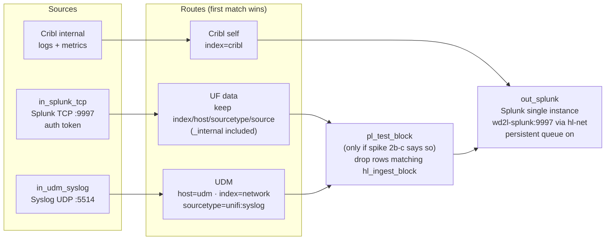

# Homelab Splunk collection + "missing data" health monitoring: spec and plan

Status: **approved** by Taylor 2026-10-30. Repo: `C:\Users\taylo\Documents\claude-code\homelab-splunk-missing-source` (empty today; it becomes a git repo). A reviewer read the draft as the builder would, and its fixes are folded in.

Amended 2026-10-31 for Cribl Stream; see [2026-10-31-cribl-stream.md](2026-10-31-cribl-stream.md) for the decisions and why.

## 1. Context

Taylor wants a realistic, production-shaped lab that answers one SOC question fast: **"Am I blind somewhere?"** That covers a host that stopped sending, a sourcetype or source that went quiet, or a forwarder someone stopped and never restarted. The answer has to be authoritative (compared against a declared list), quick (minutes), aware of normal cadence (a quiet network device isn't an outage), and usable at a few hundred hosts. Production struggles with this today, so the monitoring design matters most.

The collection side gets built as well: Universal Forwarders (UFs) + TAs on the two AlmaLinux 10 VMs and the Windows PC, a UF on the Pi, STIG-style auditing, and syslog from the UniFi Dream Machine (UDM). Everything collected goes through **Cribl Stream**, which forwards it to Splunk. It's all deployed by **one Ansible role run from the Pi**, with clean install and uninstall and service control by tags, and no deployment server.

## 2. The recommendation (the "better way")

Typical failures: a hand-kept list that drifts; one global "no data for N hours" threshold; no way to tell "forwarder down" from "one input broken"; mutes that never expire; dashboards that scan raw data. The fixes:

1. **Expectations come from the deployment code.** The role knows every input it enabled (index, sourcetype, source, interval). It renders the expected list from the same inventory and pushes it to Splunk, so deploying an input creates its expectation and removing it retires it. Agentless devices are declared in the inventory too. UI-added rows are kept separate, so a redeploy never clobbers them. *(Production equivalent: generate the list from the deployment pipeline/CMDB, not memory.)*
2. **Cadence profiles, not one threshold**: `heartbeat`, `periodic`, `continuous`, `sporadic`, `info`. Periodic thresholds come from the input's own interval. Continuous and sporadic thresholds are **learned** nightly from 14 days of history, excluding the times the host or Splunk was down, then clamped per profile, explained in the UI, and overridable per entity.
3. **Liveness separate from data.** Each UF's self-telemetry (`_internal`, every 30 s) is a fast, cadence-independent heartbeat (~2 min detection). A **probe on the Pi** pings each syslog device every 60 s and writes the result to a file the Pi's UF forwards, which gives agentless devices a heartbeat. "Device up but not logging" and "device down" become different findings.
4. **State, not scans.** Trackers (`tstats`, every minute) record last-seen times in the KV store. An evaluator turns them into statuses and writes **state transitions** to a summary index (history, MTTR, daily report). Dashboards read the KV store, so they stay fast at hundreds of hosts.
5. **Every finding gets a likely cause and the next step.** The cause combines the heartbeat, Ansible's own maintenance markers, Hyper-V VM events, relay (Cribl) status and tamper indicators. For example: "Stopped by Ansible `--tags stop` 14:03 by taylorb, not restarted → `--tags start --limit wd2l-recv`", or "Security log cleared 2 min before silence → escalate". Volume drops catch partial blinding, such as auditd still sending at 10% of normal.

**Off-the-shelf:** TrackMe covers much of this, but its free Community Edition ended Aug 2026 (it goes read-only after a 90-day trial). Hurricane Labs' Broken Hosts (free) uses the same lookup + `lateSecs` + suppressions model, without learning, heartbeats or causes. Ours is plain SPL + KV store: it ports to production, or serves as the yardstick for evaluating TrackMe. See §10 for porting notes.

## 3. Environment as found (read-only recon)

| Thing | Fact | Consequence |
|---|---|---|
| VMs `wd2l-logsrv`, `wd2l-recv` | AlmaLinux 10, **FIPS**, SELinux enforcing, Hyper-V **Default Switch NAT**, `<vm>.mshome.net`, user `taylorb`, ECDSA keys only; **Off**, started manually (Taylor's choice) | Ansible reaches them via a ProxyJump through the PC; the UF runs in FIPS mode; an off VM shows DOWN (mute long gaps) |
| wd2l on all 3 Linux hosts | rsyslog → wd2l → Splunk HEC (`enclave1`, `wd2l`, `wd2l_audit`); `/etc/audit/rules.d/wd2l.rules`; `/var/log/wd2l/audit-*.jsonl`; `authorize.conf` limits `user`/`power` to `enclave1;wd2l` | Never edit wd2l's files or the `[syslog]` props; `wd2l_audit` is out of scope; the new roles need explicit `srchIndexesAllowed` |
| Pi `pi5` | 192.168.1.120, AlmaLinux 10.2 **aarch64**, Python 3.12, no Ansible; `/etc/rsyslog.d/90-wd2l.conf` sends `*.*` to wd2l | pi5 is a **UF host** (task 4), not a syslog relay. The probe writes to a file that the UF reads, never through rsyslog or the journal, so nothing new leaks into wd2l; `90-wd2l.conf` is never touched |
| PC `HOMEPC` | 192.168.1.27, Win 11 Pro (likely a Microsoft account), no sshd, WinRM off, Docker Desktop only after sign-in | Taylor runs a one-time elevated SSH bootstrap; no `docker pull` over SSH (no credential store); the image is already local |
| Splunk | `wd2l-splunk`, `splunk/splunk` 10.6.0.5 (pinned digest), volumes `wd2l-splunk-etc/var`, ports `127.0.0.1:8000/8089`, `8088`; **download-trial licence, 500 MB/day, expires 2026-12-09 17:43 MST (2026-12-10 00:43 UTC)** (spike §14 h) | No recreate: Cribl reaches its `splunktcp` 9997 over the Docker network `hl-net`, attached live (§6). Get a licence before 12-09 |
| Docker Desktop | NAT hides the client's source IP | The UDM gets its **own Cribl port (5514/udp)**, and Cribl names the host from the port, never from the source address; forwarders are identified by hostname/guid, never by IP |
| UDM | 192.168.1.1; UniFi CEF timestamps have no time zone | It sends straight to Cribl. `_time` is **Cribl's receive time** by default, just as a relay would stamp its own. Task 8's CEF sample may switch it to the device timestamp, if that timestamp proves reliable and carries a time zone |
| TAs | `splunk-ta-local`: Splunk_TA_nix 10.3.4, Splunk_TA_windows 11.0.3 | Pinned |

## 4. Architecture

**Cribl Stream sits between every collected source and `wd2l-splunk`.** Every UF sends to Cribl, the UDM sends its syslog straight to Cribl, and Cribl forwards to Splunk. That makes Cribl a single point everything collected depends on, and a place where data can be dropped on purpose; the data-health app watches for both (§7.6). The decisions and why are in [the Cribl addendum](2026-10-31-cribl-stream.md).

wd2l's HEC traffic and the Ansible markers stay **direct to Splunk HEC 8088**. Neither is forwarder or syslog data, and keeping them off Cribl means "Cribl down" and "Splunk not receiving" can be told apart.

### 4.1 Hosts and paths


### 4.2 Inside Cribl



- **The UDM gets its own port (5514/udp)** because Docker Desktop's NAT hides the sender's IP. Cribl names the host from the port, never from the source address.
- **Cribl changes nothing in UF data:** the index, host, sourcetype and source pass through unchanged, so every rule in the data-health app keeps working.
- **Cribl's own data** goes to its own index, `cribl`. That gives Cribl a heartbeat, and its audit log of config changes.
- **Cribl's config is code:** its YAML lives in the repo under `cribl/`, and the role deploys it (§5.3 `cribl`).

### 4.3 Ports

| Port | Listener | Who sends | Published on the PC |
|---|---|---|---|
| 9997/tcp | Cribl, Splunk TCP source (token) | 4 UFs | yes, all interfaces |
| 5514/udp | Cribl, syslog source | UDM only | yes |
| 9000/tcp | Cribl UI/API | Taylor, Ansible over SSH | 127.0.0.1 only |
| 9997/tcp | Splunk `splunktcp` (token) | Cribl only | **no**; reached on `hl-net` |
| 8088/tcp | Splunk HEC | wd2l, Ansible markers | yes |
| 8000, 8089/tcp | Splunk Web, REST | Taylor, tests | 127.0.0.1 only |

### 4.4 Indexes and data collected

**Indexes** (app `hl_server_base`): `linux`, `windows`, `network`, `cribl` (Cribl's internal logs, metrics and audit log), `data_health` (written with `collect` only as sourcetype `stash`, so it isn't licence-metered; the record type goes in `source=dh:transition|dh:daily|dh:tamper|dh:admin|dh:marker`), and `wd2l_uf_audit` (readable by `wd2l_auditor` + admin only, mirroring `wd2l_audit`). `enclave1` and `wd2l` are monitored read-only; `wd2l_audit` isn't tracked.

**Data collected.** Every UF row goes UF → Cribl → Splunk; the UDM goes straight to Cribl on 5514/udp. pi5 is a full Linux UF host: the "VMs" rows are the standard Linux UF rows and apply to pi5 too (each switchable per host in `host_vars`, §5.2). The pi5 rows below are not its full list: one gives its wd2l sourcetype, and the other is its one addition, `probe.log`.

| Host | Input | index / sourcetype (source) | Profile → threshold |
|---|---|---|---|
| VMs | `/var/log/messages`, `/var/log/cron` | linux / syslog | continuous (learned) |
| VMs | `/var/log/secure` | linux / linux_secure | sporadic (learned) |
| VMs | `/var/log/audit/audit.log` | linux / linux_audit | continuous (learned) |
| VMs | TA_nix (event versions, not `*_metric`): `cpu`,`ps` 30 s; `vmstat`,`top`,`interfaces`,`netstat` 60 s; `df`,`openPorts`,`lastlog` 300 s; `package`,`Unix:Service`,`Linux:SELinuxConfig`,`Unix:SSHDConfig`,`Unix:UserAccounts` 3600 s; `Unix:Uptime`,`Unix:Version` 86400 s | linux / as the TA sets them | periodic: 2×interval+60 s |
| VMs | `/var/log/wd2l/audit-*.jsonl` | wd2l_uf_audit / `wd2l:sender:audit` (logsrv), `wd2l:audit` (recv) | sporadic |
| pi5 | `/var/log/wd2l/audit-*.jsonl` | wd2l_uf_audit / per wd2l's pi5 role, confirmed in task 6 (`hl_wd2l_audit_sourcetype` in pi5's `host_vars`) | sporadic |
| PC | WinEventLog Security, System, Application, `Microsoft-Windows-PowerShell/Operational`, `Microsoft-Windows-Windows Defender/Operational`, `Microsoft-Windows-Hyper-V-VMMS-Admin`, `Microsoft-Windows-Hyper-V-Worker-Admin` (exact names from `wevtutil el`, spike §14 g: the Hyper-V ones use a hyphen, not `/`), `renderXml=true` | windows / XmlWinEventLog (`XmlWinEventLog:<channel>`) | Security continuous; the rest sporadic |
| PC | `perfmon://CPU`, `perfmon://Memory` at 60 s | windows / Perfmon:* | periodic |
| UFs (all 4, pi5 included) | `_internal` metrics, every 30 s, through Cribl with the host intact (spike 2b-b) | (read only) | heartbeat 90 s |
| pi5 | `monitor:///var/log/hl-devprobe/probe.log` (`hl-devprobe`, one ping per device every 60 s) | network / `hl:devprobe` | periodic 180 s |
| UDM | syslog/CEF, straight to Cribl :5514 | network / `unifi:syslog` (host `udm`, set by Cribl from the port) | sporadic → learned |
| cribl | internal logs and metrics, audit log | cribl / Cribl's sourcetypes | heartbeat (exact cadence from spike 2b-f) |
| existing | wd2l-delivered syslog (HEC, not through Cribl) | enclave1 / syslog | continuous, `via=wd2l-recv` |

**The probe line format** is `time=<iso8601> device=udm ip=192.168.1.1 reachable=1 rtt_ms=0.8`, which the `dh_fwd_from_probe` macro reads (`device`, `reachable`). The probe doesn't go through rsyslog, so nothing can leak into wd2l through the journal.

No `ignoreOlderThan`: on a single quiet file it can cause false MISSING. Windows logs start from the oldest event (logs are size-capped, so the backfill is small). `sysstat` is installed on every `uf_linux` host, pi5 included, because TA_nix `cpu`/`vmstat` need `sar`/`mpstat`. If a host has no rsyslog files, it falls back to a `journald://` input.

## 5. Part A: Ansible role `homelab_splunk`

### 5.1 Transport and bootstrap
- **Windows:** OpenSSH Server, default shell PowerShell, key in `administrators_authorized_keys` (the SSH session is elevated), firewall rule 22/tcp from 192.168.1.120 only. Ansible uses `ansible_connection: ssh`, `ansible_shell_type: powershell`.
- **VMs:** `ansible_host: <vm>.mshome.net` with `-o ProxyJump=<winuser>@192.168.1.27` (the jump host resolves the name). The Pi gets a new **ECDSA P-256** key, `~/.ssh/id_ecdsa_homelab_ansible`.
- **Pi:** `ansible_connection: local`. Install `ansible-core` ≥ 2.18 (from dnf if the version is new enough, otherwise a venv in `~/.venvs/ansible`) and the collections from `requirements.yml`.
- **Scripts (Taylor runs them):** `scripts/bootstrap-windows-sshd.ps1` (elevated, idempotent, `-Remove`), `scripts/bootstrap-pi.sh`, `scripts/add-ansible-key.ps1` (copies the Pi's public key to the VMs and Windows). `scripts/sync-to-pi.ps1` copies the repo to the Pi with `tar | ssh pi5 tar x`.

### 5.2 Layout
```
ansible/ansible.cfg  requirements.yml  site.yml
ansible/inventory/hosts.yml                    # YAML; groups uf_linux (wd2l-logsrv, wd2l-recv, pi5), uf_windows, splunk_server
ansible/inventory/group_vars/<group>.yml  host_vars/<host>.yml   # input toggles, criticality, owner, profile overrides
ansible/inventory/group_vars/all/vault.yml     # ansible-vault: UF admin pw, S2S token, HEC marker token, Cribl admin pw (vault pass file on the Pi only)
ansible/roles/homelab_splunk/{defaults,meta/argument_specs.yml,tasks,handlers,templates,files,vars}
ansible/files/packages/   (gitignored)         # UF rpm x86_64 (+ aarch64 for pi5, spike 2b-i), UF msi x64, TA .spl; sha256 pinned in defaults
splunk/apps/{hl_server_base,hl_data_health}/   # server apps (the role packages them)
cribl/local/cribl/{inputs,outputs,routes}.yml  # Cribl config as code; also pipelines/…, lookups/hl_ingest_block.csv (if needed)
tests/spl/                                     # fixture lookups + expected statuses for the evaluator
scripts/  docs/
```
- **pi5 is a full `uf_linux` member.** It gets everything the VMs get: the UF, the tamper rules (§5.4), the STIG `audit_rules`, TA_nix, the file monitors and the wd2l inputs (wd2l runs on pi5 too). Each is switchable per host in `host_vars`. There is no relay group.
- **Syslog devices are vars on `splunk_server`**, each with its own Cribl port (`syslog_devices: [{name: udm, ip: 192.168.1.1, port: 5514, index: network, sourcetype: unifi:syslog, profile: sporadic, criticality: 2}]`), so Ansible never logs in to them.
- **`cribl:` vars** (on `splunk_server`) hold the image digest, the ports (§4.3) and the vault-backed admin password.
- **`hl_collector`** is where the UFs send: `192.168.1.27`, or `127.0.0.1` on HOMEPC. It is Cribl's address.
- **Secrets** (the S2S token, the Cribl admin password) are templated into Cribl's config from the vault, never committed.
- The Splunk admin password is read on HOMEPC from `~/wd2l-splunk/secrets/splunk-admin-password` and not copied anywhere.
- The role keeps a **state file** on each host (`/var/lib/hl_splunk/state.json`, or `C:\ProgramData\hl_splunk\state.json`) recording everything it added: packages (such as sysstat), the audit-policy backup, the `hl-net` attachment, the Cribl container and volume. Removal undoes exactly that list.

### 5.3 Tags. Destructive tags carry `never`, so a bare run never removes, stops or restarts anything.

| Tag | Hosts | Does |
|---|---|---|
| *(none)* / `deploy` | all | server → server_network → cribl → install → apps → audit_rules → audit_policy → probe → expected |
| `install` | UF hosts | check sha256 (§14 package table) → install the UF (rpm; msi with `LAUNCHSPLUNK=0`) → **before first start**: FIPS (`SPLUNK_FIPS=1` + `SPLUNK_FIPS_VERSION=140-3` appended to `etc/splunk-launch.conf` when `/proc/sys/crypto/fips_enabled=1`; verified on UF 10.6.1.1, §14 d), `user-seed.conf` (`PASSWORD` from the vault; consumed on first start only if `etc/passwd` is absent), mgmt `127.0.0.1:8090` (`web.conf [settings] mgmtHostPort`, meant to avoid the container's 8089 on HOMEPC). On the Linux UF 10.6.1.1 in the spike, nothing listened on TCP at all: only the Unix socket `var/run/splunk/cli.socket` ("Management port is available for UDS connections"). Why, and whether `mgmtHostPort` was read, is unconfirmed. Plan `status`/`verify` on the CLI; task 4 confirms that CLI status works over UDS with outputs configured, and task 5 checks the Windows UF's mgmt listener; `limits.conf [thruput] maxKBps=0` → boot-start (Linux: `splunk enable boot-start -systemd-managed 1 -user splunkfwd -group splunkfwd`; the RPM creates `splunkfwd`, and boot-start writes `/etc/systemd/system/SplunkForwarder.service` with `AmbientCapabilities=CAP_DAC_READ_SEARCH` and no polkit rule; run later CLI calls as `splunkfwd`; Windows: the virtual account added to Event Log Readers) → the UF-path tamper audit rules (Linux, §5.4) → start → marker |
| `apps` | UF hosts | sync the role-owned apps (§5.5); restart only on change; marker |
| `apps_remove` | UF hosts | remove the role-owned apps (or `-e hl_apps_only=[…]`) |
| `uninstall` | UF hosts | marker → stop → **remove the UF-path tamper rules first and reload auditd** (otherwise augenrules stops at the failing file and drops `wd2l.rules`) → remove apps → disable boot-start → remove the package → delete leftovers (§5.6) → **verify the contract; fail if anything is left** → the next `expected` run retires the host's rows |
| `start` / `stop` / `restart` / `status` | UF hosts | service control + marker; `status` = state, version, apps, outputs connection |
| `audit_rules` / `audit_rules_remove` | uf_linux | STIG sample rules `/usr/share/audit-rules/30-stig.rules` (package `audit-rules` 4.0.3, 33 b32 + 33 b64 rules, no `-e`/`-b`/`-f`) + `31-privileged` generated with the `find … -perm -04000` / `filecap` commands that `/usr/share/audit-rules/31-privileged.rules` ships as comments, into `/etc/audit/rules.d/50-hl-stig.rules`; `augenrules --load` (it sorts with `ls -1v` and always moves `-D` first and `-e` last, so sorting before the stock `audit.rules` is safe); `audit_immutable: false` (no `-e` is set anywhere today and `auditctl -s` shows `enabled 1`; STIG's `-e 2` would make every change need a reboot, documented). Never touches `wd2l.rules` or `wd2l-quadlet.rules` |
| `audit_policy` / `audit_policy_remove` | uf_windows | `auditpol /backup` first, then the focused subset: Logon/Logoff, Account Mgmt, Security Group Mgmt, Audit Policy Change, Authentication Policy Change, Security System Extension (4697), System Integrity, Process Creation (no command line). Remove = `auditpol /restore` from the backup |
| `probe` / `probe_remove` | pi5 | `hl-devprobe.service` + `.timer` (one ping per `syslog_devices` entry every 60 s, one line per ping appended to `/var/log/hl-devprobe/probe.log`, format in §4.4), the `/var/log/hl-devprobe/` directory, logrotate. Remove undoes each |
| `server` / `server_remove` | splunk_server | build each app as a tar → `win_copy` → `docker cp` into a temp folder → swap **only `default/`, `metadata/default.meta` and shipped lookups**, keeping `local/` and UI-written lookups → chown → restart splunkd only when indexes/inputs/props changed. Remove deletes the apps **and their KV collections (REST)**; index data stays unless `-e hl_purge_index_data=true`. `server_remove` also undoes `server_network`: it disconnects `wd2l-splunk` from `hl-net`, then deletes `hl-net` if no container is still attached, as the state file recorded them. In a full removal, `cribl_remove` runs first. `hl_server_base` includes index `cribl` and the Cribl search-time props (§5.5) |
| `server_network` | splunk_server | create the Docker network `hl-net` → `docker network connect hl-net wd2l-splunk` (live; no recreate, no new published port) → check wd2l HEC `/services/collector/health` → record the attachment and the network in the state file. Idempotent; whether it must re-attach on each run is spike 2b-h. `server_remove` undoes it |
| `cribl` / `cribl_remove` | splunk_server | render `compose.yml` (image pinned by digest, volume `hl-cribl-data`, `hl-net`, the §4.3 ports) → `docker compose up -d` over SSH → push the `cribl/` config (secrets from the vault) → reload → health check → marker. Remove = marker → `docker compose down` → delete the volume and anything the role added; the contract check (§5.6) fails the play if anything is left |
| `expected` | splunk_server, once | render `dh_expected_ansible.csv` from all hostvars + `syslog_devices` + `dh_extra_expected`, with `via=cribl` on every UF and syslog row, plus the `cribl` host row → push → run the sync search |
| `verify` | all | UF running; connected to Cribl (the UF's own status: Splunk sees only Cribl's connection); Cribl healthy; every expected sourcetype seen in the last N min (REST search through the container) |
| `download` | localhost | fetch UF packages from download.splunk.com; check sha256 |

**Markers:** every `install/apps/stop/start/restart/uninstall/apps_remove/cribl/cribl_remove` run posts an event to HEC (`index=data_health source=dh:marker`, token `hl_markers`) with host, action, the Ansible user and the time. The causes use them ("stopped by Ansible"), and the tamper search suppresses findings inside a marker window, so the role's own deploys don't look like an attack.
**"Turn off receipt" at the source:** `--tags stop --limit <host>`; or `-e '{"hl_disabled_inputs":["monitor:///var/log/secure"]}' --tags apps` to turn off one input, then re-run without it.

### 5.4 Tamper audit rules (Linux; installed and removed with the UF)
`/etc/audit/rules.d/zz-hl-uf-tamper.rules`, which sorts after `wd2l.rules`: `-a always,exit -F dir=/opt/splunkforwarder/etc -F perm=wa -F auid!=unset -k hl-uf-config`, the same for `bin`, and for `/etc/rsyslog.conf`, `/etc/rsyslog.d`, `/etc/audit` (keys `hl-syslog-config`, `hl-audit-config`). The b32 and b64 forms, like wd2l's.

### 5.5 Apps (TAs deployed **unmodified in `default/`**; our settings live in `local/`, which beats any app's `default/`; checked with `btool --debug`)
- **Linux UF:** `Splunk_TA_nix` + a role-templated `Splunk_TA_nix/local/inputs.conf` (enables the TA scripted stanzas, `index=linux`) · `hl_uf_outputs` (tcpout → Cribl at `{{ hl_collector }}:9997`, S2S `token`, `useACK` on or off per spike 2b-a (if Cribl doesn't honour it, Cribl's persistent queue is the buffer), `limits.conf` thruput) · `hl_uf_linux_inputs` (the file monitors; on pi5 also `probe.log`) · `hl_uf_wd2l_inputs` (wd2l hosts).
- **Windows UF:** `Splunk_TA_windows` + `local/inputs.conf` (perfmon interval 60, WinHostMon off) · `hl_uf_outputs` (→ Cribl at 127.0.0.1:9997) · `hl_uf_windows_inputs` (event log channels).
- **Server:** `hl_server_base` (indexes, `cribl` included; `splunktcp:9997` + `splunktcptoken`, with Cribl the only sender, over `hl-net`; props for `[hl:devprobe]` and Cribl's search-time props, **never `[syslog]`**; the test-block transform §7.7, only if spike 2b-c keeps the block in Splunk; roles `dh_analyst`/`dh_admin` with explicit `srchIndexesAllowed`) · `Splunk_TA_nix` + `Splunk_TA_windows` (search time) · `hl_data_health`. Splunk has no syslog inputs: Cribl receives the UDM and sets its host, index and sourcetype.
- **Cribl:** the `cribl/` tree (§5.2): the Splunk TCP source (token) and the UDM syslog source, the routes (§4.2), `out_splunk` with the persistent queue on, and `pl_test_block` plus its lookup only if spike 2b-c moves the block into Cribl.
- Every role-owned app's `app.conf` has `[hl] managed = true`; `apps_remove` deletes only those apps, plus the role-owned `local/inputs.conf` inside the TAs.

### 5.6 The clean-uninstall contract (checked by the role; it fails the play if anything is left)
**Linux** (the removal order was proven on wd2l-recv in the spike, §14 d):
- `rpm -q splunkforwarder` is absent.
- `/opt/splunkforwarder` is gone (`rpm -e` leaves `etc/` and `splunkfwd`'s `~/.splunk` there, about 9 MB, so the role must `rm -rf` it).
- No `SplunkForwarder*.service` exists in any systemd path (`splunk disable boot-start` removes the unit and its `multi-user.target.wants` link; it also tries the absent `/sbin/chkconfig`, which is harmless), then `systemctl daemon-reload`.
- No `/etc/polkit-1/rules.d/*plunk*` file exists (10.6 creates none; the check stays as a guard).
- `getent passwd/group splunkfwd` is empty (`userdel splunkfwd` also removes the group), and `/var/spool/mail/splunkfwd` is gone (none is created today).
- No `~/.splunk` in `/root` or the Ansible user's home.
- `find / -xdev \( -nouser -o -nogroup \)` finds nothing new **compared with a list saved before install** (wd2l-recv already has 1,435 such paths in rootless podman storage).
- The tamper rules are gone, and `auditctl -l` matches the set from before the install.
- Packages the role added (sysstat) are removed, as the state file recorded them.

**Windows:**
- The MSI product code and its uninstall key are absent.
- `C:\Program Files\SplunkUniversalForwarder` is gone.
- `HKLM:\SYSTEM\CurrentControlSet\Services\SplunkForwarder` is absent.
- The virtual account is out of Event Log Readers and Performance Monitor Users.
- No user right references the service SID: `secedit /export` is checked, and `win_user_right` removes any orphan.
- The staging folder and the state file are gone.

**Cribl (HOMEPC, `cribl_remove`):**
- No `cribl` container, from `docker ps -a`.
- No `hl-cribl-data` volume, from `docker volume ls`.
- The rendered `compose.yml`, the pushed config and anything else the role added for Cribl are gone, as the state file recorded them.

**Splunk server (HOMEPC, `server_remove`):**
- `hl-net` (in a full removal, `cribl_remove` runs first): `wd2l-splunk` is no longer attached to `hl-net`, and `hl-net` is gone unless another container is still attached. The state file recorded both the attachment and the network.
- `wd2l-splunk` keeps its volumes, ports and HEC health, and wd2l keeps ingesting.

## 6. Part B: Splunk server and Cribl
1. **No recreate.** `server_network` creates `hl-net` and attaches `wd2l-splunk` to it live (`docker network connect`), which is reversible and recorded in the state file. Cribl reaches Splunk's `splunktcp` 9997 there, so `wd2l-splunk` publishes no new port. wd2l HEC and wd2l's dashboard are checked after.
2. **Cribl** runs as the `cribl` container in Docker Desktop, from a compose file the role renders (image pinned by digest, volume `hl-cribl-data`). Its free-licence limits and the image digest come from spike 2b-g.
3. **Licence:** the download-trial (500 MB/day) ends 2026-12-09 17:43 MST (2026-12-10 00:43 UTC); after that the instance falls back to the Free group, whose features lack `Alerting`, `ScheduledAlerts` and `Auth` (REST `licenser/licenses`, §14 h), so alerts and roles stop. Get a Splunk Developer licence (free; check the current programme) before then. The daily report shows usage against the daily cap, and the evaluator raises a banner if its own tracker stops running.
4. Roles: `dh_analyst` (read, mute) and `dh_admin` (expectations, test blocks). Analysts get no `run_collect` (§7.3).

## 7. Part C: the data-health model (`hl_data_health`: SPL + KV store only)

### 7.1 Entities
Levels: **host**, **sourcetype** (index+host+sourcetype) and **source** (index+host+sourcetype+source_norm). `entity_id = level|index|host|sourcetype|source_norm`. Macros normalize the values:
- `dh_host_norm` lowercases the host and strips its domain.
- `dh_source_norm` replaces the timestamp or rotation part of a source name with `*`.

### 7.2 Storage
| Name | Kind | Writer | Holds |
|---|---|---|---|
| `dh_expected_ansible.csv` | CSV | Ansible | generated rows |
| `dh_expected` | KV | sync (*/5) + UI | **the authoritative list**: entity_id, level, index, host, sourcetype, source, collection (uf/syslog/hec), via, hypervisor, profile, interval_secs, max_gap_secs, criticality 1–4, owner, site, runbook, description, managed_by (ansible/ui), enabled |
| `dh_overrides` | KV | UI | mute_until (required, ≤30 d), reason, ticket, threshold_override_secs, by, at |
| `dh_state_fast` / `dh_state_slow` | KV | one tracker each (**one writer per collection**; KV `key_field` upserts replace whole records) | first_seen, last_indextime, last_eventtime, last_count, lag |
| `dh_fwd` | KV | fast tracker | per forwarder (hostname/guid): last heartbeat, last connect, version, OS, all from the UF's own `_internal` (§7.3) |
| `dh_baseline` | KV | nightly | learned gap, days of history, suggested profile, hourly volume median |
| `dh_status` | KV | evaluator | status, since, cause, action, threshold and its origin |
| `dh_meta` | KV | trackers | last run times (staleness and resume detection) |
| `dh_admin_log` | KV | UI (append) | every mute/override/block/edit; a scheduled search copies it to `data_health` |
| `hl_ingest_block.csv` | CSV (app lookup definition `hl_ingest_block` in `hl_server_base`) | UI (dh_admin) | test blocks; **the key column `k` must be the first column** (§7.7, §14 b). If spike 2b-c moves the block into Cribl, the table is `cribl/local/cribl/lookups/hl_ingest_block.csv`, written by the Ansible `cribl` tag (§7.7) |

### 7.3 Scheduled searches (1-minute ones: `max_concurrent=1`, `schedule_priority=highest`; monitor the skipped-search count)
- **DH Tracker fast** (1 min): `| tstats max(_indextime) max(_time) count where index IN (<dh_indexes>) _index_earliest=-5m earliest=-7d latest=+1d by index host sourcetype source` (spike §14 a: `tstats` honours `_index_earliest`/`_index_latest` exactly like a raw search, at about 0.03 s here. After wd2l's spool flushed events with `_time` up to 13 h old, this variant saw 99 index/host/sourcetype/source rows arrive in 5 min, while a `_time` window of -15m saw only 52, so a `_time` window hides backfilled arrivals) → merge with the current rows (`inputlookup … | stats max()`) → `dh_state_fast`. Also → `dh_fwd`:
  - The UF heartbeat (`tstats` on `_internal` metrics by host). This holds **if** `_internal` passes through Cribl with the UF's host intact (spike 2b-b).
  - The forwarder identity, from the UF's own `_internal`: `tcpout_connections` for the last connect; the version and OS per spike 2b-e. Splunk's `tcpin_connections` now shows only Cribl's connection, so `dh_fwd_from_tcpin` is replaced (task 11b). Forwarders are keyed by hostname/guid; the IPs are all NAT'd.
- **DH Tracker slow** (hourly, -7d..+1d) → `dh_state_slow`, catching skewed or backfilled time; it flags `clock_skew` when `_indextime − _time` is large.
- **DH Evaluate** (1 min): `dh_expected` ⨝ max(fast, slow) ⨝ baseline/overrides/fwd/markers → status/cause → `dh_status`, and changed rows → `collect index=data_health source=dh:transition`. It's **gated**: if the fast tracker didn't run in the last 2 min, or Splunk has received nothing in 2 min, or it's within 5 min of a resume (a gap in `dh_meta` run times, which covers PC sleep, where the container doesn't restart), everything is PENDING and no alerts fire. The logic is a macro over lookup names, so it can be tested on fixtures.
- **DH Sync expected** (*/5), **DH Discover unregistered** (*/15), **DH Baseline daily** (02:05: per-entity active minutes, max gap, p95 gap, count, counting only minutes when the host heartbeat and Splunk were up → `dh:daily`), **DH Baseline compute** (02:30, 14 d → `dh_baseline`; it skips days < 50% covered; if the PC was off at 02:05 it catches up on the next run), **DH Volume hourly**, **DH Tamper** (*/5), **DH Admin log copy** (*/5), **DH Prune** (*/1 for expired blocks and mutes; daily for stale state), **DH Daily SoH report** (07:00).
- Alerts (throttled per entity, 1 h): **DH Alert missing** (to MISSING, criticality ≤ 2) and **DH Alert tamper**. Action: Triggered Alerts + log event; email optional if SMTP is set up.

### 7.4 Profiles and thresholds (the answer to "what's normal?")
| Profile | For | Threshold (max silence) |
|---|---|---|
| heartbeat | UF self-telemetry (30 s); Cribl's internal data | UF: 90 s → detection ≈ 1.5–3 min. Cribl: from its cadence (spike 2b-f) |
| periodic | scripted inputs, the device probe | 2 × interval + 60 s (rendered by Ansible) |
| continuous | busy 24×7 logs | learned; floor 5 min, cap 60 min; **15 min while learning** |
| sporadic | event-driven | learned; floor 2 h, cap 7 d; **24 h while learning**. Host liveness comes from the heartbeat or probe |
| info | tracked, never alerts | — |

Learned = `clamp(1.5 × p90(daily max gap, 14 d) + 120 s, floor, cap)`, once there are ≥ 3 covered days. **While learning, an entity alerts normally** on the profile default and is labeled "learning". Precedence: override > `max_gap_secs` > learned > default. The UI always shows which one applied and why.

### 7.5 Statuses
`OK` · `LATE` (> threshold) · `MISSING` (> 2× threshold) · `NEVER_SEEN` (expected > 1 h, never arrived) · `MUTED` · `PENDING` (gated, see §7.3) · `INFO`.
Hosts roll up to:
- **DOWN:** heartbeat missing, or every agentless stream missing.
- **DEGRADED:** some children are LATE or MISSING.
- **OK.**

Mutes cascade down from a host to its children. A global banner shows when Splunk isn't receiving or the trackers are stale.

**Relay.** Cribl is the relay for everything collected: there is a host row `cribl`, and every UF and syslog row carries `via=cribl`. When `cribl` is DOWN, every row with `via=cribl` gets the cause "Cribl DOWN" (§7.6), through the existing `relay_down` logic in `dh_eval_rollup` and `dh_eval_cause`, unchanged.

### 7.6 Likely cause → action
| Evidence | Cause | Action |
|---|---|---|
| Ansible `stop` marker, no `start` since | stopped via Ansible, not restarted | `--tags start --limit <host>` |
| Hyper-V event: the VM stopped (`Microsoft-Windows-Hyper-V-Worker-Admin`, matched on `UserData/VmlEventLog/VmName` in the inventory; Docker/WSL utility VMs log under GUID names): **18502** turned off, **18504** shut down by the host through the Shutdown IC (preceded by 18506 "initiated"), **18508** shut down by the guest OS, **18510** saved; **18500** started clears it; 18514 = reset by the guest (§14 g). Caveats: 18508 was seen only for GUID-named utility VMs, never a wd2l VM, and 18502 only once (wd2l-recv). Whether `VmName` can be extracted from `XmlWinEventLog` in Splunk is untested. Task 11 verifies all three | VM off | start the VM, or mute |
| heartbeat missing, nothing else | host down, 9997 path to Cribl broken, UF crash, or an admin stop outside Ansible | ping/ssh, `--tags status`. **Annotated after recovery** from the shutdown lines, auditd `SERVICE_STOP` (auid) or Windows 7036 that arrive once the UF is back |
| heartbeat OK, all data missing | apps/inputs removed, output problem, or a test block | `--tags apps`; check the blocks |
| heartbeat OK, one sourcetype/source missing | input broken (file/permissions/rotation), auditd/rsyslog stopped, rules removed | the latest splunkd errors for that path, shown inline |
| **Cribl DOWN** (the `cribl` row) | every collected stream is unknown: "Cribl DOWN: the real state is unknown" | check the `cribl` container |
| probe: reachable, no logs | device logging config changed | check the device |
| probe: unreachable | device or network down | — |
| probe stale | the probe stopped | check `hl-devprobe` on pi5 |
| tamper finding within ±15 min (outside a marker window) | **possible deliberate blinding** | escalate |
| everything at once, HEC included | Splunk not receiving | container/ports |

"Cribl DOWN" and "Splunk not receiving" stay distinct: HEC (wd2l, the markers) goes direct to Splunk, so it still arrives when only Cribl is down.

**Tamper indicators:**
- **Windows:** 1102, 104, 4719, 1100, 4697, 7045, 7036/7040 (SplunkForwarder, EventLog).
- **Linux:** auditd DAEMON_END/ABORT, CONFIG_CHANGE, SERVICE_STOP (SplunkForwarder/auditd/rsyslog), keys `hl-*` and `wd2l-*`.
- **Cribl:** a config change in Cribl's audit log, above all a new Drop function or a route that sends to devnull, outside an Ansible `cribl` marker window → "possible deliberate blinding". Whether the audit log reaches Splunk, and how fast, is spike 2b-f.
- **Anywhere:** big clock steps.

**Volume flag:** last hour < 20% of the 14-day same-hour median (where the median is ≥ 100 events).

### 7.7 Mute, maintenance and the test block
- **Mute:** a `dh_overrides` row with a **required reason and expiry (≤ 30 d)**, from the Manage dashboard; host mutes cascade. The daily report lists active and expiring mutes.
- **Test block:**
  - **Where it runs depends on spike 2b-c** (Taylor's decision 4). Collected data now reaches Splunk from Cribl, and it isn't yet known whether Splunk still applies `[default]` ingest-time rules to Cribl-delivered S2S events.
    - **If it does:** the Splunk-side rule below, unchanged.
    - **If it doesn't (the fallback):** the block moves into Cribl as the pipeline `pl_test_block` (§4.2), which drops events matching the block lookup `cribl/local/cribl/lookups/hl_ingest_block.csv`. The Ansible `cribl` tag writes that lookup, and the Manage form shows the command to run instead of writing it. Its details (key format, expiry) follow from the spike.
    - Either way, it applies only to `linux`, `windows` and `network`: never `_internal`, `cribl`, wd2l's indexes or `wd2l_uf_audit`.
  - **Rule (Splunk-side):** `props.conf [default] TRANSFORMS-zzz_hl_testblock`. It applies only to `linux`, `windows` and `network`: never `_internal`, wd2l's indexes or `wd2l_uf_audit`.
    - **Final host:** the class sorts after `syslog-host`, so it sees the host from the syslog header.
    - **Where that was proven:** only for `[syslog]`'s `TRANSFORMS = syslog-host`, through `[default]` with a regex probe and a host-level INGEST_EVAL, on events fed straight into Splunk (§14 b). Cribl-delivered events were never tested; spike 2b-c tests them on a throwaway index.
    - **If the block stays in Splunk, task 8 must check** that a UDM host block drops UDM events, i.e. the rule sees the host Cribl sets (`udm`).
  - **Expression of record** (one `INGEST_EVAL`; not yet run as a whole, see below):
    - `queue=if((index=="linux" OR index=="windows" OR index=="network") AND (<L1> OR <L2> OR <L3>), "nullQueue", queue)`
    - Each `<Ln>` is `isnotnull(json_extract(lookup("hl_ingest_block", json_object("k", <key>), json_array("reason")), "reason"))`.
    - The keys are `h."|*|*"` (L1), `h."|".sourcetype."|*"` (L2) and `h."|".sourcetype."|".source` (L3), with `h = lower(replace(host, "[.].*$", ""))`. Use `[.]`, not a backslash.
    - L3 compares the **raw `source`**, not `dh_source_norm` (§7.1). A level-3 block therefore takes an **exact source**, and a rotated or timestamped file name won't match. Normalized patterns aren't supported at ingest time; block that file's sourcetype (L2) instead.
  - **What actually ran** (10.6.0.5, §14 b):
    - **Under `[default]`:** `queue=if(index=="hl_spike" AND <L1 for host>, "nullQueue", queue)`, on syslog events. It dropped blocked header hosts, normalized FQDNs included, and kept the rest.
    - **In a `[hl_spike]` sourcetype stanza only:** the three-level `L1 OR L2 OR L3` behind `index=="hl_spike"`, plus host-level variants.
    - **Never run:** the multi-index OR, the combined three-level expression under `[default]`, and level 2/3 on syslog events.
    - **Observed facts:** `lookup()` accepts the app-scoped definition name (no `etc/system/lookups`, no `export = system`) or the bare CSV file name, and returns NULL on no match. In INGEST_EVAL, `index`, `host`, `sourcetype` and `source` read as plain values, and `queue` reads as NULL. Assigning that NULL back in the else branch left the event alone.
  - **Mandatory pre-check in task 3, before the rule is enabled** (only if spike 2b-c keeps the block in Splunk):
    - Put the expression of record under `[default]` in a throwaway app, with the index condition temporarily set to a throwaway index only, and otherwise character-for-character identical.
    - Feed it with the §14 b method: one oneshot per case, covering all three levels, a syslog and a non-syslog sourcetype, and FQDN hosts.
    - Confirm that the blocked cases drop and the rest index, and that wd2l's indexes (`enclave1`, `wd2l`, `wd2l_audit`) keep their rates and HEC stays healthy.
    - Then remove the throwaway app and index.
  - **Rows:** `hl_ingest_block.csv` has the columns `k,until,reason,set_by` (`set_by` rather than `by`, which is an SPL keyword), **with `k` first**. With any other first column (a leading `_time` included), every ingest-time lookup on the table returns NULL.
  - **Writer:** the Manage dashboard rewrites the whole file: `| inputlookup hl_ingest_block | <add, remove or expire rows> | table k until reason set_by | outputlookup hl_ingest_block`. Prune does the same. `makeresults` adds `_time`, which `outputlookup` writes first, so the final `table` is required. In the spike, full rewrites that ended with `table k reason` (or kept `_time` last) worked. The one rewrite without a `table` (`inputlookup | append [makeresults …] | outputlookup`) wrote `_time` first and broke the table. `outputlookup append=true` was never run, so it's **untested**; don't use it.
  - **Refresh:** Splunk reloads the table lazily, every `ingest_lookup_refresh_period_secs = 60` (limits.conf default), with no restart. The four edits that produced a valid key-first file (two rewrites, two direct writes) took effect after 11–16, 32–37, 37–42 and 11–16 s. Three edits that wrote a broken file (`_time` first, at 53–58 s and ≤ 1 s; key second, NULL throughout 80 s) were also picked up but matched nothing. The design assumes ≤ 60 s. Expired rows are pruned every minute, so a block can outlive `until` by up to about 2 min; the label shows that.
  - **On the dashboard:** the status stays real, so the test is real, and the row is labeled "test block until hh:mm".
  - **Safeguards:** admin only; every change is logged. The docs warn that in production a block control is itself a blinding vector.

### 7.8 Dashboard writes (Manage)
No auto-refresh. A write runs only on submit, with every token set.
- **KV collections** (`dh_expected`, `dh_overrides`, …): upserts keyed on `_key` (so a repeat is harmless) through `outputlookup append=true key_field=_key`.
- **The test-block CSV `hl_ingest_block.csv`:** a full-file rewrite ending in `| table k until reason set_by | outputlookup hl_ingest_block` (§7.7), never an append. If the block lives in Cribl, the form writes nothing: it shows the Ansible `cribl` command to run.
- Every write also appends to `dh_admin_log`.

There's no `collect` from the UI, and a confirmation step shows the change before it's applied.

## 8. Part D: dashboards (Dashboard Studio, dark, filters: site · owner · index · criticality · status · text)
**Reference docs** (task 12d; details in [the Cribl addendum §11](2026-10-31-cribl-stream.md#11-documentation-for-the-data-health-app-taylor-2026-10-31)):
- `docs/data-health/dashboards.md` says how to read each dashboard, panel by panel: what it shows, where the number comes from (no SPL), and what to do next. It also covers the statuses, the host roll-up, every cause and every banner state.
- `docs/data-health/macros.md` says what each macro in `macros.conf` is for, its arguments and what uses it.
- Labels that only make sense after reading the guide are rewritten in plain language, and each panel's description points to its section of `dashboards.md`.
- They're **living documents**: every later task that adds or changes a macro or a panel updates them in the same PR. A coverage check in `tests/spl/` fails when a macro or panel has no entry, or an entry names one that no longer exists.

1. **Overview (SOC, refresh 60 s).**
   - **KPI tiles:** hosts/sourcetypes/sources expected · OK · late · missing · muted, plus tamper findings in 24 h; the banner.
   - **Needs attention:** one row per host, sorted by severity × criticality × duration: worst status, missing children, since, cause, action, runbook link. It says "All expected data is arriving" when empty.
   - Recently recovered (24 h) and tamper findings.
   - Clicking a row opens Host detail.
2. **Host detail.**
   - Children: status, age vs threshold, profile and threshold origin.
   - A 24 h `tstats` chart by sourcetype.
   - The forwarder: version, OS, last connect, last marker. Splunk sees only Cribl's connection, so these come from the UF's own `_internal` (`tcpout_connections` for the last connect; the version and OS per spike 2b-e), not from `tcpin_connections` (task 11b).
   - The latest splunkd errors, tamper events, transitions and Hyper-V events.
3. **Manage (no refresh).** Mute/unmute, threshold override, add a row, adopt an unregistered entity, learned vs configured thresholds, test blocks (admin), and the admin log.
4. **Daily state of health (engineering).** Outages in 24 h with durations and MTTR; flapping (≥ 3 transitions); never-seen; unregistered; forwarders off the expected version or disconnected; lag p95; volume flags; licence usage; skipped searches; expiring mutes.

**Scale:** tables paginate at 25, there are no per-host tiles, and every panel reads KV or summary data, except the host-detail chart. A **synthetic 300-host fixture** (generated KV rows) is part of the tests.

## 9. Part E: documentation (in the repo)
- `README.md`: what and why, and a quick start.
- `docs/architecture.md`: flows (Cribl included), indexes, sourcetypes, ports.
- `docs/running-the-role.md`: prerequisites, bootstraps, every tag with examples, `--limit`, `-e` toggles, vault, troubleshooting.
- `docs/data-health-design.md`: §2 and §7, plus porting (§10).
- `docs/data-health/dashboards.md`: the analyst guide, and `docs/data-health/macros.md`: the macro reference (both task 12d, §8).
- `docs/runbook-missing-data.md`: §7.6 expanded.
- `docs/testing.md`: the §12 results with measured times.
- The Obsidian handoff and log, updated at each phase end.

## 10. Decisions and porting
**Taylor decided:**
- The PC's OpenSSH Server is the jump host and the Windows transport.
- **Cribl Stream** sits between every collected source and Splunk (2026-10-31; [addendum](2026-10-31-cribl-stream.md)):
  - Cribl's config is code, under `cribl/`, deployed by the `cribl` / `cribl_remove` tags.
  - Cribl reaches `wd2l-splunk` over the Docker network `hl-net`, attached live; `wd2l-splunk` isn't recreated.
  - The device probe runs on pi5 into a file that pi5's UF forwards.
  - If Splunk skips ingest-time rules on Cribl data (spike 2b-c), the test block moves into Cribl.
- "Turn off receipt" means both mute and the ingest test block.
- Collect auditd **and** the wd2l files (index `wd2l_uf_audit`).
- Windows audit policy: the focused subset.
- The VMs stay manually started.

**My calls (say if wrong):**
- The Pi runs a UF and the device probe.
- wd2l's HEC traffic and the Ansible markers stay direct to Splunk HEC, off Cribl.
- S2S is plaintext but token-authenticated (TLS-ready variables), on both hops (UF → Cribl, Cribl → Splunk).
- auditd goes in `linux`.
- `useACK` on the UFs if Cribl honours it (spike 2b-a); otherwise off, and Cribl's persistent queue is the buffer.
- The UF is the latest 10.6.x.
- The TAs are pinned to 10.3.4 / 11.0.3.
- Dashboard Studio.
- Ansible markers go over HEC.
**GitHub (Taylor, 2026-10-30):**
- Create the **private** repo `JoeHazurmoney/homelab-splunk-missing-source` with `gh`.
- **Protect `main`:** PR required, no direct pushes, no force-push, no deletion, and the required checks `lint` + `pr-issue-link`.
- **Claude may merge PRs to main** in this repo once the checks are green (squash merge, conventional PR titles).
- **Every PR closes an issue** (`Closes #N` in the body); `.github/workflows/pr-issue-link.yml` fails a PR that doesn't link an open issue.
- **Result (2026-10-30):** GitHub refused both branch protection and rulesets (private repo, no Pro). So the rules are kept by convention: `.githooks/pre-push` blocks direct pushes to `main` (`git config core.hooksPath .githooks` per clone), and Claude merges only with `gh pr merge --squash` after `gh pr checks` is green.
- These rules go into the Obsidian handoff's "Rules for Claude" and into Claude's memory for this project.

**Porting to production (in the docs):**
- **Distributed Splunk:** the test-block CSV and transform must be pushed to the indexers or heavy forwarders by the cluster manager, not written from the search head.
- **Search-head cluster:** the KV writes replicate; keep one writer per collection.
- **Splunk Cloud:** no `INGEST_EVAL lookup()`, so drop the test block (or use Ingest Actions); everything else works.
- **The expected list:** generate it from the deployment server serverclasses or the CMDB, the same way this role does.

## 11. Implementation tasks (subagents: `model: opus`, `effort: high`, per Taylor; superpowers:subagent-driven-development; TDD for SPL logic and role checks; a review after each task)
| # | Task | Needs | Done when |
|---|---|---|---|
| 0 | `git init`, an initial commit on `main` (README stub, `.gitignore`, the CI workflows `lint` + `pr-issue-link`), `gh repo create --private`, push `main`, set branch protection (§10), then open one **issue per task 1–14** (the task table becomes their checklist). Work on a branch per task (`feat/<n>-<slug>`), with one PR per task that closes its issue; Claude merges when green. Commit this spec as `docs/specs/2026-10-30-design.md` (PR closes the task-0 issue). Write the handoff rules and the memory | — | repo private, `main` protected (or the fallback reported), issues open |
| 1 | Bootstrap scripts + inventory + `ansible.cfg` + argument specs; lint clean | 0 | **Taylor runs the two bootstraps**; `ping`/`win_ping` all from the Pi |
| 2 | **Spike** (throwaway; findings go into the spec): `tstats` `_index_earliest`/`max(_indextime)`; `INGEST_EVAL lookup()` + nullQueue + refresh; docker CLI over SSH (`whoami /groups`, `docker version`); UF FIPS on a VM; when the UF shutdown lines arrive; the STIG rules path; the syslog SELinux ports; the Hyper-V channel names; a UDM CEF sample | 1 | written up |
| 2b (#23) | **Cribl spike** (throwaway; findings go into §14): the questions a–i in [the addendum §7](2026-10-31-cribl-stream.md#7-spike-2b-throwaway-findings-go-into-spec-14): UF S2S with a token into Cribl and `useACK`; `_internal` host intact; `[default]` ingest-time rules on Cribl-delivered events; the source IP and host-by-port for UDP; forwarder identity without `tcpin_connections`; Cribl's own data and its cadence; image digest, licence limits, persistent queue, restart; `hl-net` across restarts; the UF aarch64 rpm and FIPS on pi5 | 2 | written up in §14 |
| 3 | `hl_server_base` (+ index `cribl`) + `server`/`server_remove` + `server_network`; **first, the spike check deferred here (§14): Docker CLI over SSH** (`whoami /groups`, `docker version` from the Pi); **the §7.7 pre-check only if the test block stays in Splunk** (spike 2b-c; the exact expression of record under `[default]` against a throwaway index; wd2l's indexes unaffected) | 2b | `btool check` clean; wd2l HEC + dashboard OK; `hl-net` attached |
| 3b (#24) | `cribl`/`cribl_remove` + the `cribl/` config tree | 3 | Cribl healthy; a test event reaches Splunk with the right index/host/sourcetype; remove leaves nothing |
| 4 | UF Linux on wd2l-logsrv, wd2l-recv **and pi5** → Cribl: install/uninstall/service/status/markers/tamper rules + the contract; **plus the spike check deferred here (§14): when the UF shutdown lines and auditd `SERVICE_STOP` arrive after a stop/start**; pi5's package pin and FIPS handling from spike 2b-i (UF 10.6.1.1 → Cribl is spike 2b-a) | 3b | install → connected through Cribl; uninstall → contract passes; reinstall works |
| 5 | UF Windows → 127.0.0.1:9997 (Cribl): the same + `audit_policy`/`_remove` | 3b | the same; auditpol restored exactly |
| 6 | Forwarder apps + toggles | 4, 5 | every §4 row arrives with the right index/host/source/sourcetype |
| 7 | `audit_rules`/`_remove` (STIG) | 4 | rules loaded; `auditctl -l` restored on remove; `wd2l.rules` still loaded |
| 8 | UDM via Cribl + `probe`/`probe_remove` on pi5; **plus the spike check deferred here (§14): a UDM CEF sample** (after Taylor repoints UniFi remote syslog). `_time` stays Cribl's receive time unless the sample shows the device timestamp is reliable and carries a time zone; then switch to it (§3); **if the test block stays in Splunk, a UDM host block drops UDM events** (§7.7) | 3b, 4 | UDM events arrive as `host=udm`; probe lines arrive; **wd2l `soak-check.sh` still green** |
| 9 | `hl_data_health`: collections, macros, trackers, evaluator; **fixture tests in `tests/spl/`** | 3 | every fixture case gives the expected status and cause |
| 10 | `expected` tag + sync + discovery (rows carry `via=cribl`; the `cribl` host row) | 6, 8, 9 | each enabled input has a row; removing one retires it |
| 11 | Baselines, volume, tamper, markers, prune, alerts, daily report; **plus the Hyper-V cause checks (§7.6): `VmName` extracts from `XmlWinEventLog` in Splunk, and 18508/18502 fire for a wd2l VM** (guest `shutdown` and `Stop-VM -TurnOff`) | 9 | runs clean; learned values visible |
| 11b (#25) | Data-health Cribl adaptation: the `cribl` relay row and `via=cribl`, the "Cribl DOWN" cause, forwarder identity from the UF's own `_internal` (replacing `dh_fwd_from_tcpin`), the Cribl tamper indicator, and the `probe_stale` action naming pi5, not the relay ("check hl-devprobe on pi5") (§7.3–§7.6, §8) + fixture cases | 2b, 10 | fixtures pass; Host detail shows UF version/last connect again; the Cribl tamper finding fires |
| 12 | Dashboards 1–4 + the 300-host fixture | 9–11 | load < 3 s at 300 hosts; drilldowns work |
| 12d (#26) | The data-health reference docs (§8): `docs/data-health/macros.md`, `docs/data-health/dashboards.md`, plain-language on-screen wording, and the coverage check | 12 | every macro and every panel is documented; the coverage check runs in `tests/spl/run.sh`; Taylor can read the Overview with the guide alone |
| 13 | Docs | all | someone can run the role from the docs alone |
| 14 | E2E matrix (§12, the Cribl rows included), handoff/log, PR | all | the matrix passes |

This spec's Cribl amendment is issue #22. After task 3b, run 4 and 5 in parallel; 11b follows 2b and 10, and 12d follows 12. **Stop and ask Taylor before:** anything needing elevation on the PC (including a Windows Firewall inbound rule for 5514/udp from 192.168.1.1, only if Docker Desktop's existing rule doesn't cover it), configuring the UDM (Taylor repoints UniFi remote syslog to `192.168.1.27:5514/udp` in the UniFi UI, during task 8), putting the Cribl admin password into the vault on pi5, any force push, tags or releases. Repo creation, the first push of `main`, PRs and merges to `main` are approved (§10).

## 12. Verification (E2E; measured times go into `docs/testing.md`)
| Inject | Expected on the Overview | Within |
|---|---|---|
| `--tags stop --limit wd2l-recv` | DOWN, "stopped via Ansible, not restarted" | ≤ 3 min |
| `systemctl stop SplunkForwarder` over ssh (no marker) | DOWN, "heartbeat missing"; after `start`, annotated "stopped by auid=taylorb" | ≤ 3 min |
| `Stop-VM wd2l-logsrv -TurnOff` | DOWN, "VM off (Hyper-V)" | ≤ 3 min |
| disable the `/var/log/secure` input | DEGRADED, linux_secure LATE→MISSING, cause "heartbeat OK, input" | threshold |
| disable TA_nix `cpu` | `cpu` MISSING | ≤ 3 min |
| `sudo service auditd stop` (`systemctl stop auditd` would be refused: the EL10 unit has `RefuseManualStop=yes`, §14 e). **Untested:** task 7/14 must confirm that it works on EL10 and emits `SERVICE_STOP` | linux_audit MISSING + tamper "auditd stopped" | threshold / ≤ 5 min |
| `--tags stop --limit pi5` | pi5 DOWN, "stopped via Ansible"; the UDM's syslog stream stays OK (it goes straight to Cribl), while the UDM's probe goes stale within its threshold, because `probe.log` rides on pi5's UF | ≤ 3 min; probe: threshold |
| `systemctl stop hl-devprobe.timer` on pi5 | UDM's probe stale ("check hl-devprobe on pi5") | threshold |
| UDM remote syslog off | UDM MISSING, "reachable, not logging" | threshold |
| `docker stop cribl` | `cribl` DOWN; every collected row "Cribl DOWN: the real state is unknown"; **no** "Splunk not receiving" banner (HEC still flows) | ≤ 3 min |
| add a Drop route in Cribl's UI (no marker) | tamper finding "possible deliberate blinding", plus the affected sourcetype MISSING | ≤ 15 min |
| Splunk restart while Cribl buffers | no MISSING rows after recovery; the persistent queue drains (lag spike visible in SoH) | recovery + threshold |
| clear a **test** event log (`New-EventLog HLTest` → `wevtutil cl HLTest`) | tamper 104 on HOMEPC | ≤ 5 min |
| test block host / sourcetype / source | that level missing, labeled test block | threshold + ≤ 1 min |
| mute a host | MUTED with its children, expiry shown | ≤ 1 min |
| restart splunkd; sleep and wake the PC | PENDING, **no** false alerts | — |
| deploy twice | the second run reports 0 changes | — |
| `uninstall` then `install` | contract passes; rows retire and return | — |
| wd2l | `soak-check.sh` + its dashboard unchanged | — |
Plus: ansible-lint, yamllint, `--syntax-check`, `splunk btool check`, AppInspect on `hl_data_health`, and the `tests/spl` fixtures.

## 13. Risks
- Docker CLI over SSH needs Docker Desktop running in Taylor's session. Task 3 checks it first (deferred from the spike, §14); the fallback is a local PowerShell runner for the `server` tasks.
- The licence runs out 2026-12-09 17:43 MST (2026-12-10 00:43 UTC).
- STIG rules and the Windows audit policy add volume (watch the daily report).
- FIPS quirks with the UF: the spike found none on Linux (UF 10.6.1.1 starts with the OpenSSL FIPS 140-3 provider 3.1.2). Windows FIPS is still unchecked (task 5).
- The pinned UF (10.6.1.1) now talks to Cribl, not the indexer; spike 2b-a checks that it connects with a token, and whether Cribl honours `useACK`.
- **Cribl is a single point** that everything collected depends on, and a place where data can be dropped on purpose. The `cribl` relay row, the "Cribl DOWN" cause and the Cribl tamper indicator cover both (§7.5, §7.6).
- Cribl's free-licence limits and persistent-queue behaviour while Splunk is down are unknown until spike 2b-g.
- Hyper-V Admin logs are only 1 MB (about 3 weeks of Worker-Admin history), so old VM events roll off; the UF reads them as they arrive.
- UniFi time zones: the UDM's `_time` is Cribl's receive time unless task 8 shows the device timestamp is reliable and carries a time zone (§3).
- The Default Switch subnet changes on each boot (everything uses names).
- Cribl's port 9997 is open on the LAN (token required), and so is 5514/udp. The host comes from the port, so anything that sends to 5514 is named `udm`.
- 1-minute searches may be skipped if WSL2 is short of CPU (the daily report shows the skipped count).

## 14. Spike findings (2026-10-30)
Task 2 (issue #3). Everything was tested on the real hosts. The throwaway app/index `hl_spike` and the UF on wd2l-recv were removed afterwards (§14.4). 3 splunkd restarts were used (`splunk restart` inside the container; wd2l HEC was healthy after each). The full evidence log is in the task-2 report.

### 14.1 Answers
| # | Question | Verified answer | Evidence (command → key output) | Design consequence |
|---|---|---|---|---|
| a | Does `tstats max(_indextime)` work? Is `_index_earliest`/`_index_latest` honoured in `where`? | **Yes, both.** The index-time filter gives exactly the same result as a raw search and scans only the matching events. The `tstats` variants ran in 0.03–0.07 s (the raw `where _indextime` equivalent took 0.39 s). | Fixed bounds T1/T2, 5 min apart, over `-24h..+15m` on `_internal, enclave1, wd2l`: `tstats … where … _index_earliest=T1 _index_latest=T2` → 9975 / 10793 / 1795 events (scanCount 22563); raw `search … _index_earliest=T1 _index_latest=T2` → identical; raw `\| where _indextime>=T1 AND _indextime<T2` → identical (scanCount 865284). Real backfill: wd2l's spool flushed at the container start (14:47Z), and `_index_earliest=-5m` saw enclave1 events with `_time` 46,803 s old. `tstats … by index host sourcetype source` gave 99 rows with `_index_earliest=-5m earliest=-7d latest=+1d` and 52 rows with `earliest=-15m latest=+15m`. | §7.3 fast tracker uses `_index_earliest=-5m earliest=-7d latest=+1d` (edited). |
| b | `INGEST_EVAL lookup()`: app-level definition? `nullQueue`? `[default]` `TRANSFORMS-zzz_*` after `syslog-host`? Refresh time? | **App-level definition works** (app-scoped `export = none`, `export = system`, or the bare file name; `etc/system/lookups` not needed). **`queue="nullQueue"` drops.** **The `[default]` zzz class runs after `syslog-host`** (proven for `[syslog]` only). **Refresh ≤ 60 s, no restart.** Traps: **the key must be the CSV's first column**; `outputlookup` after `makeresults` writes `_time` first. **The full expression of record has not run under `[default]`.** | See §14.1.1 (what ran where, results, refresh table). | §7.7 rewritten: expression of record, what ran where, a mandatory task-3 pre-check, the UDM caveat (task 8), the `k`-first CSV, full-rewrite writer `\| table k until reason set_by \| outputlookup`, refresh, raw-source level 3. §7.2, §7.8 and §11 rows 3/8 edited. |
| c | Does the built-in `syslog-host` set `host` from `<PRI>Mmm dd hh:mm:ss pi5 tag: msg`? | **Yes**, with the PRI prefix and without touching `[syslog]` props. | oneshot `-host hlspike-oneshot -sourcetype syslog` of `<13>Oct 30 14:56:37 pi5 spiketag: …` → indexed with `host=pi5`; `hlspike-ord-keep` likewise. | §5.3 relay plan confirmed (noted inline). |
| d | UF FIPS on a FIPS VM; what does boot-start create? | **Works.** UF **10.6.1.1** (build b2ae2962645c) with `SPLUNK_FIPS=1` + `SPLUNK_FIPS_VERSION=140-3` in `splunk-launch.conf` before first start → FIPS 140-3 provider active. The RPM (not boot-start) creates `splunkfwd` (uid/gid 1001, home `/opt/splunkforwarder`, shell bash). `enable boot-start -systemd-managed 1 -user splunkfwd -group splunkfwd` creates **only** `/etc/systemd/system/SplunkForwarder.service` + its `multi-user.target.wants` link (`User/Group=splunkfwd`, `AmbientCapabilities=CAP_DAC_READ_SEARCH`, `NoNewPrivileges=yes`, `ExecStartPre` chown); **no polkit rule**. splunkd runs as `unconfined_service_t`, with no AVC from splunkd (one benign `useradd_t` denial creating the home dir). **Observed: no TCP listener at all**, only the Unix socket `var/run/splunk/cli.socket`, and the CLI (`show fips-mode`, `_internal call`) works through it. The cause, and whether `mgmtHostPort = 127.0.0.1:8090` was read, is unconfirmed; CLI status over UDS with outputs configured was not exercised (task 4). | Host: `fips_enabled=1`, crypto policy `FIPS`, SELinux Enforcing. `splunk show fips-mode` → `FIPS mode enabled.`; `server/info` → `fips_mode=1`; splunkd.log: `FIPS provider enabled. provider: 140-3, name: OpenSSL FIPS Provider, version: 3.1.2 … status: Success`, `Server supporting only TLS (FIPS enabled)`; `splunk cmd openssl list -providers` → base + fips 3.1.2 active; `CapEff 0x4`; `loader - Management port is available for UDS connections`; `ss -ltnp` shows only sshd. Gotchas: the VM has no `openssl` CLI, and an empty `user-seed.conf` PASSWORD → `Seed user file is missing password` and no admin. Running the CLI as root prints "revert the SPLUNK_HOME ownership". | §5.3 `install` row edited (exact FIPS lines, seed, the observed UDS-only mgmt, boot-start facts); §4 diagram: Windows mgmt port to verify in task 5. §5.6 edited (removal facts). Also verify Windows FIPS in task 5. |
| e | EL10 STIG sample rules path; `rules.d`; `-e 2`; `auditctl -s` | `/usr/share/audit-rules/30-stig.rules` and `31-privileged.rules` (package `audit-rules-4.0.3-5.el10`; the latter is comments holding the generator commands). `rules.d`: `audit.rules` (stock, `-D -b 8192 --backlog_wait_time 60000 -f 1`), `wd2l.rules`, `wd2l-quadlet.rules`. **No `-e` anywhere** (`99-finalize.rules` has `#-e 2` commented). `auditctl -s`: `enabled 1`, `failure 1`, `backlog_limit 8192`, `lost 0`. `augenrules` (`ls -1v` order) hoists `-D/-b/-f` to the top and `-e` to the end. `auditd.service` has `RefuseManualStop=yes`; rules load through `audit-rules.service` (`augenrules --load`). | `rpm -ql audit audit-rules \| grep -i -E 'stig\|sample\|privileged'` → the two paths; `grep -E '^\s*-e'` over `rules.d` and `audit.rules` → none, on both VMs; `auditctl -l` = 42 rules (logsrv) / 54 (recv); `augenrules --check` → `No change`. | §5.3 `audit_rules` row edited (exact path, safe ordering, wd2l-quadlet). §12 uses `service auditd stop` (edited; untested, confirm in task 7/14). |
| f | pi5 SELinux syslog ports; can `syslogd_t` `name_connect` to tcp/10514 and tcp/20514? | **Yes, both, without any change.** tcp/10514 = `syslog_tls_port_t`, tcp/20514 = `syslogd_port_t`, udp/514 = `syslogd_port_t`. **udp/5141 is unlabelled** (`unreserved_port_t`; `nis_enabled` off), so rsyslog can't bind it until a label is added. | `semanage port -l \| grep -i syslog` → `syslog_tls_port_t tcp 6514, 10514`, `syslogd_port_t tcp 10070, 601, 20514`, `syslogd_port_t udp 514, 601, 20514` (10070/tcp is a local customization, not ours); `sesearch -A -s syslogd_t -c tcp_socket -p name_connect` (setools-console already installed) → `allow syslogd_t syslog_tls_port_t:tcp_socket { name_bind name_connect }`, `allow syslogd_t syslogd_port_t:tcp_socket { name_bind name_connect }`; `-c udp_socket -p name_bind` → only `syslog_tls_port_t`/`syslogd_port_t` (others need `nis_enabled`). rsyslogd runs as `syslogd_t`; there are no UDP listeners or firewalld 514 rules today. | §5.3 `syslog_relay` row edited: the role labels udp/5141 `syslogd_port_t` (state file). |
| g | Exact channel names, Event Log Readers access, Hyper-V lifecycle IDs | Names: `Microsoft-Windows-Hyper-V-VMMS-Admin`, `Microsoft-Windows-Hyper-V-Worker-Admin`, `Microsoft-Windows-PowerShell/Operational`, `Microsoft-Windows-Windows Defender/Operational`. **Event Log Readers (S-1-5-32-573) has read (`0x1`) on all of them** and on Security/System/Application. Worker-Admin IDs for `wd2l-*`: **18500** started, **18502** turned off, **18504** shut down (Shutdown IC, host-initiated; **18506** = initiated), **18510** saved, **18514** reset by guest, **12050** failed to restore; **18508** = shut down by the guest OS (seen only for GUID-named utility VMs, never a wd2l VM; 18502 seen once). The VM name is in `UserData/VmlEventLog/VmName`. | `wevtutil el`; `wevtutil gl <ch>` → `channelAccess: …(A;;0x1;;;S-1-5-32-573)…`; the Hyper-V Admin logs are 1 MB (Worker-Admin holds events since 10-09). Counts by `Get-WinEvent`: 18500 ×17, 18502 ×1, 18504 ×8, 18506 ×8, 18510 ×2, 18514 ×4 for wd2l VMs. | §4 PC row and §7.6 Hyper-V row edited (with caveats; task 11 verifies 18508/18502 for a wd2l VM and `VmName` extraction in Splunk); §13 risk added (small logs). |
| h | Licence type, quota, expiry | `download-trial` ("Splunk Enterprise … Download Trial"), group `Trial` active, **quota 524288000 B (500 MB/day)**, **expires 2026-12-10T00:43:09Z = 2026-12-09 17:43 MST**, 10 MB used today. The fallback Free licence lacks `Alerting`/`ScheduledAlerts`/`Auth`. | REST `GET /services/licenser/licenses` and `/licenser/groups` | §3 and §6.2 edited with the exact date. |

#### 14.1.1 Item b in detail
**What ran where** (oneshot via REST `/services/data/inputs/oneshot` into index `hl_spike`, one file per case):

| Where | Expression shape | Cases → result |
|---|---|---|
| `[hl_spike]` stanza, variant A | file name `lookup("hl_spike_a.csv", {host: h})`, host level, no index gate | `tb-a`, `TB-A.mshome.net` → dropped |
| `[hl_spike]` stanza, variant B | definition `hl_spike_b` (`export = none`), `index=="hl_spike" AND (L1 OR L2 OR L3)` on key `k` | `tb-host` (L1), `tb-st` (L2), `tb-src` + `src1.log` (L3) → dropped; `tb-src` + `src2.log` → kept |
| `[hl_spike]` stanza, variant C | definition `hl_spike_c` (`export = system`), host level | `tb-c` → dropped |
| `[default]`, regex probe | `SOURCE_KEY = MetaData:Host`, `REGEX = ^host::hlspike-ord-drop$` → `nullQueue` | syslog header host `hlspike-ord-drop` (oneshot host `hlspike-oneshot`) → dropped |
| `[default]`, INGEST_EVAL (2nd restart) | `queue=if(index=="hl_spike" AND <L1 on hl_spike_b>, "nullQueue", queue)` | syslog header `hlspike-ie-drop` and `HLSPIKE-IE-DROP.mshome.net` → dropped; `hlspike-ie-keep` → kept; `ie_keep2` (oneshot host blocked, header host not) → **kept**, so the rule saw the final host |
| Never run | `(index=="linux" OR index=="windows" OR index=="network")`, the combined three-level expression under `[default]`, L2/L3 on syslog events, `[unifi:syslog]`/`[source::tcp:*]` paths | → task 3 pre-check and task 8 (§7.7) |

**Debug fields** (a `[hl_spike]` transform appended them to `_raw`): `meta=tb-none|hl_spike|/tmp/hl_spike/none.log|hl_spike|NULL` (host, sourcetype, source, index, then `queue`, which reads NULL), `nomatch=NULL`, `queue_after=NULL`, and the event was indexed.

**Side effects:** wd2l's rates were unchanged across the `[default]` tests (enclave1 ≈ 10/min, wd2l ≈ 4/min), and HEC stayed healthy.

**Refresh** (probe events every 5 s; `ingest_lookup_refresh_period_secs = 60`):

| Edit | How | File | Took effect | Valid table? |
|---|---|---|---|---|
| e1 | `outputlookup` after `inputlookup \| append [makeresults …]` | `"_time",k,reason` | 53–58 s | **no**: every key NULL |
| e2 | `outputlookup` rewrite (`fields k reason`; `_time` kept, now last) | `k,reason,"_time"` | 11–16 s | yes |
| e3 | `outputlookup` rewrite with `table k reason` (row removed) | `k,reason` | 32–37 s | yes |
| e4 | direct write | `"_time",k,reason` | ≤ 1 s | **no**: `tb-r` not blocked although present |
| e5 | direct write | `k,reason` | 37–42 s | yes |
| e6 | direct write, key second | `reason,k` / `reason,host` | (NULL through 80 s) | **no** |
| e7 | direct write, key first again | `k,reason` / `host,reason` | 11–16 s | yes |

### 14.2 Deferred (controller ruling)
- **Docker CLI over SSH** (`whoami /groups`, `docker version`) → **task 3**, the first task that needs it. The Windows OpenSSH Server isn't installed yet (Taylor's elevated bootstrap).
- **When the UF shutdown lines (and auditd `SERVICE_STOP`) arrive after a stop/start** → **task 4**, which needs 9997, which task 3 opens.
- **A UDM CEF sample** → **task 8**; it needs Taylor's UniFi remote-syslog setting.
- Not in scope and still open:
  - UF FIPS and the mgmt listener on Windows (task 5).
  - UF 10.6.1.1 → indexer 10.6.0.5 compatibility, and CLI status over UDS with outputs configured (task 4).
- Open from the review of these findings:
  - The **task-3 pre-check** of the test-block expression of record under `[default]` (§7.7).
  - The **task-8 check** that the test block sees the UDM's final host.
  - `service auditd stop` works on EL10 and emits `SERVICE_STOP` (task 7/14).
  - 18508/18502 for a wd2l VM, and `VmName` extraction from `XmlWinEventLog` (task 11).

The task rows in §11 (3, 4, 8, 11) and §12 now name these checks.

### 14.3 UF packages (tasks 4 and 5 pin these)
Downloaded from download.splunk.com into `ansible/files/packages/` (gitignored). Splunk's published `.sha256`, `.sha512` and `.md5` files all match the downloads.

| Package | URL | Size (bytes) | sha256 |
|---|---|---|---|
| Linux x86_64 RPM, UF 10.6.1.1 | `https://download.splunk.com/products/universalforwarder/releases/10.6.1.1/linux/splunkforwarder-10.6.1.1-b2ae2962645c.x86_64.rpm` | 164887040 | `3ffe3856b1bcaa856c28124f49bd9c47cb81b228506119aa14ced8ec1c52550d` |
| Windows x64 MSI, UF 10.6.1.1 | `https://download.splunk.com/products/universalforwarder/releases/10.6.1.1/windows/splunkforwarder-10.6.1.1-b2ae2962645c-windows-x64.msi` | 386322432 | `3a42233e387dc28d9e9ecc4c9dc41f184a006862762aa9213f7cd3cc97145a03` |

Checksum URLs: append `.sha256` (not linked from the download page, but present), `.sha512` or `.md5` to the package URL.

### 14.4 Cleanup proof
- **Splunk:**
  - App `hl_spike`, `etc/users/admin/hl_spike`, `var/lib/splunk/hl_spike{,.dat}`, the two empty `confsnapshot/*/apps/hl_spike` dirs and `/tmp/hl_spike` were removed, then the final restart.
  - `GET /services/data/indexes/hl_spike` and `/services/apps/local/hl_spike` → `Could not find object`. No lookup definitions match.
  - `find /opt/splunk /tmp -iname '*hl_spike*'` → nothing.
  - btool `[default] TRANSFORMS =` and `[syslog] TRANSFORMS = syslog-host`, as before.
  - wd2l HEC `{"text":"HEC is healthy","code":17}`, and wd2l is still ingesting.
- **wd2l-recv:**
  - Stopped, `disable boot-start`, `rpm -e`, `rm -rf /opt/splunkforwarder`, `userdel splunkfwd`, `daemon-reload`.
  - `rpm -q` → not installed; `getent` → empty; `/etc/passwd`, `/etc/group` and `/etc/systemd/system` match the pre-install snapshot.
  - `systemctl list-unit-files | grep -i splunk` → none; polkit dir unchanged; nouser/nogroup list identical to the baseline (1,435).
  - `auditctl -l` still 54 rules; no `~/.splunk`; staging dir deleted.
- **wd2l-logsrv, pi5, HOMEPC:** read-only; the temporary check scripts in `/tmp` were deleted.

### 14.5 Spec edits made from these findings
- §3 Splunk row: exact licence and expiry (MST and UTC).
- §4 PC row: exact channel names. §4 diagram: Windows mgmt 8090 "to verify in task 5".
- §5.3 `install`: FIPS lines, seed, the observed UDS-only mgmt (cause unconfirmed), boot-start facts.
- §5.3 `audit_rules`: STIG path, ordering, `wd2l-quadlet.rules`.
- §5.3 `syslog_relay`: SELinux ports; udp/5141 needs a label.
- §5.3 `syslog_relay`: `syslog-host` confirmed.
- §5.6: Linux removal facts and the nouser baseline.
- §6.2: licence date and Free-group features.
- §7.2: `hl_ingest_block.csv` key first.
- §7.3: fast-tracker variant.
- §7.6: Hyper-V IDs, with caveats (task 11).
- §7.7: the test block.
  - The expression of record `(index=="linux" OR …) AND (L1 OR L2 OR L3)`, and what actually ran where.
  - The mandatory task-3 pre-check, and the UDM final-host caveat (task 8).
  - The `k`-first CSV and the full-rewrite writer (append untested).
  - Refresh (four valid edits, 11–42 s; ≤ 60 s assumed).
  - Level 3 takes an exact raw source.
- §7.8: KV upserts vs the test-block CSV full rewrite.
- §11 rows 3/4/8/11: deferred and review checks.
- §12: `service auditd stop` (untested; task 7/14).
- §13: Docker check moved to task 3; licence date; FIPS/compatibility/Hyper-V log-size risks.

### 14.6 Cribl replan (2026-10-31)
Cribl Stream now sits in the data path ([addendum](2026-10-31-cribl-stream.md)), and pi5 is a UF host, not an rsyslog relay. So some of the findings above no longer apply to the build. They stay here as the record:
- **The relay ports** (item f): tcp/10514 and tcp/20514 on Splunk, udp/514 on pi5, and the SELinux label for udp/5141. No relay, no `tcp:*` inputs on Splunk, no label, no firewalld 514 rules.
- **`syslog-host` for pi5's relayed logs** (item c): pi5's own logs now come from UF file monitors.
- **`[source::tcp:10514]`** and the `[unifi:syslog]` host transform (§14.1.1 "Never run"): neither exists. Cribl sets the UDM's host from its port.
- **The deferred UDM-through-relay test-block check** (§14.2, "the task-8 check that the test block sees the UDM's final host"): replaced by spike 2b-c and, if the block stays in Splunk, the task-8 check in §7.7.
- **The 9997 path in §14.2** ("which task 3 opens"): the UFs' 9997 is now Cribl's, opened by task 3b, so the shutdown-lines check in task 4 needs 3b.
- **The `wd2l-splunk` recreate:** dropped; `server_network` attaches `hl-net` live instead.
- **UF 10.6.1.1 → indexer 10.6.0.5 compatibility** (§14.2): the UFs now talk to Cribl (spike 2b-a).

Spike 2b (task 2b, issue #23) adds its findings here as §14.7.
