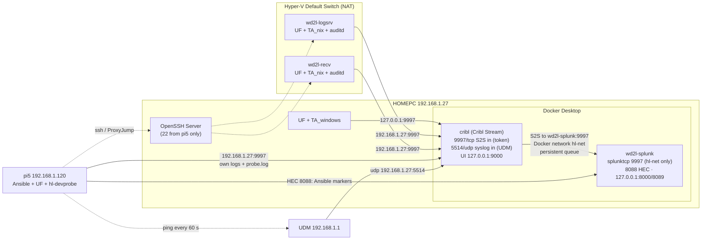
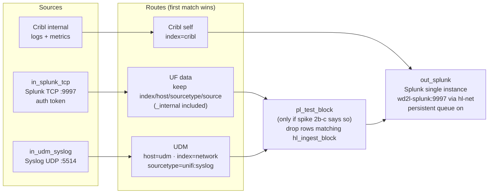

# Cribl Stream in the data path: design addendum

Status: **approved** by Taylor 2026-10-31, with the documentation additions in §11. Amends [the approved spec](2026-10-30-design.md). Once Taylor approves it, its changes are folded into that spec in place (§3–§8, §11, §12, §14), and this file stays as the record of why.

## 1. Context

Taylor wants **Cribl Stream** between every collected source and `wd2l-splunk`:
- **Every Universal Forwarder** sends to Cribl, not to Splunk.
- **The UDM** sends its syslog straight to Cribl.
- **pi5 runs a UF** instead of being an rsyslog relay.

Cribl then forwards to Splunk.

**Why it matters for the "am I blind?" question:** Cribl becomes a single point that everything depends on, and a place where data can be dropped on purpose. The data-health app has to know both.

**Already built and unaffected:** tasks 0, 1, 2, 9 and 11. Task 12 (dashboards) finishes as planned; its Cribl-specific changes move to the new task 11b.

## 2. Decisions (Taylor, 2026-10-31)

| # | Question | Decision |
|---|---|---|
| 1 | How Cribl's config is managed | **Config as code.** Cribl's YAML lives in the repo under `cribl/`, and the Ansible role deploys it with the new `cribl` / `cribl_remove` tags. |
| 2 | How Cribl reaches `wd2l-splunk` | **A Docker network, no recreate.** The role creates `hl-net` and runs `docker network connect hl-net wd2l-splunk` (live, reversible, recorded in the state file). The approved recreate (`server_ports`) is dropped. |
| 3 | Where the device probe runs | **On pi5, into a file.** The systemd timer pings each syslog device and appends one line per ping to `/var/log/hl-devprobe/probe.log`; pi5's UF forwards it. |
| 4 | The test block (§7.7), if Splunk skips ingest-time rules on Cribl data | **It moves into Cribl.** A pipeline drops events that match a block lookup. Spike 2b(c) decides whether this is needed. |

**Defaults (not asked):**
- wd2l's HEC traffic and the Ansible markers stay **direct to Splunk HEC 8088**. Neither is forwarder or syslog data, and keeping them off Cribl means "Cribl down" and "Splunk not receiving" can be told apart.
- wd2l's files, `wd2l_audit` and pi5's `90-wd2l.conf` are never touched.

## 3. Architecture

### 3.1 Hosts and paths

**What disappears from the approved design:**
- the pi5 rsyslog relay (`60-hl-splunk.conf`, `imudp` 514 and 5141, the `hl_remote` ruleset, the SELinux label for udp/5141, the firewalld 514 rules);
- Splunk's `tcp:10514` and `tcp:20514` inputs and their props (`[source::tcp:10514]`, the `[unifi:syslog]` host transform);
- the `wd2l-splunk` recreate.

None of these was built yet; task 8 hadn't started.

### 3.2 Inside Cribl

*Superseded by spec §14.7 (spike 2b): `pl_test_block` is built (Splunk skips index-time rules on Cribl data, §14.7 c). Cribl metrics go to a metrics index `cribl_metrics`, and the audit log comes in through a File Monitor source (§14.7 f). The current diagram is spec §4.2.*

- **The UDM gets its own port (5514/udp)** because Docker Desktop's NAT hides the sender's IP. Cribl names the host from the port, never from the source address.
- **Cribl changes nothing in UF data:** the index, host, sourcetype and source pass through unchanged, so every rule in the data-health app keeps working.
- **Cribl's own data** goes to a new index, `cribl`. That gives Cribl a heartbeat, and its audit log of config changes.

### 3.3 Ports

| Port | Listener | Who sends | Published on the PC |
|---|---|---|---|
| 9997/tcp | Cribl, Splunk TCP source (token) | 4 UFs | yes, all interfaces (as the approved design had for Splunk) |
| 5514/udp | Cribl, syslog source | UDM only | yes |
| 9000/tcp | Cribl UI/API | Taylor, Ansible over SSH | 127.0.0.1 only |
| 9997/tcp | Splunk `splunktcp` (token) | Cribl only | **no**; reached on `hl-net` |
| 8088/tcp | Splunk HEC | wd2l, Ansible markers | yes (unchanged) |
| 8000, 8089/tcp | Splunk Web, REST | Taylor, tests | 127.0.0.1 only (unchanged) |

## 4. Data collected (changes to spec §4)

| Host | Input | index / sourcetype | Path | Profile |
|---|---|---|---|---|
| pi5 | its own logs, `monitor:///var/log/messages`, `secure`, `cron` (journald fallback, as for the VMs) | linux / syslog, linux_secure | UF → Cribl | continuous / sporadic (learned) |
| pi5 | `monitor:///var/log/hl-devprobe/probe.log` | network / `hl:devprobe` | UF → Cribl | periodic 180 s |
| pi5 | `_internal` | (read only) | UF → Cribl | heartbeat 90 s |
| UDM | syslog/CEF | network / `unifi:syslog` | UDM → Cribl :5514 | sporadic → learned |
| cribl | internal logs and metrics, audit log | cribl / Cribl's sourcetypes | Cribl → Splunk | heartbeat (exact cadence from spike 2b-f) |
| all other rows | unchanged | unchanged | UF → **Cribl** → Splunk | unchanged |

**The probe line format** is `time=<iso8601> device=udm ip=192.168.1.1 reachable=1 rtt_ms=0.8`, which the existing `dh_fwd_from_probe` macro already reads (`device`, `reachable`). The probe no longer goes through rsyslog, so nothing can leak into wd2l through the journal.

## 5. What changes in the data-health app

| Area | Approved design | With Cribl |
|---|---|---|
| Dependency ("relay") | pi5 is the relay for the UDM and the probe (`via=pi5`) | **Cribl is the relay for everything collected**: a host row `cribl`, and `via=cribl` on every UF and syslog row. The existing `relay_down` logic (`dh_eval_rollup`, `dh_eval_cause`) is reused unchanged. |
| Cause table (§7.6) | "relay pi5 DOWN → fix the relay first" | "**Cribl DOWN** → every collected stream is unknown; check the `cribl` container". "Splunk not receiving" stays distinct: HEC (wd2l, markers) still arrives when only Cribl is down. |
| UF heartbeat | UF `_internal` metrics, `tstats … by host` | Unchanged, **if** `_internal` passes through Cribl with host intact (spike 2b-b). |
| Forwarder identity (version, OS, last connect) | Splunk's `tcpin_connections` metrics | Splunk now sees only Cribl's connection, so `dh_fwd_from_tcpin` is replaced by the UF's own `_internal` (`tcpout_connections` for the last connect; the version and OS per spike 2b-e). The Host detail forwarder panel follows. |
| Tamper (§7.6) | Windows/Linux indicators, clock steps | **plus Cribl:** a config change in Cribl's audit log, above all a new Drop function or a route that sends to devnull, outside an Ansible `cribl` marker window → "possible deliberate blinding". |
| Test block (§7.7) | `INGEST_EVAL` + nullQueue under `[default]` on Splunk | Splunk-side if spike 2b-c shows Splunk still applies it to Cribl data; otherwise `pl_test_block` in Cribl, with the block lookup written by the Ansible `cribl` tag, and the Manage form showing the command to run. *Superseded by spec §14.7 c: Splunk skips it, so the block is `pl_test_block` in Cribl; the Splunk-side follow-up is task 11b (spec §7.2).* |
| Lag p95 | `_indextime − _time` | Unchanged; it now includes the Cribl hop, which is the point. |

## 6. What changes in the Ansible role

- **Inventory:**
  - pi5 moves into `uf_linux`.
  - `syslog_relay` and its `group_vars` are retired.
  - `syslog_devices` moves to `splunk_server` vars, and each device gets a `port` (the UDM: 5514).
  - A new `cribl:` vars block holds the image digest, the ports and the vault-backed admin password.
- **`splunk_indexer` becomes `hl_collector`:** `192.168.1.27`; `127.0.0.1` on HOMEPC.
- **New and changed tags:**

| Tag | Hosts | Does |
|---|---|---|
| `server_network` (replaces `server_ports`) | splunk_server | create `hl-net`; `docker network connect hl-net wd2l-splunk`; check wd2l HEC health; record in the state file |
| `cribl` / `cribl_remove` | splunk_server | render `compose.yml` (image pinned by digest, volume `hl-cribl-data`, `hl-net`, the §3.3 ports) → `docker compose up -d` over SSH → push `cribl/` config → reload → health check → marker. Remove = marker → `docker compose down` → delete the volume and anything the role added; the contract check fails the play if anything is left |
| `probe` / `probe_remove` | pi5 | `hl-devprobe.service` + `.timer`, `/var/log/hl-devprobe/`, logrotate; remove undoes each |
| `syslog_relay` / `_remove` | — | **removed** |
| `server` | splunk_server | as approved, minus `tcp:10514`/`tcp:20514`; adds index `cribl` and the Cribl search-time props |

- **New repo tree:** `cribl/local/cribl/{inputs,outputs,routes}.yml`, `cribl/local/cribl/pipelines/…`, `cribl/local/cribl/lookups/hl_ingest_block.csv` (if needed). *Superseded by spec §14.7 / §5.2: routes are `local/cribl/pipelines/route.yml` (no `routes.yml`), and lookups live in `data/lookups/` and are pushed through the API.* Secrets, meaning the S2S token and the admin password, are templated from the vault, never committed.

## 7. Spike 2b (throwaway; findings go into spec §14)

| | Question | Decides |
|---|---|---|
| a | Does UF 10.6 S2S with a token connect to Cribl's Splunk TCP source? Does Cribl honour `useACK`? | `useACK` on or off; if off, Cribl's persistent queue is the buffer |
| b | Does UF `_internal` arrive in Splunk with `index=_internal` and the UF's `host` intact? | whether the heartbeat search stays as is |
| c | On a throwaway index, do `INGEST_EVAL`/nullQueue under `[default]` still apply to Cribl-delivered S2S events? | where the test block lives (decision 4) |
| d | Which source IP does Cribl see for UDP published by Docker Desktop? Does host-by-port work? | the UDM port design |
| e | Where do UF version, OS and last connect come from without `tcpin_connections`? | the `dh_fwd_from_tcpin` replacement |
| f | Do Cribl's internal logs, metrics and audit log reach Splunk, and at what cadence? | the Cribl heartbeat profile and the tamper indicator |
| g | The Cribl image digest and free-licence limits; persistent-queue behaviour while Splunk is down; config surviving a restart | `cribl` tag defaults |
| h | Does the `hl-net` attachment survive a `wd2l-splunk` restart and a Docker Desktop restart? | whether `server_network` must re-attach on each run (it will be idempotent either way) |
| i | Is there a UF 10.6.1.1 aarch64 rpm for AlmaLinux 10, and what is its sha256? Is FIPS on (`/proc/sys/crypto/fips_enabled`) on pi5? | task 4's package pin and FIPS handling on pi5 |

## 8. Revised task table (replaces spec §11 rows)

| # | Task | Needs | Done when |
|---|---|---|---|
| 2b *(new)* | Cribl spike (§7) | 2 | written up in §14 |
| 3 *(revised)* | `hl_server_base` (+ index `cribl`) + `server`/`server_remove` + `server_network`; Docker CLI over SSH; the §7.7 pre-check only if the test block stays in Splunk | 2b | `btool check` clean; wd2l HEC + dashboard OK; `hl-net` attached |
| 3b *(new)* | `cribl`/`cribl_remove` + the `cribl/` config tree | 3 | Cribl healthy; a test event reaches Splunk with the right index/host/sourcetype; remove leaves nothing |
| 4 *(revised)* | UF Linux on wd2l-logsrv, wd2l-recv **and pi5** → Cribl | 3b | install → connected through Cribl; uninstall → contract passes; reinstall works |
| 5 | UF Windows → 127.0.0.1:9997 (Cribl) + `audit_policy` | 3b | as approved |
| 6 | Forwarder apps + toggles | 4, 5 | every §4 row arrives with the right index/host/source/sourcetype |
| 7 | `audit_rules` (STIG) | 4 | as approved |
| 8 *(revised)* | UDM via Cribl + `probe` on pi5; the deferred UDM CEF sample | 3b, 4 | UDM events arrive as `host=udm`; probe lines arrive; wd2l `soak-check.sh` still green |
| 12d *(new)* | The data-health reference docs (§11): `docs/data-health/macros.md`, `docs/data-health/dashboards.md`, plain-language on-screen wording, and the coverage check | 12 | every macro and every panel is documented; the coverage check runs in `tests/spl/run.sh`; Taylor can read the Overview with the guide alone |
| 10 | `expected` + sync + discovery (rows carry `via=cribl`; the `cribl` host row) | 6, 8 | each enabled input has a row; removing one retires it |
| 11b *(new)* | Data-health Cribl adaptation (§5) + fixture cases | 2b, 10 | fixtures pass; Host detail shows UF version/last connect again; the Cribl tamper finding fires |
| 13 | Docs | all | someone can run the role from the docs alone |
| 14 | E2E matrix (§9), handoff/log, PR | all | the matrix passes |

## 9. New E2E rows (spec §12)

| Inject | Expected on the Overview | Within |
|---|---|---|
| `docker stop cribl` | `cribl` DOWN; every collected row "Cribl DOWN: the real state is unknown"; **no** "Splunk not receiving" banner (HEC still flows) | ≤ 3 min |
| add a Drop route in Cribl's UI (no marker) | tamper finding "possible deliberate blinding", plus the affected sourcetype MISSING | ≤ 15 min |
| `--tags stop --limit pi5` | pi5 DOWN, "stopped via Ansible"; UDM stays OK (it no longer depends on pi5) | ≤ 3 min |
| `systemctl stop hl-devprobe.timer` on pi5 | UDM's probe stale ("check hl-devprobe on pi5") | threshold |
| Splunk restart while Cribl buffers | no MISSING rows after recovery; the persistent queue drains (lag spike visible in SoH) | recovery + threshold |

## 10. Taylor's gates (asked at the time)

1. **UniFi:** change the remote syslog target to `192.168.1.27:5514/udp` (done in the UniFi UI, during task 8).
2. **Windows Firewall:** an inbound rule for 5514/udp from 192.168.1.1, only if Docker Desktop's existing rule doesn't cover it. It needs elevation.
3. **Vault:** the Cribl admin password goes into the vault on pi5.

## 11. Documentation for the data-health app (Taylor, 2026-10-31)

The app's code was written for the people who build it. Two reference documents make it readable for the people who use it. Task 12d writes them right after task 12 merges. From then on, they are **living documents**: every later task that adds or changes a macro or a panel (3, 8, 10, 11b, …) updates them in the same PR, and the task review checks it.

**`docs/data-health/macros.md`: what each macro is for.**
- One entry per macro in `splunk/apps/hl_data_health/default/macros.conf`, grouped as the file is (lookup names, normalization, tunables, the evaluator steps, trackers, baselines/volume/tamper, the UI macros).
- Each entry gives a sentence or two on what it does and why, its arguments, and what uses it (a saved search, a dashboard panel or another macro).
- Tunables also give their value, its unit, and what changes if you raise or lower it.
- It opens with a one-paragraph picture of the pipeline (trackers → evaluator → `dh_status` → dashboards and alerts), so each macro has a place to sit.

**`docs/data-health/dashboards.md`: how to read each dashboard.**
- One section per dashboard (Overview, Host detail, Manage, Daily state of health), and one entry per panel or widget, in screen order.
- Each entry covers:
  - **What it shows**, in plain words.
  - **Where the number comes from**, in one line with no SPL. For example: "counts the rows of the expected list whose status is OK".
  - **How to read it:** what a good value looks like, what a bad one means, and **what to do next**.
- It also covers the statuses (OK, LATE, MISSING, NEVER_SEEN, MUTED, PENDING, INFO), the host roll-up (DOWN, DEGRADED), every cause the "Cause" column can show, and every banner state.
- **The banner gets a worked example.** "Receiving: trackers and evaluator are current" means:
  - Splunk is indexing new data.
  - The background search that records when each stream last arrived ran within the last 2 minutes.
  - The search that turns those times into statuses has run since.

  So every status on the page is fresh and can be trusted. Each banner warning likewise gets an entry: what stopped, what the page does meanwhile (statuses held as PENDING, no alerts), and what to check.

**On-screen wording.**
- Where a label only makes sense after reading the guide, task 12d rewrites it in plain language. For example, the healthy banner becomes "Up to date: data is arriving and statuses were refreshed at hh:mm".
- Each panel gets a one-line description in Dashboard Studio that points to its section of `dashboards.md`.

**Coverage check (keeps the documents honest).** A static check in `tests/spl/` fails when:
- a macro stanza in `macros.conf` has no entry in `macros.md`;
- a panel title in the four views has no entry in `dashboards.md`;
- either document names a macro or panel that no longer exists.
